**SOFTWARE DESIGN DOCUMENT**

Enterprise Resource Planning System

*How the system will be architected, built, secured, deployed and operated — a modular monolith on Node.js and TypeScript, designed for Malaysian statutory compliance with a replaceable localisation layer.*

| **Field**           | **Value**                                                                                                                                                                   |
|---------------------|-----------------------------------------------------------------------------------------------------------------------------------------------------------------------------|
| Document title      | Software Design Document — Enterprise Resource Planning System                                                                                                              |
| Document code       | ERP-SDD-001                                                                                                                                                                 |
| Version             | 1.0 (Initial baseline for review)                                                                                                                                           |
| Status              | Draft for technical review                                                                                                                                                  |
| Date                | 22 September 2026                                                                                                                                                           |
| Prepared by         | Muiz — Software Engineering                                                                                                                                                 |
| Companion document  | ERP-SRS-001 — Software Requirements Specification. This document assumes the reader has read it; every design decision here traces to a requirement there.                  |
| Target technology   | Node.js with TypeScript, NestJS application framework, PostgreSQL, Redis, React. Selected as a business decision for this project; rationale and consequences in section 4. |
| Tenancy model       | Open decision (SRS OQ-001). Three options are designed in section 7.5 with a recommended default and an isolating seam so the decision can be deferred without rework.      |
| Localisation        | Malaysia first, with tax, statutory payroll and electronic invoicing implemented as replaceable jurisdiction rule sets.                                                     |
| Scope               | All modules identified in the SRS, phased as SRS section 3.8. Implementation sequencing in section 23.                                                                      |
| Intended readership | Development team, technical lead, DevOps and security. Sections 2, 3, 4, 21 and 22 are written to be readable by a non-specialist sponsor.                                  |

**Document Control**

**Revision history**

| **Version** | **Date**    | **Author** | **Summary of change**                                                                                                                                                                          |
|-------------|-------------|------------|------------------------------------------------------------------------------------------------------------------------------------------------------------------------------------------------|
| 0.1         | 22 Sep 2026 | Muiz       | Structure established from industry practice for a modular monolith with a C4-style architecture description.                                                                                  |
| 1.0         | 22 Sep 2026 | Muiz       | Initial baseline. Architecture, technology selection, module design, data design, API, security, workflow engines, infrastructure, operations and roadmap, with architecture decision records. |

**How to read this document**

- **Sections 1 to 4** set the goals, the architecture at a glance and the technology choices. Read these first; they explain every subsequent decision.

- **Sections 5 to 8** are the internal design: layering, module anatomy, the database, and the data models. This is where most implementation work is specified.

- **Sections 9 to 13** are the contracts and the engines: API, authentication, security, integration and the four business engines (posting, inventory, workflow, payroll).

- **Sections 14 to 20** are the frontend, reporting, infrastructure, deployment, performance, observability and recovery.

- **Sections 21 to 23** record the decisions themselves, the risks, and the order in which to build.

- **Appendices** hold naming conventions, a module skeleton, an API fragment and the legacy-to-new mapping.

**Traceability convention**

Design elements reference the SRS requirements they satisfy in the form (SRS FR-SAL-015). Design decisions carry an identifier of the form ADR-nn and are collected in section 21. Where this document proposes something the SRS does not require, it is marked (design proposal).

**Table of Contents**

*The contents list below is a Word field. It populates with page numbers when you open the document in Word and accept the update prompt, or by pressing Ctrl+A then F9. The document map that follows is static.*

**Document Map**

| **§** | **Section**                      | **What it specifies**                                                                                                                                                  |
|-------|----------------------------------|------------------------------------------------------------------------------------------------------------------------------------------------------------------------|
| 1     | Introduction                     | Purpose, scope, audience, conventions.                                                                                                                                 |
| 2     | Design Goals and Principles      | The goals the architecture optimises for, the principles it follows, and what it deliberately sacrifices.                                                              |
| 3     | System Architecture              | Context and container views, the modular-monolith decision, and the cross-cutting architecture.                                                                        |
| 4     | Technology Stack                 | Every technology choice with its rationale, the alternatives rejected, and the risks accepted.                                                                         |
| 5     | Application Architecture         | Layering, module anatomy, domain modelling, the document lifecycle framework, validation, errors, transactions, extensibility and configuration.                       |
| 6     | Module Architecture              | Module catalogue, boundary enforcement, inter-module communication, and per-module design notes.                                                                       |
| 7     | Database Architecture            | PostgreSQL design, schema organisation, conventions, money and audit patterns, tenancy options, scoping, indexing, partitioning, migrations and legacy data migration. |
| 8     | Data Models                      | Entity-relationship design per domain, the document linkage model, and numbering.                                                                                      |
| 9     | API Architecture                 | Style, resource model, versioning, envelopes, pagination, idempotency, bulk operations, errors, webhooks and documentation.                                            |
| 10    | Authentication and Authorisation | Identity model, token design, the three-stage authorisation pipeline, approval authority and service accounts.                                                         |
| 11    | Security Architecture            | Threat model, controls by layer, secrets, data protection, upload handling, audit and compliance mapping.                                                              |
| 12    | Integration Architecture         | Patterns, the MyInvois adapter, statutory feeds, mail and push, bank files, inter-company redesign and the anti-corruption layer.                                      |
| 13    | Workflow and Engine Design       | The document state machine, the approval engine, the posting engine, the inventory engine, the payroll engine and cross-module sagas.                                  |
| 14    | Frontend Architecture            | Application structure, state, the data-grid and form framework, and the design system.                                                                                 |
| 15    | Reporting Architecture           | Operational versus analytical separation, the report engine decision, read models and the export pipeline.                                                             |
| 16    | Infrastructure and Deployment    | Environments, containers, orchestration, topology, CI/CD, configuration and release strategy.                                                                          |
| 17    | Scalability and Performance      | Targets, scaling strategy, caching, database performance and load testing.                                                                                             |
| 18    | Observability                    | Logging, metrics, tracing, alerting and the operational console.                                                                                                       |
| 19    | Backup and Recovery              | Backup design, recovery procedures, and business continuity.                                                                                                           |
| 20    | Maintainability and Quality      | Testing strategy, code standards, review and documentation.                                                                                                            |
| 21    | Architecture Decision Records    | Twenty-four decisions with context, options, choice and consequences.                                                                                                  |
| 22    | Risks                            | Technical risks with mitigations and owners.                                                                                                                           |
| 23    | Implementation Roadmap           | Work breakdown by phase, with the sequence constraints that cannot be reordered.                                                                                       |
| A–F   | Appendices                       | Diagram index, naming conventions, module skeleton, OpenAPI fragment, legacy mapping and glossary.                                                                     |

**1. Introduction**

**1.1 Purpose**

This document specifies how the ERP system described in ERP-SRS-001 will be built. It is written to be sufficient for a competent development team to implement the system without re-deriving architectural decisions, and sufficient for a reviewer to challenge those decisions on their merits.

It covers the structure of the software, the data, the interfaces, the security model, the operating environment and the sequence of construction. It does not restate requirements; where a requirement is relevant it is referenced.

**1.2 Scope**

- **In scope.** System and application architecture, module decomposition and boundaries, database design, data models, API design, authentication and authorisation, security architecture, integration design, the four business engines, frontend architecture, reporting architecture, infrastructure and deployment, performance and scalability design, observability, backup and recovery, quality strategy, decisions, risks and the implementation roadmap.

- **Out of scope.** Screen-by-screen user-interface specification, detailed test cases, infrastructure-as-code source, project plan with dates and resources, and commercial or licensing arrangements. Each is a separate deliverable that depends on this one.

**1.3 Design inputs**

| **Input**                            | **Effect on this design**                                                                                                                                                                                                                                         |
|--------------------------------------|-------------------------------------------------------------------------------------------------------------------------------------------------------------------------------------------------------------------------------------------------------------------|
| ERP-SRS-001                          | The functional and non-functional requirements. Every section of this document exists to satisfy some part of it.                                                                                                                                                 |
| Node.js and TypeScript with NestJS   | A business decision for this project. Determines the application framework, the module model, the dependency-injection style and the testing tooling. Section 4.                                                                                                  |
| Malaysia first, multi-country ready  | Determines that tax, statutory payroll and electronic invoicing are jurisdiction rule sets behind stable interfaces rather than inline logic. Sections 12.2, 13.5 and ADR-14.                                                                                     |
| Tenancy undecided                    | Determines that tenant identity is carried in the data model and enforced in one place from the first line of code, with the deployment topology left open. Section 7.5 and ADR-05.                                                                               |
| All modules in scope, phased         | Determines that module boundaries must be correct from the start, because modules built in later phases must not require earlier modules to be reopened. Section 6.                                                                                               |
| The legacy system’s measured shape   | Approximately 340 tables, 722 permission keys, 173 reports, 231 domain events. Determines that the design must scale in breadth, not merely in load: patterns that require per-entity hand-written code will not survive this volume. Sections 5.5, 9.2 and 14.3. |
| The legacy system’s observed defects | Silent posting failure, scheduled data repair, per-row query loops, lost permission bindings, non-versioned statutory tables. Each is addressed by a specific design element rather than left to discipline. Sections 13.3, 13.4, 5.8 and 10.4.                   |

**1.4 Definitions**

Business terminology is defined in ERP-SRS-001 section 1.5 and is not repeated. Terms specific to this design are defined below.

| **Term**                | **Meaning in this document**                                                                                                                                                             |
|-------------------------|------------------------------------------------------------------------------------------------------------------------------------------------------------------------------------------|
| Modular monolith        | A single deployable application internally partitioned into modules with enforced boundaries, communicating through published contracts and events rather than through shared internals. |
| Module                  | A unit of the system owning its own domain, schema, API surface and published contract. The unit of boundary enforcement, not merely of folder organisation.                             |
| Contract package        | The only part of a module that other modules may import: its published types, events and service interfaces. Everything else is internal.                                                |
| Aggregate               | A cluster of entities and value objects treated as one consistency boundary, with a single root through which all changes pass.                                                          |
| Application service     | A use-case handler. Owns the transaction boundary and orchestrates domain objects and infrastructure ports.                                                                              |
| Port and adapter        | An interface declared by the domain or application layer (port) and implemented by infrastructure (adapter). Keeps the domain free of infrastructure.                                    |
| Outbox                  | A table written in the same transaction as a state change, holding the events to be published, so that publication cannot be lost or occur without the change.                           |
| Saga / process manager  | A coordinator for a multi-module business process that cannot be one database transaction, with explicit compensation.                                                                   |
| Read model              | A denormalised, query-optimised projection maintained from events or as a materialised view, used for lists, reports and dashboards.                                                     |
| Data scope              | A mandatory query predicate applied in the repository layer — tenant, branch, sales agent — that cannot be bypassed by a caller.                                                         |
| Jurisdiction rule set   | A pluggable implementation of tax, statutory payroll or electronic-invoicing rules for one country.                                                                                      |
| Expand-migrate-contract | A three-release pattern for schema change that keeps old and new shapes valid simultaneously so deployment needs no downtime.                                                            |

**2. Design Goals, Principles and Constraints**

**2.1 Design goals, in priority order**

When two goals conflict, the higher one wins. This ordering is the single most useful thing in the document for resolving day-to-day design arguments.

| **\#** | **Goal**                       | **What it means concretely**                                                                                                                                                                                        |
|--------|--------------------------------|---------------------------------------------------------------------------------------------------------------------------------------------------------------------------------------------------------------------|
| 1      | Correctness of money and stock | Fixed-point arithmetic everywhere. Transactional consistency for anything that affects a balance. No silent failure anywhere in a posting path. If a design is faster but can lose a journal entry, it is rejected. |
| 2      | Auditability                   | Every change attributable, every accounting entry traceable to its source and back, every audit record immutable. An elegant design that loses provenance is rejected.                                              |
| 3      | Changeability                  | Boundaries enforced by the build, business rules in testable units, and the domain independent of framework and database. This is what the legacy system lost, and it is why the rebuild exists.                    |
| 4      | Breadth without ceremony       | Roughly 45 document families and 340 tables. Anything requiring more than a modest amount of hand-written code per entity will not be finished. Cross-cutting concerns are framework, not copy-paste.               |
| 5      | Operability                    | Failures visible, work retryable, state inspectable, deployment routine. An operator who did not build the system must be able to run it.                                                                           |
| 6      | Interactive performance        | Sub-two-second document entry at realistic volume. Fast, but never at the cost of the four goals above.                                                                                                             |
| 7      | Horizontal scalability         | Stateless application tier, independently scaled workers. Necessary but not urgent; the expected load is modest.                                                                                                    |
| 8      | Deployment flexibility         | Runs on customer infrastructure or in the cloud, with no dependency on a single provider’s proprietary service.                                                                                                     |

**2.2 Architectural principles**

| **Principle**                                 | **Statement and consequence**                                                                                                                                                                                                            |
|-----------------------------------------------|------------------------------------------------------------------------------------------------------------------------------------------------------------------------------------------------------------------------------------------|
| Dependencies point inward                     | The domain layer imports nothing from the application, interface or infrastructure layers. Consequence: business rules are unit-testable with no database, no HTTP and no framework.                                                     |
| Boundaries are mechanical, not cultural       | Module dependency rules and layer rules are enforced by the build. Consequence: a violation is a failed pipeline, not a code-review argument. This directly answers the legacy system’s eroded boundaries.                               |
| One way in                                    | Every write path — user interface, API, import, batch — passes through the same application service. Consequence: a rule cannot be enforced on one path and missed on another, which is how the legacy system lost a permission binding. |
| Derived data is transactional or a projection | A denormalised value is either updated in the same transaction as its source, or it is an explicitly rebuildable projection. Consequence: no scheduled repair jobs (SRS FR-PLT-015).                                                     |
| Nothing important fails quietly               | Every asynchronous consequence is recorded, observable, retryable and idempotent. Consequence: an outbox, a queue with dead-lettering and an operator console are architecture, not additions.                                           |
| Explicit over inferred                        | Document-to-posting-profile mapping, state transitions and permission bindings are declared and exhaustively checked. Consequence: a missing mapping fails at start-up, not at month end. This answers two legacy defects directly.      |
| Configuration over customisation              | Behavioural variation is data. Consequence: the settings service, the numbering service and the posting-route resolver are first-class subsystems.                                                                                       |
| The localisation seam is load-bearing         | Tax, statutory payroll and e-invoicing sit behind interfaces from the first release, even though only Malaysia is implemented. Consequence: a second country is a new package, not a refactor.                                           |
| Boring technology by default                  | Prefer widely understood, well-supported components. Consequence: PostgreSQL rather than a specialised store; a queue rather than a streaming platform; server-rendered reports rather than a bespoke engine.                            |
| Optimise last, measure first                  | No caching, denormalisation or read model without a measurement showing it is needed. Consequence: the design stays simple until it has earned complexity.                                                                               |

**2.3 What this design deliberately gives up**

Stating the trade-offs explicitly prevents them being rediscovered as surprises.

| **Sacrifice**                                 | **Why it is acceptable**                                                                                                                                                                                                                                                                                                                                         |
|-----------------------------------------------|------------------------------------------------------------------------------------------------------------------------------------------------------------------------------------------------------------------------------------------------------------------------------------------------------------------------------------------------------------------|
| Independent deployability of modules          | A modular monolith deploys as one unit. Accepted because the organisation is one business with one release cadence, and because microservices would impose distributed transactions on a domain whose core requirement is transactional consistency of money and stock. The module boundaries are kept strict enough that extraction later is possible (ADR-02). |
| Per-module technology choice                  | Every module uses the same language, framework and database. Accepted because a single team maintains all of it, and polyglot persistence would fragment the transactional guarantees.                                                                                                                                                                           |
| Maximum raw throughput                        | The domain layer adds mapping and validation overhead compared with writing SQL against request payloads. Accepted because the expected load is modest and correctness ranks above speed.                                                                                                                                                                        |
| Screen-level fidelity to the legacy interface | The frontend is redesigned. Accepted per SRS ASM-06, and necessary because the legacy server-driven interface model is inseparable from the encrypted platform.                                                                                                                                                                                                  |
| Reuse of the legacy report templates as-is    | Reports are rebuilt or migrated deliberately. Accepted because the report engine decision (ADR-16) is made on merit, and because the catalogue should be pruned on usage first (SRS OQ-053).                                                                                                                                                                     |
| Immediate multi-tenancy                       | The first deployments are single-tenant. Accepted because the tenancy seam is built from the start, so the decision is deferred rather than foreclosed (ADR-05).                                                                                                                                                                                                 |

**2.4 Design constraints**

Constraints from SRS section 3.5 apply in full. The additional constraints below arise from this design.

| **Ref** | **Constraint**                                                                                                                                                               |
|---------|------------------------------------------------------------------------------------------------------------------------------------------------------------------------------|
| DCN-01  | No business logic in a controller, a database trigger, a stored procedure or a frontend component. The domain and application layers are the only place business rules live. |
| DCN-02  | No module may import another module’s internal path. Only contract packages are importable, and this is enforced in the build.                                               |
| DCN-03  | No repository method may return data without applying the mandatory data scopes. Scope application is not optional and not a caller responsibility.                          |
| DCN-04  | No monetary or quantity value may be represented as a JavaScript number at rest, in transport or in calculation.                                                             |
| DCN-05  | No cross-module call inside a database transaction. Cross-module effects are events consumed after commit.                                                                   |
| DCN-06  | No event handler may assume single delivery. Every handler is idempotent.                                                                                                    |
| DCN-07  | No secret in the database, in configuration files committed to source control, or in a log.                                                                                  |
| DCN-08  | No schema change that is not expand-migrate-contract safe may be deployed without a declared downtime window.                                                                |
| DCN-09  | No entity may be added without its audit coverage; auditing is a base capability of the persistence layer, not a per-entity decision.                                        |
| DCN-10  | No jurisdiction-specific rule may appear outside a jurisdiction rule set.                                                                                                    |

**3. System Architecture**

**3.1 Architecture at a glance**

The system is a modular monolith: one deployable application, internally divided into modules with enforced boundaries, supported by a worker tier for asynchronous work, a relational database, a cache and queue, an object store and a report renderer.

- **One application, many modules.** All modules share a process, a database and a transaction manager. They do not share internals; each publishes a contract and communicates through it and through domain events.

- **Two runtime roles from one artefact.** The same built image runs as an API process or as a worker process, selected by configuration. This keeps the domain code identical in both and removes a whole class of drift.

- **Synchronous where correctness demands it, asynchronous everywhere else.** A document save and its immediate invariants are one transaction. Posting, mirroring, notification, e-Invoice submission and report generation are asynchronous, through an outbox.

- **One database, schema per module.** PostgreSQL with a schema per module gives clear ownership and cheap boundary auditing while keeping cross-module transactions and joins available where genuinely needed.

**3.2 Context view**

The system boundary and the actors and systems around it are as specified in SRS section 2.5. Reproduced here as the outermost layer of the architecture description.

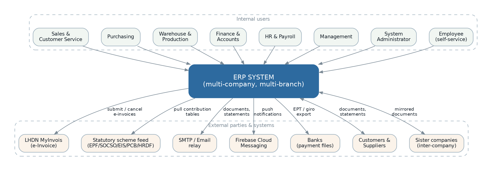

*Figure 1 — Context view — the system, its users and the external systems it depends on.*

**3.3 Container view**

The deployable units and the stores they use. Each is described in section 4 with its technology choice and in section 16 with its deployment.

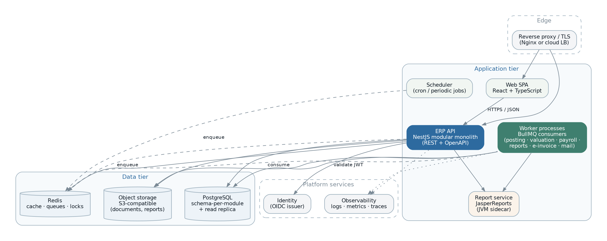

*Figure 2 — Container view — runtime processes and data stores.*

| **Container**   | **Responsibility**                                                                                                                                                                                              | **Scaling**                                                                               |
|-----------------|-----------------------------------------------------------------------------------------------------------------------------------------------------------------------------------------------------------------|-------------------------------------------------------------------------------------------|
| Web SPA         | The user interface for all internal users. Talks only to the ERP API over HTTPS. Holds no business rules.                                                                                                       | Static assets behind a CDN; scales trivially.                                             |
| ERP API         | The whole application: all modules, all domain logic, all synchronous request handling. Stateless.                                                                                                              | Horizontally, behind a load balancer. No session affinity.                                |
| Workers         | Asynchronous consequences: posting, stock valuation, payroll calculation, report rendering, e-Invoice submission, mail and push, inter-company mirroring, imports. Same code as the API, different entry point. | Horizontally and independently, per queue. A long payroll run cannot slow document entry. |
| Scheduler       | Periodic work: fiscal-year generation, period locking, statement dispatch, price-list activation, valuation, statutory refresh, purges. Enqueues rather than executes.                                          | Single active instance by leader election; the work itself scales on the workers.         |
| Report renderer | Renders parameterised report templates to PDF and spreadsheet. Isolated because it is resource-hungry and, if JasperReports is retained, runs on a different runtime.                                           | Horizontally; queue-fed.                                                                  |
| PostgreSQL      | All transactional state. Primary for writes; a streaming replica for reporting and analytical reads.                                                                                                            | Vertically for the primary; read replicas for read load.                                  |
| Redis           | Job queues, cache, distributed locks, rate limiting, short-lived shared state.                                                                                                                                  | Clustered when needed.                                                                    |
| Object storage  | Attached documents, generated reports, import files, e-Invoice payload archives.                                                                                                                                | Effectively unbounded.                                                                    |

**3.4 Why a modular monolith**

This is the most consequential structural decision in the document, recorded formally as ADR-02. The reasoning is set out here because everything else follows from it.

**3.4.1 The forces**

- The core domain requirement is transactional consistency between a document, its stock effect and its accounting effect. In a distributed system that becomes a saga with compensation for what is naturally one transaction — more moving parts, more failure modes, and exactly the class of silent inconsistency the legacy system already suffers from.

- The reporting requirement is cross-domain: a sales report joins sales, master data, finance and inventory. Splitting the database turns those joins into API composition or data duplication.

- The team is small and maintains everything. Distributed operational overhead — service discovery, distributed tracing as a prerequisite rather than a nicety, per-service pipelines, version compatibility — is paid for by the same people who must deliver 45 document families.

- Load is modest. The volumes in SRS section 9.4 are comfortably served by one well-built application and one well-tuned database. There is no scaling driver for decomposition.

- Against all that: boundaries in a monolith erode unless enforced. This is precisely how the legacy system arrived at modules that read each other’s tables.

**3.4.2 The resolution**

Take the monolith for its transactional and operational simplicity, and pay the boundary cost deliberately and mechanically rather than culturally:

- Each module is a separate workspace package with its own schema, and may import only other modules’ contract packages.

- The dependency graph is declared and checked in the build; a violation fails the pipeline (SRS FR-PLT-024).

- Cross-module effects travel as domain events through a transactional outbox, never as direct calls inside a transaction (DCN-05).

- Each module owns its tables. Cross-schema reads are permitted only through a module’s published read model, and cross-schema writes are prohibited.

- Every module is structured so that extracting it into its own process later requires replacing its event transport and its read-model access, not rewriting its domain.

<table>
<colgroup>
<col style="width: 100%" />
</colgroup>
<tbody>
<tr class="odd">
<td>
<strong>The honest limitation</strong>

A modular monolith deploys as one unit. A defect in one module can take the process down, and every release ships every module. This is accepted because the organisation releases as one business, and because the alternative trades an outage risk for a consistency risk in a domain where consistency is the product.

The mitigation is operational, not architectural: strict layer isolation so a module cannot corrupt shared state, a worker tier that fails independently of the API, and a deployment strategy that rolls forward one instance at a time (section 16.7).
</td>
</tr>
</tbody>
</table>

**3.5 Cross-cutting architecture**

These concerns are implemented once, in the platform, and consumed by every module. In the legacy system several of them were duplicated per module, and that duplication is a stated defect to correct (SRS WK-08).

| **Concern**                | **Implementation approach**                                                                                                            | **Section** |
|----------------------------|----------------------------------------------------------------------------------------------------------------------------------------|-------------|
| Identity and authorisation | Token validation, permission guard, policy layer and mandatory query scope — three enforcement stages, the last inside the repository. | 10          |
| Tenancy and branch scoping | Request-scoped context propagated through async local storage; applied as predicates by the repository base class.                     | 7.5, 7.6    |
| Transactions               | One transaction per application service invocation, managed by an interceptor; nested calls join the ambient transaction.              | 5.8         |
| Domain events and outbox   | Events collected on aggregates, written to the outbox in the same transaction, dispatched after commit.                                | 5.8, 13.6   |
| Audit                      | Persistence-layer subscriber capturing before and after state with actor and correlation identifier, written append-only.              | 11.7        |
| Validation                 | Schema validation at the boundary, invariant enforcement in the domain, and rule objects for rules that span aggregates.               | 5.6         |
| Errors                     | A typed error hierarchy mapped once to HTTP and to queue retry semantics.                                                              | 5.7         |
| Document numbering         | A single platform service with the legacy token grammar and pluggable reset policies.                                                  | 8.10        |
| Settings                   | A hierarchical resolver — default, tenant, branch — with typed access and a declarative registry per module.                           | 5.10        |
| Localisation               | Message catalogues, and jurisdiction rule sets for tax, statutory payroll and e-invoicing.                                             | 12.2, 13.5  |
| Observability              | Structured logging, metrics and tracing with one correlation identifier from request to queue to database.                             | 18          |
| Idempotency                | Request-level idempotency keys for API writes, handler-level dedupe records for event consumers.                                       | 9.5, 13.7   |

**4. Technology Stack**

**4.1 Selection summary**

The runtime platform was a business decision for this project. The remaining choices are made here on merit, with alternatives and risks stated.

| **Layer**                    | **Choice**                                                                                                    | **Rationale**                                                                                                                                                                                                                                                     | **Decision**      |
|------------------------------|---------------------------------------------------------------------------------------------------------------|-------------------------------------------------------------------------------------------------------------------------------------------------------------------------------------------------------------------------------------------------------------------|-------------------|
| Language                     | TypeScript (strict)                                                                                           | One language across backend, frontend and tooling. Strict mode plus branded types gives enough type safety for a financial domain, provided money is never a plain number.                                                                                        | Business decision |
| Runtime                      | Node.js (current LTS)                                                                                         | Mandated. Excellent for input/output-bound workloads, which an ERP overwhelmingly is.                                                                                                                                                                             | Business decision |
| Application framework        | NestJS                                                                                                        | Mandated, and a good fit: its module system, dependency injection and interceptor model map directly onto the module boundaries, transaction interceptor and authorisation pipeline this design needs.                                                            | Business decision |
| Database                     | PostgreSQL 16+                                                                                                | Transactional integrity, exact numeric type, schemas for module ownership, row-level security if tenancy demands it, partitioning for the stock and audit ledgers, materialised views for read models, and strong JSON support for settings and payload archives. | ADR-03            |
| Data access                  | Prisma for schema, migrations and typed queries; raw parameterised SQL for reporting and set-based operations | Prisma gives generated types, readable migrations and a productive client. Its weakness is complex analytical SQL, so reporting and bulk posting use hand-written parameterised SQL through the same connection pool.                                             | ADR-04            |
| Queue and cache              | Redis with BullMQ                                                                                             | Ordered queues, delayed jobs, retry with backoff, dead-lettering, repeatable jobs for the scheduler, plus cache and distributed locks from the same component.                                                                                                    | ADR-06            |
| Event transport              | Transactional outbox in PostgreSQL, dispatched to Redis streams                                               | Guarantees an event is published if and only if its transaction committed. The legacy system publishes in-process, which loses events on failure.                                                                                                                 | ADR-07            |
| Frontend                     | React with TypeScript, Vite, TanStack Query and TanStack Table, React Hook Form with Zod                      | Largest ecosystem for the data-dense grids and forms an ERP is made of. TanStack Table handles the virtualised, column-configurable grids that dominate the interface.                                                                                            | ADR-15            |
| Report engine                | JasperReports as an isolated service for the existing catalogue; a TypeScript renderer for new documents      | A migration decision rather than a preference: 173 templates exist. Section 15.2 sets out the three options and the reasoning.                                                                                                                                    | ADR-16            |
| Spreadsheet export           | ExcelJS                                                                                                       | Streaming write for large exports, with numeric types preserved (SRS RPT-025).                                                                                                                                                                                    |                   |
| Authentication               | OIDC-compatible issuer; JWT access tokens with rotating refresh tokens; argon2id password hashing             | Standards-based, federatable later (SRS FR-SEC-067), and independently revocable for service accounts.                                                                                                                                                            | ADR-11            |
| Money and decimals           | decimal.js-light behind a branded Money type                                                                  | Exact decimal arithmetic. The branded type makes it a compile error to use a plain number where money is expected (DCN-04).                                                                                                                                       | ADR-09            |
| Validation                   | Zod at the API boundary; domain invariants in the aggregate                                                   | One schema generates the runtime validator, the TypeScript type and part of the OpenAPI document.                                                                                                                                                                 |                   |
| Testing                      | Vitest for unit; Testcontainers with PostgreSQL and Redis for integration; Playwright for end-to-end          | Real database in integration tests, because most of this system’s risk is in SQL and transactions.                                                                                                                                                                | ADR-20            |
| Boundary enforcement         | dependency-cruiser plus workspace package boundaries                                                          | Makes the module graph a build artefact rather than a diagram (SRS FR-PLT-024).                                                                                                                                                                                   | ADR-08            |
| Containers and orchestration | Docker; Docker Compose for small deployments, Kubernetes where the customer already runs it                   | Same image either way. Avoids mandating Kubernetes on a customer who does not want it.                                                                                                                                                                            | ADR-21            |
| Object storage               | S3-compatible API                                                                                             | Works against a cloud service or a self-hosted MinIO, which keeps deployment flexible (SRS NFR-POR-002).                                                                                                                                                          |                   |
| Observability                | OpenTelemetry with Prometheus metrics and a log aggregator                                                    | Vendor-neutral instrumentation; the backend can be swapped per deployment.                                                                                                                                                                                        | ADR-22            |

**4.2 Backend design consequences of the runtime choice**

Node.js is a good fit for an ERP’s input/output profile but has two characteristics that shape this design.

| **Characteristic**                     | **Consequence for this design**                                                                                                                                                                                                              |
|----------------------------------------|----------------------------------------------------------------------------------------------------------------------------------------------------------------------------------------------------------------------------------------------|
| Single-threaded event loop per process | No CPU-bound work in an API process. Payroll calculation, stock revaluation, report rendering, spreadsheet generation and bulk import all run on workers. This is why the worker tier is architecture rather than optimisation.              |
| No native decimal type                 | Money and quantity are a branded Money type over an exact decimal library, serialised as a string across every boundary, and stored as PostgreSQL numeric. No arithmetic on a plain number is permitted anywhere in the money path (ADR-09). |
| Dynamic typing at the edges            | Every inbound payload is validated by schema before it reaches an application service. The type system is trusted only behind that boundary.                                                                                                 |
| Mature but fast-moving ecosystem       | Dependencies are pinned, scanned on every build, and a supply-chain policy limits direct dependencies in the domain layer to zero.                                                                                                           |

**4.3 Rejected alternatives**

Recorded so the choices are reviewable rather than assumed.

| **Alternative**                             | **Why rejected**                                                                                                                                                                                                                                                                                                                                                                           |
|---------------------------------------------|--------------------------------------------------------------------------------------------------------------------------------------------------------------------------------------------------------------------------------------------------------------------------------------------------------------------------------------------------------------------------------------------|
| Keep Laravel and PHP                        | Would preserve the domain logic almost unchanged and is the cheapest path. Rejected as a business decision for this project. Its real merit — near-direct reuse of 117 services — is a genuine cost of the chosen path and is acknowledged in ADR-01.                                                                                                                                      |
| Microservices from the start                | Rejected on the reasoning in section 3.4: it converts the core transactional requirement into a distributed consistency problem, for a load that does not need it, with a team that cannot operate it.                                                                                                                                                                                     |
| Event sourcing for the whole domain         | Attractive for the ledger and the stock card, both of which are already append-only. Rejected as a global pattern because 340 tables of master data and configuration do not benefit, and the operational and cognitive cost is high. Used selectively: the stock ledger, the general ledger and the audit trail are append-only by design (section 8).                                    |
| A document database                         | Rejected. The domain is highly relational, reporting is cross-domain and the correctness requirement demands multi-entity transactions.                                                                                                                                                                                                                                                    |
| TypeORM instead of Prisma                   | More flexible for complex queries and supports the repository pattern natively, but its migration story and type safety are weaker. Rejected, with the acknowledgement that Prisma’s analytical query weakness must be covered by raw SQL (ADR-04).                                                                                                                                        |
| GraphQL as the primary API                  | Good for a flexible frontend, poor for a domain whose operations are commands (release, revise, cancel, approve) rather than graph reads, and it complicates authorisation and rate limiting. Rejected as primary; may be added later as a read-only façade (section 9.1).                                                                                                                 |
| Server-driven UI, as the legacy system does | It genuinely solved the breadth problem: 45 document families defined in backend code. Rejected because it couples the backend to one frontend forever, blocks a public API and a mobile client, and was inseparable from the encrypted platform. The breadth problem is instead solved by frontend metadata (section 14.3), which keeps the concentration of effort without the coupling. |
| Kubernetes as the only deployment target    | Rejected to preserve deployability on customer infrastructure that does not run it (ADR-21).                                                                                                                                                                                                                                                                                               |

<table>
<colgroup>
<col style="width: 100%" />
</colgroup>
<tbody>
<tr class="odd">
<td>
<strong>The cost being accepted, stated plainly</strong>

Changing runtime discards direct reuse of the legacy business logic. Roughly 117 service classes, 231 event handlers and the whole posting and costing implementation must be reimplemented from the requirements rather than ported.

The mitigation is that the legacy code remains the reference specification. ERP-SRS-001 sections 7 and 8 exist precisely to make that reimplementation possible without re-deriving the rules, and the legacy repository should be kept readable for the duration of the project (SRS ASM-01).
</td>
</tr>
</tbody>
</table>

**5. Application Architecture**

**5.1 Layering**

Each module is internally divided into four layers with a strict inward dependency rule. This is what makes business rules testable without a database and replaceable without touching the framework.

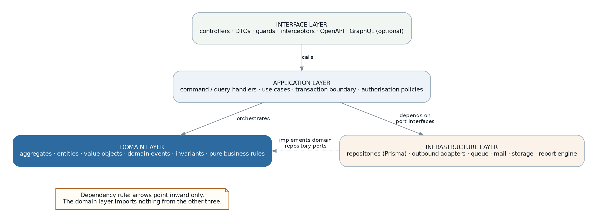

*Figure 3 — Layering within a module. Dependencies point inward; the domain layer imports nothing.*

| **Layer**      | **Contains**                                                                                                                                      | **May depend on**               | **Must never**                                                   |
|----------------|---------------------------------------------------------------------------------------------------------------------------------------------------|---------------------------------|------------------------------------------------------------------|
| Interface      | Controllers, request and response DTOs, schema validators, guards, interceptors, OpenAPI decorators, queue consumers, scheduled-job entry points. | Application layer               | Contain a business rule or touch a repository directly.          |
| Application    | Command and query handlers, one per use case. Owns the transaction boundary, orchestrates the domain, calls ports, raises events.                 | Domain, ports                   | Contain domain invariants or reference HTTP.                     |
| Domain         | Aggregates, entities, value objects, domain events, domain services for logic spanning aggregates, and repository port interfaces.                | Nothing                         | Import the framework, the ORM, the HTTP layer or another module. |
| Infrastructure | Repository implementations, outbound adapters (mail, storage, statutory platform, bank file), the queue client, the report client.                | Domain (to implement its ports) | Be imported by the domain.                                       |

<table>
<colgroup>
<col style="width: 100%" />
</colgroup>
<tbody>
<tr class="odd">
<td>
<strong>Where the legacy system differs, and why it matters</strong>

In the legacy system the framework, the persistence layer and the business rules are interleaved: a controller trait performs the transaction, dispatches events by reflecting over class attributes, and calls a view-model that builds the user interface. That is efficient to write and impossible to test in isolation, which is exactly why there are no tests.

The layering above costs more code per use case. It buys the ability to test every rule in section 8 of the SRS without a database, which is objective OBJ-03.
</td>
</tr>
</tbody>
</table>

**5.2 Module anatomy**

Every module has the same shape. Consistency is deliberate: with roughly a dozen modules and 45 document families, a developer must be able to find anything in an unfamiliar module immediately.

<table>
<colgroup>
<col style="width: 100%" />
</colgroup>
<tbody>
<tr class="odd">
<td>
modules/sales/

├─ contract/ ← THE ONLY IMPORTABLE PATH

│ ├─ events.ts published domain events + payload types

│ ├─ types.ts shared value types (SalesOrderRef, DocumentStatus…)

│ ├─ ports.ts interfaces other modules may call

│ └─ read-model.ts query interfaces other modules may read

│

├─ domain/

│ ├─ sales-order/

│ │ ├─ sales-order.aggregate.ts invariants, state transitions, events

│ │ ├─ sales-order-line.entity.ts

│ │ ├─ sales-order.repository.ts PORT (interface only)

│ │ └─ sales-order.spec.ts pure unit tests, no database

│ ├─ shared/

│ │ ├─ document-status.vo.ts

│ │ ├─ transfer-balance.vo.ts

│ │ └─ credit-decision.service.ts domain service

│ └─ events.ts internal event definitions

│

├─ application/

│ ├─ commands/

│ │ ├─ create-sales-order.handler.ts

│ │ ├─ release-sales-order.handler.ts

│ │ ├─ revise-sales-order.handler.ts

│ │ └─ transfer-to-invoice.handler.ts

│ ├─ queries/

│ │ ├─ list-sales-orders.handler.ts

│ │ └─ get-transfer-overview.handler.ts

│ └─ policies/

│ └─ sales-order.policy.ts record-level authorisation

│

├─ infrastructure/

│ ├─ persistence/

│ │ ├─ sales-order.prisma-repository.ts ADAPTER (implements the port)

│ │ └─ sales-order.mapper.ts

│ ├─ consumers/

│ │ ├─ payment-received.consumer.ts reacts to Finance events

│ │ └─ shipment-completed.consumer.ts

│ └─ read-models/

│ └─ outstanding-orders.view.sql

│

├─ interface/

│ ├─ http/

│ │ ├─ sales-order.controller.ts

│ │ └─ dto/

│ ├─ jobs/

│ └─ permissions.ts declarative permission catalogue

│

├─ config/

│ ├─ settings.registry.ts declarative settings

│ ├─ numbering.registry.ts document number formats

│ ├─ reports.registry.ts report definitions

│ └─ notifications.registry.ts message intents

│

├─ prisma/sales.prisma schema fragment, sales schema only

└─ module.ts NestJS module wiring
</td>
</tr>
</tbody>
</table>

**The config directory replaces the legacy sidecar manifests.** The legacy system declares permissions, menus, reports, file buckets and message intents in JSON files beside each module. That pattern is genuinely good — it makes capability registration declarative and decoupled — and it is preserved, but as typed TypeScript registries so that a mistake is a compile error rather than a runtime surprise (SRS FR-PLT-006, RPT-001, FR-MSG-002).

**5.3 Domain modelling**

**5.3.1 Aggregates and consistency boundaries**

An aggregate is a consistency boundary: everything inside it is updated in one transaction and its invariants always hold. Choosing the boundaries well is most of the domain design.

| **Aggregate**            | **Contains**                                                                 | **Invariants it enforces**                                                                                                                                                           |
|--------------------------|------------------------------------------------------------------------------|--------------------------------------------------------------------------------------------------------------------------------------------------------------------------------------|
| SalesOrder               | Header, detail lines, line-level transfer balances.                          | Totals equal the sum of lines; balance quantity never negative nor above ordered quantity; status transitions legal; released documents immutable except through defined operations. |
| SalesInvoice             | Header, lines, references to settled documents.                              | As above, plus: outstanding amount never exceeds total; tax mode fixed once released.                                                                                                |
| Journal                  | Header and all detail lines.                                                 | Debits equal credits in document and home currency; every line has exactly one of debit or credit; the period is open.                                                               |
| StockTransaction         | One ledger row with its FIFO cost layers.                                    | Balance quantity and balance cost are consistent with the layers; layers never negative; append-only.                                                                                |
| PayrollRun               | Run header, entries, payslips.                                               | Every active employee has exactly one entry; a payslip’s components sum to its net; not recalculable once approved.                                                                  |
| ApprovalRequest          | Request and its decision history.                                            | Decisions are append-only; the chain advances in sequence; expiry is enforced.                                                                                                       |
| Item, Customer, Supplier | The record and its owned children (addresses, contacts, banks, conversions). | Code uniqueness within scope; cannot be deactivated while referenced by an open document.                                                                                            |

**Rule of thumb applied throughout.** A document header and its detail lines are always one aggregate, because their totals and balances must agree. Two different documents are never one aggregate, even when one transfers to the other — the transfer is an event and a link, not a shared transaction. This is what keeps a large document flow from becoming a single enormous lock.

**5.3.2 Value objects**

Value objects carry the rules that would otherwise leak into every handler. They are the cheapest correctness win available.

<table>
<colgroup>
<col style="width: 100%" />
</colgroup>
<tbody>
<tr class="odd">
<td>
// Money — exact decimal, currency-aware, immutable.

// Arithmetic between different currencies is a compile-time impossibility

// and a runtime error; there is no implicit conversion anywhere.

class Money {

private constructor(

private readonly amount: Decimal, // never a JS number

readonly currency: CurrencyCode,

) {}

static of(v: string | Decimal, c: CurrencyCode): Money

add(o: Money): Money // throws on currency mismatch

multiply(q: Quantity): Money

allocate(ratios: number[]): Money[] // penny-perfect apportionment

convertTo(c: CurrencyCode, r: ExchangeRate): Money

toString(): string // the only serialisation form

}

// Quantity — carries its unit, so a unit mismatch cannot silently pass.

class Quantity {

static of(v: string | Decimal, uom: UomCode, scale: number): Quantity

convertTo(uom: UomCode, factor: ConversionFactor): Quantity

}

// TransferBalance — the single most defect-prone value in the legacy system,

// modelled explicitly so that the invariant cannot be violated by a caller.

class TransferBalance {

constructor(readonly ordered: Quantity, readonly transferred: Quantity) {

invariant(transferred.lte(ordered), "transferred exceeds ordered");

invariant(transferred.gte(ZERO), "transferred is negative");

}

get balance(): Quantity { return this.ordered.minus(this.transferred); }

get status(): TransferStatus { /* pending | partial | done */ }

transfer(q: Quantity): TransferBalance // returns a new instance

}
</td>
</tr>
</tbody>
</table>

Other value objects: ExchangeRate, TaxRate, DocumentNumber, PeriodKey, AccountCode, BranchRef, PartyRef, DocumentRef, PermissionKey, EmailAddress, IdentityNumber (masked on serialisation).

**5.4 Application services**

Every use case is one handler. The handler is the transaction boundary, and it is the only place where the sequence of a use case is written down.

<table>
<colgroup>
<col style="width: 100%" />
</colgroup>
<tbody>
<tr class="odd">
<td>
@CommandHandler(ReleaseSalesOrderCommand)

export class ReleaseSalesOrderHandler {

constructor(

private readonly orders: SalesOrderRepository, // port

private readonly numbering: NumberingService,

private readonly credit: CreditDecisionService,

private readonly approvals: ApprovalPort,

private readonly outbox: OutboxWriter,

) {}

@Transactional() // interceptor opens / commits / rolls back

@RequiresPermission("Sales::Sales Order@Release Record")

async execute(cmd: ReleaseSalesOrderCommand, ctx: RequestContext) {

const order = await this.orders.findForUpdate(cmd.id, ctx);

// ^ scope applied inside the repository

await this.policy.assertCanRelease(order, ctx); // record-level check

const decision = await this.credit.evaluate(order); // domain service

if (decision.requiresApproval) {

const req = await this.approvals.raise(order.ref(), decision.reason, ctx);

order.blockPendingApproval(req.id); // aggregate method

} else {

order.release(ctx.now, ctx.actor); // invariants enforced here

}

await this.orders.save(order);

await this.outbox.publish(order.pullEvents()); // same transaction

return SalesOrderResponse.from(order);

}

}
</td>
</tr>
</tbody>
</table>

| **Rule**                                               | **Reason**                                                                                                                                  |
|--------------------------------------------------------|---------------------------------------------------------------------------------------------------------------------------------------------|
| One transaction per handler                            | A use case either happens completely or not at all. Nested handler calls join the ambient transaction rather than opening their own.        |
| No cross-module call inside the transaction            | Would create a distributed transaction inside a monolith and couple failure domains (DCN-05). Cross-module effects are outbox events.       |
| Events published to the outbox, never directly         | Guarantees an event exists if and only if its transaction committed (ADR-07).                                                               |
| Permission declared on the handler, not the controller | The check applies to every entry path — HTTP, queue, import, batch — rather than only to the one the developer remembered (SRS FR-SEC-008). |
| No query inside a loop                                 | Batch reads and set-based writes only. This is the direct answer to the legacy per-row query loops (SRS NFR-PERF-006).                      |

**5.5 The document lifecycle framework**

This is the most important piece of internal infrastructure in the system. The legacy platform provides it — a controller trait plus PHP attributes giving every document create, read, update, delete, release, revise, cancel, transfer and bulk operations — and it is the main reason 45 document families could be built at all. It must be rebuilt, because writing that machinery once per document family is not feasible.

**5.5.1 What the framework provides**

| **Capability**          | **Provided as**                                                                                                                                                                           |
|-------------------------|-------------------------------------------------------------------------------------------------------------------------------------------------------------------------------------------|
| Document base aggregate | An abstract aggregate supplying identity, document number, branch, date, status, transfer status, currency, totals, audit fields, event collection and the state machine.                 |
| State machine           | A declarative transition table per document type, validated at start-up. An illegal transition throws rather than silently applying (SRS BR-STA-004).                                     |
| Numbering               | Allocated on release by the numbering service, using the document type’s registered format.                                                                                               |
| Transfer engine         | Generic quantity transfer between any two document types, maintaining balance quantities and transfer status transactionally, with partial transfer and reversal (SRS FR-SAL-015 to 018). |
| Revision                | Replicate-and-link with a revision counter, and exclusion of superseded revisions from default queries (SRS FR-SAL-021).                                                                  |
| Cancellation            | Reason capture plus a downstream guard that refuses cancellation while un-reversed downstream documents exist (SRS BR-DOC-003).                                                           |
| Line management         | Sequence, grouping under heading lines, and recalculation of header totals from lines.                                                                                                    |
| Calculation pipeline    | An ordered, testable chain: line amount, discount, tax, exemption, subtotal, rounding, total, home-currency conversion.                                                                   |
| Attachments             | Bucket-aware file attachment with the delete guard (SRS FR-SAL-011).                                                                                                                      |
| Dimensions              | Project, department, document type and agent carried to the header and lines.                                                                                                             |
| Bulk operations         | Per-item outcome reporting without aborting the batch (SRS BR-STA-005).                                                                                                                   |
| Printing                | Report binding with print-count tracking.                                                                                                                                                 |

**5.5.2 Declaring a document type**

A new document family is defined by a declaration rather than by reimplementing the machinery. This is the mechanism that makes the breadth of the system tractable.

<table>
<colgroup>
<col style="width: 100%" />
</colgroup>
<tbody>
<tr class="odd">
<td>
export const SalesOrderDefinition = defineDocument({

code: "SALES_ORDER",

module: "sales",

table: "sales.sales_order",

numbering: { key: "sales_order", default: "{BB}/S-SO{00000}", reset: "none" },

permissions: { object: "Sales::Sales Order" },

states: {

draft: { to: ["awaiting_approval", "released", "cancelled"] },

awaiting_approval: { to: ["released", "draft", "cancelled"] },

released: { to: ["cancelled", "revised"], immutableFields: ["*"] },

cancelled: { to: [], terminal: true },

revised: { to: [], terminal: true },

},

transfersTo: [

{ target: "OUTGOING_SHIPMENT", trigger: "releaseShipment", quantityField: "quantity" },

{ target: "SALES_INVOICE", trigger: "transfer", quantityField: "quantity" },

{ target: "PROFORMA_INVOICE", trigger: "transfer", affectsBalance: false },

],

onRelease: [

{ event: "SalesOrderReleased" },

{ guard: "creditControl", operation: "sales_order" },

],

posting: { profile: "AR_NONE" }, // a sales order posts nothing

dimensions: ["project", "department", "salesAgent", "documentType"],

attachments: { bucket: "sales-documents" },

});
</td>
</tr>
</tbody>
</table>

<table>
<colgroup>
<col style="width: 100%" />
</colgroup>
<tbody>
<tr class="odd">
<td>
<strong>Why this is worth building first</strong>

Every document family in every phase depends on it. Built well in Phase 0, each of the remaining 44 families is a declaration plus its genuinely specific rules. Built poorly or late, each family carries its own copy of transfer, revision, cancellation and numbering logic — which is how a codebase reaches 340 tables with no tests.

It is also the highest-risk component to get wrong, because a defect in it appears in every module at once. It therefore receives the most thorough test suite in the system, including property-based tests for the transfer arithmetic.
</td>
</tr>
</tbody>
</table>

**5.6 Validation architecture**

Validation is applied at three levels, each with a distinct job. Mixing them is what produces rules that hold on one path and not another.

| **Level**     | **Checks**                                                                                                            | **Where**                                        | **On failure**                                       |
|---------------|-----------------------------------------------------------------------------------------------------------------------|--------------------------------------------------|------------------------------------------------------|
| Schema        | Shape, type, required, format, range, enum. "Is this a well-formed request?"                                          | Zod schema at the interface layer.               | 400 with all field errors together (SRS BR-VAL-021). |
| Invariant     | Rules internal to one aggregate. "Do the lines sum to the total? Is the balance non-negative?"                        | The aggregate constructor and methods.           | A domain error; cannot be bypassed.                  |
| Business rule | Rules spanning aggregates or needing external state. "Is this party active? Is the period open? Is credit available?" | Rule objects invoked by the application service. | A typed rule violation carrying the rule identifier. |

<table>
<colgroup>
<col style="width: 100%" />
</colgroup>
<tbody>
<tr class="odd">
<td>
// A rule object: one rule, one class, independently testable,

// reusable across every entry path. The eighteen explicit legacy

// validation rules (SRS section 8.11) each become one of these.

export class PeriodMustBeOpen implements BusinessRule&lt;PostingContext&gt; {

readonly id = "BR-FISC-003";

constructor(private readonly periods: FiscalPeriodReader) {}

async check(ctx: PostingContext): Promise&lt;RuleResult&gt; {

const period = await this.periods.forDate(ctx.branchId, ctx.date);

if (!period) return fail("No fiscal period covers this date");

if (period.accountingLocked) return fail(`Period ${period.key} is locked`);

return ok();

}

}
</td>
</tr>
</tbody>
</table>

Rule identifiers are the SRS business-rule references. This gives direct traceability from a rejected transaction to the documented rule that rejected it, and lets the acceptance process verify coverage mechanically (SRS section 20).

**5.7 Error handling**

| **Error class**       | **Meaning**                                                                                                  | **HTTP** | **Queue behaviour**                               |
|-----------------------|--------------------------------------------------------------------------------------------------------------|----------|---------------------------------------------------|
| ValidationError       | Malformed request.                                                                                           | 400      | Do not retry; dead-letter.                        |
| AuthenticationError   | Missing or invalid credentials.                                                                              | 401      | Do not retry.                                     |
| AuthorizationError    | Authenticated but not permitted. Never reveals whether the record exists.                                    | 403      | Do not retry.                                     |
| NotFoundError         | Absent, or outside the caller’s data scope — deliberately indistinguishable.                                 | 404      | Do not retry.                                     |
| BusinessRuleViolation | A documented rule refused the operation; carries the rule identifier.                                        | 422      | Do not retry; surface to the operator.            |
| ConcurrencyError      | The record changed since it was read.                                                                        | 409      | Retry once after refresh.                         |
| IdempotencyConflict   | The same idempotency key was used with a different payload.                                                  | 409      | Do not retry.                                     |
| IntegrationError      | An external system failed.                                                                                   | 502      | Retry with exponential backoff, then dead-letter. |
| TransientError        | A temporary internal condition — lock timeout, pool exhaustion.                                              | 503      | Retry with backoff.                               |
| ConfigurationError    | The system is misconfigured — for example an unmapped posting route. Detected at start-up wherever possible. | 500      | Halt and alert; do not retry.                     |

**The rule that matters most.** No catch block may swallow an error. Every handler either resolves the error, converts it to a typed error, or lets it propagate. The legacy posting routine that retries three times and discards the exception each time (SRS WK-02) is the specific pattern this prohibits, and a lint rule enforces it for empty and bare catch blocks.

**5.8 Transactions, concurrency and events**

**5.8.1 Transaction management**

- A @Transactional() interceptor opens a transaction before the handler and commits or rolls back after it. The transaction client is carried in async local storage, so repositories join it without it being threaded through every signature.

- Nested handlers join the ambient transaction. There are no nested or independent sub-transactions; a partial success inside a use case is not a state this system recognises.

- Default isolation is READ COMMITTED. SERIALIZABLE is used for the three places where phantom reads would be incorrect: number allocation, stock balance computation and period-lock checking.

- Row locks are acquired in a fixed order (document, then lines, then referenced balances) to make deadlock deterministic and rare; where it still occurs, the transient retry policy handles it.

**5.8.2 Concurrency control**

Optimistic concurrency on every document (SRS NFR-REL-007). Each aggregate carries a version column; an update asserts the version it read and fails with a ConcurrencyError if it changed. The API returns the version as an ETag and accepts it as If-Match, so a stale client cannot silently overwrite another user’s edit — a real risk in a system where several clerks work the same customer’s documents.

**5.8.3 Domain events and the outbox**

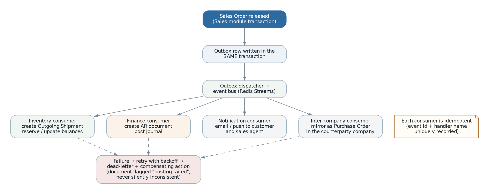

*Figure 4 — Outbox-based event flow from one module’s transaction to many consumers, with idempotency and the failure path.*

1.  An aggregate records events as it changes state; it does not publish them.

2.  The application service pulls the events and writes them to the outbox table — in the same transaction as the state change. If the transaction rolls back, the events vanish with it.

3.  A dispatcher polls the outbox (using SKIP LOCKED so several instances can dispatch concurrently) and pushes each event to its Redis stream, then marks it dispatched.

4.  Consumers process events. Each consumer records (event id, handler name) uniquely, so redelivery is a no-op rather than a duplicate posting.

5.  A consumer failure is retried with exponential backoff; persistent failure dead-letters the event, raises an alert and, where the event had a business consequence such as posting, marks the source document as having a failed consequence so it is visible in the user interface (SRS NFR-REL-004).

<table>
<colgroup>
<col style="width: 100%" />
</colgroup>
<tbody>
<tr class="odd">
<td>
CREATE TABLE platform.outbox (

id bigserial PRIMARY KEY,

tenant_id uuid NOT NULL,

aggregate_type text NOT NULL,

aggregate_id text NOT NULL,

event_type text NOT NULL,

event_version int NOT NULL DEFAULT 1,

payload jsonb NOT NULL,

correlation_id uuid NOT NULL,

causation_id uuid,

occurred_at timestamptz NOT NULL DEFAULT now(),

dispatched_at timestamptz,

attempts int NOT NULL DEFAULT 0,

last_error text

);

-- partial index: the dispatcher only ever scans undispatched rows

CREATE INDEX outbox_pending_idx ON platform.outbox (id)

WHERE dispatched_at IS NULL;

CREATE TABLE platform.event_handled (

event_id bigint NOT NULL,

handler text NOT NULL,

handled_at timestamptz NOT NULL DEFAULT now(),

PRIMARY KEY (event_id, handler) -- the idempotency guarantee

);
</td>
</tr>
</tbody>
</table>

**5.9 Extensibility design**

The legacy extension mechanism — one module adding fields, relationships, data scopes and user-interface elements to another without modifying it — is one of the system’s real strengths and must be preserved (SRS FR-EXT-001 to 007). The design differs because TypeScript cannot reopen a class at runtime the way PHP can.

| **Extension need**                     | **Legacy mechanism**                                       | **This design**                                                                                                                                                                                                                                      |
|----------------------------------------|------------------------------------------------------------|------------------------------------------------------------------------------------------------------------------------------------------------------------------------------------------------------------------------------------------------------|
| Add fields to another module’s entity  | Runtime cast and relation registration on the model class. | Custom-field definitions stored as data, persisted in a typed jsonb column on the extended entity, with the extending module declaring the field set, its validation and its display. Compile-time access through a generated type per installation. |
| Add a relationship                     | Runtime relation resolution.                               | The extending module owns the join table in its own schema and exposes the relationship through its read model. The extended module is unaware of it.                                                                                                |
| Add a data scope                       | Global query scope added to another module’s model.        | Registered scope providers. The repository base class asks the scope registry for all providers applicable to the entity, so an extension contributes a predicate without the extended module knowing.                                               |
| Add UI columns, filters, form sections | View-model extension classes mapped declaratively.         | Frontend metadata contributions: the extending module registers descriptors that the grid and form renderers merge with the base descriptors (section 14.3). The mechanism and even the declaration style are preserved.                             |
| React to another module’s behaviour    | Subscribe to any event.                                    | Subscribe to published contract events only. Internal events are not exported, which makes the coupling surface explicit and versionable (SRS FR-EXT-004).                                                                                           |
| Remove an extension cleanly            | Disable the module.                                        | Same: the module registry drives permissions, navigation, scope providers, event subscriptions and metadata contributions, so disabling a module withdraws all of them (SRS FR-PLT-021, FR-EXT-005).                                                 |

**5.10 Configuration and settings**

Behavioural variation is data (SRS FR-PLT-006 to 010). The legacy system proves the value of this: a substantial part of its adaptability comes from 239 declared settings rather than from code branches.

<table>
<colgroup>
<col style="width: 100%" />
</colgroup>
<tbody>
<tr class="odd">
<td>
// Declarative registry, per module. Typed, so a consumer cannot

// misread a boolean as a string or forget the default.

export const salesSettings = defineSettings("sales", {

general: {

defaultPaymentTerms: text ({ default: "Cash on Delivery" }),

defaultDeliveryTerms: text ({ default: "Cash on Delivery" }),

quotationValidityDays: integer({ default: 30, min: 0, max: 365 }),

enableProfitEstimator: bool ({ default: false }),

autoPostingEnabled: bool ({ default: false, scope: "branch" }),

},

creditControl: {

actions: hasMany({

key: "operation",

shape: {

operation: enumOf(["quotation","sales_order","invoice","cash_sales","delivery"]),

onOverLimit: enumOf(["allow","approval","block"]),

onOverdue: enumOf(["allow","approval","block"]),

},

scope: "branch",

}),

},

});

// Resolution order: branch override → tenant → module default.

const days = await settings.get(salesSettings.general.quotationValidityDays, ctx);
</td>
</tr>
</tbody>
</table>

| **Design point**           | **Reason**                                                                                                                                                                     |
|----------------------------|--------------------------------------------------------------------------------------------------------------------------------------------------------------------------------|
| Typed accessors            | A setting read with the wrong type is a compile error, not a production surprise.                                                                                              |
| Explicit scope per setting | The legacy model is mostly global with some settings smuggling a branch identifier into their payload (SRS OQ-012). Scope is declared here so the resolution is unambiguous.   |
| Request-scoped cache       | Settings are read constantly during document entry. They are loaded once per request and cached in Redis with invalidation on change, so reads are effectively free.           |
| Audited                    | Every change records actor, before and after (SRS FR-PLT-008).                                                                                                                 |
| Secrets excluded           | Mail passwords, integration keys and webhook secrets move to the secret store. The legacy system holds them in the settings table, which is a stated defect (SRS NFR-SEC-004). |

**6. Module Architecture**

**6.1 Module catalogue**

| **Module**                          | **Owns**                                                                                                                                                                                                           | **Publishes**                                                                                              | **Phase** |
|-------------------------------------|--------------------------------------------------------------------------------------------------------------------------------------------------------------------------------------------------------------------|------------------------------------------------------------------------------------------------------------|-----------|
| **Layer 0 — Platform**              |                                                                                                                                                                                                                    |                                                                                                            |           |
| platform                            | Tenants, users, roles, permissions, branches, settings, numbering, audit, outbox, currencies and rates, custom fields, search.                                                                                     | Identity and context types, permission registry, settings port, numbering port, audit port, currency port. | 0         |
| files                               | Storage buckets, file metadata, retention.                                                                                                                                                                         | File port, bucket registry.                                                                                | 0         |
| messaging                           | Channels, intents, templates, recipient rules, message archive.                                                                                                                                                    | Notification port, intent registry.                                                                        | 0         |
| reporting                           | Report registry, parameters, access, history, rendering orchestration.                                                                                                                                             | Report port, report registry.                                                                              | 0         |
| workflow                            | Approval definitions, chains, requests, decisions, escalation, work queue.                                                                                                                                         | Approval port, approval events.                                                                            | 0         |
| **Layer 1 — Master data**           |                                                                                                                                                                                                                    |                                                                                                            |           |
| master-data                         | Items, groups, brands, scopes, UoM and conversions, bills of material, price lists, customers, suppliers, tax, tax profiles, credit terms, payment plans, document types, departments, sales agents, tariff codes. | Item, party, price, tax and UoM read models; party and item events.                                        | 1         |
| **Layer 2 — Financial core**        |                                                                                                                                                                                                                    |                                                                                                            |           |
| finance                             | Chart of accounts, journals, fiscal years and periods, AR and AP documents, settlement, cashbook, bank reconciliation, posting routes, projects, budgets, statements.                                              | Posting port, period port, party-balance read model, payment events.                                       | 1         |
| **Layer 3 — Operational**           |                                                                                                                                                                                                                    |                                                                                                            |           |
| sales                               | Ten sales document families, credit control, territories, enquiry reference data, tax exemption, price history, profit estimator.                                                                                  | Sales document events, outstanding read model.                                                             | 2         |
| purchasing                          | Nine purchase document families, demand, sourcing, supplier tax exemption, price history.                                                                                                                          | Purchase document events, outstanding read model.                                                          | 2         |
| inventory                           | Bins, batches, stock locations, the stock ledger, valuation, inbound and outbound chains, picking, putaway, transfers, adjustments, issues, receipts, scrap, opening balances.                                     | Stock events, availability read model, valuation read model.                                               | 2 / 3     |
| production                          | Job orders, process orders, routing task sets, BoM explosion layers, material issue, progress, assembly, disassembly, wastage.                                                                                     | Production events, WIP read model.                                                                         | 4         |
| **Layer 4 — People**                |                                                                                                                                                                                                                    |                                                                                                            |           |
| payroll                             | Employees, positions, compensation, components, leave, claims, payroll runs, payslips, statutory schemes, annual income.                                                                                           | Payroll posting events, employee read model.                                                               | 4         |
| self-service                        | Employee-facing views over payroll; no tables of its own.                                                                                                                                                          | —                                                                                                          | 4         |
| **Layer 5 — Compliance and growth** |                                                                                                                                                                                                                    |                                                                                                            |           |
| e-invoice                           | Jurisdiction adapters, submission records, validation outcomes, cancellation.                                                                                                                                      | e-Invoice status events.                                                                                   | 3         |
| crm                                 | Leads, opportunities, pipeline, activities, targets.                                                                                                                                                               | Opportunity events.                                                                                        | 5         |
| client-portal                       | Customer-facing authentication and views; separately deployable.                                                                                                                                                   | —                                                                                                          | 5         |
| fixed-assets                        | Asset register, depreciation, disposal, revaluation.                                                                                                                                                               | Depreciation posting events.                                                                               | 5         |
| integration                         | API keys, webhook subscriptions and delivery, import and export definitions.                                                                                                                                       | Webhook port.                                                                                              | 5         |

**6.2 Boundary enforcement**

The dependency rule in SRS section 3.2 is enforced in three independent ways, because a single mechanism will eventually be worked around.

| **Mechanism**                         | **What it prevents**                                                                                                                                                             |
|---------------------------------------|----------------------------------------------------------------------------------------------------------------------------------------------------------------------------------|
| Workspace packages                    | Each module is a package whose exports are limited to its contract path. Importing an internal path is a resolution failure, not a style issue.                                  |
| dependency-cruiser rules in the build | A declared, machine-checked graph: which module may depend on which, and that the domain layer imports nothing. Violations fail the pipeline (SRS FR-PLT-024).                   |
| Database schema grants                | Each module’s tables live in its own schema. In deployments where it is warranted, per-module database roles make a cross-schema write impossible rather than merely prohibited. |

<table>
<colgroup>
<col style="width: 100%" />
</colgroup>
<tbody>
<tr class="odd">
<td>
// .dependency-cruiser.js — the module graph as an executable rule

forbidden: [

{ name: "no-module-internals",

comment: "Only a module's contract/ path may be imported by others",

from: { path: "^src/modules/([^/]+)/" },

to: { path: "^src/modules/(?!$1)([^/]+)/(?!contract)" } },

{ name: "domain-imports-nothing",

comment: "The domain layer is framework- and infrastructure-free",

from: { path: "/domain/" },

to: { path: "(@nestjs|@prisma|axios|/infrastructure/|/interface/)" } },

{ name: "respect-layer-order",

comment: "Operational modules may not be depended on by lower layers",

from: { path: "^src/modules/(platform|master-data|finance)/" },

to: { path: "^src/modules/(sales|purchasing|inventory|production|payroll)/" } },

]
</td>
</tr>
</tbody>
</table>

**6.3 Inter-module communication**

| **Need**                                                | **Mechanism**                                                                                                  | **Example**                                                                                                     |
|---------------------------------------------------------|----------------------------------------------------------------------------------------------------------------|-----------------------------------------------------------------------------------------------------------------|
| React to something that happened                        | Contract event via the outbox. Asynchronous, idempotent, retryable. The default and strongly preferred option. | Sales order released → Inventory creates an outgoing shipment; Finance posts the receivable.                    |
| Read another module’s data                              | That module’s published read model — a typed query interface backed by a view it owns. Synchronous, read-only. | Sales reads the item price and the customer credit position.                                                    |
| Ask another module to do something now, transactionally | A published port. Permitted only within the layer hierarchy and only where asynchrony would be incorrect.      | Sales asks the numbering service for a document number; Finance asks the period service whether a date is open. |
| Contribute to another module’s user interface or scope  | Registry contribution (section 5.9).                                                                           | Sales contributes sales-agent columns and an agent data scope to the customer screen.                           |

<table>
<colgroup>
<col style="width: 100%" />
</colgroup>
<tbody>
<tr class="odd">
<td>
<strong>Prohibited, and checked</strong>

Reading or writing another module’s tables directly. This is what the legacy inter-company listener does — it writes Purchase rows from a Sales listener — and it is why the two modules cannot be changed independently (SRS WK-09).

Calling another module’s application service inside a transaction. Creates a hidden distributed transaction and couples failure domains (DCN-05).
</td>
</tr>
</tbody>
</table>

**6.4 Per-module design notes**

**6.4.1 platform**

- Contains no business domain. Its job is to make every other module’s job smaller: context, authorisation, numbering, settings, audit, outbox and currency.

- The document lifecycle framework (section 5.5) lives here and is the largest single piece of Phase 0 work.

- Tenant and branch context are established by middleware and carried in async local storage. Nothing downstream passes them explicitly, and nothing downstream can omit them.

**6.4.2 master-data**

- Owns the vocabulary every other module speaks. Its read models are the highest-traffic queries in the system and are the first candidates for caching.

- Bill-of-material flattening is maintained as a materialised projection rebuilt on change, preserving the legacy pre-flattening idea (SRS FR-MST-021) with explicit rebuild semantics.

- Price resolution is a domain service with an explicit, testable order (SRS BR-PRC-001, OQ-046) rather than logic embedded in document entry.

- Circular BoM detection is a domain invariant, closing SRS OQ-017 by construction.

**6.4.3 finance**

- Owns the ledger and is the only module that may write a journal. Everything else requests posting through the posting port and receives an event.

- The posting engine (section 13.3) is the highest-risk component after the document framework, and carries the same test depth.

- Fiscal period state is exposed as a read model consulted by every posting path, so the period lock is enforced in one place.

- AR and AP are structurally identical and share a generic settlement engine parameterised by direction — mirroring the legacy design, which is sound.

**6.4.4 inventory**

- The largest module. Internally split into stock (ledger, valuation, locations, batches), inbound, outbound and warehouse operations sub-domains, each with its own aggregates but one shared ledger.

- The stock ledger is append-only and partitioned by period (section 7.7). Valuation is computed forward, never by aggregating history.

- Movement processing is set-based: one statement per document, not one per line. This is a specific correction of SRS WK-05 and is verified by a performance test rather than by inspection.

**6.4.5 production**

- Separated from inventory, unlike the legacy system, because it has a different user population, a different lifecycle and its own reporting.

- Depends on inventory through events and read models only, so it can be built in Phase 4 without reopening inventory.

- Designed with cost components (material, labour, overhead) from the start even though only material is populated initially, so that closing SRS OQ-031 later is a data change rather than a schema change.

**6.4.6 payroll**

- Statutory computation is a jurisdiction rule set behind a stable interface (section 13.5). The Malaysian implementation is one package.

- Statutory tables are effective-dated from the first release, which is the single most important correction in this module (SRS FR-PAY-040, BR-PAY-011).

- A payroll run is an aggregate spanning entries and payslips, because its totals must agree; each employee’s calculation is a pure function tested independently against published tables.

- Personal data is classified at field level, masked by default and audited on reveal (SRS FR-SEC-042).

**6.4.7 e-invoice**

- A module rather than a feature of finance, because it is a jurisdiction concern with its own lifecycle, its own retry semantics and its own external dependency.

- Subscribes to finance document events; never writes finance tables. Its submission state lives in its own schema and is exposed to finance as a read model.

- Structured as an adapter per jurisdiction so a second regime is additive (SRS FR-EIV-011).

**7. Database Architecture**

**7.1 Database selection**

PostgreSQL 16 or later (ADR-03). The decision is driven by five specific needs of this domain rather than by general preference.

| **Need**                                    | **PostgreSQL capability used**                                                                                                                                                    |
|---------------------------------------------|-----------------------------------------------------------------------------------------------------------------------------------------------------------------------------------|
| Exact monetary arithmetic                   | The numeric type with declared precision and scale. No floating point anywhere in the money path (DCN-04).                                                                        |
| Module ownership without separate databases | Schemas, with per-module roles and grants where a deployment warrants hard enforcement.                                                                                           |
| Tenant isolation, if required               | Row-level security policies, which make the tenant predicate a database guarantee rather than an application convention. This is what keeps option C in section 7.5 viable.       |
| Ledger volumes                              | Declarative range partitioning for the stock ledger, journal details and audit log — the three tables that grow without bound.                                                    |
| Read models and reporting                   | Materialised views with concurrent refresh, expression and partial indexes, common table expressions and window functions for aging, running balances and comparative statements. |
| Semi-structured data                        | jsonb with GIN indexes for settings, custom fields, e-Invoice payload archives and audit before/after state.                                                                      |

**7.2 Schema organisation**

One schema per module. Ownership is then visible in every query, and a cross-boundary access is detectable by reading SQL rather than by reading code.

| **Schema**  | **Contents**                                                                                                                             | **Growth**                        |
|-------------|------------------------------------------------------------------------------------------------------------------------------------------|-----------------------------------|
| platform    | Tenants, users, roles, permissions, branches, settings, number sequences, currencies and rates, outbox, event_handled, idempotency keys. | Low                               |
| audit       | The append-only audit log and security event log. Separate schema so retention and access control are managed independently.             | Very high — partitioned           |
| files       | File metadata and bucket definitions. Content lives in object storage.                                                                   | Medium                            |
| messaging   | Intents, templates, recipient rules, message archive.                                                                                    | Medium — purged                   |
| reporting   | Report registry, parameters, access grants, generation history.                                                                          | Medium — purged                   |
| workflow    | Approval definitions, chains, requests, decisions.                                                                                       | Low                               |
| master_data | Items, parties, pricing, tax, UoM, BoM and reference data.                                                                               | Low                               |
| finance     | Chart of accounts, journals and details, fiscal periods, AR and AP documents, settlement, posting routes, projects, budgets.             | High — journal_detail partitioned |
| sales       | Sales document families and their details and references.                                                                                | High                              |
| purchasing  | Purchase document families.                                                                                                              | High                              |
| inventory   | Locations, batches, the stock ledger, valuation, and the inbound, outbound and warehouse documents.                                      | Very high — ledger partitioned    |
| production  | Job orders, process orders, routing, BoM layers, wastage.                                                                                | Medium                            |
| payroll     | Employees, compensation, components, leave, claims, runs, payslips, statutory schemes.                                                   | Medium                            |
| einvoice    | Submissions, validation outcomes, cancellations, payload references.                                                                     | High                              |
| read_model  | Materialised views and projections that span modules for reporting and dashboards. Written only by refresh processes.                    | Derived                           |

**7.3 Naming and structural conventions**

| **Element**           | **Convention**                                                                                                                                                            | **Example**                           |
|-----------------------|---------------------------------------------------------------------------------------------------------------------------------------------------------------------------|---------------------------------------|
| Schema, table, column | snake_case, singular table names.                                                                                                                                         | sales.sales_order                     |
| Detail tables         | Parent name plus \_line. The legacy system uses \_detail; \_line is clearer and the mapping is recorded in Appendix E.                                                    | sales.sales_order_line                |
| Primary key           | \[object Object\] — uuid v7, which is time-ordered so it indexes well while remaining non-guessable in URLs.                                                              | id uuid PRIMARY KEY                   |
| Foreign key           | Referenced table singular plus \_id, with an explicit constraint always.                                                                                                  | customer_id uuid REFERENCES …         |
| Money                 | \[object Object\] in document currency, plus a \_home suffixed column in home currency.                                                                                   | \[object Object\] / \[object Object\] |
| Quantity              | \[object Object\] — six decimals to absorb unit conversion without rounding drift.                                                                                        | quantity numeric(19,6)                |
| Rate                  | numeric(19,8)                                                                                                                                                             | currency_rate numeric(19,8)           |
| Dates                 | \[object Object\] for business dates; \[object Object\] for events. Never a naive timestamp (SRS NFR-LOC-005).                                                            | document_date date                    |
| Booleans              | Positive phrasing, \[object Object\] or \[object Object\] prefix, never nullable.                                                                                         | is_active boolean NOT NULL            |
| Enumerations          | text with a check constraint, not a PostgreSQL enum type — adding a value must not require a type migration.                                                              | status text CHECK (status IN (…))     |
| Audit columns         | Every business table: created_at, created_by, updated_at, updated_by, version.                                                                                            | version integer NOT NULL DEFAULT 1    |
| Tenant column         | Every business table carries tenant_id, whatever the tenancy model chosen.                                                                                                | tenant_id uuid NOT NULL               |
| Soft delete           | Not used. Records are deactivated by a business field, or they are genuinely deleted. A global soft-delete flag silently breaks uniqueness, aggregation and foreign keys. | —                                     |

<table>
<colgroup>
<col style="width: 100%" />
</colgroup>
<tbody>
<tr class="odd">
<td>
<strong>Two conventions that are load-bearing rather than cosmetic</strong>

Money stored as numeric(19,4) with a separate home-currency column, both NOT NULL for released documents. The legacy schema uses decimal(15,2) and decimal(10,2) inconsistently across tables; four decimals are used uniformly here so that unit-price precision and tax apportionment do not round prematurely, with presentation rounding applied only at display and print.

tenant_id on every business table from the first migration, even in a single-tenant deployment where it holds one constant value. Adding it later means rewriting every table, every index and every query (ADR-05).
</td>
</tr>
</tbody>
</table>

**7.4 Recurring structural patterns**

**7.4.1 The document and line pattern**

<table>
<colgroup>
<col style="width: 100%" />
</colgroup>
<tbody>
<tr class="odd">
<td>
-- Every one of the ~45 document families follows this shape.

-- Generated from the document definition (section 5.5.2) so it cannot drift.

CREATE TABLE sales.sales_order (

id uuid PRIMARY KEY DEFAULT uuidv7(),

tenant_id uuid NOT NULL,

branch_id uuid NOT NULL REFERENCES platform.branch(id),

document_number text, -- NULL until released

document_date date NOT NULL,

status text NOT NULL DEFAULT 'draft'

CHECK (status IN ('draft','awaiting_approval',

'released','cancelled','revised')),

transfer_status text NOT NULL DEFAULT 'pending'

CHECK (transfer_status IN ('pending','partial','done')),

customer_id uuid NOT NULL REFERENCES master_data.customer(id),

currency_code char(3) NOT NULL,

currency_rate numeric(19,8) NOT NULL DEFAULT 1,

is_tax_inclusive boolean NOT NULL DEFAULT false,

subtotal numeric(19,4) NOT NULL DEFAULT 0,

total_discount numeric(19,4) NOT NULL DEFAULT 0,

total_tax numeric(19,4) NOT NULL DEFAULT 0,

total_exempt_tax numeric(19,4) NOT NULL DEFAULT 0,

rounding numeric(19,4) NOT NULL DEFAULT 0,

total numeric(19,4) NOT NULL DEFAULT 0,

total_home numeric(19,4) NOT NULL DEFAULT 0,

revision integer NOT NULL DEFAULT 0,

revised_from_id uuid REFERENCES sales.sales_order(id),

approval_id uuid, -- workflow schema, no FK across modules

custom_fields jsonb NOT NULL DEFAULT '{}',

created_at timestamptz NOT NULL DEFAULT now(),

created_by uuid NOT NULL,

updated_at timestamptz NOT NULL DEFAULT now(),

updated_by uuid NOT NULL,

version integer NOT NULL DEFAULT 1,

CONSTRAINT sales_order_number_unique

UNIQUE (tenant_id, branch_id, document_number),

CONSTRAINT sales_order_released_has_number

CHECK (status = 'draft' OR document_number IS NOT NULL)

);

CREATE TABLE sales.sales_order_line (

id uuid PRIMARY KEY DEFAULT uuidv7(),

tenant_id uuid NOT NULL,

sales_order_id uuid NOT NULL REFERENCES sales.sales_order(id) ON DELETE CASCADE,

line_number integer NOT NULL,

group_line_number integer, -- heading grouping

item_id uuid REFERENCES master_data.item(id),

description text NOT NULL,

uom_id uuid REFERENCES master_data.uom(id),

conversion_factor numeric(19,6) NOT NULL DEFAULT 1,

quantity numeric(19,6) NOT NULL,

transferred_qty numeric(19,6) NOT NULL DEFAULT 0,

unit_price numeric(19,4) NOT NULL,

discount_expr text, -- "10%" or "150.00"

discount_amount numeric(19,4) NOT NULL DEFAULT 0,

tax_id uuid REFERENCES master_data.tax(id),

tax_rate numeric(9,4),

tax_amount numeric(19,4) NOT NULL DEFAULT 0,

exempt_tax_rate numeric(9,4),

exempt_tax_amount numeric(19,4) NOT NULL DEFAULT 0,

line_total numeric(19,4) NOT NULL,

project_id uuid,

department_id uuid,

custom_fields jsonb NOT NULL DEFAULT '{}',

CONSTRAINT line_unique UNIQUE (sales_order_id, line_number),

CONSTRAINT qty_positive CHECK (quantity &gt; 0),

CONSTRAINT transfer_within_bounds

CHECK (transferred_qty &gt;= 0 AND transferred_qty &lt;= quantity)

);

-- balance_quantity is GENERATED, not stored redundantly.

-- This makes the legacy drift defect (SRS WK-04) structurally impossible.

ALTER TABLE sales.sales_order_line

ADD COLUMN balance_qty numeric(19,6)

GENERATED ALWAYS AS (quantity - transferred_qty) STORED;
</td>
</tr>
</tbody>
</table>

**The generated column is the key correction.** In the legacy schema, balance quantity is an ordinary column updated by application code, which is why it drifts and why three modules run corrective jobs twice a day. Deriving it in the database means it cannot disagree with its inputs, and the transfer-status rollup is then a cheap aggregate over a correct value (SRS FR-PLT-015).

**7.4.2 The append-only ledger pattern**

Three tables are append-only by design: the stock ledger, journal details and the audit log. Each carries its running balance on the row so that a point-in-time query is a lookup rather than an aggregation — preserving the legacy approach, which is correct.

- No UPDATE and no DELETE are granted to the application role on these tables. Correction is by a further row.

- Each is range-partitioned by period so that old partitions can be detached and archived without touching live data (SRS DR-026).

- Each carries the correlation identifier of the request that produced it, so a ledger row can be traced to an API call, a queue job or a batch import.

**7.4.3 The document linkage pattern**

The legacy system links documents with a loose triple of type string, identifier and rendered URL, with no referential integrity — the direct cause of orphaned links and one of the reasons the corrective jobs exist (SRS WK-07, DR-018). This design replaces it with a first-class relation.

<table>
<colgroup>
<col style="width: 100%" />
</colgroup>
<tbody>
<tr class="odd">
<td>
CREATE TABLE platform.document_link (

id uuid PRIMARY KEY DEFAULT uuidv7(),

tenant_id uuid NOT NULL,

source_type text NOT NULL, -- registered document type code

source_id uuid NOT NULL,

source_line_id uuid,

target_type text NOT NULL,

target_id uuid NOT NULL,

target_line_id uuid,

link_kind text NOT NULL -- transfer | reversal | settlement

CHECK (link_kind IN ('transfer','reversal','settlement','mirror')),

quantity numeric(19,6),

amount numeric(19,4),

created_at timestamptz NOT NULL DEFAULT now(),

created_by uuid NOT NULL,

CONSTRAINT link_types_registered

FOREIGN KEY (source_type) REFERENCES platform.document_type_registry(code),

CONSTRAINT link_target_registered

FOREIGN KEY (target_type) REFERENCES platform.document_type_registry(code),

CONSTRAINT link_unique

UNIQUE (source_type, source_id, source_line_id, target_type, target_id, target_line_id, link_kind)

);

CREATE INDEX link_source_idx ON platform.document_link (source_type, source_id);

CREATE INDEX link_target_idx ON platform.document_link (target_type, target_id);
</td>
</tr>
</tbody>
</table>

Because document type is a registered code with a foreign key, a link can never name a type that does not exist. Cross-module referential integrity on the identifier itself is enforced by the linkage service and by a nightly consistency assertion that reports — rather than silently repairs — any dangling link (SRS DR-056). The legacy "transfer overview" screen becomes a recursive query over this one table.

**7.5 Tenancy design**

The tenancy model is an open business decision (SRS OQ-001). This section designs all three options, states the recommendation, and defines the seam that makes the decision reversible.

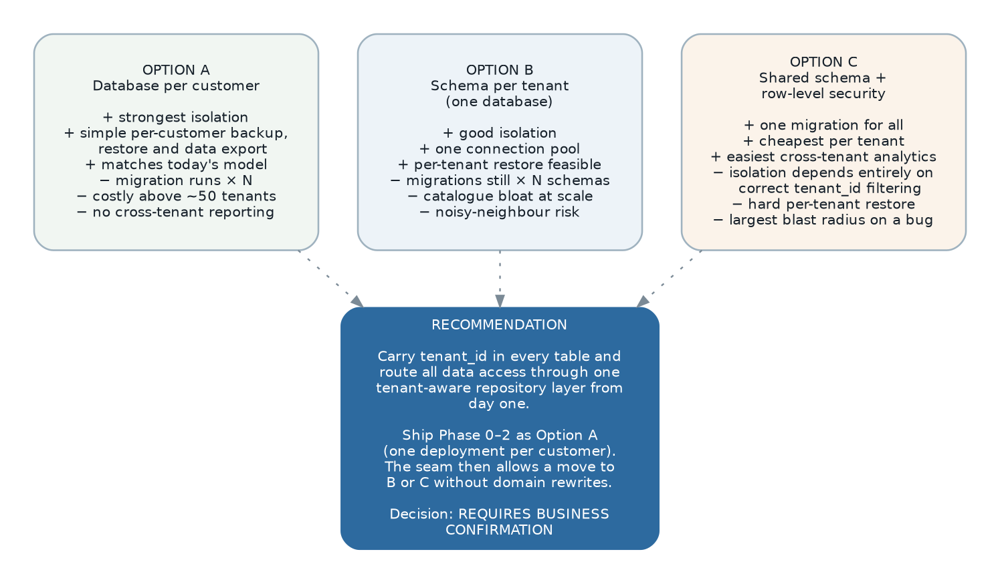

*Figure 5 — Tenancy options and the recommended approach.*

| **Dimension**          | **A — Database per tenant**                                                  | **B — Schema per tenant**        | **C — Shared schema + RLS**                |
|------------------------|------------------------------------------------------------------------------|----------------------------------|--------------------------------------------|
| Isolation              | Strongest. A query cannot physically reach another tenant.                   | Strong. Search path plus grants. | Logical only. Depends on a correct policy. |
| Migration cost         | One run per tenant.                                                          | One run per schema.              | One run, all tenants.                      |
| Connection pooling     | A pool per tenant; expensive above roughly 50.                               | One pool.                        | One pool.                                  |
| Per-tenant restore     | Trivial.                                                                     | Feasible.                        | Hard — requires row-level extraction.      |
| Cross-tenant reporting | Not possible without a warehouse.                                            | Possible but awkward.            | Trivial.                                   |
| Blast radius of a bug  | One tenant.                                                                  | One tenant.                      | All tenants.                               |
| Noisy neighbour        | None.                                                                        | Shared resources.                | Shared resources.                          |
| Best suited to         | A few large customers with strict isolation demands — the current situation. | Tens of mid-sized tenants.       | Many small tenants; a true SaaS product.   |

**7.5.1 Recommendation**

- **Carry tenant_id in every business table from the first migration,** and route every read and write through one tenant-aware repository base class. This is non-negotiable whichever option is chosen, and it is the whole seam.

- **Ship Phases 0 to 2 as option A** — one deployment and one database per customer. It matches the present situation, gives the strongest isolation while the system is new and least proven, and makes per-customer backup and restore trivial.

- **Keep options B and C reachable.** Because the tenant predicate is applied in one place and the column already exists, moving to B is a deployment change, and moving to C means enabling row-level security policies that can be written against the existing column.

<table>
<colgroup>
<col style="width: 100%" />
</colgroup>
<tbody>
<tr class="odd">
<td>
// The seam. Every repository extends this; none of them re-implement scoping,

// and none of them can forget it.

export abstract class ScopedRepository&lt;T&gt; {

protected constructor(

protected readonly db: DatabaseClient,

private readonly scopes: ScopeRegistry,

) {}

protected scopeFor(ctx: RequestContext, entity: EntityName): Predicate[] {

const predicates: Predicate[] = [

eq("tenant_id", ctx.tenantId), // always

];

if (this.scopes.isBranchScoped(entity)) {

predicates.push(inList("branch_id", ctx.visibleBranchIds));

}

// registered contributions — e.g. sales-agent scope added by the sales module

for (const provider of this.scopes.providersFor(entity)) {

const extra = provider.predicate(ctx);

if (extra) predicates.push(extra);

}

return predicates;

}

// There is deliberately no public method that skips scoping. A genuine

// system-level need uses an explicit SystemContext, which is audited.

}
</td>
</tr>
</tbody>
</table>

**7.6 Multi-company and branch scoping**

Independently of tenancy, the system partitions data by branch (SRS FR-SEC-020 to 026). The design separates the two concepts the legacy system conflates.

| **Entity**   | **Represents**                                                                                                                                     | **Why separated**                                                                                                                                                                            |
|--------------|----------------------------------------------------------------------------------------------------------------------------------------------------|----------------------------------------------------------------------------------------------------------------------------------------------------------------------------------------------|
| legal_entity | A registered company: tax registration, TIN, SST numbers, employer numbers, statutory identity, chart of accounts, fiscal calendar, home currency. | Statutory reporting, e-Invoice submission and payroll filing are all per legal entity. In the legacy model these hang off a branch that may equally be a warehouse (SRS FR-PLT-004, OQ-002). |
| branch       | An operating location within a legal entity: document prefix, address, letterhead, default stock location, operating users.                        | Documents, stock and users are scoped to a branch. A branch tree remains, but it no longer carries statutory identity.                                                                       |
| user_branch  | Which branches a user may operate in.                                                                                                              | Unchanged from the legacy model, which is sound.                                                                                                                                             |

**Migration consequence.** Legacy branches split into legal entities and branches. Where a legacy branch has its own tax registration it becomes a legal entity, with a default branch created beneath it; where it does not, it becomes a branch of its parent’s legal entity. This mapping must be reviewed with finance during migration design and is recorded in Appendix E.

**7.7 Indexing, partitioning and query design**

**7.7.1 Indexing policy**

| **Index**                   | **On**                                                                                                                                                                           |
|-----------------------------|----------------------------------------------------------------------------------------------------------------------------------------------------------------------------------|
| Tenant-leading composite    | Every high-traffic table: (tenant_id, branch_id, document_date DESC) — matching the default list query so that the scoped predicate and the sort are served by one index.        |
| Document number lookup      | (tenant_id, branch_id, document_number) — unique, and the index that serves the global search.                                                                                   |
| Foreign keys                | Every foreign key column. PostgreSQL does not create these automatically and their absence is a common cause of slow cascading deletes and joins.                                |
| Partial index on open work  | WHERE balance_qty \> 0 on line tables, and WHERE status = 'released' on headers — the outstanding reports read only these rows, and the partial index is a fraction of the size. |
| Partial index on the outbox | WHERE dispatched_at IS NULL — the dispatcher scans only pending rows.                                                                                                            |
| Stock ledger composite      | (tenant_id, item_id, branch_id, location_id, batch_id, transaction_date, id) — the exact key of the valuation walk, so FIFO layer resolution is an index scan.                   |
| GIN on jsonb                | custom_fields and audit before/after, only where queried.                                                                                                                        |
| Trigram                     | Party and item name and code, for the near-match duplicate warning (SRS DR-057) and for search-as-you-type.                                                                      |

**7.7.2 Partitioning**

| **Table**                                   | **Strategy**                                                                                                                                                          |
|---------------------------------------------|-----------------------------------------------------------------------------------------------------------------------------------------------------------------------|
| inventory.stock_transaction                 | Range partition by month on transaction_date. Valuation queries are naturally date-bounded; archiving is a detach.                                                    |
| finance.journal_line                        | Range partition by fiscal period. A locked period’s partition can be set read-only, which makes SRS BR-FISC-003 a storage guarantee rather than an application check. |
| audit.audit_log                             | Range partition by month, with a tiered retention policy detaching and archiving old partitions (SRS DR-028).                                                         |
| messaging.message, reporting.report_history | Range partition by month, dropped on the configured retention schedule.                                                                                               |

**7.7.3 Query design rules**

- No N+1. Repositories load aggregates with their children in one round trip; list queries project only the columns requested.

- No query inside a loop, in any layer. Bulk operations read the whole working set once and write set-based statements.

- No SELECT \*. Column lists are explicit so that adding a column cannot change a query plan or a payload.

- Cursor pagination (keyset) for every list, not offset pagination, which degrades linearly and produces duplicates under concurrent insert.

- Reporting queries run against the read replica and are written as parameterised SQL reviewed with EXPLAIN as part of code review.

- Every query carries a statement timeout; a runaway report cannot hold a connection indefinitely.

**7.8 Migration and schema change**

| **Aspect**      | **Approach**                                                                                                                                                                                                                 |
|-----------------|------------------------------------------------------------------------------------------------------------------------------------------------------------------------------------------------------------------------------|
| Tooling         | Prisma Migrate, with generated SQL reviewed and committed. Nothing is applied that has not been read by a person.                                                                                                            |
| Direction       | Forward-only. A mistake is corrected by a new migration, never by editing an applied one.                                                                                                                                    |
| Zero downtime   | Expand-migrate-contract: add the new shape, dual-write and backfill, switch reads, then remove the old shape in a later release. A migration that cannot be made safe this way requires a declared downtime window (DCN-08). |
| Ownership       | Each module owns its schema fragment; the build composes them. Two modules cannot migrate the same table.                                                                                                                    |
| Verification    | Every migration is applied to a production-shaped copy in the pipeline, and the schema is diffed against the expected state before promotion.                                                                                |
| Data migrations | Separated from schema migrations, run as idempotent, resumable jobs with progress reporting, because a backfill over 20 million ledger rows cannot run inside a deployment step.                                             |

**7.9 Legacy data migration design**

Migration satisfies SRS DR-040 to DR-050 and is the largest single cutover risk. It is designed as a repeatable pipeline, not a one-off script.

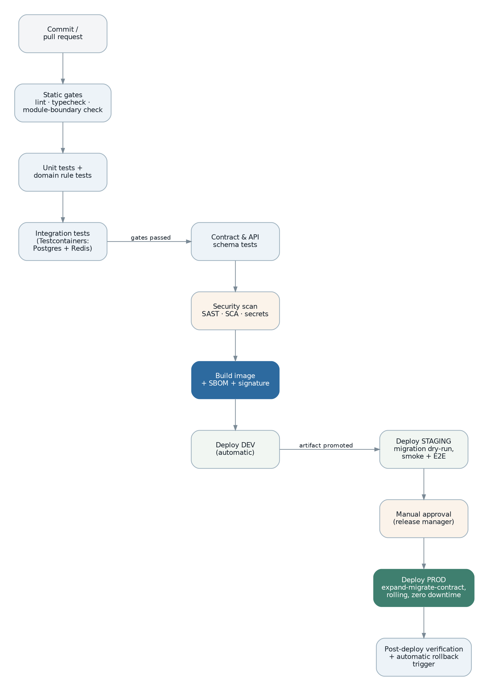

*Figure 6 — The delivery pipeline. Migration rehearsals run through the same promotion path as code.*

| **Stage**   | **What happens**                                                                                                                                                                                                                        | **Output**                                                 |
|-------------|-----------------------------------------------------------------------------------------------------------------------------------------------------------------------------------------------------------------------------------------|------------------------------------------------------------|
| 1 Extract   | Read the legacy MySQL database into a staging schema, unchanged. No transformation, so extraction can be re-run cheaply and repeatedly.                                                                                                 | Staging tables plus row counts.                            |
| 2 Profile   | Measure the real data: volumes, null rates, orphaned references, duplicate parties, out-of-range values, inconsistent derived balances. This is also how SRS OQ-050 is answered.                                                        | A data-quality report that drives the cleansing decisions. |
| 3 Cleanse   | Apply agreed corrections in staging — never in the legacy system. Every correction is a recorded rule so the result is reproducible.                                                                                                    | Cleansed staging plus a rule log.                          |
| 4 Transform | Map to the new model: split branch into legal entity and branch, convert polymorphic references to document links, derive FIFO layers per item, bin and batch, map permission keys, convert naive dates to explicit time zone.          | Load-ready sets.                                           |
| 5 Load      | Insert in dependency order — tenants, legal entities, branches, users, roles, master data, opening balances, open documents, closed history. Idempotent on natural keys so a failed run can be resumed.                                 | Populated target.                                          |
| 6 Reconcile | Compare control totals: record counts per entity, sum of monetary and quantity columns, trial balance, stock quantity and value by item, party outstanding totals, leave balances. Cutover does not proceed on a mismatch (SRS DR-049). | A reconciliation report, signed off by finance.            |
| 7 Verify    | Run a defined set of business scenarios against migrated data — release an order, post an invoice, settle it, value stock, run a payroll — before anyone is allowed in.                                                                 | A verification checklist.                                  |

| **Decision**        | **Design**                                                                                                                                                                                                                                                                                                           |
|---------------------|----------------------------------------------------------------------------------------------------------------------------------------------------------------------------------------------------------------------------------------------------------------------------------------------------------------------|
| Identifier strategy | New uuid primary keys, with the legacy identifier retained in a legacy_ref column on every migrated row. External references and legacy documents remain traceable, and a re-run can find what it already loaded (SRS DR-041).                                                                                       |
| Open documents      | Migrated with balance quantities and outstanding amounts, and marked as migrated so that they are exempt from new-system rules they could not have obeyed — for example a mandatory statutory field introduced after they were raised (SRS DR-042, DR-043).                                                          |
| Ledger history      | Granularity is an open question (SRS OQ-051). The design supports both: period balances per account, branch, project and department as the minimum, with journal-line detail loaded into the partitioned table for the statutory retention period where the business requires drill-down.                            |
| Stock               | Opening balance per item, bin, batch and project with cost basis; FIFO items additionally receive reconstructed cost layers so that the first outbound movement values correctly (SRS DR-045). Where layers cannot be reconstructed, the item is switched to weighted average with the change recorded and approved. |
| Attachments         | Copied to object storage with their attachment points remapped to the new document links.                                                                                                                                                                                                                            |
| Rehearsal           | The full pipeline is run against a production copy at least three times before cutover, with the reconciliation report compared each time. The last rehearsal is the cutover script.                                                                                                                                 |
| Rollback            | Cutover is reversible until the moment the legacy system is made read-only. The rollback plan is a rehearsed procedure, not an intention.                                                                                                                                                                            |

**8. Data Models and Relationships**

The diagrams in this section show the target model rather than the legacy model. Differences from the legacy schema are deliberate and are noted; the full mapping is in Appendix E.

**8.1 Conventions used in the diagrams**

- Only significant attributes are shown; audit columns, tenant_id and version are present on every business table and omitted for readability.

- Solid lines are enforced foreign keys. Dotted lines are references across module boundaries, resolved through a read model or the document link table rather than a database constraint.

- Shaded boxes are the aggregate roots — the entities through which all changes pass.

**8.2 Platform and identity**

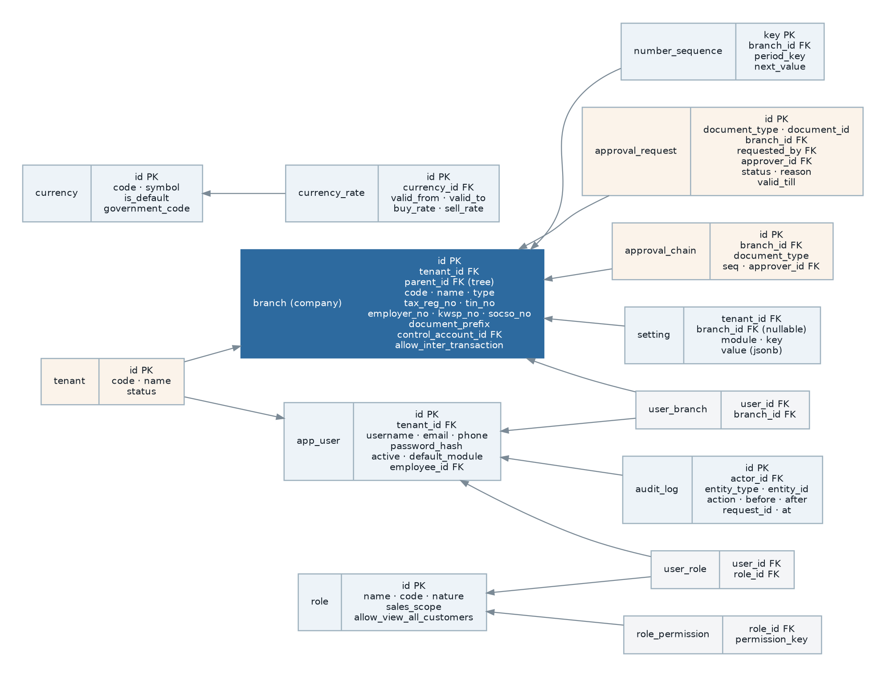

*Figure 7 — Platform and identity model. The tenant and approval-chain entities are additions; legal entity is separated from branch per section 7.6.*

| **Change from legacy**             | **Reason**                                                                                                       |
|------------------------------------|------------------------------------------------------------------------------------------------------------------|
| tenant added                       | Tenancy seam (section 7.5, ADR-05).                                                                              |
| legal_entity separated from branch | Statutory identity belongs to a company, not a location (SRS FR-PLT-004).                                        |
| user_role many-to-many             | The legacy model allows one role per user, forcing combinatorial roles (SRS FR-SEC-002).                         |
| approval_chain per document type   | The legacy chain is per branch only, so all sales documents share one chain (SRS FR-SEC-050).                    |
| number_sequence with period key    | Makes monthly and yearly reset explicit rather than derived, and allocation atomic (SRS BR-NUM-002, FR-PLT-012). |
| setting with explicit scope        | Resolves the ambiguity in the legacy global-with-embedded-branch model (SRS OQ-012).                             |
| audit_log with correlation id      | Groups every change made by one request (SRS NFR-AUD-001).                                                       |

**8.3 Master data**

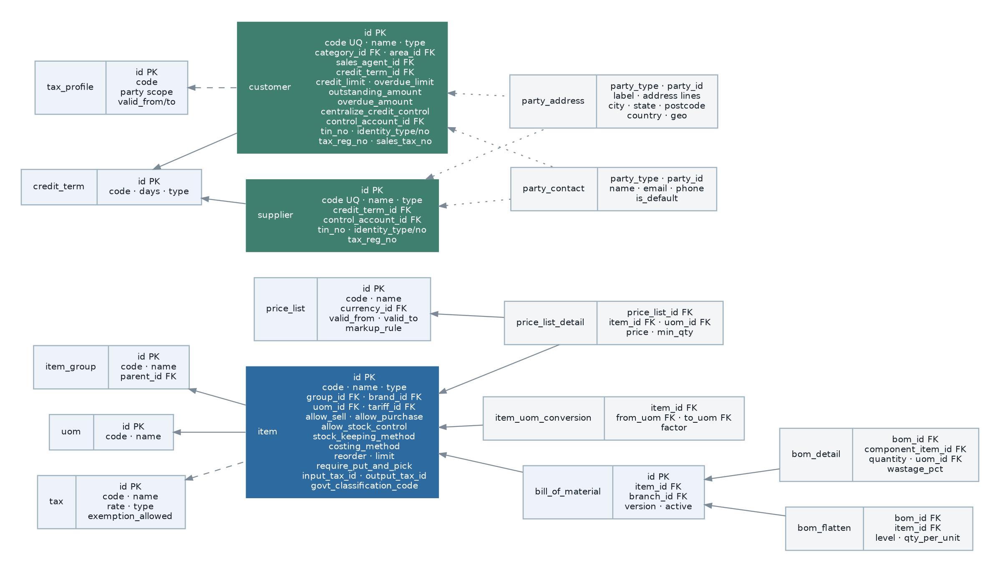

*Figure 8 — Master data model.*

| **Design note**                   | **Detail**                                                                                                                                                                                                               |
|-----------------------------------|--------------------------------------------------------------------------------------------------------------------------------------------------------------------------------------------------------------------------|
| Party address and contact unified | The legacy schema has parallel customer_address and supplier_address tables with identical structure. One party_address table with a party type discriminator removes the duplication and the risk of the two diverging. |
| Item quantity summaries           | on_hand, available, ordered, reserved and in_production are maintained as a projection refreshed from stock events, not as columns updated by application code (SRS FR-MST-009).                                         |
| BoM flattening                    | A materialised projection with an explicit rebuild trigger, preserving the legacy pre-flattening for planning speed while making staleness impossible to ignore.                                                         |
| Price resolution                  | Price list detail carries min_qty for quantity breaks. Resolution order is a documented, tested domain service (SRS BR-PRC-001).                                                                                         |
| Tax effective dating              | tax carries valid_from and valid_to. The legacy table does not, which makes historical recomputation wrong (SRS BR-TAX-006).                                                                                             |
| Party code uniqueness             | Scoped to (tenant_id, code) by default, with per-branch scoping available by configuration, resolving the latent contradiction in the legacy model (SRS OQ-049).                                                         |

**8.4 Sales and purchasing**

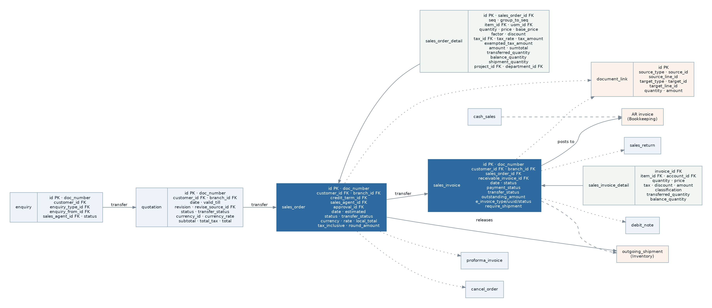

*Figure 9 — Sales model. Purchasing is structurally identical with supplier substituted for customer.*

Both modules are generated from the document definition pattern (section 5.5.2), so their tables are structurally uniform. The transfer chain is expressed through platform.document_link rather than through nullable foreign keys on each document, which is why one recursive query serves the transfer overview for every document type.

**8.5 Inventory**

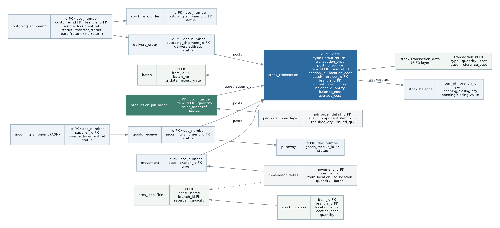

*Figure 10 — Inventory model. The stock transaction ledger is the single source of truth for quantity and value.*

| **Design note**             | **Detail**                                                                                                                                                                                                                                         |
|-----------------------------|----------------------------------------------------------------------------------------------------------------------------------------------------------------------------------------------------------------------------------------------------|
| Ledger is authoritative     | stock_location and the item quantity summaries are projections of the ledger, rebuildable at any time. The ledger itself is append-only and partitioned by month.                                                                                  |
| FIFO layers                 | Held as child rows of the transaction that created them, carrying quantity, unit cost, acquisition date and, for returns, the reference date of the original issue — preserving the legacy model, which is correct and unusually well thought out. |
| Running balances on the row | balance_quantity, balance_cost and average_cost are stored per transaction so a point-in-time balance is a lookup. Preserved from the legacy design.                                                                                               |
| Goods in transit            | An explicit state for inter-branch transfer, subject to SRS OQ-028. Modelled now so that enabling it later is configuration rather than migration.                                                                                                 |
| Reservation                 | A first-class entity with its own lifecycle, and availability is computed as on-hand minus reservations minus allocations, resolving SRS OQ-027 in the design.                                                                                     |

**8.6 Finance**

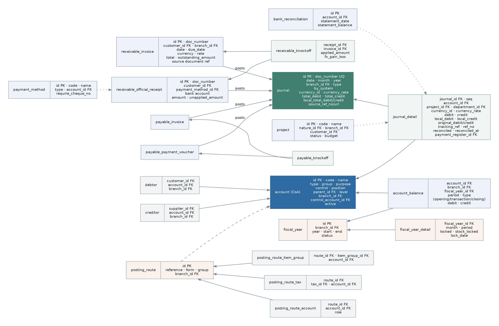

*Figure 11 — Finance model — chart of accounts, journals, sub-ledgers, settlement and posting routes.*

| **Design note**          | **Detail**                                                                                                                                                                                                                               |
|--------------------------|------------------------------------------------------------------------------------------------------------------------------------------------------------------------------------------------------------------------------------------|
| Journal is one aggregate | Header and all lines are saved together, so the balanced invariant is enforced inside the transaction rather than by a later check.                                                                                                      |
| Settlement is generic    | One settlement table covers receipts against invoices, payments against bills, credit and debit note application, deposit application and contra, parameterised by direction. The legacy system has six near-identical knock-off tables. |
| Posting route resolution | The ordered chain is data, held as route rows with an explicit precedence column, and validated for completeness at start-up (SRS FR-FIN-056).                                                                                           |
| Fiscal period locks      | Two independent boolean locks per period, plus a lock date, plus named exceptions — preserving the legacy model, which is sound, with the addition that a locked period’s partition is set read-only.                                    |
| Unrealised FX            | A revaluation run entity with a reversing entry in the following period, closing SRS OQ-016.                                                                                                                                             |

**8.7 Payroll**

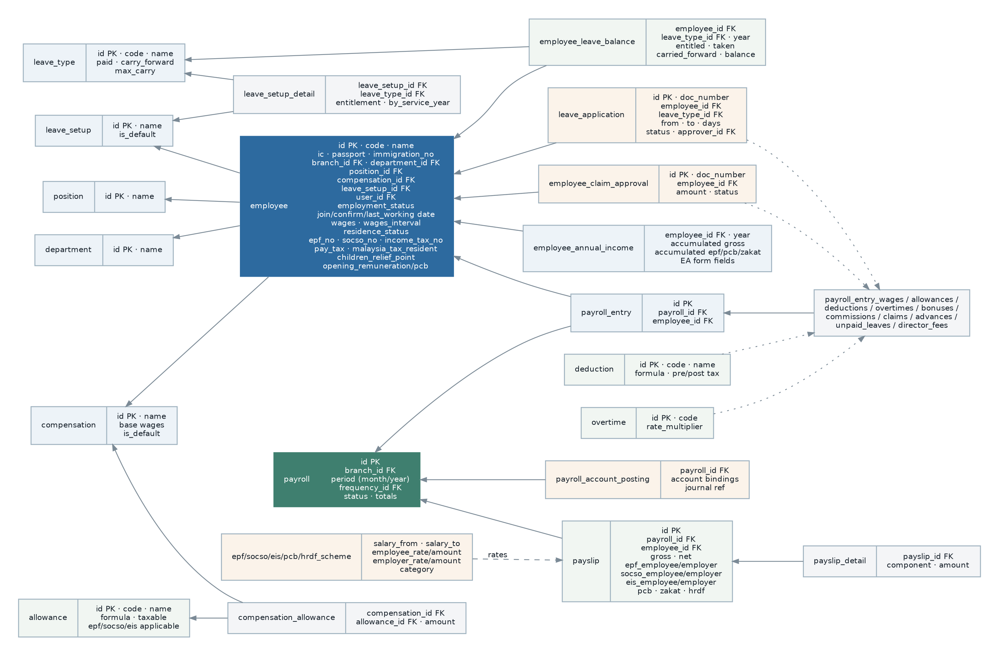

*Figure 12 — Payroll model, including the effective-dated statutory scheme tables.*

| **Design note**                     | **Detail**                                                                                                                                                                                                                                                                                                           |
|-------------------------------------|----------------------------------------------------------------------------------------------------------------------------------------------------------------------------------------------------------------------------------------------------------------------------------------------------------------------|
| Effective-dated schemes             | Every statutory table carries valid_from and valid_to and is never replaced in place. This is the single most important correction in the module (SRS FR-PAY-040).                                                                                                                                                   |
| Payroll entry categories            | The legacy model has ten parallel tables for wages, allowances, deductions, overtime, bonuses, commissions, claims, advances, unpaid leave and director fees. These become one payroll_entry_component table with a component type, which removes 900 lines of near-duplicate handling while preserving every field. |
| Payslip is immutable after approval | Enforced by state, and the run partition is read-only thereafter.                                                                                                                                                                                                                                                    |
| Personal data classification        | Identity number, passport, immigration number and bank account are marked sensitive in the schema metadata, which drives masking, audit-on-reveal and export suppression (SRS FR-SEC-042).                                                                                                                           |
| Leave balance is derived and stored | Computed from entitlement, taken and carry-forward, recomputable on demand, with the recomputation producing an assertion rather than a silent repair.                                                                                                                                                               |

**8.8 Document numbering design**

Numbering must reproduce the legacy token grammar exactly (SRS CON-08, BR-NUM-001) while being atomic and gap-controlled (SRS FR-PLT-012).

<table>
<colgroup>
<col style="width: 100%" />
</colgroup>
<tbody>
<tr class="odd">
<td>
CREATE TABLE platform.number_sequence (

tenant_id uuid NOT NULL,

branch_id uuid NOT NULL,

sequence_key text NOT NULL, -- e.g. "sales_order"

period_key text NOT NULL, -- "" | "2026" | "2026-09"

next_value bigint NOT NULL DEFAULT 1,

PRIMARY KEY (tenant_id, branch_id, sequence_key, period_key)

);

-- Allocation is a single atomic statement. No read-then-write race,

-- and no application-level lock.

INSERT INTO platform.number_sequence AS s

(tenant_id, branch_id, sequence_key, period_key, next_value)

VALUES ($1, $2, $3, $4, 2)

ON CONFLICT (tenant_id, branch_id, sequence_key, period_key)

DO UPDATE SET next_value = s.next_value + 1

RETURNING next_value - 1 AS allocated;
</td>
</tr>
</tbody>
</table>

| **Token** | **Meaning**                                                                       | **Example**                                             |
|-----------|-----------------------------------------------------------------------------------|---------------------------------------------------------|
| {B}       | One character from the branch document prefix, left to right, per token instance. | \[object Object\] with prefix "SGC1" → "SG"             |
| {Y}       | One digit of the year, right to left, per instance.                               | \[object Object\] in 2026 → "26"                        |
| {M}       | Month, zero-padded to the token width.                                            | \[object Object\] in September → "09"                   |
| {0}       | Running number, zero-padded to the token width.                                   | \[object Object\] → "00042"                             |
| {A}       | Characters from an alphabetic source such as a party name.                        | \[object Object\] for "Acme Trading" → "ACME"           |
| {N}       | A numeric source supplied by the caller.                                          | Used in employee and party codes.                       |
| literal   | Any other character is emitted as written.                                        | \[object Object\], \[object Object\], \[object Object\] |

| **Design point**         | **Detail**                                                                                                                                                                                                                                                                                                                                                         |
|--------------------------|--------------------------------------------------------------------------------------------------------------------------------------------------------------------------------------------------------------------------------------------------------------------------------------------------------------------------------------------------------------------|
| Allocation timing        | On release, not on draft creation. A draft that is abandoned therefore consumes no number, which is what makes gap-free sequences achievable. The user interface shows "(assigned on release)" until then. This depends on SRS OQ-014 and OQ-045; if the business requires the number visible during entry, allocation moves to creation and gaps become possible. |
| Reset policy             | The period key is computed from the policy — empty for never, the year for yearly, year and month for monthly — so a reset is a new row rather than a mutation.                                                                                                                                                                                                    |
| Concurrency              | The single upsert above is atomic under any isolation level, which closes the concurrency question in SRS FR-PLT-012.                                                                                                                                                                                                                                              |
| Editing                  | Permitted only where the setting and the permission allow it, uniqueness is still enforced by the database constraint, and the edit is audited (SRS FR-PLT-013).                                                                                                                                                                                                   |
| Separate system sequence | System-generated posting journals use their own sequence and format so that they are distinguishable from manual journals by number alone (SRS BR-NUM-007).                                                                                                                                                                                                        |

**9. API Architecture**

**9.1 Style**

A resource-oriented HTTP API with JSON payloads, described by OpenAPI 3.1 generated from the code. Command-style sub-resources are used for operations that are not CRUD, because most of what this system does is not CRUD (SRS INT-011).

| **Decision**           | **Rationale**                                                                                                                                                                                                                                                                                                                      |
|------------------------|------------------------------------------------------------------------------------------------------------------------------------------------------------------------------------------------------------------------------------------------------------------------------------------------------------------------------------|
| REST over GraphQL      | The dominant operations are commands — release, revise, cancel, transfer, approve, post — which map poorly onto a graph query language, and which need per-operation authorisation, idempotency and rate limiting. A read-only GraphQL façade may be added later for flexible reporting; it is not the primary interface (ADR-17). |
| Generated OpenAPI      | The specification is derived from the same Zod schemas that validate requests, so documentation cannot drift from behaviour (SRS NFR-MNT-006).                                                                                                                                                                                     |
| One API for everything | The web client, the future mobile client and partner integrations use the same API. There is no privileged internal interface, which is what keeps the API honest and complete.                                                                                                                                                    |

**9.2 Resource and operation model**

<table>
<colgroup>
<col style="width: 100%" />
</colgroup>
<tbody>
<tr class="odd">
<td>
# Collections and records — plural nouns, uuid identifiers

GET /api/v1/sales/orders?status=released&amp;cursor=…&amp;limit=50

POST /api/v1/sales/orders

GET /api/v1/sales/orders/{id}

PATCH /api/v1/sales/orders/{id} # If-Match required

DELETE /api/v1/sales/orders/{id} # drafts only

# Commands — a sub-resource, POST, named for the business operation

POST /api/v1/sales/orders/{id}/release

POST /api/v1/sales/orders/{id}/release-shipment

POST /api/v1/sales/orders/{id}/revise

POST /api/v1/sales/orders/{id}/cancel # { reason }

POST /api/v1/sales/orders/{id}/transfer # { targetType, lines[] }

# Bulk commands — one request, per-item outcomes

POST /api/v1/sales/orders/bulk/release # { ids[] }

# Projections and related data

GET /api/v1/sales/orders/{id}/transfer-overview

GET /api/v1/sales/orders/{id}/audit

GET /api/v1/sales/orders/{id}/attachments

# Documents and reports

POST /api/v1/reports/{code}/render # → job id

GET /api/v1/reports/jobs/{jobId} # status + download url

# Metadata — what drives the generic frontend (section 14.3)

GET /api/v1/meta/documents/SALES_ORDER # grid + form descriptors

GET /api/v1/meta/permissions # effective permissions

GET /api/v1/meta/settings/sales # resolved settings
</td>
</tr>
</tbody>
</table>

| **Rule**                           | **Detail**                                                                                                                                       |
|------------------------------------|--------------------------------------------------------------------------------------------------------------------------------------------------|
| Module prefix in the path          | Makes ownership visible in logs and access rules, and allows per-module rate limits.                                                             |
| Commands are POST sub-resources    | Not PATCH with a status field. "Release" has preconditions, side effects and its own permission; modelling it as a field update hides all three. |
| No verbs on collections            | Except under an explicit /bulk/ segment, so a bulk operation is never mistaken for a single one.                                                 |
| Metadata endpoints are first-class | The generic grid and form renderers depend on them, so they are versioned and tested like any other endpoint.                                    |

**9.3 Versioning**

- Major version in the path (/api/v1). A breaking change means /api/v2, and the previous version is supported for a published period.

- Additive changes — new optional fields, new endpoints, new enum values in a response — are not breaking and ship within the current version. Clients must tolerate unknown fields, and this is stated in the API documentation.

- Contract events carry their own version number so that a consumer can handle more than one shape during a rollout.

- The OpenAPI document is published per version, and a pipeline step diffs it against the previous build and fails on an unannounced breaking change.

**9.4 Envelope, pagination, filtering and sorting**

<table>
<colgroup>
<col style="width: 100%" />
</colgroup>
<tbody>
<tr class="odd">
<td>
// Single record

{ "data": { "id": "018f…", "documentNumber": "SGC/S-SO00042",

"total": "12500.0000", "currencyCode": "MYR", "version": 3 },

"meta": { "requestId": "c1a…" } }

// Collection — keyset pagination, never offset

{ "data": [ … ],

"page": { "cursor": "eyJkIjoi…", "hasMore": true, "limit": 50 },

"meta": { "requestId": "c1a…", "totalEstimate": 1284 } }

// Error — every failure, same shape

{ "error": { "code": "BUSINESS_RULE_VIOLATION",

"ruleId": "BR-CRED-002",

"message": "Customer has exceeded the overdue limit",

"details": [ { "field": "customerId",

"message": "Overdue 45,200.00 exceeds limit 20,000.00" } ] },

"meta": { "requestId": "c1a…" } }
</td>
</tr>
</tbody>
</table>

| **Concern**     | **Design**                                                                                                                                                                                                                  |
|-----------------|-----------------------------------------------------------------------------------------------------------------------------------------------------------------------------------------------------------------------------|
| Money in JSON   | Always a decimal string, never a JSON number. A JSON number is a double in most parsers and would silently lose precision on a large amount. Every client library is expected to parse it as a decimal.                     |
| Pagination      | Keyset cursors over an ordered key. Stable under concurrent insert and constant-time at any depth, unlike offset pagination which degrades and duplicates.                                                                  |
| Total count     | Returned as an estimate by default, because an exact count over a large filtered set is expensive. An exact count is available on explicit request.                                                                         |
| Filtering       | A declared filter set per resource — the same descriptors the frontend uses to render the filter bar. Arbitrary client-supplied predicates are not accepted, which removes a whole class of injection and performance risk. |
| Sorting         | Declared sortable fields only, each backed by an index.                                                                                                                                                                     |
| Field selection | An optional fields parameter limiting the projection, used by the grid to fetch only visible columns — which is how the legacy data adapter works, and it is worth keeping.                                                 |
| Expansion       | An explicit expand parameter for related data, with a whitelist and a depth limit, so a client cannot compose an expensive query by accident.                                                                               |

**9.5 Idempotency and concurrency**

| **Mechanism**          | **Design**                                                                                                                                                                                                                                                                                                                                   |
|------------------------|----------------------------------------------------------------------------------------------------------------------------------------------------------------------------------------------------------------------------------------------------------------------------------------------------------------------------------------------|
| Idempotency-Key header | Required on every POST that creates or commands. The key, the request fingerprint and the response are recorded; a repeat with the same key returns the stored response, and the same key with a different payload returns 409. This makes a retried release safe, which matters because a warehouse tablet on poor connectivity will retry. |
| ETag and If-Match      | Every record response carries its version as an ETag. PATCH and command endpoints require If-Match and return 409 on mismatch, so a stale client cannot overwrite another user’s edit (SRS NFR-REL-007).                                                                                                                                     |
| Retry guidance         | Every error response states whether the operation is retryable, so clients need not infer it from the status code.                                                                                                                                                                                                                           |

**9.6 Bulk operations**

Bulk release, bulk transfer and bulk import are genuine business operations in the legacy system, and the requirement is that one failure does not abort the batch (SRS BR-STA-005).

<table>
<colgroup>
<col style="width: 100%" />
</colgroup>
<tbody>
<tr class="odd">
<td>
POST /api/v1/sales/orders/bulk/release

{ "ids": ["018f…a1","018f…a2","018f…a3"] }

// 207 Multi-Status — per-item outcome, never a single pass/fail

{ "data": {

"succeeded": 2,

"failed": 1,

"results": [

{ "id": "018f…a1", "status": "ok" },

{ "id": "018f…a2", "status": "ok" },

{ "id": "018f…a3", "status": "error",

"error": { "code": "BUSINESS_RULE_VIOLATION",

"ruleId": "BR-DOC-002",

"message": "Document has already been released" } }

] } }
</td>
</tr>
</tbody>
</table>

- Each item is processed in its own transaction, so one failure cannot roll back the others.

- Above a configured threshold the operation is accepted as a job (202 with a job identifier) and the client polls, so a 5,000-item batch does not hold an HTTP connection.

- The whole batch shares one correlation identifier, so its effects are traceable together in the audit trail and the logs.

**9.7 Webhooks and the event API**

| **Aspect**          | **Design**                                                                                                                                                                                  |
|---------------------|---------------------------------------------------------------------------------------------------------------------------------------------------------------------------------------------|
| Subscription        | A consumer registers a target URL, the event types it wants and an optional filter. Registration is per tenant and requires a permission.                                                   |
| Payload             | The contract event, with its version, a correlation identifier and a resource link rather than the full record — so a webhook cannot become an uncontrolled data-export channel.            |
| Signing             | HMAC-SHA256 over the raw body with a per-subscription secret, in a signature header with a timestamp to prevent replay.                                                                     |
| Delivery            | At-least-once, with exponential backoff, a delivery log, and automatic suspension of a target that fails persistently. Consumers are told to be idempotent.                                 |
| Replay              | A subscriber may request redelivery for a time range, under permission — which removes the most common integration support request.                                                         |
| Legacy relationship | The legacy system has webhook target configuration and a shared secret in settings but no event emission (SRS INT-012). This design completes it and moves the secrets to the secret store. |

**9.8 Rate limiting, quotas and documentation**

- Per-identity token-bucket limits in Redis, with separate buckets for authentication, ordinary reads, writes, exports and report rendering — because an export is a thousand times more expensive than a read and should not share its budget.

- Limits are returned in response headers so a client can pace itself rather than discovering the limit by failing.

- Interactive users get generous limits; service accounts get contractual limits per integration.

- The OpenAPI document is published with the release, and a typed client is generated from it for the web application so that a backend change that breaks a client fails at compile time.

**10. Authentication and Authorisation**

**10.1 Identity model**

| **Principal**           | **Authenticates by**                                                                    | **Characteristics**                                                                                                                    |
|-------------------------|-----------------------------------------------------------------------------------------|----------------------------------------------------------------------------------------------------------------------------------------|
| Internal user           | Username or email and password, with optional multi-factor authentication.              | Holds roles, a branch set and one active branch. Interactive session with short-lived access tokens.                                   |
| Employee (self-service) | The same credentials, linked to an employee record.                                     | Scoped to their own employee data by the data-access layer, not by permission alone (SRS FR-ESS-001).                                  |
| Service account         | Client credentials, or a signed API key exchanged for a token.                          | No interactive session, no password reset, its own permission set, and distinguishable in every log and audit record (SRS FR-SEC-016). |
| Portal user (customer)  | Separate credential store in the client-portal module.                                  | Cannot authenticate against the internal API at all. A portal compromise does not yield internal access (SRS FR-CPT-004).              |
| System context          | Not authenticated; constructed internally for migrations, scheduled jobs and consumers. | The only principal that may bypass branch scope, and every such action is audited as a system action with its correlation identifier.  |

**10.2 Authentication design**

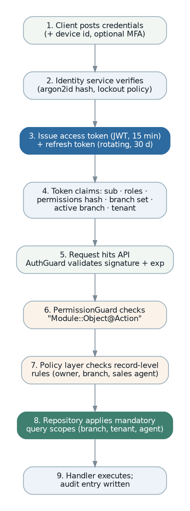

*Figure 13 — Authentication and the three-stage authorisation pipeline.*

| **Element**                   | **Design**                                                                                                                                                                                                                                   |
|-------------------------------|----------------------------------------------------------------------------------------------------------------------------------------------------------------------------------------------------------------------------------------------|
| Password storage              | argon2id with per-user salt and tuned parameters. Never a fast hash.                                                                                                                                                                         |
| Password policy               | Configurable minimum length, a breached-password check against a local list, and no forced rotation — rotation drives users to weaker passwords and is no longer recommended practice.                                                       |
| Lockout                       | Progressive delay then temporary lock after a configurable number of failures, keyed on both account and source address so that a single account cannot be locked out by an attacker at will (SRS FR-SEC-062).                               |
| Multi-factor                  | TOTP, enforceable per role. Mandatory for roles holding financial, payroll or administrative authority (SRS FR-SEC-061).                                                                                                                     |
| Access token                  | A JWT valid for fifteen minutes, carrying subject, tenant, role identifiers, a permission-set hash, the visible branch set and the active branch. Signed with a rotating key set published at a JWKS endpoint.                               |
| Refresh token                 | Opaque, stored hashed, valid for thirty days, single-use with rotation and reuse detection. Reuse of a rotated token invalidates the whole family and raises a security event.                                                               |
| Permission-set hash           | The token carries a hash of the effective permission set rather than the set itself. A role change invalidates the hash, so the next request re-resolves permissions — permissions revoke within one request rather than one token lifetime. |
| Session and device management | A user can list and revoke their own active sessions and registered devices; an administrator can revoke any (SRS FR-SEC-065).                                                                                                               |
| Branch switching              | Re-issues the access token with the new active branch. The branch cannot be spoofed by a header, which the legacy system permits through an override header.                                                                                 |
| Federation                    | The issuer is OIDC-compatible, so an external identity provider can be introduced later without changing the resource server (SRS FR-SEC-067).                                                                                               |

**10.3 Authorisation model**

Three independent stages, all of which must pass. This is the design that answers the legacy defect where a duplicated map key silently removed a permission check (SRS WK-01, FR-SEC-008).

| **Stage**               | **Question answered**                                                                 | **Implementation**                                                                                                                                               |
|-------------------------|---------------------------------------------------------------------------------------|------------------------------------------------------------------------------------------------------------------------------------------------------------------|
| 1 Permission guard      | Does this principal hold the permission this operation requires?                      | A guard reading the permission declared on the application-service handler. Route-level, before any business code runs.                                          |
| 2 Policy                | Is this principal allowed to do this to this particular record, in its current state? | A policy class per aggregate, invoked by the handler. Covers ownership, agent assignment, document state and segregation of duties.                              |
| 3 Mandatory query scope | Which records may this principal see at all?                                          | Predicates applied inside the repository base class — tenant, branch, and registered scope providers. Not optional and not the caller’s responsibility (DCN-03). |

<table>
<colgroup>
<col style="width: 100%" />
</colgroup>
<tbody>
<tr class="odd">
<td>
// Permissions are declared once, in a typed registry per module.

// The registry is the single source of truth for the catalogue, the guard

// and the role editor, which is why a binding cannot be lost.

export const salesPermissions = definePermissions("Sales", {

"Sales Order": [

"Index", "Create", "Show", "Edit Record", "Delete Record",

"Print Record", "Release Record", "Release Shipment", "Cancel Record",

],

"Invoice": [ /* … */ ],

});

// A handler binds to exactly one key. The key must exist in the registry,

// so a typo is a compile error.

@RequiresPermission(salesPermissions.SalesOrder.ReleaseRecord)

async execute(cmd: ReleaseSalesOrderCommand, ctx: RequestContext) { … }

// Start-up assertion: every registered command handler must carry exactly

// one permission binding. An unbound or doubly-bound handler halts boot

// rather than shipping an unguarded operation.

assertEveryHandlerHasExactlyOnePermission();
</td>
</tr>
</tbody>
</table>

**10.3.1 Data scopes**

| **Scope**               | **Predicate**                                                                                                                         | **Applies to**                                                                                                                                                                                |
|-------------------------|---------------------------------------------------------------------------------------------------------------------------------------|-----------------------------------------------------------------------------------------------------------------------------------------------------------------------------------------------|
| Tenant                  | tenant_id = context tenant.                                                                                                           | Every business table, unconditionally.                                                                                                                                                        |
| Branch                  | branch_id IN context visible branches.                                                                                                | Every branch-scoped entity. The visible set is the user’s assigned branches, optionally narrowed to the active branch.                                                                        |
| Sales agent             | Customer’s primary or secondary agent equals the user’s agent identity, for customers and for documents belonging to those customers. | Registered by the sales module as a scope provider. Two independent role switches control customer visibility and document visibility, preserving the legacy behaviour (SRS FR-SEC-030, 031). |
| Own employee record     | employee_id = the employee linked to the authenticated user.                                                                          | Self-service. Enforced in the repository, so a crafted identifier in a URL returns 404 rather than another employee’s payslip.                                                                |
| Visible to all branches | A record-level override flag that exempts a specific customer from branch scope.                                                      | Preserved from the legacy model (SRS FR-SEC-033).                                                                                                                                             |

**One deliberate design choice worth stating.** A record outside the caller’s data scope returns 404, never 403. Returning 403 would confirm that a record with that identifier exists, which leaks information about another branch’s or another agent’s data.

**10.4 Verification of the authorisation model**

Access control is the area where a defect is least visible and most damaging, so it is verified mechanically rather than by review.

- A start-up assertion that every command and query handler carries exactly one permission binding, and that every binding exists in the registry.

- A generated test that enumerates every endpoint and asserts that an unauthenticated request receives 401 and an authenticated request without the permission receives 403 — no endpoint can be added without this coverage.

- A generated test per branch-scoped entity that a user in branch A cannot read, update or delete a record in branch B through the list endpoint, the record endpoint, any command endpoint, any report, or any export (SRS FR-SEC-032, OQ-009).

- A test that the self-service endpoints return 404 for another employee’s records.

- A test that every report returns no rows outside the caller’s scope for every parameter combination in its declared parameter set (SRS RPT-020).

**10.5 Approval authority and segregation of duties**

| **Requirement**                             | **Design**                                                                                                                                                                                                           |
|---------------------------------------------|----------------------------------------------------------------------------------------------------------------------------------------------------------------------------------------------------------------------|
| Chains per document type and branch         | An approval definition keyed on document type, branch and condition, with an ordered list of approver roles or users (SRS FR-SEC-050).                                                                               |
| No self-approval                            | The policy layer refuses a decision by the document’s creator unless the role explicitly permits it, and the exception is recorded as a security event (SRS FR-SEC-054).                                             |
| Delegation                                  | A delegation record with a validity window; the approval engine resolves the effective approver through it, and both the delegate and the original authority appear in the audit trail (SRS FR-SEC-053).             |
| Escalation                                  | The validity expiry on an approval request is acted upon: a scheduled job escalates to the next authority and notifies, rather than leaving the request silently pending as the legacy system does (SRS FR-SEC-055). |
| Immutability                                | Decisions are append-only. A reversal is a new decision record referencing the original (SRS FR-SEC-057, subject to OQ-011).                                                                                         |
| Preparer and approver separation in payroll | Enforced as a policy rule, not a convention (SRS FR-PAY-042).                                                                                                                                                        |

**11. Security Architecture**

**11.1 Threat model**

The threats below are those specific to this system. Generic web threats are covered by the controls in section 11.2.

| **Threat**                                   | **Impact**                                                                                         | **Primary control**                                                                                                                                                                                    |
|----------------------------------------------|----------------------------------------------------------------------------------------------------|--------------------------------------------------------------------------------------------------------------------------------------------------------------------------------------------------------|
| Cross-branch or cross-tenant data access     | One legal entity sees another’s trading data; in a shared deployment, one customer sees another’s. | Mandatory query scope in the repository layer, verified by generated tests, and row-level security in the database where tenancy option C is adopted (sections 7.5, 10.3).                             |
| Payroll and personal data exposure           | Salaries, identity numbers and bank details disclosed. A PDPA breach.                              | Module-level permission separation, field-level sensitivity classification, masking by default, audit on reveal, and exclusion from cross-module search and general reporting (SRS FR-SEC-040 to 042). |
| Unauthorised financial posting or alteration | Fraudulent or erroneous ledger entries.                                                            | Permission plus policy plus period lock; system journals not manually editable; append-only journal lines; read-only partitions for locked periods; full audit.                                        |
| Approval circumvention                       | A document released despite a credit or value breach.                                              | The release path checks approval state inside the aggregate, not in the controller; no self-approval; every override audited and reportable.                                                           |
| Privilege escalation through role editing    | A user grants themselves authority.                                                                | Role management is itself permission-controlled, changes are audited, and a user cannot grant a permission they do not hold.                                                                           |
| Stored file disclosure                       | An attached document retrieved by anyone holding its URL.                                          | Files are never publicly addressable. Access is authorised against the record the file is attached to, and download links are short-lived and signed (SRS FR-DOC-003, OQ-040).                         |
| Malicious upload                             | Stored malware distributed to other users.                                                         | Type and size validation, content-type sniffing, antivirus scan before availability, storage outside any web root, and no execution path (SRS FR-DOC-004).                                             |
| Ad-hoc query abuse                           | The saved-query facility used to read data the user should not see, or to overload the database.   | Queries run as a restricted read-only role against the replica, with a statement timeout, a row cap, mandatory scope injection, and a permission that is not granted by default (SRS RPT-014, OQ-041). |
| Integration credential theft                 | An attacker obtains the statutory platform or banking credentials.                                 | All secrets in a secret store, never in the settings table, never logged, and scoped per legal entity (SRS NFR-SEC-004, INT-015).                                                                      |
| Report or export exfiltration                | Bulk data removed under a legitimate account.                                                      | Export is a distinct permission, every export is audited with its parameters and row count, and exports are separately rate-limited (SRS NFR-SEC-012).                                                 |
| Supply-chain compromise                      | A malicious dependency reaches production.                                                         | Pinned versions, vulnerability scanning on every build, a generated software bill of materials, signed images, and zero direct dependencies in the domain layer.                                       |

**11.2 Controls by layer**

| **Layer**     | **Controls**                                                                                                                                                                                                                                                     |
|---------------|------------------------------------------------------------------------------------------------------------------------------------------------------------------------------------------------------------------------------------------------------------------|
| Network       | TLS 1.2 or later everywhere, with plain HTTP refused rather than redirected on API endpoints. Application and data tiers in private subnets. The database reachable only from application and worker tiers. Outbound egress restricted to declared destinations. |
| Edge          | Web application firewall, per-identity rate limiting, request size limits, and strict security headers including a content security policy without unsafe-inline.                                                                                                |
| Application   | Schema validation of every input, parameterised queries only, output encoding, CSRF protection for cookie-based flows, no dynamic query construction from user input, and typed errors that never leak internal detail.                                          |
| Authorisation | The three-stage pipeline of section 10.3, with the mandatory scope inside the repository so a forgotten check cannot expose data.                                                                                                                                |
| Data          | Encryption at rest at the storage layer; field-level protection for personal identifiers and bank details; masking by default; append-only audit; read-only partitions for locked periods.                                                                       |
| Secrets       | A secret store with short-lived credentials where available, rotation procedures, and no secret in the database, in committed configuration or in a log.                                                                                                         |
| Operations    | Least-privilege database roles per runtime role; no shared administrative accounts; break-glass access time-limited and audited; production data never used unmasked in a lower environment (SRS NFR-SEC-013).                                                   |
| Build         | Static analysis, dependency scanning, secret scanning, container image scanning and image signing, all as pipeline gates rather than advisory steps.                                                                                                             |

**11.3 Data protection and personal data**

| **Class**                      | **Examples**                                                                                                               | **Treatment**                                                                                                                                                                                    |
|--------------------------------|----------------------------------------------------------------------------------------------------------------------------|--------------------------------------------------------------------------------------------------------------------------------------------------------------------------------------------------|
| Highly sensitive               | National identity number, passport number, immigration and permit numbers, bank account number, salary and payslip detail. | Field-level protection; masked in every list, export and log; revealed only by an explicit action that is audited; excluded from cross-module search; excluded from non-production environments. |
| Sensitive                      | Employee contact details, dependants, leave and claim records, customer credit position, margin and cost data.             | Permission-gated; masked in exports where not required; audited on access where the business requires it.                                                                                        |
| Business confidential          | Prices, terms, documents, ledger balances.                                                                                 | Standard permission and scope controls; audited on change.                                                                                                                                       |
| Public within the organisation | Item catalogue, unit definitions, document type reference data.                                                            | Standard controls.                                                                                                                                                                               |

**PDPA alignment (SRS NFR-AUD-005).** Purpose is recorded per data class; retention is configured per class and enforced by the archiving design in section 19; a subject access request is served by an export scoped to one employee or party; and a defensible erasure process removes personal data where no statutory retention obligation overrides it, leaving the transaction record intact but de-identified. The erasure design must be reviewed with legal before implementation.

**11.4 Audit trail design**

<table>
<colgroup>
<col style="width: 100%" />
</colgroup>
<tbody>
<tr class="odd">
<td>
CREATE TABLE audit.audit_log (

id bigserial,

tenant_id uuid NOT NULL,

occurred_at timestamptz NOT NULL DEFAULT now(),

actor_type text NOT NULL, -- user | service | system

actor_id uuid,

actor_label text NOT NULL, -- retained even if the user is deleted

correlation_id uuid NOT NULL, -- groups one request's changes

causation_id uuid, -- the event that caused this change

entity_schema text NOT NULL,

entity_table text NOT NULL,

entity_id text NOT NULL,

action text NOT NULL, -- insert | update | delete | command

command text, -- e.g. "release", "cancel"

before jsonb, -- sensitive fields already masked

after jsonb,

PRIMARY KEY (id, occurred_at)

) PARTITION BY RANGE (occurred_at);

-- The application role can insert and select. It cannot update or delete.

REVOKE UPDATE, DELETE ON audit.audit_log FROM app_role;
</td>
</tr>
</tbody>
</table>

| **Design point**                    | **Reason**                                                                                                                                                              |
|-------------------------------------|-------------------------------------------------------------------------------------------------------------------------------------------------------------------------|
| Written by a persistence subscriber | Coverage is automatic for every entity rather than per-entity opt-in, which is how the legacy system ends up with uneven coverage (DCN-09).                             |
| Correlation identifier              | One request often changes a document, its lines, a balance and a link. Grouping them makes the trail readable rather than a stream of unrelated rows (SRS NFR-AUD-001). |
| Causation identifier                | Distinguishes "the user did this" from "this happened because the user did something else", which is essential once posting is asynchronous.                            |
| Actor label retained                | The trail remains meaningful after a user is deactivated or renamed.                                                                                                    |
| Sensitive fields masked at write    | The audit trail must not become the place where masked data is readable.                                                                                                |
| Append-only by grant                | Immutability is a database guarantee, not an application promise (SRS NFR-AUD-002, OQ-015).                                                                             |
| Partitioned with tiered retention   | The largest table by row count. Old partitions are summarised then archived (SRS DR-028).                                                                               |

**Separate security event log.** Sign-in, sign-in failure, lockout, permission change, role change, sensitive-field reveal, export, credential change, approval override and period-lock exception are written to a separate security log with its own retention of at least one year and its own access control, so that a security review does not require access to business data (SRS NFR-SEC-012).

**11.5 Security in the delivery process**

- Threat modelling at the start of each phase, revisited when a new external interface is added.

- Static analysis and dependency, secret and container scanning as blocking pipeline gates.

- A security review of every change touching authentication, authorisation, the scope layer, file handling or an integration credential.

- Penetration testing before each major release, with findings tracked to closure.

- An incident response procedure that is rehearsed, including credential rotation and customer notification obligations under PDPA.

**12. Integration Architecture**

**12.1 Patterns**

| **Pattern**                    | **Used for**                                                                                  | **Design rules**                                                                                                                           |
|--------------------------------|-----------------------------------------------------------------------------------------------|--------------------------------------------------------------------------------------------------------------------------------------------|
| Outbound adapter behind a port | Statutory platform, mail, push, bank files, statutory table feeds.                            | The domain declares the port; the adapter is infrastructure. The domain never knows the protocol, and the adapter can be stubbed in tests. |
| Queued outbound call           | Every external call with a business consequence.                                              | Never inside a request. Enqueued after commit, retried with backoff, dead-lettered with an alert, idempotent by construction.              |
| Anti-corruption layer          | Any external model that differs from the domain — the statutory invoice format in particular. | Translation lives in the adapter. No external field name, code list or quirk leaks into the domain.                                        |
| Inbound webhook                | Validation callbacks and partner notifications.                                               | Signature verified, replay window enforced, payload validated, processed asynchronously, idempotent on the external identifier.            |
| File exchange                  | Bank payment files, statutory returns, bulk import.                                           | Format definitions are configuration, not code. Every generated file is archived with a checksum.                                          |
| Jurisdiction rule set          | Tax, statutory payroll, electronic invoicing.                                                 | One package per jurisdiction behind a stable interface, selected by the legal entity’s country (DCN-10).                                   |

**12.2 e-Invoice — the MyInvois adapter**

The most important integration, and the one the legacy system prepared for but never built (SRS section 4.4, FR-EIV-001 to 011, INT-007).

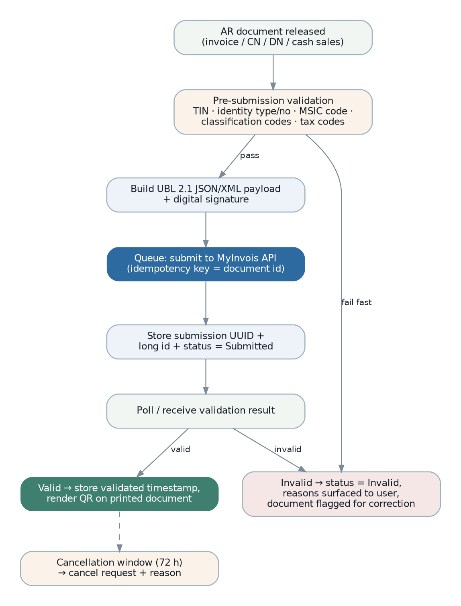

*Figure 14 — e-Invoice submission lifecycle.*

| **Component**            | **Responsibility**                                                                                                                                                                                                                                    |
|--------------------------|-------------------------------------------------------------------------------------------------------------------------------------------------------------------------------------------------------------------------------------------------------|
| EInvoiceEligibility      | Decides from the document, the party and the legal entity whether an e-Invoice is required and which document type applies — including the self-billed and consolidated variants, subject to SRS OQ-030.                                              |
| EInvoiceValidator        | Pre-submission validation of every mandatory element: party TIN, identity type and number, classification code per line, tax code, unit code, currency and rate. Returns every failure at once so a user corrects the document in one pass, not five. |
| EInvoiceMapper           | The anti-corruption layer. Maps the domain document to the statutory payload format, including code-list translation. The only component that knows the external format.                                                                              |
| EInvoiceSigner           | Applies the digital signature, using a key held in the secret store per legal entity.                                                                                                                                                                 |
| MyInvoisClient           | The transport: authentication, submission, status polling, cancellation. Rate-limit aware, with circuit breaking.                                                                                                                                     |
| EInvoiceSubmission       | The aggregate recording state: submitted, valid, invalid, cancelled, with identifiers, timestamps, rejection reasons and the archived payload reference.                                                                                              |
| EInvoiceStatusProjection | A read model exposing e-Invoice state to finance and to the operations dashboard, so anything unsubmitted, rejected or pending is visible without inspecting documents one by one (SRS FR-EIV-010).                                                   |

| **Design decision**                             | **Reasoning**                                                                                                                                                                                                    |
|-------------------------------------------------|------------------------------------------------------------------------------------------------------------------------------------------------------------------------------------------------------------------|
| Validate at master-data entry, not at invoicing | A missing TIN discovered at invoice submission blocks trading. Party tax identity is validated when the party is created or changed, and an invalid party is flagged before it is used (SRS FR-MST-043, DR-058). |
| Submission is queued and idempotent             | The document identifier is the idempotency key, so a retry after a timeout cannot double-submit (SRS FR-EIV-008).                                                                                                |
| Invoicing never blocks on the platform          | A platform outage queues submissions; it does not prevent invoicing. This is an explicit graceful-degradation requirement (SRS NFR-REL-006).                                                                     |
| Payload archived                                | The exact submitted payload and the exact response are archived in object storage, because a statutory dispute is about what was sent, not about what the system would send today.                               |
| Cancellation window tracked                     | The statutory cancellation window is tracked per submission, and the option to cancel disappears from the user interface when it closes, rather than failing at the platform.                                    |
| Structured as an adapter                        | A second jurisdiction is a new adapter package implementing the same ports (SRS FR-EIV-011).                                                                                                                     |

**12.3 Statutory contribution tables**

The legacy implementation fetches EPF, SOCSO, EIS, HRDF and PCB tables from a single vendor endpoint on a daily schedule, deleting all existing rows before inserting the new set. A failed fetch therefore empties the tables, and a successful fetch makes historical recomputation wrong. Both are corrected here (SRS WK-10, INT-006, FR-PAY-040).

6.  Fetch into a staging table. Nothing live is touched.

7.  Validate: expected band count, no gaps or overlaps in the salary ranges, rates within plausible bounds, and a comparison against the current set with a configurable tolerance on change.

8.  If validation fails, keep the current set, raise an alert, and record the failure. The system continues to compute payroll correctly with the existing tables.

9.  If validation passes, insert the new set as a new effective-dated version with valid_from set to its statutory effective date. Nothing is deleted.

10. Computation selects the version in force on the payroll date, so recomputing a prior period reproduces the original result (SRS NFR-AUD-007).

11. The source is a specification the organisation controls — a published file or an official feed — with the option to load a version manually, so that a vendor endpoint is not a single point of failure (SRS OQ-025).

**12.4 Mail, push and file integrations**

| **Integration**       | **Design**                                                                                                                                                                                                                                  |
|-----------------------|---------------------------------------------------------------------------------------------------------------------------------------------------------------------------------------------------------------------------------------------|
| Outbound mail         | A provider-agnostic port with adapters for SMTP and for a transactional mail service. Every message is queued, retried, archived with its delivery outcome, and bounce and complaint feedback flags the party record (SRS FR-MSG-006, 007). |
| Push notification     | A port with a push adapter. Payloads carry a reference only, never personal or financial content, so a notification on a lock screen discloses nothing (SRS NTF-036).                                                                       |
| Bank payment export   | A format registry: each bank format is a declarative definition plus a validation rule set, so adding a bank is configuration. Every generated file is archived with a checksum and a record of who generated it (SRS INT-009, IMP-18).     |
| Bank statement import | Parsers per format, feeding the reconciliation engine with a staging and match-proposal step rather than direct posting (SRS INT-010).                                                                                                      |
| Bulk import           | A generic pipeline — upload, parse, validate, dry-run report, apply — available through the user interface rather than only the command line, with a rejection report and a resumable apply (SRS INT-013).                                  |

**12.5 Inter-company trading, redesigned**

The legacy inter-company mirroring writes directly into the counterparty module’s tables from an event listener, which couples Sales and Purchasing at the data layer (SRS WK-09, BR-ICO-005).

| **Aspect**              | **Design**                                                                                                                                                                                                       |
|-------------------------|------------------------------------------------------------------------------------------------------------------------------------------------------------------------------------------------------------------|
| Trigger                 | A contract event from the source module, consumed by a dedicated inter-company process manager.                                                                                                                  |
| Execution               | The process manager calls the target module’s published command through its port — creating a purchase order exactly as a user would — so every rule, validation and audit entry of the target module applies.   |
| Linkage                 | A document link of kind mirror, bidirectional, at header and line level.                                                                                                                                         |
| Idempotency             | The source document identifier and event identifier form the key, so a retry cannot create a second mirror (SRS BR-ICO-004).                                                                                     |
| Suppression             | An explicit, supported field on the document rather than the legacy undeclared attribute a developer must add by hand (SRS BR-ICO-001).                                                                          |
| Cancellation            | Propagated as a command, not a direct update, so the mirror is cancelled through its own lifecycle and cannot be left orphaned.                                                                                  |
| Pricing and elimination | Open questions (SRS OQ-044). The process manager is the single place where an inter-company pricing rule or an elimination marker will be applied, so the design does not need to change when they are answered. |

**12.6 Resilience of every integration**

- Timeouts on every outbound call — no unbounded wait, ever.

- Circuit breaking per integration, so a failing external system does not exhaust the worker pool.

- Exponential backoff with jitter, and a dead-letter queue with an alert when retries are exhausted.

- Bulkheading: each integration has its own queue and its own worker concurrency, so a slow statutory platform cannot delay email or report rendering.

- A stub or sandbox implementation of every adapter, so integration behaviour is testable without touching a production counterparty (SRS section 12.3).

- A health view per integration showing last success, last failure, queue depth and circuit state.

**13. Workflow and Engine Design**

Four engines carry most of this system’s business behaviour. They are described separately because each is a distinct correctness problem, and because three of them correspond to specific legacy defects.

**13.1 The document state machine**

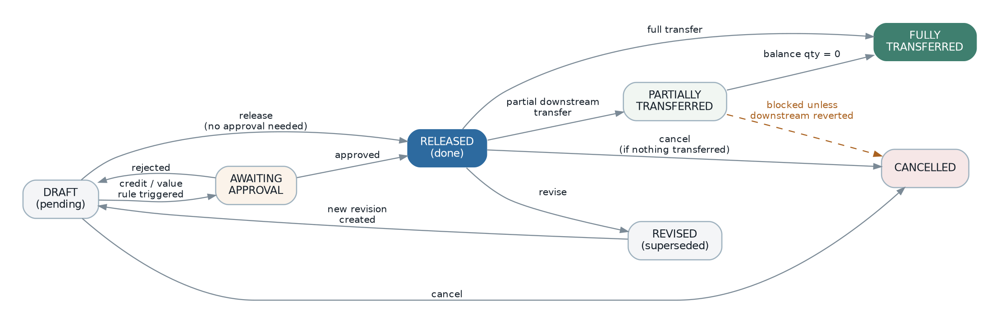

*Figure 15 — The document state machine every numbered document follows.*

| **Element**                       | **Design**                                                                                                                                                                                                                    |
|-----------------------------------|-------------------------------------------------------------------------------------------------------------------------------------------------------------------------------------------------------------------------------|
| Declarative transitions           | Each document type declares its states and legal transitions (section 5.5.2). The table is validated at start-up; an unreachable or undeclared state halts boot.                                                              |
| Transitions are aggregate methods | release(), cancel(reason), revise(), blockPendingApproval() — never a status field assignment. The method enforces the preconditions, so an invalid transition is impossible rather than merely discouraged (SRS BR-STA-004). |
| Guards                            | A transition may declare guards: credit control on release, downstream-reversal on cancel, period-open on post. Guards are rule objects (section 5.6) and are therefore independently tested.                                 |
| Immutability after release        | The declaration names the fields frozen on release; the aggregate refuses to change them, and the API rejects them rather than silently ignoring them.                                                                        |
| Transfer status is derived        | Computed from the generated balance columns, never assigned. This is what removes the legacy drift defect at its root.                                                                                                        |
| Events per transition             | Each transition raises its contract event, which is how every downstream consequence is triggered.                                                                                                                            |

**13.2 The approval engine**

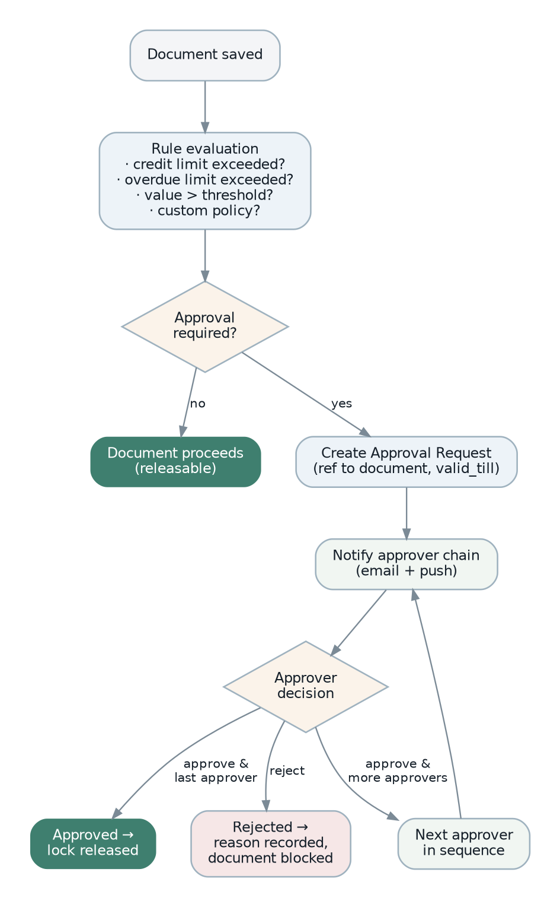

*Figure 16 — Approval workflow.*

| **Element**       | **Design**                                                                                                                                                                                       |
|-------------------|--------------------------------------------------------------------------------------------------------------------------------------------------------------------------------------------------|
| Definition        | An approval definition per document type, branch and condition, holding an ordered chain of approver roles or users, a quorum where relevant, and an expiry.                                     |
| Conditions        | Expressed against document attributes — total in home currency, customer, item group, margin, project — as a declarative rule so a new threshold is configuration, not code (SRS FR-WFL-002).    |
| Evaluation point  | On save and on release. The credit-control rule set and the value-threshold rule set are both condition providers feeding the same engine, so the two legacy triggers converge on one mechanism. |
| Request lifecycle | Raised, notified, decided, or escalated on expiry. Every decision is appended, never amended.                                                                                                    |
| Blocking          | The document aggregate holds the approval reference and refuses release while it is pending — the block is in the domain, not in the user interface.                                             |
| Work queue        | One cross-module queue of everything awaiting a user’s decision, which the legacy system lacks entirely (SRS FR-WFL-005, IMP-04).                                                                |
| Clearing          | Cancelling the document clears its pending approval; an already-approved document is not re-blocked on resave — preserving legacy behaviour (SRS BR-CRED-006, 007).                              |

**13.3 The posting engine**

This is the component the legacy system gets most wrong, and its redesign is the single highest-value correctness change in the project (SRS WK-02, WK-03, FR-FIN-031, FR-FIN-032, BR-POST-007, BR-POST-008).

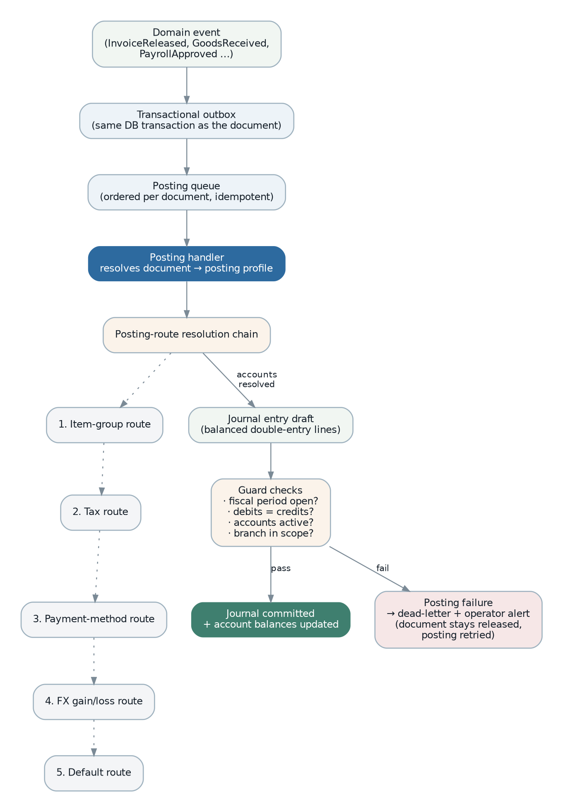

*Figure 17 — Posting engine — from document event to committed journal, with route resolution and the failure path.*

**13.3.1 Flow**

12. A document transition raises its contract event, written to the outbox in the document’s transaction.

13. The dispatcher publishes it; the posting consumer receives it, keyed for idempotency on (event id, handler).

14. The consumer resolves the document’s posting profile from an explicit registry. An unmapped document type is a configuration error detected at start-up, not a runtime crash — this replaces the legacy reflection-based handler selection (SRS WK-03).

15. The profile builds journal lines. Each line’s account is resolved through the ordered route chain: item-group route, tax route, payment-method route, foreign-exchange route, default route (SRS BR-POST-002).

16. Guards run: the period must be open, debits must equal credits in both currencies, every account must exist and be active, and the branch must be in scope.

17. The journal is committed in one transaction with the account-balance updates.

18. On success, the document records its posting reference. On failure, the event dead-letters, an alert is raised, and the document is marked as having a failed posting — visible in the user interface and in an operations report. The document stays released; it is never silently unposted (SRS NFR-REL-004).

**13.3.2 Design decisions**

| **Decision**                             | **Reasoning**                                                                                                                                                                                                                                                              |
|------------------------------------------|----------------------------------------------------------------------------------------------------------------------------------------------------------------------------------------------------------------------------------------------------------------------------|
| Asynchronous, not in-request             | Posting can be slow and can fail on external state such as a period lock. Holding the user’s request hostage to it — and retrying three times with a one-second sleep inside a single-threaded runtime, as the legacy system does — blocks a worker and hides the failure. |
| Idempotent by handler record             | The (event id, handler) uniqueness constraint makes redelivery a no-op. Without it, at-least-once delivery would produce duplicate journals.                                                                                                                               |
| Explicit profile registry                | Document type to posting profile is a declared map, checked exhaustively at start-up. A new document type without a profile fails the build, not the month-end close.                                                                                                      |
| Route completeness validated at start-up | Every route the enabled document types require must resolve to an active account. A missing route is a boot-time configuration error rather than a posting failure discovered by an accountant (SRS FR-FIN-056).                                                           |
| Never post to suspense silently          | An unresolvable account fails loudly. Silent suspense posting is how a ledger becomes untrustworthy (SRS BR-POST-004, OQ-048).                                                                                                                                             |
| Reversal by counter-entry                | A correction is a new journal, never an edit. Locked-period partitions are read-only, so this is enforced by the database.                                                                                                                                                 |
| Balances updated in the same transaction | Account balances are not a projection refreshed later; they are part of the posting transaction, because a trial balance must always tie.                                                                                                                                  |

**13.4 The inventory engine**

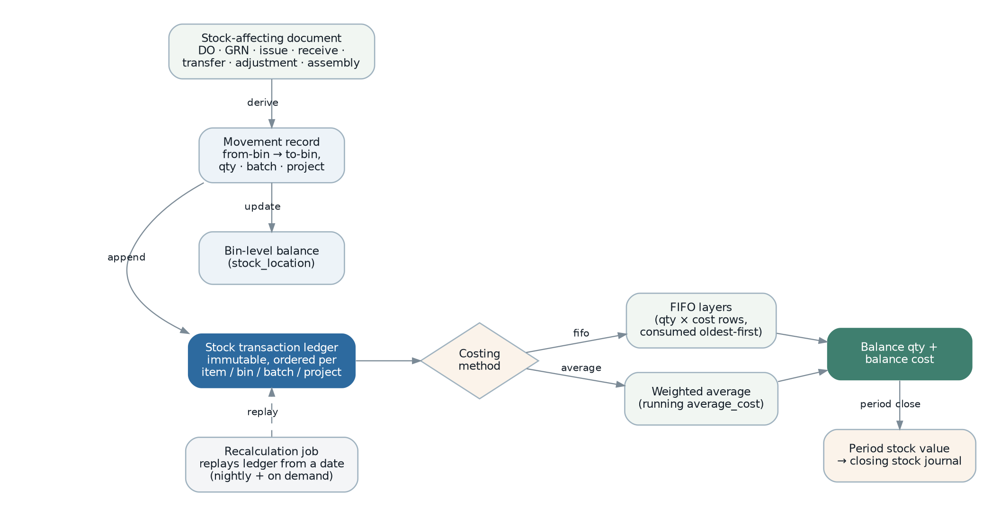

*Figure 18 — Stock movement and valuation pipeline.*

| **Element**                     | **Design**                                                                                                                                                                                                                       |
|---------------------------------|----------------------------------------------------------------------------------------------------------------------------------------------------------------------------------------------------------------------------------|
| One pipeline for every document | Delivery order, goods receipt, issue, receive, transfer, adjustment, scrap, assembly and disassembly all produce movements through the same path. There is exactly one place where stock changes.                                |
| Set-based processing            | One statement per document rather than per line. A 500-line document produces a handful of round trips, not thousands — the direct correction of SRS WK-05, verified by a performance test.                                      |
| Append-only ledger              | Every movement appends rows carrying the resulting balance quantity, balance cost and average cost, so a point-in-time balance is a lookup. Preserved from the legacy design, which is correct.                                  |
| FIFO layers                     | Held as child rows of the transaction. Layers are carried forward, adjusted, merged where type, cost and date coincide, and dropped where a group sums to zero — preserving the legacy algorithm exactly (SRS BR-COST-002, 003). |
| Weighted average                | A running average recomputed on inbound movement; outbound valued at the prevailing average (SRS BR-COST-004).                                                                                                                   |
| Ordering under concurrency      | Movements for the same item, bin, batch and project are serialised by an advisory lock on that key, so two concurrent movements cannot compute their balances from the same predecessor.                                         |
| Projections                     | Bin balances and item quantity summaries are projections of the ledger, rebuildable at any time. A rebuild produces an assertion report rather than a silent repair (SRS DR-056).                                                |
| Recalculation                   | Exists for deliberate historical restatement only — a backdated cost correction — not as a routine correctness mechanism (SRS FR-INV-047). It is idempotent and reports what it changed.                                         |
| Period lock                     | No movement posts into a stock-locked period, enforced by the same read-only partition mechanism as the ledger.                                                                                                                  |

**13.5 The payroll engine**

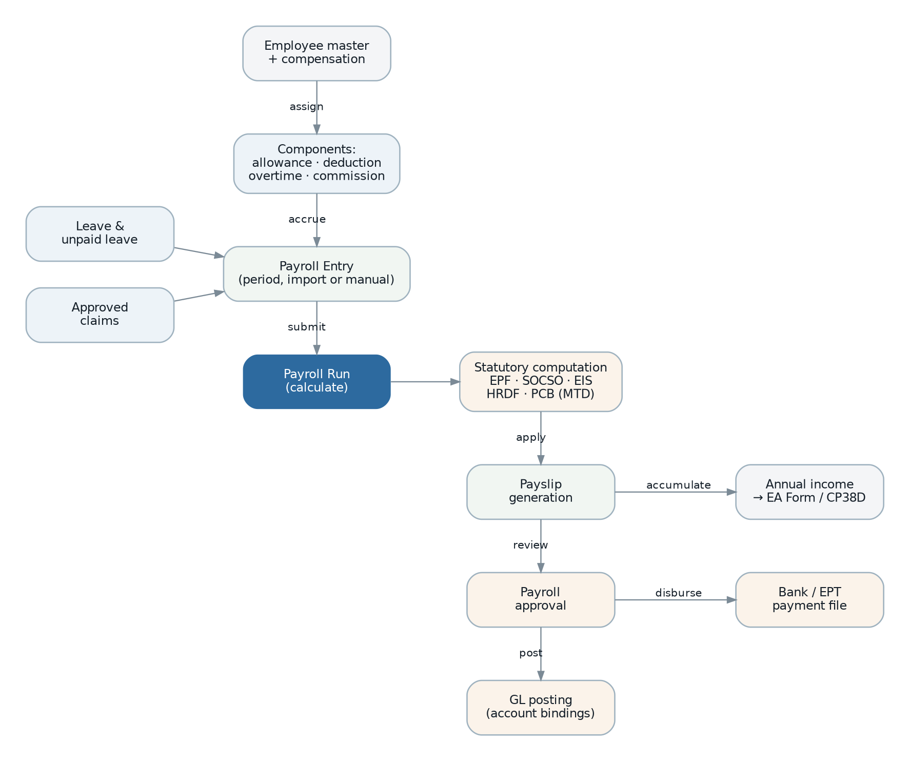

*Figure 19 — Payroll cycle.*

| **Element**                | **Design**                                                                                                                                                                                                                                                              |
|----------------------------|-------------------------------------------------------------------------------------------------------------------------------------------------------------------------------------------------------------------------------------------------------------------------|
| Jurisdiction rule set      | A package per country implementing contribution and withholding interfaces. Malaysia implements EPF, SOCSO, EIS, HRDF and the PCB monthly formula. The run itself contains no country-specific logic (SRS FR-PAY-048).                                                  |
| Effective-dated tables     | Every statutory table is versioned by effective date and selected by payroll date, which makes historical recomputation correct (SRS BR-PAY-011).                                                                                                                       |
| Pure calculation functions | Each employee’s calculation is a pure function of the entry, the compensation structure, the year-to-date accumulations and the statutory version. It is therefore testable directly against published tables — the only defensible way to verify statutory arithmetic. |
| Year-to-date sourcing      | Accumulations come from prior payslips in the year plus the employee’s opening balances, so a mid-year implementation computes correctly (SRS BR-PAY-015).                                                                                                              |
| Run as an aggregate        | Entries and payslips are saved with the run, so a partially calculated run is not a state the system recognises.                                                                                                                                                        |
| Calculation on workers     | A 500-employee run is CPU-bound and cannot run in an API process. It is a job with progress reporting (SRS NFR-PERF-009).                                                                                                                                               |
| Approval gate              | No payslip release, no posting and no payment file before approval, and the approver may not be the preparer (SRS FR-PAY-042).                                                                                                                                          |
| Posting                    | Through the same posting engine as everything else, using the payroll account bindings as its posting profile.                                                                                                                                                          |
| Reproducibility            | Recomputing a historical run with the same inputs and the same statutory version must reproduce the original result to the cent. This is an automated test, not an aspiration (SRS NFR-AUD-007).                                                                        |

**13.6 Cross-module process managers**

Some business processes span modules and cannot be one transaction. Each is an explicit process manager with its own state, rather than an implicit chain of event handlers whose order nobody has written down.

| **Process manager**     | **Coordinates**                                                                             | **Compensation**                                                                                                                             |
|-------------------------|---------------------------------------------------------------------------------------------|----------------------------------------------------------------------------------------------------------------------------------------------|
| Order fulfilment        | Order released → shipment created → picked → delivered → invoiced → posted.                 | A failure at any step marks the order as having a failed consequence and surfaces it; quantities are restored by the transfer reversal path. |
| Purchase receipt        | Order released → shipment → receipt → putaway → invoice matched → posted.                   | As above.                                                                                                                                    |
| Document posting        | Document released → receivable or payable created → journal posted → party balance updated. | Dead-letter plus a visible failed-posting state; retry is safe because posting is idempotent.                                                |
| Inter-company mirroring | Source released → mirror command issued in the counterparty → links recorded.               | Mirror cancelled through its own lifecycle; links cleared.                                                                                   |
| e-Invoice submission    | Document posted → validated → submitted → outcome recorded.                                 | Rejection holds the document for correction; the platform outage path queues indefinitely without blocking invoicing.                        |
| Period close            | Cut off → value stock → reconcile → post adjustments → produce statements → lock.           | Each step is separately reversible until the lock is applied; the lock is the point of no return.                                            |

**Why explicit.** The legacy system implements these as chains of event listeners, with one module’s event service provider commenting that some listeners "must execute in order" and wiring them manually for that reason. An order dependency that exists but is not represented is a defect waiting to happen; a process manager makes the sequence, the current state and the compensation visible.

**13.7 Idempotency and retry policy**

| **Layer**            | **Mechanism**                                         | **Retry policy**                                                                            |
|----------------------|-------------------------------------------------------|---------------------------------------------------------------------------------------------|
| API write            | Idempotency-Key with a stored response (section 9.5). | Client-driven; safe to repeat.                                                              |
| Event consumer       | Unique (event id, handler) record.                    | Five attempts, exponential backoff with jitter, then dead-letter with an alert.             |
| Outbound integration | Idempotency key derived from the business identifier. | Per-integration policy; circuit breaker; dead-letter.                                       |
| Scheduled job        | A run record keyed on job and period.                 | A missed run is detected and either re-run or alerted; a job never silently skips a period. |
| Data migration       | Natural-key upsert against legacy_ref.                | Fully resumable; a re-run loads only what is missing.                                       |

**14. Frontend Architecture**

**14.1 Application structure**

A single-page React application in TypeScript, built with Vite, talking only to the ERP API. It holds no business rules; every rule it appears to enforce is a rendering of server-supplied metadata or a server response.

<table>
<colgroup>
<col style="width: 100%" />
</colgroup>
<tbody>
<tr class="odd">
<td>
apps/web/src/

├─ app/ routing, providers, error boundaries, layout shell

├─ platform/ auth, tenant &amp; branch context, permission hooks,

│ Money &amp; Quantity formatting, i18n

├─ ui/ design system: primitives and composites

├─ framework/ THE GENERIC LAYER

│ ├─ data-grid/ virtualised grid driven by column descriptors

│ ├─ document-form/ form renderer driven by field descriptors

│ ├─ line-editor/ keyboard-first detail-line editor

│ ├─ picker/ remote look-up / autocomplete

│ ├─ report-runner/ parameter form + render + download

│ └─ command-bar/ release / revise / cancel / print / bulk actions

├─ modules/

│ ├─ sales/ only genuinely bespoke screens and widgets

│ ├─ inventory/

│ └─ …

└─ generated/ API client + types generated from OpenAPI
</td>
</tr>
</tbody>
</table>

**14.2 State management**

| **State kind**        | **Held in**                                             | **Reasoning**                                                                                                                                                                             |
|-----------------------|---------------------------------------------------------|-------------------------------------------------------------------------------------------------------------------------------------------------------------------------------------------|
| Server data           | TanStack Query                                          | Caching, invalidation, retry and optimistic update are solved problems; reimplementing them in a global store is the most common cause of stale-data defects in this kind of application. |
| Document being edited | React Hook Form with a Zod resolver                     | Large forms with many detail lines need uncontrolled inputs for performance. The Zod schema is generated from the same API schema, so client and server validate identically.             |
| Session and context   | A small context provider                                | User, tenant, active branch, permissions, locale. Read everywhere, written rarely.                                                                                                        |
| Interface preferences | Local storage plus a server-side personalisation record | Column selection, filters, sort and page size persist per user across devices (SRS NFR-USE-005).                                                                                          |
| Ephemeral UI state    | Component state                                         | Dialogs, expansion, focus. Never global.                                                                                                                                                  |

**Deliberately absent: a global client-side domain model.** The server is the source of truth. The client renders and submits; it does not maintain a parallel model of the business, because two models of the same domain diverge.

**14.3 The grid and form framework — solving the breadth problem**

This is the most important frontend decision. The legacy system solves breadth by building the entire user interface in backend PHP: roughly 45 document families are defined as component trees server-side, and there are almost no per-screen frontend components. That is genuinely effective, and it is also why the frontend cannot be replaced independently and why no public API was ever needed.

| **Option**                                      | **Assessment**                                                                                                                                                                                                                                                                                                             |
|-------------------------------------------------|----------------------------------------------------------------------------------------------------------------------------------------------------------------------------------------------------------------------------------------------------------------------------------------------------------------------------|
| Hand-build every screen                         | Rejected. Roughly 45 document families with 20 to 60 fields each, plus 173 report parameter forms. Either it is never finished, or it is inconsistent, or both.                                                                                                                                                            |
| Keep server-driven UI as the legacy system does | Rejected. It couples the backend to one client permanently, blocks the public API and mobile requirements (SRS INT-011), and was inseparable from the encrypted platform.                                                                                                                                                  |
| Metadata-driven rendering (chosen)              | The backend publishes descriptors — columns, filters, fields, layout, actions, permissions — at /api/v1/meta/documents/{type}. The frontend has generic renderers that interpret them. Bespoke components are registered by name and referenced from a descriptor, exactly as the legacy dynamic-component mechanism does. |

<table>
<colgroup>
<col style="width: 100%" />
</colgroup>
<tbody>
<tr class="odd">
<td>
// Metadata, served by the backend and derived from the same document

// definition that generates the schema and the permissions.

{ "documentType": "SALES_ORDER",

"grid": {

"columns": [

{ "field": "documentNumber", "label": "Document No", "width": 150,

"link": "record", "sortable": true },

{ "field": "documentDate", "label": "Date", "type": "date", "sortable": true },

{ "field": "customer.name", "label": "Customer", "flex": 2 },

{ "field": "total", "label": "Total", "type": "money", "align": "right" },

{ "field": "transferStatus", "label": "Transfer", "type": "tag",

"tags": { "pending": "grey", "partial": "amber", "done": "green" } } ],

"filters": [

{ "field": "dateRange", "type": "dateRange", "label": "Filter by date" },

{ "field": "status", "type": "select", "options": "…" },

{ "field": "salesAgentId", "type": "remoteSelect",

"source": "/api/v1/master-data/sales-agents" } ],

"actions": [

{ "command": "release", "label": "Release",

"permission": "Sales::Sales Order@Release Record",

"enabledWhen": "status == 'draft'", "bulk": true },

{ "command": "print", "label": "Print", "report": "sales-order-general" } ] },

"form": {

"sections": [ { "title": "Customer", "columns": 2, "fields": [ … ] } ],

"lines": { "editor": "standard", "columns": [ … ] },

"components": [ { "name": "sales-profit-estimator", "slot": "footer",

"visibleWhen": "settings.sales.enableProfitEstimator" } ] } }
</td>
</tr>
</tbody>
</table>

| **Consequence**                      | **Detail**                                                                                                                                                                                                          |
|--------------------------------------|---------------------------------------------------------------------------------------------------------------------------------------------------------------------------------------------------------------------|
| Effort concentrates in the framework | The grid, the form renderer and the line editor are built once, thoroughly, and tested hard. A new document family is a descriptor.                                                                                 |
| Consistency is structural            | Every list behaves the same because there is one list implementation. The legacy system achieves this too, and it is worth keeping.                                                                                 |
| Extensions still work                | An extending module contributes descriptors, which the renderer merges — the legacy extension mechanism preserved (section 5.9).                                                                                    |
| The API stays first-class            | Metadata is an API resource like any other, so the API remains complete enough for a mobile client or a partner integration.                                                                                        |
| Escape hatch retained                | A descriptor may name a bespoke component, so the profit estimator, the payment splitter and the price-history panel are ordinary React components — exactly the eight bespoke widgets the legacy sales module has. |

**14.4 Keyboard-first document entry**

High-volume users do not use a mouse (SRS NFR-USE-001). This is a design requirement on the line editor, not a preference.

- Full keyboard traversal of the line grid, with Enter to commit a line and open the next, and a defined shortcut to duplicate the previous line.

- Type-ahead item and party look-up that resolves on code, name or barcode, with barcode-scanner input treated as fast keyboard input.

- Inline validation that does not move focus or reflow the grid.

- A documented shortcut set, discoverable from a help overlay — the legacy system has a hotkey dialog, and it is worth reproducing.

- Draft autosave so a connection loss does not discard work in progress (SRS NFR-USE-004).

**14.5 Design system and accessibility**

- A small set of primitives and composites with a documented token set for colour, spacing, type scale and elevation. Data density is tuned for an ERP: compact rows, right-aligned numerics, tabular figures, and monospaced document numbers.

- Light and dark themes, with contrast verified against WCAG 2.1 AA (SRS NFR-USE-007).

- Full keyboard operability, visible focus, correct labelling and live-region announcements for asynchronous results.

- Warehouse and self-service views built for touch with large targets and single-handed reach (SRS ENV-02, NFR-USE-006).

- All text externalised for translation; number, date and currency formatting driven by locale (SRS NFR-LOC-001, 002).

**14.6 Frontend performance**

| **Concern**       | **Approach**                                                                                                                                  |
|-------------------|-----------------------------------------------------------------------------------------------------------------------------------------------|
| Large lists       | Row virtualisation with keyset pagination; only visible columns are requested from the API.                                                   |
| Large documents   | Virtualised line editor; a 500-line document renders and edits without degradation.                                                           |
| Bundle size       | Route-level and module-level code splitting; bespoke components lazy-loaded by descriptor name, mirroring the legacy lazy component registry. |
| Money formatting  | Decimal strings parsed once into a Money type; formatting memoised per locale.                                                                |
| Perceived latency | Optimistic updates for low-risk actions; never for release, post or approve, where the server outcome is the only truth.                      |

**15. Reporting and Analytics Architecture**

**15.1 Operational and analytical separation**

| **Class**           | **Source**                                                                                                 | **Delivery**                                                                                    |
|---------------------|------------------------------------------------------------------------------------------------------------|-------------------------------------------------------------------------------------------------|
| Printable document  | The document itself, read from stored data so it reproduces identically later (SRS RPT-026).               | Rendered synchronously for a single record; cached by document and template version.            |
| Operational report  | Read replica, parameterised SQL.                                                                           | Synchronous under ten seconds; above that, a job with notification (SRS RPT-007).               |
| Financial statement | Read replica, over account balances and journal lines.                                                     | Synchronous; materialised views for the comparative variants.                                   |
| Dashboard indicator | Materialised views refreshed on a cadence per indicator.                                                   | Cached with a stated freshness, so a dashboard never runs a heavy query per view (SRS RPT-038). |
| Ad-hoc query        | Read replica, restricted role, mandatory scope injection, statement timeout and row cap.                   | Synchronous, permission-gated, audited (SRS RPT-014).                                           |
| Analytical          | Out of scope for the first release; the read replica and the event stream make a warehouse additive later. | —                                                                                               |

**The replica is the key decision.** All reporting reads from a streaming replica, so a month-end report run cannot degrade document entry (SRS RPT-008, NFR-PERF-010). Replication lag is measured and displayed on reports where it matters, because a finance user needs to know whether a figure includes the last minute’s postings.

**15.2 Report engine decision**

173 report definitions exist as templates for one specific engine. The decision is a migration decision, not a preference (ADR-16).

| **Option**                                    | **Assessment**                                                                                                                                                                                                                                                                                                                                                                            |
|-----------------------------------------------|-------------------------------------------------------------------------------------------------------------------------------------------------------------------------------------------------------------------------------------------------------------------------------------------------------------------------------------------------------------------------------------------|
| Retain JasperReports as an isolated service   | Templates migrate largely unchanged, which removes the single largest reporting cost. Costs: a JVM in the deployment, a socket or HTTP bridge, and a second skill set. The legacy system already does this, bridging from PHP to Java, so the operational pattern is proven.                                                                                                              |
| Rebuild every report in a TypeScript renderer | One runtime, one language, full control, better testability. Costs: 173 templates rebuilt, including complex financial statements with hierarchy, comparatives and multi-branch roll-up — a substantial project in itself.                                                                                                                                                                |
| Adopt a third-party reporting service         | Fastest to a good-looking result. Rejected: it externalises financial data, complicates on-premises deployment, and makes report definitions someone else’s artefact.                                                                                                                                                                                                                     |
| **Chosen: a hybrid**                          | Retain JasperReports as an isolated, queue-fed service for the migrated catalogue, so Phase 2 does not carry a 173-template rebuild. Implement new documents and all dashboard indicators in a TypeScript renderer. Prune the catalogue on actual usage first (SRS OQ-053, IMP-09), and retire Jasper progressively as reports are rebuilt or dropped. Re-evaluate at the end of Phase 3. |

**Consequence to accept.** The deployment carries a JVM for a period, and two report technologies coexist. This is a deliberate trade of architectural purity for schedule, and it is reversible in one direction only — which is why the pruning step comes first.

**15.3 Report execution design**

- A report is a registered definition: code, category, template reference, parameter descriptors, access grants and the data provider it uses (SRS RPT-001, 002).

- Parameters are rendered by the generic parameter form from the same descriptors, so a new report needs no frontend work.

- Every execution injects the caller’s tenant, visible branch set and applicable data scopes as non-overridable parameters. A report cannot return data outside the caller’s scope for any parameter combination, and this is verified by a generated test per report (SRS RPT-003, RPT-020).

- Execution is recorded with the requesting user, the parameters and the timestamp, purged on a configurable schedule (SRS RPT-005).

- Output goes to object storage with a short-lived signed download link; the file is never served from the application process.

- Templates are versioned, so a historical document reproduces with the template that produced it (SRS RPT-028).

- Customer-uploaded templates are validated before acceptance and are permission-gated (SRS RPT-009).

**15.4 Read models**

| **Read model**            | **Purpose**                                                       | **Refresh**                                                                    |
|---------------------------|-------------------------------------------------------------------|--------------------------------------------------------------------------------|
| Outstanding documents     | Every outstanding report, across sales, purchasing and inventory. | A view over the generated balance columns — always current, no refresh needed. |
| Party balances and aging  | Receivable and payable aging, statements, credit control.         | Materialised, refreshed on settlement events and on a schedule.                |
| Stock availability        | On hand, reserved, allocated, available per item, branch and bin. | Materialised, refreshed on stock events.                                       |
| Stock valuation by period | Month-end valuation, aging by value, closing stock posting.       | Materialised per period, rebuilt by the valuation run.                         |
| Account balances          | Trial balance, statements, drill-down.                            | Maintained transactionally by the posting engine, not projected.               |
| Item quantity summary     | Document entry availability display.                              | Projection from stock events, with an assertion job rather than a repair job.  |
| Dashboard indicators      | Module overview screens.                                          | Materialised per indicator, refreshed on a per-indicator cadence.              |

**Rule.** A read model is either maintained transactionally with its source, or it is rebuildable from source and carries a visible freshness timestamp. There is no third category, because a stale projection with no freshness indicator is how users lose trust in a system.

**16. Infrastructure and Deployment Architecture**

**16.1 Environments**

| **Environment**     | **Purpose**                                                                                         | **Data**                                  | **Deploys**         |
|---------------------|-----------------------------------------------------------------------------------------------------|-------------------------------------------|---------------------|
| Local               | Development. Full stack in containers, seeded with generated data.                                  | Synthetic.                                | Continuous.         |
| CI                  | Automated verification. Ephemeral database and Redis per run via Testcontainers.                    | Fixtures.                                 | Per commit.         |
| Development         | Integrated environment for the team.                                                                | Synthetic.                                | Automatic on merge. |
| Staging             | Release verification, migration rehearsal, performance testing, user acceptance. Production-shaped. | Masked production copy (SRS NFR-SEC-013). | On promotion.       |
| Production          | Live.                                                                                               | Live.                                     | On approval.        |
| Migration rehearsal | Repeated full-scale migration runs against a production copy.                                       | Production copy.                          | On demand.          |

**16.2 Containerisation and orchestration**

- One image for the whole application. The runtime role — API, worker or scheduler — is chosen by configuration, so the same artefact is promoted through every environment (SRS NFR-MNT-003).

- Multi-stage build producing a minimal runtime image with a non-root user and no build toolchain.

- The report service is a separate image because it carries a different runtime.

- Deployment target is the customer’s choice: Docker Compose for a single-server deployment, Kubernetes where the customer already operates it. The image and the configuration contract are identical (ADR-21, SRS NFR-POR-001).

- All infrastructure defined as code and version-controlled, so an environment is reproducible rather than remembered (SRS NFR-POR-003).

**16.3 Deployment topology**

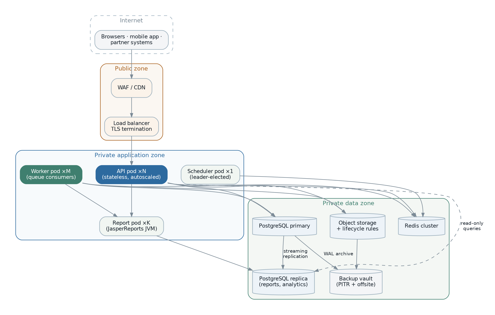

*Figure 20 — Production deployment topology with zone separation.*

| **Zone**              | **Contents**                                                         | **Access rules**                                                                            |
|-----------------------|----------------------------------------------------------------------|---------------------------------------------------------------------------------------------|
| Public                | Web application firewall, load balancer, CDN for static assets.      | The only internet-reachable zone. Terminates TLS.                                           |
| Application (private) | API instances, workers, scheduler, report service.                   | Reachable only from the load balancer. Outbound egress restricted to declared destinations. |
| Data (private)        | PostgreSQL primary and replica, Redis, object storage, backup vault. | Reachable only from the application zone. No internet route.                                |

| **Deployment size** | **Shape**                                                                                        | **Suited to**                                                    |
|---------------------|--------------------------------------------------------------------------------------------------|------------------------------------------------------------------|
| Single server       | All containers on one host, PostgreSQL local, nightly backup offsite.                            | A small customer, or a pilot. Lowest cost; no high availability. |
| Small cluster       | Two application hosts behind a load balancer, managed PostgreSQL with a replica, managed Redis.  | The expected production shape for the current organisation.      |
| Scaled              | Autoscaled API and worker pools, PostgreSQL with replicas and connection pooling, Redis cluster. | Multi-tenant operation or substantially higher volume.           |

**16.4 CI/CD pipeline**

*Figure 21 — Delivery pipeline. Every gate is blocking; none is advisory.*

| **Stage**                | **Gate**                                                                                                                                                          |
|--------------------------|-------------------------------------------------------------------------------------------------------------------------------------------------------------------|
| Static analysis          | Lint, strict type check, and the dependency-cruiser module-boundary rules. A boundary violation fails here (SRS FR-PLT-024).                                      |
| Unit tests               | Domain and application layers, with coverage thresholds enforced per module rather than globally, so a weakly tested module cannot hide behind a well-tested one. |
| Business rule coverage   | An assertion that every rule identifier in SRS section 8 is referenced by at least one test. A rule with no test fails the build (SRS NFR-MNT-001).               |
| Integration tests        | Real PostgreSQL and Redis via Testcontainers. Repositories, transactions, scoping, migrations, the posting engine and the inventory engine.                       |
| Contract and API tests   | Generated authorisation and scope tests (section 10.4), plus an OpenAPI diff that fails on an unannounced breaking change.                                        |
| Security scans           | Dependency, secret and container image scanning; a high-severity finding blocks.                                                                                  |
| Build and sign           | Image built once, software bill of materials generated, image signed. The same digest is promoted onward — never rebuilt per environment.                         |
| Staging deploy           | Migration dry-run against a production-shaped copy, smoke tests, then end-to-end tests.                                                                           |
| Approval                 | A human release decision for production.                                                                                                                          |
| Production deploy        | Expand-migrate-contract migration, then a rolling instance replacement with health gating.                                                                        |
| Post-deploy verification | Synthetic transactions, error-rate and latency comparison against the previous baseline, with automatic rollback on breach.                                       |

**16.5 Configuration and secrets**

| **Category**                 | **Held in**                                           | **Changed by**                                                                                                             |
|------------------------------|-------------------------------------------------------|----------------------------------------------------------------------------------------------------------------------------|
| Infrastructure configuration | Environment variables from the deployment definition. | A deployment. Validated at start-up; the process refuses to boot on an invalid or missing value rather than failing later. |
| Secrets                      | A secret store, injected at runtime.                  | Rotation procedure. Never in the database, never in committed files, never in a log (SRS NFR-SEC-004).                     |
| Business settings            | The settings service (section 5.10).                  | An administrator in the application, audited.                                                                              |
| Feature switches             | The settings service, scoped per tenant and branch.   | An administrator, audited.                                                                                                 |
| Jurisdiction selection       | Per legal entity.                                     | Configuration at entity setup.                                                                                             |

**16.6 Release and migration strategy**

19. A release is a single signed image plus its migration set.

20. Migrations run before the new instances take traffic, and every migration in a release must be compatible with the outgoing code version — that is what expand-migrate-contract guarantees.

21. Instances are replaced one at a time, each gated on its health endpoint, so both versions serve traffic briefly and must therefore both work against the same schema.

22. Workers drain in-flight jobs before stopping; queues are durable, so no job is lost across a deployment.

23. A failed post-deploy verification triggers an automatic rollback to the previous image. Because migrations are expand-only, a rollback needs no schema reversal.

24. A destructive contract migration ships only after the release that stopped using the old shape has been stable in production.

25. Target: a routine release with no user-visible downtime; the fifteen-minute window in SRS NFR-REL-005 is the exception, not the norm.

**17. Scalability and Performance Design**

**17.1 Targets and where they are met**

| **Requirement**                                | **Design element that meets it**                                                                                                            |
|------------------------------------------------|---------------------------------------------------------------------------------------------------------------------------------------------|
| NFR-PERF-001 list view ≤ 1.5 s                 | Tenant-leading composite indexes matching the default query and sort; keyset pagination; projection limited to visible columns.             |
| NFR-PERF-002 document save ≤ 2 s               | Single aggregate write; generated balance columns instead of application-maintained ones; no per-line queries.                              |
| NFR-PERF-003 release ≤ 3 s                     | Only the document transition and the outbox write are synchronous. Posting, shipment creation, mirroring and notification are asynchronous. |
| NFR-PERF-004 look-up ≤ 300 ms                  | Trigram indexes on code and name; cached master-data read models; a hard result limit.                                                      |
| NFR-PERF-005 and 007 reports                   | Read replica; materialised views for comparatives; asynchronous execution above the threshold.                                              |
| NFR-PERF-006 bulk posting ≤ 5 s for 500 lines  | Set-based movement and posting processing; verified by a performance test in the pipeline, not by inspection.                               |
| NFR-PERF-008 valuation ≤ 30 min                | Partitioned ledger, index-aligned valuation walk, and a job that does not block transactional use.                                          |
| NFR-PERF-009 payroll ≤ 5 min for 500 employees | Pure calculation functions parallelised across workers; statutory tables cached per run.                                                    |
| NFR-SCAL-001 to 005                            | Stateless API, independently scaled workers, partitioned high-volume tables, read replica for reporting.                                    |

**17.2 Scaling strategy**

| **Tier**        | **Scaling**                                    | **Limit and next step**                                                                                |
|-----------------|------------------------------------------------|--------------------------------------------------------------------------------------------------------|
| API             | Horizontal; stateless, no session affinity.    | Bounded by database connections. Next step: a connection pooler in transaction mode.                   |
| Workers         | Horizontal per queue.                          | Bounded by database write throughput. Next step: batching and partition-aware writes.                  |
| Database reads  | Read replicas.                                 | Bounded by replication lag. Next step: a dedicated reporting replica, then a warehouse.                |
| Database writes | Vertical, plus partitioning of the hot tables. | Bounded by a single primary. Next step: partition by tenant, then a separate cluster per tenant group. |
| Redis           | Vertical, then cluster.                        | Bounded by memory. Next step: separate cache and queue instances.                                      |
| Report service  | Horizontal, queue-fed.                         | Bounded by CPU. Next step: more instances; rendering is embarrassingly parallel.                       |

**17.3 Caching**

| **Cache**           | **Contents**                                                                         | **Invalidation**                                                                                |
|---------------------|--------------------------------------------------------------------------------------|-------------------------------------------------------------------------------------------------|
| Request-scoped      | Settings, permissions, currency rates, tax rates read repeatedly within one request. | End of request. No staleness possible.                                                          |
| Distributed (Redis) | Resolved settings, permission sets, master-data read models, dashboard indicators.   | Event-driven on the change that invalidates it, with a conservative time-to-live as a backstop. |
| Materialised views  | Aging, availability, valuation, indicators.                                          | Concurrent refresh on event or schedule, with a visible freshness timestamp.                    |
| HTTP                | Static assets, metadata descriptors, report templates.                               | Content-hash filenames for assets; ETag for metadata.                                           |

**Explicitly not cached:** anything on a money or stock write path. A cached account balance, credit position or stock quantity used to make a decision is a correctness hazard, and correctness ranks above performance (section 2.1).

**17.4 Performance verification**

- Performance tests in the pipeline for the five operations most likely to regress: list query, document save, document release with posting, bulk release of 500 documents, and a 500-line movement.

- A seeded performance dataset at the volumes in SRS section 9.4, refreshed as the real figures are measured (SRS OQ-050).

- Query plan review as part of code review for any new reporting query.

- Production latency and error budgets tracked continuously against the section 13.1 targets rather than assessed only at acceptance (SRS NFR-PERF-010).

**18. Logging, Monitoring and Observability**

**18.1 Correlation**

One identifier follows a unit of work from the browser through the API, into the outbox, through the queue, into every consumer and into every audit and ledger row it produces. Without it, an asynchronous posting failure cannot be traced back to the action that caused it — which is precisely the situation in the legacy system.

<table>
<colgroup>
<col style="width: 100%" />
</colgroup>
<tbody>
<tr class="odd">
<td>
Browser request X-Request-Id: 018f2c…

→ API span correlation_id = 018f2c…

→ outbox row correlation_id = 018f2c…

→ queue job correlation_id = 018f2c…, causation_id = &lt;event id&gt;

→ posting consumer correlation_id = 018f2c…

→ journal row correlation_id = 018f2c…

→ audit rows correlation_id = 018f2c…
</td>
</tr>
</tbody>
</table>

**18.2 Logging**

| **Aspect** | **Design**                                                                                                                                                             |
|------------|------------------------------------------------------------------------------------------------------------------------------------------------------------------------|
| Format     | Structured JSON, one event per line, with correlation identifier, tenant, actor, module, and duration where relevant.                                                  |
| Levels     | error for a failure needing attention; warn for a handled abnormality; info for business-significant events; debug off in production.                                  |
| Redaction  | A field-level redaction list applied by the logger itself, so a developer cannot log a password, token, identity number or bank account by accident (SRS NFR-OBS-001). |
| Retention  | Application logs thirty to ninety days; the security event log at least one year; the audit trail per its own retention policy.                                        |

**18.3 Metrics**

| **Category**   | **Metrics**                                                                                                                                                                                                              |
|----------------|--------------------------------------------------------------------------------------------------------------------------------------------------------------------------------------------------------------------------|
| Technical      | Request rate, latency distribution and error rate per endpoint; database connection pool usage; query duration distribution; queue depth, age and processing time; cache hit rate; event-loop lag.                       |
| Business       | Documents created and released per type; postings succeeded and failed; e-Invoice submissions by outcome; report renders and duration; payroll runs; integration success rate; scheduled-job outcomes (SRS NFR-OBS-002). |
| Data integrity | Outbox backlog and age; dead-letter depth; consistency-assertion failures; replication lag. These are the metrics that reveal the class of defect the legacy system hides.                                               |

**18.4 Alerting**

| **Alert**                     | **Condition and rationale**                                                                                                         |
|-------------------------------|-------------------------------------------------------------------------------------------------------------------------------------|
| Posting failure               | Any dead-lettered posting event. Paged, because an unposted released document is a financial correctness problem (SRS NFR-OBS-004). |
| Outbox backlog                | Oldest undispatched event exceeds a threshold — the earliest signal that downstream effects are not happening.                      |
| Dead-letter growth            | Any queue accumulating failures.                                                                                                    |
| Consistency assertion failure | A projection disagrees with its source. Alerted, never silently repaired (SRS DR-056).                                              |
| Integration failure           | Circuit open, or repeated failures against the statutory platform, mail or bank interfaces.                                         |
| Missed scheduled job          | A job that did not run in its window. The legacy system would not notice this at all (SRS NFR-OBS-005).                             |
| Security events               | Sign-in failure spikes, refresh-token reuse, permission escalation, unusual export volume.                                          |
| Error budget burn             | Latency or error rate trending against the availability target.                                                                     |

**18.5 Operations console**

A permission-gated area of the application, because operational visibility that requires database access is not operational visibility (SRS NFR-OBS-003).

- Failed asynchronous work, with the ability to inspect the payload and error, retry, or discard — every action audited.

- Documents with a failed posting, with a retry action.

- Integration health: last success, last failure, queue depth, circuit state.

- Scheduled job history with outcome and volume processed.

- Consistency assertion results over time.

- Report execution history and duration.

**19. Backup, Recovery and Business Continuity**

**19.1 Backup design**

| **Asset**                                    | **Method**                                                                                    | **Retention**                                                                            |
|----------------------------------------------|-----------------------------------------------------------------------------------------------|------------------------------------------------------------------------------------------|
| PostgreSQL                                   | Nightly base backup plus continuous write-ahead log archiving, giving point-in-time recovery. | Daily for 30 days, weekly for 12 weeks, monthly for 7 years to meet statutory retention. |
| Object storage                               | Versioning enabled plus cross-location replication.                                           | Matching the database retention.                                                         |
| Secrets                                      | Backed up by the secret store’s own mechanism, separately from data.                          | Per policy.                                                                              |
| Configuration and infrastructure definitions | Version control.                                                                              | Indefinite.                                                                              |
| Archived partitions                          | Exported to object storage with a checksum, and re-attachable.                                | Statutory period.                                                                        |

**19.2 Recovery**

| **Scenario**                      | **Procedure**                                                                                                    | **Target**                                                   |
|-----------------------------------|------------------------------------------------------------------------------------------------------------------|--------------------------------------------------------------|
| Application instance failure      | Load balancer removes it; orchestrator replaces it. No data effect.                                              | Seconds; no data loss.                                       |
| Worker failure                    | Jobs are durable and redelivered; handlers are idempotent.                                                       | Seconds; no data loss.                                       |
| Database primary failure          | Promote the replica; repoint the application; verify.                                                            | Within the 4-hour RTO; data loss bounded by replication lag. |
| Data corruption or bad deployment | Point-in-time recovery to just before the event, then replay from the audit trail and the outbox where possible. | Within RTO; RPO of 15 minutes (SRS NFR-BCP-001).             |
| Accidental deletion by a user     | The audit trail holds the before state; a targeted restore procedure re-creates the record with its history.     | Hours.                                                       |
| Complete site loss                | Rebuild from infrastructure definitions; restore the database and object storage from the offsite vault.         | Within RTO.                                                  |

**19.3 Verification**

- A restore is performed and verified at least quarterly. A backup that has never been restored is not a backup (SRS NFR-BCP-004).

- A full disaster-recovery rehearsal annually, including database promotion and application repoint, timed against the stated targets.

- Backup completion and integrity are monitored and alerted, so a silently failing backup is not discovered during an incident.

- The recovery procedure is written for an operator who did not build the system, and is validated by having such a person execute it (SRS NFR-BCP-006).

**20. Maintainability, Testing and Quality**

**20.1 Test strategy**

| **Level**          | **Scope**                                                                                                                                             | **Target**                                                                                    |
|--------------------|-------------------------------------------------------------------------------------------------------------------------------------------------------|-----------------------------------------------------------------------------------------------|
| Unit               | Aggregates, value objects, domain services, calculation functions, rule objects. No database, no framework.                                           | ≥ 80% statements in the domain layer; 100% of SRS section 8 business rules (SRS NFR-MNT-001). |
| Integration        | Repositories, transactions, scoping, migrations, the posting engine, the inventory engine, the numbering service — against real PostgreSQL and Redis. | Every repository and every engine path.                                                       |
| Contract           | Generated authorisation, scope and API-schema tests.                                                                                                  | Every endpoint, every branch-scoped entity, every report.                                     |
| Process            | Cross-module process managers, driven through events with injected failures at each step.                                                             | Every process manager, including its compensation path.                                       |
| End-to-end         | The business journeys in SRS section 7, through the user interface.                                                                                   | Order to cash, procure to pay, period close, payroll run, production job.                     |
| Performance        | The five operations in section 17.4.                                                                                                                  | Thresholds enforced in the pipeline.                                                          |
| Statutory accuracy | Payroll and tax computations against published tables and worked examples.                                                                            | To the cent; a dedicated suite per statutory version.                                         |

**20.2 The statutory accuracy suite**

Worth calling out separately. Payroll statutory arithmetic is the one area where a defect is both very likely to occur and very hard to detect by inspection. The suite holds worked examples covering: each EPF, SOCSO, EIS and HRDF band boundary; PCB across income ranges with and without each supported relief; mid-year commencement with opening balances; and recomputation of a historical period asserting the original result. Each example cites its statutory source, and the suite is extended whenever a statutory version changes.

**20.3 Code standards and review**

- TypeScript strict mode, with no implicit any and no non-null assertion in the domain layer.

- Lint rules that encode the architectural rules: no empty or bare catch, no cross-module internal import, no plain number in a money type position, no query construction from a template string.

- Every change reviewed, with mandatory additional review for anything touching authorisation, the scope layer, posting, valuation, statutory computation or a migration.

- Conventional commits, and a changelog generated per release.

- Architecture decisions recorded as they are made (section 21), so a future reader finds the reasoning rather than only the result.

**20.4 Documentation**

| **Artefact**              | **Generated or written**                  | **Kept current by**                                                              |
|---------------------------|-------------------------------------------|----------------------------------------------------------------------------------|
| API reference             | Generated from schemas.                   | The build; drift is impossible.                                                  |
| Database schema reference | Generated from migrations.                | The build.                                                                       |
| Module contract reference | Generated from contract packages.         | The build.                                                                       |
| Permission catalogue      | Generated from the permission registries. | The build.                                                                       |
| Settings catalogue        | Generated from the settings registries.   | The build.                                                                       |
| Report catalogue          | Generated from the report registries.     | The build.                                                                       |
| This document and the SRS | Written.                                  | Reviewed at each phase boundary; superseded sections marked rather than deleted. |
| Runbooks                  | Written.                                  | Updated after every incident and every rehearsal.                                |

**The principle.** Anything that can be generated from the code is generated, because hand-written technical documentation about a 340-table system will be wrong within a month. What is written by hand is what cannot be derived: intent, reasoning and procedure.

**21. Architecture Decision Records**

Each decision records the context, the options considered, the choice and the consequences accepted. A decision is not a statement that the alternative was wrong; it is a record of what was traded away, so that a future reader can tell whether the trade still holds.

**ADR-01 — Rebuild on a new runtime rather than modernise in place**

| **Aspect**   | **Detail**                                                                                                                                                                                                                                                                                                     |
|--------------|----------------------------------------------------------------------------------------------------------------------------------------------------------------------------------------------------------------------------------------------------------------------------------------------------------------|
| Context      | The legacy system is a working Laravel modular monolith whose platform layer is encrypted and whose frontend is end-of-life. Modernising in place would preserve 117 service classes and the whole posting and costing implementation.                                                                         |
| Options      | A\) Modernise in place on Laravel. B) Rebuild on a new runtime.                                                                                                                                                                                                                                                |
| Decision     | **B — rebuild on Node.js and TypeScript with NestJS, as directed for this project.**                                                                                                                                                                                                                           |
| Consequences | Accepted: direct reuse of the legacy business logic is lost and must be reimplemented from the requirements. Mitigated by treating the legacy repository as the reference specification and by ERP-SRS-001 sections 7 and 8, which exist to make that reimplementation possible without re-deriving the rules. |

**ADR-02 — Modular monolith rather than microservices**

| **Aspect**   | **Detail**                                                                                                                                                                                                                                                                                  |
|--------------|---------------------------------------------------------------------------------------------------------------------------------------------------------------------------------------------------------------------------------------------------------------------------------------------|
| Context      | The core requirement is transactional consistency between a document, its stock effect and its accounting effect. Reporting is cross-domain. The team is small. Load is modest.                                                                                                             |
| Options      | A\) Microservices per domain. B) Modular monolith with enforced boundaries. C) Unstructured monolith.                                                                                                                                                                                       |
| Decision     | **B.**                                                                                                                                                                                                                                                                                      |
| Consequences | Transactional simplicity and cross-domain querying retained; the boundary-erosion risk is real and is paid for by mechanical enforcement (ADR-08). The system deploys as one unit, so a defect in one module can affect availability of all. Extraction of a module later remains possible. |

**ADR-03 — PostgreSQL as the only datastore**

| **Aspect**   | **Detail**                                                                                                                                                                                                                                                      |
|--------------|-----------------------------------------------------------------------------------------------------------------------------------------------------------------------------------------------------------------------------------------------------------------|
| Context      | Exact money arithmetic, module ownership, tenant isolation options, very large ledgers, cross-domain reporting and semi-structured settings are all required.                                                                                                   |
| Options      | A\) PostgreSQL. B) MySQL, as the legacy system uses. C) PostgreSQL plus a specialised analytical store.                                                                                                                                                         |
| Decision     | **A.**                                                                                                                                                                                                                                                          |
| Consequences | One datastore to operate, back up and reason about. Row-level security keeps tenancy option C viable; partitioning handles the ledgers; materialised views serve read models. An analytical store can be added later without changing the transactional design. |

**ADR-04 — Prisma for schema and typed access, raw SQL for reporting and bulk work**

| **Aspect**   | **Detail**                                                                                                                                                                                                                                                                                                                                                                 |
|--------------|----------------------------------------------------------------------------------------------------------------------------------------------------------------------------------------------------------------------------------------------------------------------------------------------------------------------------------------------------------------------------|
| Context      | Prisma gives generated types and readable migrations but is weak at complex analytical SQL and at set-based bulk operations, both of which this domain needs heavily.                                                                                                                                                                                                      |
| Options      | A\) Prisma only. B) TypeORM. C) Prisma plus hand-written parameterised SQL. D) A query builder only.                                                                                                                                                                                                                                                                       |
| Decision     | **C.**                                                                                                                                                                                                                                                                                                                                                                     |
| Consequences | Two access styles in the codebase, which must be conventionalised: Prisma for aggregate load and save, reviewed parameterised SQL for reporting and bulk operations, both through the same pool and the same scope layer. The scope layer must therefore be enforceable in both, which is why it lives in a shared repository base rather than in Prisma middleware alone. |

**ADR-05 — Carry tenant identity from the first migration, defer the tenancy topology**

| **Aspect**   | **Detail**                                                                                                                                                                                                                                                           |
|--------------|----------------------------------------------------------------------------------------------------------------------------------------------------------------------------------------------------------------------------------------------------------------------|
| Context      | The tenancy model is an open business decision (SRS OQ-001), but data access code cannot be written without knowing whether a tenant predicate exists.                                                                                                               |
| Options      | A\) Single-tenant, no tenant column. B) Tenant column plus one enforcement point, topology deferred. C) Commit to multi-tenant shared schema now.                                                                                                                    |
| Decision     | **B.**                                                                                                                                                                                                                                                               |
| Consequences | A tenant_id column that holds one constant value in early deployments, and a repository base class that always applies it. Costs a negligible amount now; avoids rewriting every table, index and query later. All three topologies in section 7.5 remain reachable. |

**ADR-06 — Redis with BullMQ for queues, cache and locks**

| **Aspect**   | **Detail**                                                                                                                                                                                                                                                |
|--------------|-----------------------------------------------------------------------------------------------------------------------------------------------------------------------------------------------------------------------------------------------------------|
| Context      | Asynchronous consequences, scheduled work, caching, distributed locking and rate limiting are all needed.                                                                                                                                                 |
| Options      | A\) Redis with BullMQ. B) PostgreSQL-backed queue. C) A message broker such as RabbitMQ or Kafka.                                                                                                                                                         |
| Decision     | **A.**                                                                                                                                                                                                                                                    |
| Consequences | One additional component covers five needs. Redis is not a durable event log, which is why the outbox is in PostgreSQL (ADR-07). If event replay or long retention becomes a requirement, a broker can be introduced behind the same publisher interface. |

**ADR-07 — Transactional outbox for all cross-module events**

| **Aspect**   | **Detail**                                                                                                                                                                                                                                    |
|--------------|-----------------------------------------------------------------------------------------------------------------------------------------------------------------------------------------------------------------------------------------------|
| Context      | The legacy system publishes events in-process during a request, so an event can be published without its transaction committing, or lost when it fails.                                                                                       |
| Options      | A\) In-process publication. B) Transactional outbox. C) Two-phase commit across database and broker.                                                                                                                                          |
| Decision     | **B.**                                                                                                                                                                                                                                        |
| Consequences | An event exists if and only if its transaction committed. Costs a table, a dispatcher and at-least-once delivery, which makes consumer idempotency mandatory (DCN-06). This is the single change that makes asynchronous posting trustworthy. |

**ADR-08 — Enforce module and layer boundaries in the build**

| **Aspect**   | **Detail**                                                                                                                                                                                                                                                          |
|--------------|---------------------------------------------------------------------------------------------------------------------------------------------------------------------------------------------------------------------------------------------------------------------|
| Context      | Boundaries maintained only by convention erode. The legacy system demonstrates the end state.                                                                                                                                                                       |
| Options      | A\) Convention and code review. B) Build-time enforcement. C) Separate repositories per module.                                                                                                                                                                     |
| Decision     | **B.**                                                                                                                                                                                                                                                              |
| Consequences | A declared dependency graph checked in the pipeline, plus workspace package boundaries, plus per-module schemas. A violation fails the build. Costs some friction when a genuine new dependency is needed, which is exactly when the decision should be deliberate. |

**ADR-09 — A branded Money type over an exact decimal library**

| **Aspect**   | **Detail**                                                                                                                                                                                                                             |
|--------------|----------------------------------------------------------------------------------------------------------------------------------------------------------------------------------------------------------------------------------------|
| Context      | JavaScript has no decimal type, and this is a financial system.                                                                                                                                                                        |
| Options      | A\) Numbers with careful rounding. B) Integer minor units. C) A branded Money value object over decimal.js.                                                                                                                            |
| Decision     | **C.**                                                                                                                                                                                                                                 |
| Consequences | Arithmetic is exact and currency-aware; using a plain number where money belongs is a compile error. Money serialises as a string everywhere, so every client must parse it as a decimal, and this is stated in the API documentation. |

**ADR-10 — Derive balance quantities in the database**

| **Aspect**   | **Detail**                                                                                                                                                                                                                                                                                                 |
|--------------|------------------------------------------------------------------------------------------------------------------------------------------------------------------------------------------------------------------------------------------------------------------------------------------------------------|
| Context      | Application-maintained balance quantities are the direct cause of the legacy drift defect and of three scheduled repair jobs.                                                                                                                                                                              |
| Options      | A\) Application-maintained columns. B) Generated stored columns. C) Compute on read.                                                                                                                                                                                                                       |
| Decision     | **B.**                                                                                                                                                                                                                                                                                                     |
| Consequences | balance_qty is a generated column over quantity and transferred_qty, so it cannot disagree with its inputs. Transfer status is then a cheap aggregate over a correct value. Transferred quantity itself is still application-maintained, but it is a single monotonic value guarded by a check constraint. |

**ADR-11 — JWT access tokens with a permission-set hash**

| **Aspect**   | **Detail**                                                                                                                                                                                                                 |
|--------------|----------------------------------------------------------------------------------------------------------------------------------------------------------------------------------------------------------------------------|
| Context      | Permissions must be enforced on every request without a database read per request, yet a role change must take effect quickly.                                                                                             |
| Options      | A\) Opaque session tokens with a lookup per request. B) JWT carrying the full permission set. C) JWT carrying a permission-set hash.                                                                                       |
| Decision     | **C.**                                                                                                                                                                                                                     |
| Consequences | No per-request permission lookup in the common case, and a role change invalidates the hash so permissions re-resolve on the next request rather than at token expiry. Token size stays small even with 722 possible keys. |

**ADR-12 — Return 404, not 403, for records outside the caller’s data scope**

| **Aspect**   | **Detail**                                                                                                                                                                                        |
|--------------|---------------------------------------------------------------------------------------------------------------------------------------------------------------------------------------------------|
| Context      | A 403 confirms that a record exists, which leaks information across branch and agent boundaries.                                                                                                  |
| Options      | A\) 403 with a clear message. B) 404, indistinguishable from absent.                                                                                                                              |
| Decision     | **B.**                                                                                                                                                                                            |
| Consequences | Slightly less helpful diagnostics for legitimate users, which is mitigated by clear messaging when a branch switch would make the record visible. No information leakage across scope boundaries. |

**ADR-13 — Explicit posting profile registry instead of runtime dispatch**

| **Aspect**   | **Detail**                                                                                                                                                                            |
|--------------|---------------------------------------------------------------------------------------------------------------------------------------------------------------------------------------|
| Context      | The legacy journal dispatcher selects a handler by reflecting over method signatures, and crashes on an unmapped document type instead of reporting it.                               |
| Options      | A\) Reflection-based dispatch. B) A declared registry validated at start-up.                                                                                                          |
| Decision     | **B.**                                                                                                                                                                                |
| Consequences | A document type without a posting profile fails at boot, not at month-end close. Adding a document type requires an explicit posting decision, which is the correct forcing function. |

**ADR-14 — Jurisdiction rule sets for tax, statutory payroll and electronic invoicing**

| **Aspect**   | **Detail**                                                                                                                                                                                                                                                                                  |
|--------------|---------------------------------------------------------------------------------------------------------------------------------------------------------------------------------------------------------------------------------------------------------------------------------------------|
| Context      | Malaysia is the only jurisdiction in the first release, but the business has directed multi-country readiness.                                                                                                                                                                              |
| Options      | A\) Malaysian rules inline, refactor when a second country arrives. B) Rule sets behind stable interfaces from the first release.                                                                                                                                                           |
| Decision     | **B.**                                                                                                                                                                                                                                                                                      |
| Consequences | Some abstraction cost now for exactly one implementation, which is the usual argument against it. Accepted because the alternative is refactoring the tax engine, the payroll run and the e-invoice module simultaneously under delivery pressure, which is how localisation projects fail. |

**ADR-15 — React with metadata-driven rendering for grids and forms**

| **Aspect**   | **Detail**                                                                                                                                                                                                                                 |
|--------------|--------------------------------------------------------------------------------------------------------------------------------------------------------------------------------------------------------------------------------------------|
| Context      | Roughly 45 document families and 173 report parameter forms. Hand-building each screen is not achievable; server-driven UI as the legacy system does it blocks the API and mobile requirements.                                            |
| Options      | A\) Hand-build every screen. B) Server-driven UI. C) Metadata-driven generic renderers with a bespoke-component escape hatch.                                                                                                              |
| Decision     | **C.**                                                                                                                                                                                                                                     |
| Consequences | Effort concentrates in the framework layer, which must therefore be built well and early. Consistency is structural. The API stays complete. A descriptor language is a design surface that needs versioning and documentation of its own. |

**ADR-16 — Retain JasperReports for the migrated catalogue; build new output in TypeScript**

| **Aspect**   | **Detail**                                                                                                                                                                                                                          |
|--------------|-------------------------------------------------------------------------------------------------------------------------------------------------------------------------------------------------------------------------------------|
| Context      | 173 report templates exist for one specific engine. Rebuilding all of them is a project in itself.                                                                                                                                  |
| Options      | A\) Rebuild everything. B) Retain Jasper permanently. C) Hybrid, with progressive retirement after pruning on usage.                                                                                                                |
| Decision     | **C.**                                                                                                                                                                                                                              |
| Consequences | Phase 2 does not carry a 173-template rebuild. The deployment carries a JVM for a period and two report technologies coexist. Re-evaluated at the end of Phase 3, after the catalogue has been pruned on actual usage (SRS OQ-053). |

**ADR-17 — REST as the primary API, GraphQL only as a possible read façade**

| **Aspect**   | **Detail**                                                                                                                                                                                                 |
|--------------|------------------------------------------------------------------------------------------------------------------------------------------------------------------------------------------------------------|
| Context      | The dominant operations are commands with preconditions, side effects and per-operation authorisation.                                                                                                     |
| Options      | A\) REST. B) GraphQL. C) Both from the start.                                                                                                                                                              |
| Decision     | **A, with B available later for read-only reporting.**                                                                                                                                                     |
| Consequences | Authorisation, idempotency, rate limiting and caching stay straightforward. Flexible client-driven queries are not available initially; the declared filter and expansion model covers the practical need. |

**ADR-18 — Keyset pagination everywhere**

| **Aspect**   | **Detail**                                                                                                                                                                                                    |
|--------------|---------------------------------------------------------------------------------------------------------------------------------------------------------------------------------------------------------------|
| Context      | Offset pagination degrades linearly with depth and duplicates rows under concurrent insert.                                                                                                                   |
| Options      | A\) Offset. B) Keyset cursors. C) Both.                                                                                                                                                                       |
| Decision     | **B.**                                                                                                                                                                                                        |
| Consequences | Jumping to an arbitrary page number is not supported, which is a genuine user-interface constraint. Accepted because deep page jumps are rare and expensive, and filtering serves the underlying need better. |

**ADR-19 — Separate legal entity from branch**

| **Aspect**   | **Detail**                                                                                                                                                                                                               |
|--------------|--------------------------------------------------------------------------------------------------------------------------------------------------------------------------------------------------------------------------|
| Context      | The legacy branch entity carries statutory identity, document prefix, control account and location simultaneously, which limits statutory reporting and multi-entity operation.                                          |
| Options      | A\) Keep the combined entity for migration simplicity. B) Separate them.                                                                                                                                                 |
| Decision     | **B.**                                                                                                                                                                                                                   |
| Consequences | A more faithful model and correct statutory reporting per entity, at the cost of a migration mapping that must be reviewed with finance. Deferring this change would make it prohibitively expensive later (SRS OQ-002). |

**ADR-20 — Integration tests against a real database**

| **Aspect**   | **Detail**                                                                                                                                                                 |
|--------------|----------------------------------------------------------------------------------------------------------------------------------------------------------------------------|
| Context      | Most of this system’s risk lives in SQL, transactions, constraints, scoping and migrations. None of it is exercised by a mocked repository.                                |
| Options      | A\) Mock repositories. B) In-memory substitute. C) Real PostgreSQL via Testcontainers.                                                                                     |
| Decision     | **C.**                                                                                                                                                                     |
| Consequences | Slower test runs and a container dependency in CI. Accepted because a green test suite against mocks would provide false confidence in exactly the areas that matter most. |

**ADR-21 — Support both Compose and Kubernetes from one image**

| **Aspect**   | **Detail**                                                                                                                                                        |
|--------------|-------------------------------------------------------------------------------------------------------------------------------------------------------------------|
| Context      | Some customers run Kubernetes; others will not accept it. The organisation also self-hosts.                                                                       |
| Options      | A\) Kubernetes only. B) Compose only. C) One image, both targets.                                                                                                 |
| Decision     | **C.**                                                                                                                                                            |
| Consequences | The image and the configuration contract are identical; only the orchestration definition differs. Costs maintaining two deployment definitions and testing both. |

**ADR-22 — OpenTelemetry for instrumentation**

| **Aspect**   | **Detail**                                                                                                   |
|--------------|--------------------------------------------------------------------------------------------------------------|
| Context      | Observability backends differ per deployment, and a customer-hosted installation may have its own.           |
| Options      | A\) Vendor agent. B) OpenTelemetry. C) Logs only.                                                            |
| Decision     | **B.**                                                                                                       |
| Consequences | Vendor-neutral instrumentation; the backend is a deployment choice. Slightly more setup than a vendor agent. |

**ADR-23 — Allocate document numbers on release, not on creation**

| **Aspect**   | **Detail**                                                                                                                                                                                                                                                                                                  |
|--------------|-------------------------------------------------------------------------------------------------------------------------------------------------------------------------------------------------------------------------------------------------------------------------------------------------------------|
| Context      | Gap-free sequences are commonly expected for tax documents, and a number allocated to an abandoned draft creates a gap.                                                                                                                                                                                     |
| Options      | A\) Allocate on creation, accept gaps. B) Allocate on release, gap-free.                                                                                                                                                                                                                                    |
| Decision     | **B, pending confirmation of SRS OQ-014 and OQ-045.**                                                                                                                                                                                                                                                       |
| Consequences | A draft shows "(assigned on release)" rather than a number, which is a visible user-interface change from the legacy behaviour. If the business requires the number during entry, the decision reverses and gaps become possible — which is why it is flagged as an open question rather than settled here. |

**ADR-24 — Separate production into its own module**

| **Aspect**   | **Detail**                                                                                                                                                                                                 |
|--------------|------------------------------------------------------------------------------------------------------------------------------------------------------------------------------------------------------------|
| Context      | The legacy system holds production inside inventory, which makes inventory the largest module by a wide margin.                                                                                            |
| Options      | A\) Keep production inside inventory. B) Separate module depending on inventory through contracts.                                                                                                         |
| Decision     | **B.**                                                                                                                                                                                                     |
| Consequences | Production can be built in Phase 4 without reopening inventory, and it can carry its own reporting and user population. Costs a contract surface between the two that would otherwise be an internal call. |

**22. Risks**

Technical and delivery risks arising from this design. Business risks and open requirements questions are in ERP-SRS-001 sections 17 and 19.

| **Ref** | **Risk**                                                                                                                              | **Impact** | **Likelihood** | **Mitigation**                                                                                                                                                                                                                                                                                                            |
|---------|---------------------------------------------------------------------------------------------------------------------------------------|------------|----------------|---------------------------------------------------------------------------------------------------------------------------------------------------------------------------------------------------------------------------------------------------------------------------------------------------------------------------|
| R-01    | The document lifecycle framework is under-built or built late, so each document family reimplements transfer, revision and numbering. | Very high  | Medium         | Build it first, in Phase 0, with the deepest test suite in the system including property-based tests for transfer arithmetic. Treat it as a product with its own acceptance criteria, and prove it against three document families before Phase 2 begins.                                                                 |
| R-02    | Reimplementing the domain logic from requirements rather than porting code loses rules that exist only in the legacy source.          | High       | High           | The legacy repository stays readable for the project duration (SRS ASM-01). Each module’s build phase starts with a re-read of the corresponding legacy code against the SRS section for that module, and any newly discovered rule is raised as a change request rather than silently implemented.                       |
| R-03    | The 173-report catalogue is underestimated and becomes the critical path.                                                             | High       | High           | Prune on actual usage before migrating (SRS OQ-053, IMP-09). Retain Jasper for the surviving catalogue (ADR-16). Treat reporting as a parallel workstream with its own capacity from Phase 1, not as a task at the end of each module.                                                                                    |
| R-04    | Data migration reconciliation fails close to cutover.                                                                                 | Very high  | Medium         | Profile the data in Phase 0, not at cutover. Rehearse the full pipeline at least three times against a production copy. Cutover is gated on a signed reconciliation report (SRS DR-049), and the rollback is rehearsed rather than intended.                                                                              |
| R-05    | The metadata-driven frontend cannot express a genuinely complex screen, and bespoke components proliferate until consistency is lost. | Medium     | Medium         | Validate the descriptor language against the three most complex legacy screens before Phase 2. Keep the bespoke-component escape hatch explicit and reviewed, and track the ratio of descriptor-driven to bespoke screens as a design metric.                                                                             |
| R-06    | Statutory rules change during the build — e-Invoice scope, contribution rates, tax rules.                                             | Medium     | High           | Rule sets behind stable interfaces (ADR-14), effective-dated tables, and configuration rather than code for rates and thresholds. A statutory change becomes a data change plus a test, not a release.                                                                                                                    |
| R-07    | Posting or valuation defects reach production and corrupt financial data.                                                             | Very high  | Low            | Idempotent posting, explicit profile registry validated at start-up, guards inside the transaction, append-only ledgers, read-only locked partitions, and reconciliation assertions that alert rather than repair. Parallel running against the legacy system for one full month-end before the legacy ledger is retired. |
| R-08    | Node.js single-threaded execution blocks under CPU-bound work that was not moved to a worker.                                         | Medium     | Medium         | An event-loop lag metric with an alert, a lint rule against synchronous heavy operations in request handlers, and a load test that exercises the report and payroll paths concurrently with document entry.                                                                                                               |
| R-09    | The team is unfamiliar with the chosen stack, so the first module sets poor patterns that propagate.                                  | High       | Medium         | Build Phase 0 as a reference implementation with explicit pattern documentation and a module generator (Appendix C). Review the first two modules against the patterns before the third begins.                                                                                                                           |
| R-10    | Boundary enforcement is disabled or worked around under delivery pressure.                                                            | High       | Medium         | The rules are pipeline gates, not advisory. Disabling one requires a recorded decision. The ratio of allowed exceptions is reported per release.                                                                                                                                                                          |
| R-11    | Phase 2 ships and the business needs payroll before Phase 4 completes, forcing parallel running of two systems for stock or ledger.   | High       | Medium         | Resolve SRS OQ-006 before Phase 0 begins. If a single-step cutover is required, Phase 4 moves into the first release and the plan lengthens accordingly — that is a planning decision, not something to discover mid-build.                                                                                               |
| R-12    | Performance targets are baselined on estimated rather than measured volumes.                                                          | Medium     | High           | Measure the production legacy database during Phase 0 profiling (SRS OQ-050) and re-baseline section 17.1 before Phase 2 acceptance.                                                                                                                                                                                      |
| R-13    | The e-Invoice platform specification or credentials are unavailable when Phase 3 starts.                                              | High       | Medium         | Obtain the current specification and sandbox credentials during Phase 1 (SRS DEP-01). Build against the sandbox with a stub adapter so the module is complete before production credentials arrive.                                                                                                                       |
| R-14    | The statutory contribution table source disappears or changes shape.                                                                  | High       | Medium         | Resolve SRS OQ-025 in Phase 0. Support manual loading of a version as a first-class path, and validate before replacement so a bad feed cannot take payroll down.                                                                                                                                                         |
| R-15    | Two report technologies and a JVM in the deployment become permanent rather than transitional.                                        | Low        | High           | A review checkpoint at the end of Phase 3 with a recorded decision either to retire Jasper on a schedule or to accept it permanently and stop building the second renderer.                                                                                                                                               |

**23. Implementation Roadmap**

The phasing follows ERP-SRS-001 section 3.8. This section adds the work breakdown and, more importantly, the sequence constraints — the orderings that cannot be changed without creating work that must later be thrown away.

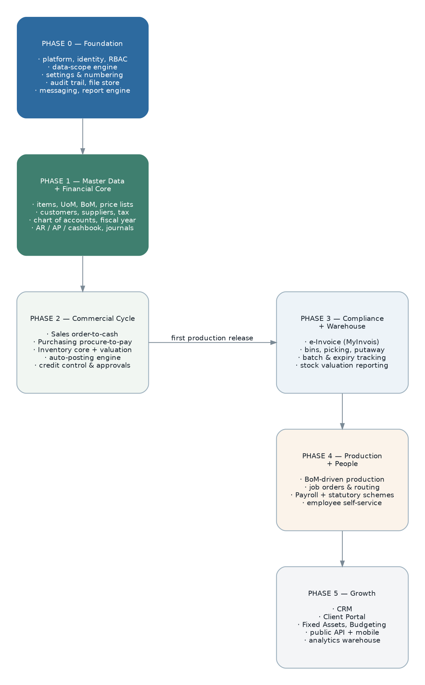

*Figure 22 — Release phasing. Phases 0 to 2 constitute the first production release.*

**23.1 Sequence constraints**

| **Constraint**                                                 | **Why it cannot be reordered**                                                                                                          |
|----------------------------------------------------------------|-----------------------------------------------------------------------------------------------------------------------------------------|
| The tenancy decision precedes any data-access code.            | It determines the repository base class and every table definition. Deciding later means rewriting both (ADR-05).                       |
| The legal-entity separation precedes master data and finance.  | Statutory identity, chart of accounts and fiscal calendars attach to it. Retrofitting it means migrating every document (ADR-19).       |
| The document lifecycle framework precedes any document family. | Every family is a declaration against it. Building families first means each carries its own copy of the machinery (R-01).              |
| The authorisation pipeline precedes any endpoint.              | Retrofitting scope enforcement into existing repositories is how scope gaps are created.                                                |
| The posting engine precedes any module that posts.             | Sales, purchasing, inventory and payroll all depend on it. Built per module, it would be built four times, differently.                 |
| Master data precedes the commercial cycle.                     | Nothing can transact on items, parties, tax or prices that do not exist.                                                                |
| The financial core precedes automatic posting.                 | Nothing can post to a ledger that does not exist.                                                                                       |
| Inventory core precedes warehouse depth and production.        | Bins, picking and job orders all write through the stock ledger.                                                                        |
| Data profiling precedes migration design.                      | The transformation rules depend on what the data actually contains, and it also answers the volume questions that baseline performance. |

**23.2 Work breakdown**

**Phase 0 — Foundation**

| **Workstream**               | **Deliverables**                                                                                                                                                                                                                     | **Exit criterion**                                                                               |
|------------------------------|--------------------------------------------------------------------------------------------------------------------------------------------------------------------------------------------------------------------------------------|--------------------------------------------------------------------------------------------------|
| Project setup                | Monorepo, workspace packages, build pipeline with all gates, boundary rules, module generator, local environment, test harness with Testcontainers.                                                                                  | A generated module passes every gate.                                                            |
| Platform core                | Tenant and request context, legal entity and branch, users, roles, the permission registry and three-stage authorisation pipeline, settings service, numbering service, audit subscriber, outbox and dispatcher, currency and rates. | An administrator can create an entity, a branch, a user and a role, and every action is audited. |
| Document lifecycle framework | Base aggregate, state machine, transfer engine, revision, cancellation, line management, calculation pipeline, bulk operations, attachments — with its full test suite.                                                              | Three trial document families run end to end on it.                                              |
| Workflow engine              | Approval definitions, conditions, chains, decisions, escalation, delegation, work queue.                                                                                                                                             | A value-threshold approval blocks and releases a trial document.                                 |
| Supporting platform          | File store with buckets, messaging with channels and intents, report registry and rendering orchestration.                                                                                                                           | A file attaches, an email sends, a report renders.                                               |
| Frontend framework           | Design system primitives, data grid, document form renderer, line editor, picker, command bar, report runner, generated API client.                                                                                                  | A trial document family is fully usable with no bespoke screen code.                             |
| Data profiling               | Legacy extraction into staging, a data-quality report, measured volumes, the legal-entity mapping proposal.                                                                                                                          | Profiling report reviewed; SRS OQ-050 answered.                                                  |
| Observability and operations | Structured logging with correlation, metrics, alerting, the operations console.                                                                                                                                                      | A deliberately failed job appears in the console and raises an alert.                            |

**Phase 1 — Master data and financial core**

| **Workstream**        | **Deliverables**                                                                                                                                                                                                                                                                                    | **Exit criterion**                                                                 |
|-----------------------|-----------------------------------------------------------------------------------------------------------------------------------------------------------------------------------------------------------------------------------------------------------------------------------------------------|------------------------------------------------------------------------------------|
| Master data           | Items with all classifications, UoM and conversions, multi-level BoM with flattening and cycle detection, price lists with scheduling and history, customers and suppliers with addresses, contacts and banks, tax with effective dating, tax profiles and exemptions, reference data, bulk import. | A full catalogue and party set can be loaded and maintained.                       |
| Finance — ledger      | Chart of accounts, journals and templates, fiscal years and periods with dual locks and exceptions, account balances, projects and departments, budgets.                                                                                                                                            | A month of manual entry closes with a correct trial balance.                       |
| Finance — sub-ledgers | AR and AP document sets, the generic settlement engine, deposits, contra, aging, statements with scheduling.                                                                                                                                                                                        | Invoices settle, aging ties, statements dispatch.                                  |
| Finance — cashbook    | Payment methods, general receipts and vouchers, payment registers, bank reconciliation.                                                                                                                                                                                                             | A bank account reconciles.                                                         |
| Posting engine        | Profile registry, posting-route resolution chain with start-up validation, guards, idempotency, failure surfacing.                                                                                                                                                                                  | A manual AR invoice posts correctly and a deliberately broken route fails at boot. |
| Reporting             | Report engine integration, financial statements with comparatives, aging, ledgers, listings. Catalogue pruning decision.                                                                                                                                                                            | The statutory statement set produces correct output.                               |
| Migration             | Master data and opening-balance migration, first full rehearsal with reconciliation.                                                                                                                                                                                                                | Reconciliation report signed by finance.                                           |

**Phase 2 — Commercial cycle (first production release)**

| **Workstream**        | **Deliverables**                                                                                                                                                                                                               | **Exit criterion**                                                        |
|-----------------------|--------------------------------------------------------------------------------------------------------------------------------------------------------------------------------------------------------------------------------|---------------------------------------------------------------------------|
| Sales                 | All ten document families, transfer chain, revision, cancellation, credit control with configurable actions, territories, exemptions, price history, profit estimator, document email.                                         | Order to cash runs end to end and posts automatically.                    |
| Purchasing            | All nine document families, demand, sourcing, value-threshold approval, three-way matching with tolerances, supplier price history.                                                                                            | Procure to pay runs end to end and posts automatically.                   |
| Inventory core        | Locations, batches, the stock ledger, FIFO and weighted-average valuation, inbound and outbound chains, delivery and receipt, issues, receipts, transfers, adjustments, scrap, opening balances, period valuation and posting. | Stock quantity and value reconcile to the ledger.                         |
| Process managers      | Order fulfilment, purchase receipt, document posting, inter-company mirroring.                                                                                                                                                 | Each runs to completion and compensates correctly on an injected failure. |
| Operational reporting | Sales, purchase and inventory summary and outstanding reports; printable documents; dashboards.                                                                                                                                | The pruned catalogue for these modules is delivered.                      |
| Migration and cutover | Open-document migration, final rehearsals, parallel running through one month-end, cutover, rollback rehearsal.                                                                                                                | One month-end reconciles in both systems; cutover executed.               |

**Phase 3 — Compliance and warehouse depth**

| **Workstream**       | **Deliverables**                                                                                                                                                       | **Exit criterion**                                |
|----------------------|------------------------------------------------------------------------------------------------------------------------------------------------------------------------|---------------------------------------------------|
| e-Invoice            | Eligibility, validation, mapping, signing, submission, status retrieval, cancellation, status reporting, party TIN validation at master-data entry.                    | Documents submit and validate in production.      |
| Warehouse depth      | Bin-level operations, pick orders with exception states, putaway, batch and expiry tracking and alerting, stock count and cycle count, reservations with availability. | A warehouse operates bin-level on a touch device. |
| Valuation reporting  | Stock card, aging by quantity and value, month-end balance, count sheet, project costing.                                                                              | Valuation reporting reconciles to the ledger.     |
| Archiving            | Partition detachment, archive export, drill-down to archived data.                                                                                                     | A period is archived and remains queryable.       |
| Report engine review | Decision on retiring or retaining Jasper (ADR-16, R-15).                                                                                                               | Recorded decision.                                |

**Phase 4 — Production and people**

| **Workstream** | **Deliverables**                                                                                                                                                                                                                                         | **Exit criterion**                                                                                          |
|----------------|----------------------------------------------------------------------------------------------------------------------------------------------------------------------------------------------------------------------------------------------------------|-------------------------------------------------------------------------------------------------------------|
| Production     | Job orders, BoM explosion and netting, shortage requests, process orders, routing task sets, material issue, progress, assembly, disassembly, wastage, cost roll-up with labour and overhead components, variance reporting.                             | A make-to-order job runs end to end and costs correctly.                                                    |
| Payroll        | Employees, positions, compensation, components, leave setup and balances, applications, claims, runs, payslips, the Malaysian statutory rule set with effective-dated tables, annual income, EA form, statutory returns, bank payment files, GL posting. | A run reconciles to the published statutory tables to the cent; a historical period recomputes identically. |
| Self-service   | Payslips, EA form, leave balance and application, claims, notifications, manager approval, mobile usability.                                                                                                                                             | An employee completes a leave and claim cycle on a phone.                                                   |
| Migration      | Employee, leave-balance and year-to-date migration with reconciliation.                                                                                                                                                                                  | Year-to-date figures reconcile.                                                                             |

**Phase 5 — Growth**

- CRM: leads, opportunities, pipeline, activities, targets, and the integration back into the sales lifecycle that the legacy hooks already expect.

- Client portal: separate deployment, customer authentication, document and statement access, order placement.

- Fixed assets: register, depreciation, disposal, revaluation, ledger reconciliation.

- Budgeting: preparation, submission, approval and revision workflow over the existing budget entity.

- Integration hub: published API programme, webhook subscriptions, import and export definitions, partner onboarding.

- Mobile clients for warehouse and self-service.

- Analytics: warehouse, dimensional models, self-service business intelligence.

**23.3 Definition of done, per module**

- Every SRS requirement for the module is implemented or has a recorded decision to defer it.

- Every SRS business rule for the module is covered by at least one automated test.

- Authorisation and data-scope tests are generated and passing for every endpoint and entity.

- Integration tests cover every repository and engine path against a real database.

- Performance tests for the module’s critical operations meet the section 17.1 targets.

- Migration mapping exists and a rehearsal reconciles.

- The permission, settings and report registries are complete and generate their documentation.

- Observability is in place: metrics emitted, alerts defined, failures visible in the operations console.

- A runbook exists for the module’s scheduled jobs and failure modes.

**Appendices**

**Appendix A — Diagram index**

| **Figure** | **Diagram**                      | **Section** | **Shows**                                                          |
|------------|----------------------------------|-------------|--------------------------------------------------------------------|
| 1          | Context view                     | 3.2         | System boundary, actors, external systems.                         |
| 2          | Container view                   | 3.3         | Runtime processes and data stores.                                 |
| 3          | Layering within a module         | 5.1         | The inward dependency rule.                                        |
| 4          | Outbox event flow                | 5.8.3       | Transactional publication, consumers, idempotency, failure path.   |
| 5          | Module map                       | 6.1 (SRS)   | Layered module dependencies.                                       |
| 6          | Tenancy options                  | 7.5         | Three isolation models and the recommendation.                     |
| 7          | Delivery pipeline                | 7.9, 16.4   | Gates from commit to production.                                   |
| 8          | Platform and identity ERD        | 8.2         | Tenant, entity, branch, user, role, permission, approval, audit.   |
| 9          | Master data ERD                  | 8.3         | Items, parties, pricing, tax, UoM, BoM.                            |
| 10         | Sales ERD                        | 8.4         | Document families, transfer chain, links to finance and inventory. |
| 11         | Inventory ERD                    | 8.5         | Locations, batches, ledger, layers, production link.               |
| 12         | Finance ERD                      | 8.6         | Accounts, journals, sub-ledgers, settlement, posting routes.       |
| 13         | Payroll ERD                      | 8.7         | Employees, components, leave, runs, payslips, statutory schemes.   |
| 14         | Authentication and authorisation | 10.2        | Token issue and the three-stage pipeline.                          |
| 15         | Document state machine           | 13.1        | States, transitions and guards.                                    |
| 16         | Approval workflow                | 13.2        | Rule evaluation to release.                                        |
| 17         | Posting engine                   | 13.3        | Event to journal, route chain, failure path.                       |
| 18         | Inventory engine                 | 13.4        | Movement to valuation.                                             |
| 19         | Payroll cycle                    | 13.5        | Master data to disbursement and annual reporting.                  |
| 20         | e-Invoice lifecycle              | 12.2        | Validation, submission, outcome, cancellation.                     |
| 21         | Deployment topology              | 16.3        | Zones, tiers and data stores.                                      |
| 22         | Release phasing                  | 23          | Phase contents and sequence.                                       |

**Appendix B — Naming conventions**

| **Artefact**       | **Convention**                                           | **Example**                                |
|--------------------|----------------------------------------------------------|--------------------------------------------|
| Module directory   | kebab-case                                               | modules/master-data/                       |
| Aggregate class    | PascalCase, business noun                                | SalesOrder                                 |
| Value object       | PascalCase, no suffix                                    | \[object Object\], \[object Object\]       |
| Domain event       | PascalCase past tense                                    | SalesOrderReleased                         |
| Command            | PascalCase imperative + Command                          | ReleaseSalesOrderCommand                   |
| Command handler    | Command name + Handler                                   | ReleaseSalesOrderHandler                   |
| Repository port    | Aggregate + Repository                                   | SalesOrderRepository                       |
| Repository adapter | Aggregate + technology + Repository                      | SalesOrderPrismaRepository                 |
| Business rule      | A sentence in PascalCase                                 | PeriodMustBeOpen                           |
| Policy             | Aggregate + Policy                                       | SalesOrderPolicy                           |
| Outbound port      | Capability + Port                                        | NotificationPort                           |
| Outbound adapter   | Provider + capability + Adapter                          | SmtpNotificationAdapter                    |
| Read model         | Noun phrase + View                                       | OutstandingOrdersView                      |
| Database table     | snake_case singular, in the module schema                | sales.sales_order                          |
| Detail table       | Parent + \_line                                          | sales.sales_order_line                     |
| API path           | kebab-case plural nouns                                  | /api/v1/sales/orders                       |
| API command path   | kebab-case verb sub-resource                             | /api/v1/sales/orders/{id}/release-shipment |
| Permission key     | Module::Object@Action — preserved from the legacy format | Sales::Sales Order@Release Record          |
| Setting key        | module.group.camelCaseKey                                | sales.general.quotationValidityDays        |
| Queue name         | module.purpose                                           | finance.posting                            |
| Metric name        | erp_module_subject_unit                                  | erp_finance_postings_failed_total          |
| Feature switch     | module.enableThing                                       | core.enableInterlink                       |

**Appendix C — Module skeleton**

The module generator produces this structure with a passing test, a registered permission, a settings registry and a migration, so that a new module starts compliant rather than being made compliant later.

<table>
<colgroup>
<col style="width: 100%" />
</colgroup>
<tbody>
<tr class="odd">
<td>
$ pnpm gen:module --name fixed-assets --layer 5 --depends platform,master-data,finance

created modules/fixed-assets/

contract/{events,types,ports,read-model}.ts

domain/asset/{asset.aggregate.ts,asset.repository.ts,asset.spec.ts}

application/commands/create-asset.handler.ts

application/queries/list-assets.handler.ts

application/policies/asset.policy.ts

infrastructure/persistence/asset.prisma-repository.ts

interface/http/asset.controller.ts

interface/permissions.ts

config/{settings,numbering,reports,notifications}.registry.ts

prisma/fixed-assets.prisma

module.ts

README.md

registered fixed_assets schema in the composed Prisma schema

registered module in the dependency graph (layer 5 → platform, master-data, finance)

registered permission object "FixedAssets::Asset"

generated authorisation + scope contract tests

$ pnpm test --filter fixed-assets ✓ 6 passed

$ pnpm lint:boundaries ✓ no violations
</td>
</tr>
</tbody>
</table>

**Appendix D — OpenAPI fragment**

<table>
<colgroup>
<col style="width: 100%" />
</colgroup>
<tbody>
<tr class="odd">
<td>
paths:

/api/v1/sales/orders/{id}/release:

post:

operationId: releaseSalesOrder

summary: Release a sales order

description: &gt;

Commits the order. Evaluates credit control and may raise an approval

instead of releasing. Requires Sales::Sales Order@Release Record.

parameters:

- { name: id, in: path, required: true, schema: { type: string, format: uuid } }

- { name: If-Match, in: header, required: true, schema: { type: string },

description: The version returned as the ETag of the last read. }

- { name: Idempotency-Key, in: header, required: true, schema: { type: string } }

responses:

"200":

description: Released, or blocked pending approval.

headers:

ETag: { schema: { type: string } }

content:

application/json:

schema:

type: object

properties:

data:

allOf:

- $ref: "#/components/schemas/SalesOrder"

- type: object

properties:

approvalId: { type: string, format: uuid, nullable: true }

"409": { $ref: "#/components/responses/Conflict" }

"422": { $ref: "#/components/responses/BusinessRuleViolation" }

components:

schemas:

Money:

type: string

pattern: "^-?\\d+(\\.\\d{1,4})?$"

description: &gt;

A decimal string. MUST be parsed with a decimal library; parsing as a

double will lose precision on large amounts.

example: "12500.0000"

responses:

BusinessRuleViolation:

description: A documented business rule refused the operation.

content:

application/json:

schema:

type: object

properties:

error:

type: object

properties:

code: { type: string, enum: [BUSINESS_RULE_VIOLATION] }

ruleId: { type: string, example: "BR-CRED-002" }

message: { type: string }
</td>
</tr>
</tbody>
</table>

**Appendix E — Legacy to new mapping**

The structural mappings that migration and requirements archaeology both depend on. Table-level mappings are maintained as a separate working artefact; this appendix records the decisions behind them.

| **Legacy concept**                                      | **New concept**                    | **Migration note**                                                                                                                                                                                                              |
|---------------------------------------------------------|------------------------------------|---------------------------------------------------------------------------------------------------------------------------------------------------------------------------------------------------------------------------------|
| Branch (combined company and location)                  | legal_entity + branch              | A legacy branch holding its own tax registration becomes a legal entity with a default branch beneath it; otherwise it becomes a branch of its parent’s entity. Must be reviewed with finance (ADR-19, SRS OQ-002).             |
| Grant string                                            | Permission key                     | Format preserved exactly, so role configurations migrate rather than being rebuilt (SRS CON-09).                                                                                                                                |
| Role (one per user)                                     | Role (many per user)               | Each legacy user gets their single role; combinatorial roles created to work around the limitation can be decomposed afterwards.                                                                                                |
| ref_object_type / ref_object_id / ref_object_url triple | document_link row                  | Type strings map to registered document type codes; orphaned references are reported, not migrated (SRS WK-07, DR-018).                                                                                                         |
| \*\_detail tables                                       | \*\_line tables                    | Straight rename with column mapping.                                                                                                                                                                                            |
| balance_quantity column                                 | Generated column                   | Not migrated; derived from quantity and transferred_quantity. A discrepancy in the legacy value is reported as a data-quality finding (ADR-10).                                                                                 |
| Ten payroll entry tables                                | One payroll_entry_component table  | Component type derived from the source table; all fields preserved.                                                                                                                                                             |
| Six knock-off tables                                    | One settlement table               | Direction derived from the source table.                                                                                                                                                                                        |
| Parallel customer_address / supplier_address            | party_address with a discriminator | Straight union.                                                                                                                                                                                                                 |
| Statutory scheme tables (replaced in place)             | Effective-dated versions           | The current set is loaded as the version effective from its known statutory date; earlier versions are loaded where obtainable, otherwise historical recomputation before that date is flagged as unsupported (SRS BR-PAY-011). |
| Settings table (module + key)                           | Settings with explicit scope       | Scope inferred per setting; ambiguous cases resolved with the business (SRS OQ-012).                                                                                                                                            |
| Mail and webhook secrets in settings                    | Secret store                       | Migrated into the secret store and removed from the database (SRS NFR-SEC-004).                                                                                                                                                 |
| Report definition JSON                                  | Report registry entry              | Mechanical; parameter descriptors map directly.                                                                                                                                                                                 |
| Keeper bucket JSON                                      | Bucket registry entry              | Mechanical; file content copied to object storage.                                                                                                                                                                              |
| Dove intent JSON                                        | Notification intent registry       | Mechanical, with the intent catalogue extended per SRS section 11.1.                                                                                                                                                            |
| View sales_view_transfer_overview                       | Recursive query over document_link | Replaced by a query; the view is not migrated.                                                                                                                                                                                  |
| Naive date and datetime columns                         | date and timestamptz               | Business dates stay dates; timestamps are interpreted as Asia/Kuala_Lumpur and converted, subject to SRS OQ-005.                                                                                                                |

**Appendix F — Glossary**

Business terminology is in ERP-SRS-001 section 1.5. Design terminology is in section 1.4 of this document. Both are deliberately placed near the front rather than in an appendix, because they are needed from the first page.

*End of document — ERP-SDD-001 v1.0*
