**SOFTWARE REQUIREMENTS SPECIFICATION**

Enterprise Resource Planning System

*Derived from an engineering analysis of the existing modular Laravel ERP codebase, with gap analysis and forward requirements for a rebuilt system.*

| **Field**           | **Value**                                                                                                                                                                                           |
|---------------------|-----------------------------------------------------------------------------------------------------------------------------------------------------------------------------------------------------|
| Document title      | Software Requirements Specification — Enterprise Resource Planning System                                                                                                                           |
| Document code       | ERP-SRS-001                                                                                                                                                                                         |
| Version             | 1.0 (Initial baseline for review)                                                                                                                                                                   |
| Status              | Draft for business and technical review                                                                                                                                                             |
| Date                | 22 September 2026                                                                                                                                                                                   |
| Prepared by         | Muiz — Software Engineering                                                                                                                                                                         |
| Basis of analysis   | Static code review of the legacy modular ERP repository: 12 modules, 340 database tables, 722 permission keys, 173 report definitions, 231 domain events and approximately 570 route registrations. |
| Companion document  | ERP-SDD-001 — Software Design Document (how the system will be built). This SRS deliberately contains no implementation design.                                                                     |
| Intended readership | Business owners and process owners, product management, the development team, QA, and the eventual implementation and support teams.                                                                |
| Review status       | Section 19 lists every point that must be confirmed by the business before the corresponding requirements are treated as baselined.                                                                 |

# Document Control

## Revision history

| **Version** | **Date**    | **Author** | **Summary of change**                                                                                                                                            |
|-------------|-------------|------------|------------------------------------------------------------------------------------------------------------------------------------------------------------------|
| 0.1         | 22 Sep 2026 | Muiz       | Skeleton and table of contents established from industry practice (ISO/IEC/IEEE 29148 and IEEE 830 adapted for a packaged ERP product).                          |
| 1.0         | 22 Sep 2026 | Muiz       | Initial baseline. All requirements derived from static analysis of the legacy codebase, classified by implementation status, with gap analysis and phased scope. |

## Approvals required

This document is not baselined until the following approvals are recorded. Until then, every requirement in it is a proposal.

| **Role**                   | **Responsibility for this document**                                                            | **Name / date** |
|----------------------------|-------------------------------------------------------------------------------------------------|-----------------|
| Business sponsor           | Confirms business objectives, scope and release phasing (sections 2, 3.8 and 18).               |                 |
| Finance process owner      | Confirms accounting, tax, credit-control and period-close requirements (sections 6.7, 8.4–8.9). |                 |
| Operations process owner   | Confirms sales, purchasing, inventory and production requirements (sections 6.3–6.6).           |                 |
| HR / Payroll process owner | Confirms payroll, statutory and leave requirements (sections 6.8, 8.10).                        |                 |
| IT / Security              | Confirms non-functional, security and compliance requirements (section 13).                     |                 |
| Development lead           | Confirms the requirements are testable and the scope is achievable as phased.                   |                 |

## Related documents

| **Reference**           | **Document**                                                                       | **Relationship**                                                                   |
|-------------------------|------------------------------------------------------------------------------------|------------------------------------------------------------------------------------|
| ERP-SDD-001             | Software Design Document — Enterprise Resource Planning System                     | Describes how the requirements in this SRS will be realised. Read second.          |
| LEGACY-REPO             | Existing modular Laravel ERP repository (12 modules as git submodules)             | Primary source of requirements. Referenced throughout as "the legacy system".      |
| ISO/IEC/IEEE 29148:2018 | Systems and software engineering — Life cycle processes — Requirements engineering | Structural standard followed for this document.                                    |
| IEEE 830-1998           | Recommended Practice for Software Requirements Specifications                      | Superseded, but its section ordering remains widely expected and is retained here. |

# Table of Contents

*The contents list below is a Word field. It populates with page numbers when you open the document in Word and accept the update prompt, or by pressing Ctrl+A then F9. The document map that follows it is static and always available.*

[Document Control [2](#document-control)](#document-control)

[Revision history [2](#revision-history)](#revision-history)

[Approvals required [2](#approvals-required)](#approvals-required)

[Related documents [2](#related-documents)](#related-documents)

[Table of Contents [3](#table-of-contents)](#table-of-contents)

[Document Map [9](#document-map)](#document-map)

[1. Introduction [10](#introduction)](#introduction)

[1.1 Purpose [10](#purpose)](#purpose)

[1.2 Document conventions [10](#document-conventions)](#document-conventions)

[1.2.1 Requirement identifiers [10](#requirement-identifiers)](#requirement-identifiers)

[1.2.2 Obligation language [10](#obligation-language)](#obligation-language)

[1.2.3 Status classification [11](#status-classification)](#status-classification)

[1.3 Intended audience and reading suggestions [11](#intended-audience-and-reading-suggestions)](#intended-audience-and-reading-suggestions)

[1.4 Product scope [12](#product-scope)](#product-scope)

[1.5 Definitions, acronyms and abbreviations [12](#definitions-acronyms-and-abbreviations)](#definitions-acronyms-and-abbreviations)

[1.6 References [15](#references)](#references)

[2. Business Context and Objectives [16](#business-context-and-objectives)](#business-context-and-objectives)

[2.1 Background: the legacy system [16](#background-the-legacy-system)](#background-the-legacy-system)

[2.2 Business drivers for rebuilding [17](#business-drivers-for-rebuilding)](#business-drivers-for-rebuilding)

[2.3 Business objectives and success measures [17](#business-objectives-and-success-measures)](#business-objectives-and-success-measures)

[2.4 Stakeholders [18](#stakeholders)](#stakeholders)

[2.5 Operating context [18](#operating-context)](#operating-context)

[3. Overall Description [20](#overall-description)](#overall-description)

[3.1 Product perspective [20](#product-perspective)](#product-perspective)

[3.2 Module map and dependency model [20](#module-map-and-dependency-model)](#module-map-and-dependency-model)

[3.3 User classes and characteristics [21](#user-classes-and-characteristics)](#user-classes-and-characteristics)

[3.4 Operating environment [22](#operating-environment)](#operating-environment)

[3.5 Design and implementation constraints [23](#design-and-implementation-constraints)](#design-and-implementation-constraints)

[3.6 Assumptions [23](#assumptions)](#assumptions)

[3.7 Dependencies [24](#dependencies)](#dependencies)

[3.8 Apportioning of requirements — release phasing [24](#apportioning-of-requirements-release-phasing)](#apportioning-of-requirements-release-phasing)

[4. Scope Baseline — Legacy Capability Inventory [27](#scope-baseline-legacy-capability-inventory)](#scope-baseline-legacy-capability-inventory)

[4.1 Method used to derive requirements [27](#method-used-to-derive-requirements)](#method-used-to-derive-requirements)

[4.2 Module inventory and status [28](#module-inventory-and-status)](#module-inventory-and-status)

[4.3 Quantified capability baseline [29](#quantified-capability-baseline)](#quantified-capability-baseline)

[4.4 Capabilities referenced by the legacy code but absent from it [29](#capabilities-referenced-by-the-legacy-code-but-absent-from-it)](#capabilities-referenced-by-the-legacy-code-but-absent-from-it)

[4.5 Structural weaknesses observed, to be corrected [30](#structural-weaknesses-observed-to-be-corrected)](#structural-weaknesses-observed-to-be-corrected)

[5. User Roles, Permissions and Access Control Requirements [32](#user-roles-permissions-and-access-control-requirements)](#user-roles-permissions-and-access-control-requirements)

[5.1 Role model [33](#role-model)](#role-model)

[5.2 Permission catalogue [33](#permission-catalogue)](#permission-catalogue)

[5.3 Data-scope rules [34](#data-scope-rules)](#data-scope-rules)

[5.3.1 Branch scope [34](#branch-scope)](#branch-scope)

[5.3.2 Sales-agent scope [34](#sales-agent-scope)](#sales-agent-scope)

[5.3.3 Record and field sensitivity [35](#record-and-field-sensitivity)](#record-and-field-sensitivity)

[5.4 Approval authority and delegation [35](#approval-authority-and-delegation)](#approval-authority-and-delegation)

[5.5 Authentication requirements [36](#authentication-requirements)](#authentication-requirements)

[6. Functional Requirements by Module [37](#functional-requirements-by-module)](#functional-requirements-by-module)

[6.1 Platform and Administration [37](#platform-and-administration)](#platform-and-administration)

[6.1.1 Sub-modules [37](#sub-modules)](#sub-modules)

[6.1.2 Requirements [37](#requirements)](#requirements)

[6.2 Master Data [41](#master-data)](#master-data)

[6.2.1 Requirements [43](#requirements-1)](#requirements-1)

[6.3 Sales [46](#sales)](#sales)

[6.3.1 Document set and flow [46](#document-set-and-flow)](#document-set-and-flow)

[6.3.2 Requirements [49](#requirements-2)](#requirements-2)

[6.4 Purchasing [52](#purchasing)](#purchasing)

[6.4.1 Document set [52](#document-set)](#document-set)

[6.4.2 Requirements [53](#requirements-3)](#requirements-3)

[6.5 Inventory and Warehouse [55](#inventory-and-warehouse)](#inventory-and-warehouse)

[6.5.1 Structure [55](#structure)](#structure)

[6.5.2 Requirements [57](#requirements-4)](#requirements-4)

[6.6 Production [60](#production)](#production)

[6.6.1 Requirements [60](#requirements-5)](#requirements-5)

[6.7 Finance and Accounting [62](#finance-and-accounting)](#finance-and-accounting)

[6.7.1 Requirements — general ledger [64](#requirements-general-ledger)](#requirements-general-ledger)

[6.7.2 Requirements — fiscal year and period control [64](#requirements-fiscal-year-and-period-control)](#requirements-fiscal-year-and-period-control)

[6.7.3 Requirements — receivables and payables [65](#requirements-receivables-and-payables)](#requirements-receivables-and-payables)

[6.7.4 Requirements — cashbook, banking and posting configuration [66](#requirements-cashbook-banking-and-posting-configuration)](#requirements-cashbook-banking-and-posting-configuration)

[6.8 Payroll and Human Resources [68](#payroll-and-human-resources)](#payroll-and-human-resources)

[6.8.1 Requirements — employee and structure [70](#requirements-employee-and-structure)](#requirements-employee-and-structure)

[6.8.2 Requirements — leave and claims [70](#requirements-leave-and-claims)](#requirements-leave-and-claims)

[6.8.3 Requirements — payroll run and statutory computation [71](#requirements-payroll-run-and-statutory-computation)](#requirements-payroll-run-and-statutory-computation)

[6.9 Employee Self-Service [73](#employee-self-service)](#employee-self-service)

[6.10 Document Store [73](#document-store)](#document-store)

[6.11 Messaging and Notification [74](#messaging-and-notification)](#messaging-and-notification)

[6.12 Reporting and Analytics [75](#reporting-and-analytics)](#reporting-and-analytics)

[6.12.1 Report classes [75](#report-classes)](#report-classes)

[6.12.2 Requirements [75](#requirements-6)](#requirements-6)

[6.13 Extensibility Framework [76](#extensibility-framework)](#extensibility-framework)

[6.14 Proposed Modules [77](#proposed-modules)](#proposed-modules)

[6.14.1 e-Invoice (Malaysia — MyInvois) [77](#e-invoice-malaysia-myinvois)](#e-invoice-malaysia-myinvois)

[6.14.2 Customer Relationship Management [78](#customer-relationship-management)](#customer-relationship-management)

[6.14.3 Client Portal [79](#client-portal)](#client-portal)

[6.14.4 Fixed Assets [79](#fixed-assets)](#fixed-assets)

[6.14.5 Workflow and Approval Engine [79](#workflow-and-approval-engine)](#workflow-and-approval-engine)

[6.14.6 Integration Hub [80](#integration-hub)](#integration-hub)

[6.14.7 Other capabilities confirmed absent [81](#other-capabilities-confirmed-absent)](#other-capabilities-confirmed-absent)

[7. Business Processes and Workflows [82](#business-processes-and-workflows)](#business-processes-and-workflows)

[7.1 Notation and conventions [82](#notation-and-conventions)](#notation-and-conventions)

[7.2 Order to cash [82](#order-to-cash)](#order-to-cash)

[7.3 Procure to pay [85](#procure-to-pay)](#procure-to-pay)

[7.4 Inventory movement and valuation [86](#inventory-movement-and-valuation)](#inventory-movement-and-valuation)

[7.5 Make to order [88](#make-to-order)](#make-to-order)

[7.6 Record to report — period close [89](#record-to-report-period-close)](#record-to-report-period-close)

[7.7 Hire to retire — the payroll cycle [90](#hire-to-retire-the-payroll-cycle)](#hire-to-retire-the-payroll-cycle)

[7.8 Approval and authorisation [92](#approval-and-authorisation)](#approval-and-authorisation)

[7.9 Inter-company trading [93](#inter-company-trading)](#inter-company-trading)

[7.10 Document revision, cancellation and correction [93](#document-revision-cancellation-and-correction)](#document-revision-cancellation-and-correction)

[8. Business Rules [95](#business-rules)](#business-rules)

[8.1 Document numbering [95](#document-numbering)](#document-numbering)

[8.2 Document status and transfer status [96](#document-status-and-transfer-status)](#document-status-and-transfer-status)

[8.3 Pricing and discount [97](#pricing-and-discount)](#pricing-and-discount)

[8.4 Credit control [97](#credit-control)](#credit-control)

[8.5 Tax [98](#tax)](#tax)

[8.6 Currency and foreign exchange [98](#currency-and-foreign-exchange)](#currency-and-foreign-exchange)

[8.7 Inventory costing and valuation [99](#inventory-costing-and-valuation)](#inventory-costing-and-valuation)

[8.8 Fiscal period control [99](#fiscal-period-control)](#fiscal-period-control)

[8.9 Accounting posting [100](#accounting-posting)](#accounting-posting)

[8.10 Payroll and statutory rules (Malaysia) [100](#payroll-and-statutory-rules-malaysia)](#payroll-and-statutory-rules-malaysia)

[8.11 Validation rules [101](#validation-rules)](#validation-rules)

[9. Data Requirements [103](#data-requirements)](#data-requirements)

[9.1 Conceptual data model [103](#conceptual-data-model)](#conceptual-data-model)

[9.2 Master data entities [105](#master-data-entities)](#master-data-entities)

[9.3 Transactional data entities [105](#transactional-data-entities)](#transactional-data-entities)

[9.4 Data volumes and growth [106](#data-volumes-and-growth)](#data-volumes-and-growth)

[9.5 Data retention and archiving [106](#data-retention-and-archiving)](#data-retention-and-archiving)

[9.6 Data migration requirements [107](#data-migration-requirements)](#data-migration-requirements)

[9.7 Data quality requirements [108](#data-quality-requirements)](#data-quality-requirements)

[10. Reporting Requirements [109](#reporting-requirements)](#reporting-requirements)

[10.1 Catalogue summary [109](#catalogue-summary)](#catalogue-summary)

[10.2 Cross-cutting reporting requirements [110](#cross-cutting-reporting-requirements)](#cross-cutting-reporting-requirements)

[10.3 Dashboard and indicator requirements [110](#dashboard-and-indicator-requirements)](#dashboard-and-indicator-requirements)

[11. Notification Requirements [112](#notification-requirements)](#notification-requirements)

[11.1 Intent catalogue [112](#intent-catalogue)](#intent-catalogue)

[11.2 Delivery requirements [113](#delivery-requirements)](#delivery-requirements)

[12. Integration Requirements [114](#integration-requirements)](#integration-requirements)

[12.1 Existing integrations [114](#existing-integrations)](#existing-integrations)

[12.2 Required integrations [114](#required-integrations)](#required-integrations)

[12.3 Integration constraints [115](#integration-constraints)](#integration-constraints)

[13. Non-Functional Requirements [116](#non-functional-requirements)](#non-functional-requirements)

[13.1 Performance [116](#performance)](#performance)

[13.2 Capacity and scalability [116](#capacity-and-scalability)](#capacity-and-scalability)

[13.3 Availability and reliability [117](#availability-and-reliability)](#availability-and-reliability)

[13.4 Security [117](#security)](#security)

[13.5 Auditability and compliance [118](#auditability-and-compliance)](#auditability-and-compliance)

[13.6 Usability and accessibility [118](#usability-and-accessibility)](#usability-and-accessibility)

[13.7 Localisation and internationalisation [119](#localisation-and-internationalisation)](#localisation-and-internationalisation)

[13.8 Maintainability [119](#maintainability)](#maintainability)

[13.9 Portability and operability [120](#portability-and-operability)](#portability-and-operability)

[13.10 Observability [120](#observability)](#observability)

[13.11 Backup and disaster recovery [120](#backup-and-disaster-recovery)](#backup-and-disaster-recovery)

[13.12 Licensing and intellectual property [120](#licensing-and-intellectual-property)](#licensing-and-intellectual-property)

[14. System Constraints [122](#system-constraints)](#system-constraints)

[15. Assumptions and Dependencies [122](#assumptions-and-dependencies)](#assumptions-and-dependencies)

[16. Gap Analysis Summary [122](#gap-analysis-summary)](#gap-analysis-summary)

[16.1 Distribution by status [122](#distribution-by-status)](#distribution-by-status)

[16.2 The gaps that matter most [123](#the-gaps-that-matter-most)](#the-gaps-that-matter-most)

[17. Improvement Backlog [124](#improvement-backlog)](#improvement-backlog)

[18. Future Requirements and Roadmap [124](#future-requirements-and-roadmap)](#future-requirements-and-roadmap)

[19. Open Questions Requiring Business Confirmation [125](#open-questions-requiring-business-confirmation)](#open-questions-requiring-business-confirmation)

[20. Acceptance and Traceability [128](#acceptance-and-traceability)](#acceptance-and-traceability)

[20.1 Acceptance approach [128](#acceptance-approach)](#acceptance-approach)

[20.2 Traceability matrix structure [129](#traceability-matrix-structure)](#traceability-matrix-structure)

[20.3 Verification methods [129](#verification-methods)](#verification-methods)

[Appendices [130](#appendices)](#appendices)

[Appendix A — Legacy Database Table Inventory [130](#appendix-a-legacy-database-table-inventory)](#appendix-a-legacy-database-table-inventory)

[A.1 Bookkeeping — 71 tables [130](#a.1-bookkeeping-71-tables)](#a.1-bookkeeping-71-tables)

[A.2 Common — 39 tables [131](#a.2-common-39-tables)](#a.2-common-39-tables)

[A.3 Dove — 3 tables [131](#a.3-dove-3-tables)](#a.3-dove-3-tables)

[A.4 Extension — 1 tables [131](#a.4-extension-1-tables)](#a.4-extension-1-tables)

[A.5 Inventory — 74 tables [132](#a.5-inventory-74-tables)](#a.5-inventory-74-tables)

[A.6 Keeper — 3 tables [133](#a.6-keeper-3-tables)](#a.6-keeper-3-tables)

[A.7 Payroll — 52 tables [133](#a.7-payroll-52-tables)](#a.7-payroll-52-tables)

[A.8 Purchase — 27 tables [133](#a.8-purchase-27-tables)](#a.8-purchase-27-tables)

[A.9 Reporting — 9 tables [134](#a.9-reporting-9-tables)](#a.9-reporting-9-tables)

[A.10 Sales — 34 tables [134](#a.10-sales-34-tables)](#a.10-sales-34-tables)

[A.11 Platform module tables (reconstructed) [135](#a.11-platform-module-tables-reconstructed)](#a.11-platform-module-tables-reconstructed)

[Appendix B — Permission Catalogue [136](#appendix-b-permission-catalogue)](#appendix-b-permission-catalogue)

[B.1 Bookkeeping [136](#b.1-bookkeeping)](#b.1-bookkeeping)

[B.2 Common [137](#b.2-common)](#b.2-common)

[B.3 Core [137](#b.3-core)](#b.3-core)

[B.4 Dove [137](#b.4-dove)](#b.4-dove)

[B.5 EmployeeHub [138](#b.5-employeehub)](#b.5-employeehub)

[B.6 Inventory [138](#b.6-inventory)](#b.6-inventory)

[B.7 Payroll [139](#b.7-payroll)](#b.7-payroll)

[B.8 Purchase [139](#b.8-purchase)](#b.8-purchase)

[B.9 Reporting [140](#b.9-reporting)](#b.9-reporting)

[B.10 Sales [140](#b.10-sales)](#b.10-sales)

[Appendix C — Report Catalogue [141](#appendix-c-report-catalogue)](#appendix-c-report-catalogue)

[Bookkeeping / AP Reports — 10 reports [141](#bookkeeping-ap-reports-10-reports)](#bookkeeping-ap-reports-10-reports)

[Bookkeeping / AR Reports — 12 reports [141](#bookkeeping-ar-reports-12-reports)](#bookkeeping-ar-reports-12-reports)

[Bookkeeping / Balance Sheet — 4 reports [142](#bookkeeping-balance-sheet-4-reports)](#bookkeeping-balance-sheet-4-reports)

[Bookkeeping / Cash Flow — 4 reports [142](#bookkeeping-cash-flow-4-reports)](#bookkeeping-cash-flow-4-reports)

[Bookkeeping / Documents — 18 reports [142](#bookkeeping-documents-18-reports)](#bookkeeping-documents-18-reports)

[Bookkeeping / General — 10 reports [143](#bookkeeping-general-10-reports)](#bookkeeping-general-10-reports)

[Bookkeeping / Ledger — 6 reports [143](#bookkeeping-ledger-6-reports)](#bookkeeping-ledger-6-reports)

[Bookkeeping / Profit & Loss — 5 reports [143](#bookkeeping-profit-loss-5-reports)](#bookkeeping-profit-loss-5-reports)

[Bookkeeping / Trial Balance — 2 reports [143](#bookkeeping-trial-balance-2-reports)](#bookkeeping-trial-balance-2-reports)

[Common / Documents — 2 reports [143](#common-documents-2-reports)](#common-documents-2-reports)

[Inventory — 20 reports [144](#inventory-20-reports)](#inventory-20-reports)

[Inventory Documents — 18 reports [144](#inventory-documents-18-reports)](#inventory-documents-18-reports)

[Listing Report — 4 reports [145](#listing-report-4-reports)](#listing-report-4-reports)

[Payroll — 5 reports [145](#payroll-5-reports)](#payroll-5-reports)

[Purchase — 18 reports [145](#purchase-18-reports)](#purchase-18-reports)

[Purchase Documents — 6 reports [146](#purchase-documents-6-reports)](#purchase-documents-6-reports)

[Sales — 20 reports [146](#sales-20-reports)](#sales-20-reports)

[Sales Documents — 7 reports [147](#sales-documents-7-reports)](#sales-documents-7-reports)

[Tax Report — 2 reports [147](#tax-report-2-reports)](#tax-report-2-reports)

[Appendix D — Configuration Settings Catalogue [148](#appendix-d-configuration-settings-catalogue)](#appendix-d-configuration-settings-catalogue)

[Appendix E — Status and State Vocabularies [154](#appendix-e-status-and-state-vocabularies)](#appendix-e-status-and-state-vocabularies)

[Appendix F — Scheduled and Batch Operations [155](#appendix-f-scheduled-and-batch-operations)](#appendix-f-scheduled-and-batch-operations)

[Appendix G — Glossary [156](#appendix-g-glossary)](#appendix-g-glossary)

[Appendix H — Document Status Legend [156](#appendix-h-document-status-legend)](#appendix-h-document-status-legend)

# Document Map

| **§** | **Section**                                   | **What it answers**                                                                                                                                                                                                                  |
|-------|-----------------------------------------------|--------------------------------------------------------------------------------------------------------------------------------------------------------------------------------------------------------------------------------------|
| 1     | Introduction                                  | Purpose, conventions, the status classification that governs every requirement, glossary and references.                                                                                                                             |
| 2     | Business Context and Objectives               | What the legacy system is, why it is being rebuilt, the measurable objectives, stakeholders and operating context.                                                                                                                   |
| 3     | Overall Description                           | Module map and dependency model, user classes, environment, constraints, assumptions, dependencies and release phasing.                                                                                                              |
| 4     | Scope Baseline                                | How the requirements were extracted, the module-by-module inventory, the quantified baseline, and the capabilities the code expects but does not contain.                                                                            |
| 5     | Roles, Permissions and Access Control         | The role model, the 722-key permission catalogue, the three data-scope layers, approval authority and authentication.                                                                                                                |
| 6     | Functional Requirements by Module             | The functional core. Fourteen subsections covering platform, master data, sales, purchasing, inventory, production, finance, payroll, self-service, documents, notifications, reporting, extensibility and the proposed new modules. |
| 7     | Business Processes and Workflows              | The cross-module processes: order to cash, procure to pay, stock valuation, production, period close, payroll, approval, inter-company and document correction.                                                                      |
| 8     | Business Rules                                | Numbering, status, pricing, credit control, tax, currency, costing, period control, posting, payroll statutory rules and validation.                                                                                                 |
| 9     | Data Requirements                             | Data model patterns, master and transactional entities, volumes, retention, migration and data quality.                                                                                                                              |
| 10    | Reporting Requirements                        | The 173-report catalogue summary and the cross-cutting reporting and dashboard rules.                                                                                                                                                |
| 11    | Notification Requirements                     | The intent catalogue — what the system must tell whom, and what it currently does not.                                                                                                                                               |
| 12    | Integration Requirements                      | Existing integrations, required integrations and integration constraints.                                                                                                                                                            |
| 13    | Non-Functional Requirements                   | Performance, scalability, reliability, security, auditability, usability, localisation, maintainability, portability, observability, recovery and licensing.                                                                         |
| 14–15 | Constraints, Assumptions and Dependencies     | Environmental constraints and the assumption and dependency registers.                                                                                                                                                               |
| 16–18 | Gap Analysis, Improvement Backlog and Roadmap | What is missing ranked by consequence, optional improvements, and deferred capabilities with their architectural implications.                                                                                                       |
| 19    | Open Questions                                | Fifty-five questions the business must answer, ordered by the cost of answering them late. Read this section even if you read nothing else.                                                                                          |
| 20    | Acceptance and Traceability                   | How requirements become baselined, traced and verified.                                                                                                                                                                              |
| A–H   | Appendices                                    | Full table inventory, permission catalogue, report catalogue, settings catalogue, status vocabularies, scheduled operations, glossary pointer and the status legend.                                                                 |

# 1. Introduction

## 1.1 Purpose

This Software Requirements Specification defines what the new Enterprise Resource Planning (ERP) system must do. It exists for three reasons.

- **To recover the requirements already embodied in the legacy system.** A large, working ERP exists but has no written requirements. Its rules live only in PHP source, JSON manifests and database migrations. Those rules represent years of accumulated business knowledge and are the single most valuable asset in the rebuild. This document extracts them into reviewable form.

- **To separate what is genuinely required from what is merely inherited.** Not everything the legacy system does should be rebuilt. Some behaviour is a workaround, some is incomplete, and some is a defect that has become habit. Every requirement in this document therefore carries an explicit status so that the business can decide, item by item, what carries forward.

- **To establish an agreed baseline before any code is written.** No implementation work should begin on a module until the corresponding requirements in section 6 and the corresponding business rules in section 8 have been reviewed and accepted.

This document deliberately contains no solution design. Technology choices, data models, API shapes, deployment topology and security mechanisms belong to the companion Software Design Document (ERP-SDD-001).

## 1.2 Document conventions

### 1.2.1 Requirement identifiers

Every requirement carries a stable identifier so that it can be referenced in design documents, test cases and change requests. Identifiers are never reused or renumbered.

| **Pattern**         | **Meaning**                                                                                                   | **Example**  |
|---------------------|---------------------------------------------------------------------------------------------------------------|--------------|
| FR-\<MOD\>-\<nnn\>  | Functional requirement, scoped to a module.                                                                   | FR-SAL-014   |
| NFR-\<CAT\>-\<nnn\> | Non-functional requirement, scoped to a quality category.                                                     | NFR-PERF-003 |
| BR-\<AREA\>-\<nnn\> | Business rule — a constraint on data or behaviour that holds regardless of which screen or interface is used. | BR-CRED-002  |
| DR-\<nnn\>          | Data requirement.                                                                                             | DR-012       |
| RPT-\<nnn\>         | Reporting requirement.                                                                                        | RPT-007      |
| INT-\<nnn\>         | Integration requirement.                                                                                      | INT-004      |
| NTF-\<nnn\>         | Notification requirement.                                                                                     | NTF-003      |
| OQ-\<nnn\>          | Open question requiring business confirmation (section 19).                                                   | OQ-021       |

### 1.2.2 Obligation language

The words below are used with their ISO/IEC/IEEE 29148 meaning and with no other meaning anywhere in this document.

| **Word**   | **Obligation**                                                                                                  |
|------------|-----------------------------------------------------------------------------------------------------------------|
| **shall**  | A binding requirement. Absence of the behaviour is a defect and blocks acceptance of the release containing it. |
| **should** | A strong recommendation. Deviation is permitted but must be recorded as a design decision with a stated reason. |
| **may**    | An option. No obligation is created in either direction.                                                        |
| **will**   | A statement of fact about the environment or about another party, not a requirement on this system.             |

### 1.2.3 Status classification

This is the most important convention in the document. Each requirement is tagged with exactly one status, which states the relationship between the requirement and the legacy codebase.

<table style="width:100%;">
<colgroup>
<col style="width: 0%" />
<col style="width: 25%" />
<col style="width: 73%" />
</colgroup>
<thead>
<tr class="header">
<th colspan="2"><strong>Status</strong></th>
<th><strong>Definition</strong></th>
</tr>
</thead>
<tbody>
<tr class="odd">
<td colspan="2"><strong>Existing</strong></td>
<td>The capability is implemented in the legacy codebase and was directly observed during the code review. It is carried forward as a confirmed requirement.</td>
</tr>
<tr class="even">
<td colspan="2"><strong>Partially Implemented</strong></td>
<td>Some of the capability exists — for example database columns, event hooks or UI fields — but the logic that completes it is absent, stubbed, disabled by default, or delegated to a module that is not present in the repository.</td>
</tr>
<tr class="odd">
<td colspan="2"><strong>Missing</strong></td>
<td>The capability does not exist in the legacy system but is required for the new system to be a complete and defensible ERP product.</td>
</tr>
<tr class="even">
<td colspan="2"><strong>Proposed</strong></td>
<td>A new capability or design improvement recommended by this analysis. It was not requested by the business and is not present in the legacy system.</td>
</tr>
<tr class="odd">
<td colspan="2"><strong>Requires Business Confirmation</strong></td>
<td>The legacy code implies a rule or behaviour whose business intent could not be determined with confidence from the source alone. The requirement is stated as an open question and must be confirmed before implementation.</td>
</tr>
<tr class="even">
<td colspan="3">
<strong>How to read a status tag</strong>

A status describes provenance, not priority. "Existing" does not mean "must be kept" — it means "the business is already relying on this, so removing it is a decision that must be taken consciously". "Missing" does not mean "urgent" — phasing is decided separately in section 3.8.

Where a requirement is tagged Requires Business Confirmation, the corresponding open question is listed in section 19 with the code evidence that raised it.
</td>
</tr>
</tbody>
</table>

## 1.3 Intended audience and reading suggestions

| **Reader**                              | **Read first**                                                                                        | **Then**                                                                          |
|-----------------------------------------|-------------------------------------------------------------------------------------------------------|-----------------------------------------------------------------------------------|
| Business sponsor                        | Sections 2, 3, 4 and 18.                                                                              | Section 17 (gap analysis) and section 19 (open questions). Skip section 6 detail. |
| Process owner (Finance, Operations, HR) | The subsection of section 6 for your area, then section 7 (workflows) and section 8 (business rules). | Section 10 (reports) and section 19 for the questions that concern you.           |
| Product / project management            | Sections 3.8, 4, 17 and 18.                                                                           | Section 20 for the traceability and acceptance approach.                          |
| Developer                               | Sections 4, 5, 6, 7, 8 and 9 in full.                                                                 | Then move to ERP-SDD-001, which is written to be read after this document.        |
| QA / test lead                          | Sections 6, 8, 13 and 20.                                                                             | Sections 7 and 11 for end-to-end scenarios.                                       |
| Support / implementation consultant     | Sections 5, 6, 8 and 12.                                                                              | Section 9.6 for data migration.                                                   |

## 1.4 Product scope

**In scope.** A multi-company, multi-branch, multi-currency ERP system covering the complete commercial and financial operating cycle of a mid-sized Malaysian trading, distribution and light-manufacturing business, together with its warehouse, production, payroll and statutory reporting obligations.

The functional footprint is derived from the legacy system and comprises:

- Platform and administration — identity, role-based access control, company and branch structure, configurable settings, document numbering, approval routing, audit trail, document storage, messaging and a report engine.

- Shared master data — items and services, units of measure and conversions, bills of material, price lists, customers, suppliers, taxes, credit terms, document types and organisational dimensions.

- Sales — enquiry through quotation, order, shipment release, invoicing, credit and debit notes, returns, cash sales and order cancellation, with credit control and sales-agent territory restriction.

- Purchasing — demand, purchase requests, requests for quotation, purchase orders, goods receipt, purchase invoicing, debit notes, returns, cash purchases and order cancellation.

- Inventory and warehouse — inbound and outbound shipments, delivery and receipt documents, bin-level stock locations, picking and putaway, batch and expiry tracking, transfers, adjustments, issues, receipts, scrap and stock valuation.

- Production — bill-of-material explosion, job orders, process orders, routing task sets, material issue, progress recording, assembly and disassembly, and wastage.

- Finance and accounting — chart of accounts, general ledger and journals, accounts receivable and payable with settlement and knock-off, cashbook, bank reconciliation, fiscal-year and period control, projects and departments as reporting dimensions, and automated posting from operational documents.

- Payroll and human resources — employee records, compensation structures, allowances, deductions, overtime and commissions, leave entitlement and application, claims, payroll runs, payslips, Malaysian statutory contributions and annual income reporting.

- Employee self-service — payslip access, leave application and claims submission.

- Reporting and analytics — a parameterised report catalogue, printable business documents, statements, and management dashboards.

**Out of scope for this document.** Point-of-sale hardware integration, transport management and route optimisation, equipment maintenance management, quality-management workflows, consolidated group financial reporting across separate legal databases, and any statutory jurisdiction other than Malaysia in the first release. These are noted in section 18 as candidates for later consideration, not as requirements.

**Explicitly not a goal.** Screen-for-screen reproduction of the legacy user interface. The legacy system builds its entire user interface by constructing component trees in PHP; that is an implementation choice, not a requirement, and the new system is free to differ provided the functional requirements in section 6 are met.

## 1.5 Definitions, acronyms and abbreviations

Terms that carry a specific meaning in this system are defined here. Where the legacy system uses a term in a non-standard way, that is stated, because the legacy vocabulary appears in database column names and will persist into migration work.

| **Term**                              | **Definition**                                                                                                                                                                                                                                                                                                                                            |
|---------------------------------------|-----------------------------------------------------------------------------------------------------------------------------------------------------------------------------------------------------------------------------------------------------------------------------------------------------------------------------------------------------------|
| **Organisational and platform terms** |                                                                                                                                                                                                                                                                                                                                                           |
| Tenant                                | A customer organisation whose data is isolated from all other customers. The legacy system has no tenant concept; it is deployed once per customer. See OQ-001.                                                                                                                                                                                           |
| Branch                                | An organisational unit in the legacy data model, stored in a self-referencing tree. A branch carries its own tax registration numbers, employer numbers, document prefix and control account, which means a branch is used to represent both a legal company and a location within one. This overloading is a known weakness — see BR-ORG-002 and OQ-002. |
| Active branch                         | The single branch a user is currently operating in. It is chosen from the set of branches assigned to that user and can be switched without signing out.                                                                                                                                                                                                  |
| Grant                                 | The legacy term for a permission. Grants are expressed as strings of the form Module::Object@Action, for example Sales::Sales Order@Release Record.                                                                                                                                                                                                       |
| Data scope                            | A restriction on which records a user may see, applied in addition to permissions. The legacy system implements branch scope, sales-agent scope and an all-customers override.                                                                                                                                                                            |
| Setting                               | A configurable value that changes system behaviour. Settings are defined per module and may be overridden per branch.                                                                                                                                                                                                                                     |
| Interlink                             | The legacy term for automated inter-company document mirroring: releasing a sales document in one company automatically creates the matching purchase document in a sister company within the same database.                                                                                                                                              |
| Extension                             | The legacy mechanism by which one module adds fields, relationships, data scopes and user-interface elements to another module without modifying it.                                                                                                                                                                                                      |
| **Document and workflow terms**       |                                                                                                                                                                                                                                                                                                                                                           |
| Document                              | Any numbered business record with a header, detail lines and a lifecycle — a quotation, order, invoice, goods receipt, journal, payslip and so on.                                                                                                                                                                                                        |
| Release                               | The act of moving a document from draft to committed. Release is the trigger for downstream effects: stock movement, accounting posting and inter-company mirroring. An unreleased document has no effect outside its own module.                                                                                                                         |
| Transfer                              | The act of carrying quantities or amounts from one document to a downstream document — quotation to order, order to invoice, order to shipment. Transfer is quantity-aware and supports partial transfer.                                                                                                                                                 |
| Transfer status                       | A per-document summary of how much of it has been transferred downstream: pending, partial or done. Computed from the balance quantity of its detail lines.                                                                                                                                                                                               |
| Balance quantity                      | On a detail line, the quantity not yet transferred downstream. The central control value of the whole document-flow model.                                                                                                                                                                                                                                |
| Knock-off                             | The legacy term for settlement — applying a receipt, payment, credit note or deposit against one or more open invoices.                                                                                                                                                                                                                                   |
| Outstanding amount                    | The unsettled balance of a receivable or payable document.                                                                                                                                                                                                                                                                                                |
| Posting                               | Generating accounting entries from an operational document.                                                                                                                                                                                                                                                                                               |
| Posting route                         | A per-branch configuration that decides which general-ledger account an operational document line posts to, resolved through a chain of rules.                                                                                                                                                                                                            |
| Revision                              | A superseding copy of a released document. The legacy system replicates the document, links the copy to its source and increments a revision counter.                                                                                                                                                                                                     |
| **Inventory and production terms**    |                                                                                                                                                                                                                                                                                                                                                           |
| Bin / area label                      | A physical storage location within a branch. The legacy table is named area_labels.                                                                                                                                                                                                                                                                       |
| Putaway                               | Moving received goods from a receiving area into storage bins.                                                                                                                                                                                                                                                                                            |
| Picking                               | Selecting goods from bins to fulfil an outbound shipment.                                                                                                                                                                                                                                                                                                 |
| Batch                                 | A tracked production or purchase lot, optionally carrying manufacture and expiry dates.                                                                                                                                                                                                                                                                   |
| Stock transaction                     | An immutable ledger row recording one stock movement for one item in one bin, with its cost and resulting balance. The basis of all valuation.                                                                                                                                                                                                            |
| FIFO layer                            | One cost layer within a stock transaction, representing a quantity acquired at a specific cost, consumed oldest-first.                                                                                                                                                                                                                                    |
| Bill of material (BoM)                | The component structure of a manufactured item, which may be multi-level.                                                                                                                                                                                                                                                                                 |
| Flattened BoM                         | A pre-computed expansion of a multi-level BoM into total quantity per base component, maintained by the legacy system for planning speed.                                                                                                                                                                                                                 |
| **Finance terms**                     |                                                                                                                                                                                                                                                                                                                                                           |
| Chart of accounts                     | The hierarchical structure of general-ledger accounts.                                                                                                                                                                                                                                                                                                    |
| Control account                       | A general-ledger account that summarises a subsidiary ledger — for example trade receivables controlling all debtor accounts.                                                                                                                                                                                                                             |
| Debtor / Creditor                     | The legacy terms for a customer or supplier sub-ledger account, linking a party to its control account within a branch.                                                                                                                                                                                                                                   |
| Fiscal year                           | The accounting year of a branch, divided into periods that can be locked independently for accounting and for stock.                                                                                                                                                                                                                                      |
| Contra                                | Offsetting a receivable against a payable for a party that is both customer and supplier.                                                                                                                                                                                                                                                                 |
| Aging                                 | The classification of open receivables or payables into time buckets.                                                                                                                                                                                                                                                                                     |
| **Malaysian statutory terms**         |                                                                                                                                                                                                                                                                                                                                                           |
| LHDN                                  | Lembaga Hasil Dalam Negeri — the Inland Revenue Board of Malaysia.                                                                                                                                                                                                                                                                                        |
| MyInvois                              | LHDN’s national electronic invoicing platform.                                                                                                                                                                                                                                                                                                            |
| e-Invoice                             | An invoice, credit note, debit note or refund note submitted to and validated by MyInvois.                                                                                                                                                                                                                                                                |
| TIN                                   | Tax Identification Number issued by LHDN.                                                                                                                                                                                                                                                                                                                 |
| BRN / NRIC                            | Business Registration Number / National Registration Identity Card number — the identity types recorded against a party for e-Invoice purposes.                                                                                                                                                                                                           |
| SST                                   | Sales and Service Tax. A party may hold a sales tax number, a service tax number, or both.                                                                                                                                                                                                                                                                |
| EPF / KWSP                            | Employees Provident Fund — mandatory retirement contribution by employee and employer.                                                                                                                                                                                                                                                                    |
| SOCSO / PERKESO                       | Social Security Organisation — employment injury and invalidity contribution.                                                                                                                                                                                                                                                                             |
| EIS                                   | Employment Insurance System contribution.                                                                                                                                                                                                                                                                                                                 |
| HRDF / HRD Corp                       | Human Resources Development levy payable by qualifying employers.                                                                                                                                                                                                                                                                                         |
| PCB / MTD                             | Potongan Cukai Bulanan / Monthly Tax Deduction — statutory income-tax withholding, computed by an LHDN-published formula.                                                                                                                                                                                                                                 |
| EA Form / CP38D                       | The annual statement of remuneration issued to each employee for personal tax filing.                                                                                                                                                                                                                                                                     |
| Zakat                                 | A religious contribution which, when paid through the employer, reduces the PCB liability.                                                                                                                                                                                                                                                                |
| PDPA                                  | Personal Data Protection Act 2010 (Malaysia).                                                                                                                                                                                                                                                                                                             |
| **General**                           |                                                                                                                                                                                                                                                                                                                                                           |
| UoM                                   | Unit of measure.                                                                                                                                                                                                                                                                                                                                          |
| ASN                                   | Advanced Shipping Notice — the legacy name for an inbound shipment notification.                                                                                                                                                                                                                                                                          |
| DO / GRN                              | Delivery Order / Goods Receive Note.                                                                                                                                                                                                                                                                                                                      |
| AR / AP                               | Accounts Receivable / Accounts Payable.                                                                                                                                                                                                                                                                                                                   |
| GL                                    | General Ledger.                                                                                                                                                                                                                                                                                                                                           |
| RBAC                                  | Role-Based Access Control.                                                                                                                                                                                                                                                                                                                                |
| SLA                                   | Service Level Agreement.                                                                                                                                                                                                                                                                                                                                  |
| RPO / RTO                             | Recovery Point Objective / Recovery Time Objective.                                                                                                                                                                                                                                                                                                       |

## 1.6 References

- Legacy ERP repository — 12 modules, module manifests, database migrations, domain events, listeners, services, settings manifests and report catalogue. Primary requirements source.

- ISO/IEC/IEEE 29148:2018 — requirements engineering life-cycle processes.

- IEEE Std 830-1998 — recommended practice for software requirements specifications.

- ISO/IEC 25010:2011 — systems and software quality models. Used to structure section 13.

- Malaysian Personal Data Protection Act 2010 — basis for the personal-data requirements in section 13.4 and 13.5.

- LHDN e-Invoice guidelines and MyInvois platform specification — basis for section 6.14.1 and section 12.2. To be obtained in current revision before implementation; see OQ-030.

- EPF Act 1991, Employees’ Social Security Act 1969, Employment Insurance System Act 2017, PSMB Act 2001 and the LHDN MTD computation specification — basis for section 8.10.

# 2. Business Context and Objectives

## 2.1 Background: the legacy system

The organisation operates a Laravel-based modular ERP that has been in production and under continuous extension for several years. Its measured shape, as observed during this analysis, is as follows.

| **Dimension**                    | **Measured value** | **Note**                                                                                                                                                           |
|----------------------------------|--------------------|--------------------------------------------------------------------------------------------------------------------------------------------------------------------|
| Functional modules               | 12                 | Eleven distributed as separate git submodules, plus one scaffold module used as a template for custom work.                                                        |
| Database tables                  | ≈ 340              | 313 created by module migrations plus approximately 27 platform tables in the encrypted core module.                                                               |
| Discrete permission keys         | 722                | Across 135 permission groups, each bound to a controller and a set of actions.                                                                                     |
| Report definitions               | 173                | JasperReports templates with declared parameters, organised into categories.                                                                                       |
| HTTP route registrations         | ≈ 570              | Predominantly server-rendered web routes; the external API surface is very small.                                                                                  |
| Domain events                    | 231                | With 88 listeners. Cross-module behaviour is almost entirely event-driven.                                                                                         |
| Domain services                  | 117                | Encapsulating calculation, posting, transfer and validation logic.                                                                                                 |
| Model observers                  | 14                 | Concentrated in the finance module.                                                                                                                                |
| Scheduled background tasks       | 13                 | Covering fiscal-year generation, period locking, statement dispatch, price-list scheduling, stock revaluation, statutory table refresh and data-correction sweeps. |
| Command-line operations          | 28                 | Including data import, recalculation and corrective routines.                                                                                                      |
| Explicit validation rule classes | 18                 | Plus a large volume of inline validation in request classes.                                                                                                       |
| Automated tests                  | 0                  | Only the two framework example stubs exist. No unit, integration or end-to-end test covers any business rule.                                                      |

Two structural facts about the legacy system materially affect this project.

- **The platform layer is encrypted and cannot be modified.** The core module — which provides identity, permissions, the document lifecycle framework, the data-grid engine, the user-interface component model, numbering, audit and the report bridge — ships as encrypted bytecode. It cannot be read, debugged, profiled or patched. Every defect in it is a third-party support ticket, and roughly forty per cent of the running framework is therefore opaque to the team.

- **Three modules are referenced by the code but are not in the repository.** The business modules contain 54 references to an e-Invoice module, and further references to a CRM module and a Client Portal module. None of the three is present. The referencing code is written defensively, so the features silently do nothing. This means capabilities the business may believe it has are in fact absent — see section 4.4.

## 2.2 Business drivers for rebuilding

The drivers below are inferred from the state of the codebase and from the decision to rebuild. They must be confirmed and prioritised by the business sponsor (OQ-003).

| **Driver**                                          | **Evidence in the current situation**                                                                                        | **Consequence if not addressed**                                  |
|-----------------------------------------------------|------------------------------------------------------------------------------------------------------------------------------|-------------------------------------------------------------------|
| Remove dependency on an encrypted third-party core  | Approximately 40% of the running framework is unreadable bytecode. Defects cannot be diagnosed in-house.                     | Permanent vendor dependency; unbounded incident resolution times. |
| Regain the ability to change the system safely      | Zero automated tests across 340 tables and 117 services. Every change is validated by hand.                                  | Change cost rises with system size; regressions reach production. |
| Close the statutory compliance gap                  | e-Invoice database columns, validation hooks and submission events exist, but the module that performs submission is absent. | Non-compliance with LHDN e-Invoice mandates.                      |
| Escape an end-of-life technology stack              | The user interface is built on Vue 2 (end of life December 2023) and laravel-mix (maintenance only).                         | Security exposure; inability to hire; blocked runtime upgrades.   |
| Open the system to integration                      | The external API surface is a handful of endpoints. Everything else is server-rendered HTML.                                 | No mobile, no partner integration, no customer self-service.      |
| Make the product sellable to more than one customer | The system is single-tenant by deployment with no tenancy seam.                                                              | Per-customer operational cost stays linear; growth is capped.     |
| Reduce accumulated correctness risk                 | Scheduled "outstanding document correction" jobs exist in three modules to repair data the system itself corrupts.           | Ongoing silent financial and stock inaccuracy.                    |

## 2.3 Business objectives and success measures

Each objective must be measurable, otherwise it cannot be used to judge the project. The targets below are proposed and require confirmation (OQ-004).

| **Ref** | **Objective**                                                             | **Success measure (proposed)**                                                                                                                                                                |
|---------|---------------------------------------------------------------------------|-----------------------------------------------------------------------------------------------------------------------------------------------------------------------------------------------|
| OBJ-01  | Preserve every business capability the organisation currently depends on. | Every requirement tagged Existing in section 6 is either delivered or has a recorded business decision to drop it. Zero unplanned capability loss at cutover.                                 |
| OBJ-02  | Own the whole stack.                                                      | No encrypted or non-inspectable component in the production runtime. 100% of business logic readable and debuggable by the team.                                                              |
| OBJ-03  | Make change safe.                                                         | Automated test coverage of at least 80% of statements in the domain layer, and 100% of the business rules listed in section 8 covered by at least one automated test.                         |
| OBJ-04  | Achieve statutory compliance.                                             | e-Invoice submission, validation-result handling and cancellation operate end to end against the LHDN platform. Payroll statutory computations reconcile to the published tables to the cent. |
| OBJ-05  | Make the system integrable.                                               | A documented, versioned API covering every core business entity, with published OpenAPI definitions and a functioning webhook mechanism.                                                      |
| OBJ-06  | Improve financial accuracy.                                               | No scheduled corrective job is required in production. Trial balance and stock valuation reconcile without manual repair for twelve consecutive months.                                       |
| OBJ-07  | Keep the system fast as data grows.                                       | The performance targets in section 13.1 are met at the data volumes stated in section 9.4.                                                                                                    |
| OBJ-08  | Support growth beyond one customer.                                       | The tenancy decision in OQ-001 is implemented such that onboarding an additional customer is an operational task, not a development task.                                                     |

## 2.4 Stakeholders

| **Stakeholder**                | **Interest in the system**                                                     | **What they must sign off**         |
|--------------------------------|--------------------------------------------------------------------------------|-------------------------------------|
| Business sponsor               | Return on the rebuild investment; continuity of trading.                       | Scope, phasing, budget, objectives. |
| Finance and accounts team      | Accurate ledgers, closeable periods, defensible audit trail, statutory filing. | Sections 6.7, 8.4–8.9, 10.          |
| Sales team and sales agents    | Fast quoting and order entry; visibility of own customers and commissions.     | Sections 6.3, 5.3.                  |
| Purchasing team                | Controlled procurement, supplier price history, three-way matching.            | Section 6.4.                        |
| Warehouse and production staff | Accurate stock, workable picking and putaway, batch traceability.              | Sections 6.5, 6.6.                  |
| HR and payroll team            | Correct statutory computation, on-time payroll, auditable leave balances.      | Sections 6.8, 8.10.                 |
| Employees                      | Access to own payslips, leave balance and claims.                              | Section 6.9.                        |
| Management                     | Reliable operational and financial reporting.                                  | Sections 10, 13.1.                  |
| System administrators          | Manageable user and permission administration; operable system.                | Sections 5, 13.                     |
| Development and QA team        | Requirements that are unambiguous and testable.                                | The whole document.                 |
| External auditors              | Traceability from transaction to ledger and back; immutable audit trail.       | Sections 8.8, 13.5.                 |
| Customers and suppliers        | Correct, timely, compliant documents and statements.                           | Sections 6.3, 6.4, 10, 12.          |
| LHDN and statutory bodies      | Compliant e-Invoice submissions and statutory contributions.                   | Sections 6.14.1, 8.10, 12.2.        |

## 2.5 Operating context

The system operates inside a single business group that trades, distributes and does light manufacturing, and that runs several related legal entities and physical locations. Three characteristics of that context drive a disproportionate amount of the requirements.

- **Several companies share one system.** Documents, master data and ledgers are partitioned by branch, and a branch may be a legal company or a location. Users are assigned to a set of branches and operate in one at a time. Some master data — customers and suppliers in particular — can be shared across branches or held privately, controlled by a setting.

- **Companies in the group trade with each other.** A sale from one group company to another must appear as a purchase in the counterparty without duplicate data entry. The legacy system does this by mirroring documents inside the same database.

- **Statutory obligation is Malaysian, but the product should not be.** The first release must satisfy Malaysian tax, e-Invoice and payroll law. The business has directed that localisation be designed as a replaceable layer so that other jurisdictions can be added later without redesigning the tax and payroll engines.

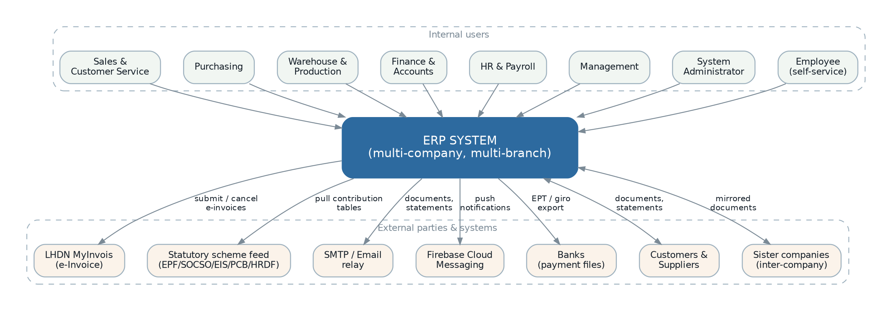

*Figure 1 — System context — actors and external systems around the ERP boundary.*

# 3. Overall Description

## 3.1 Product perspective

The new system replaces the legacy ERP in full. It is not an extension of it, and it does not run alongside it except during a controlled migration window. Its position in the organisation is unchanged: it is the system of record for orders, stock, money and people, and everything else the business runs either feeds it or reads from it.

Three properties of the legacy system are treated as requirements rather than implementation details, because the business depends on them directly:

- **Modularity is functional, not just structural.** Modules can be switched off per deployment. When a module is absent, the features that other modules contribute to it disappear cleanly rather than failing. The legacy system achieves this with a module status manifest and defensive capability checks; the new system shall preserve the behaviour (FR-PLT-021).

- **Configuration replaces customisation.** A substantial amount of behaviour that would otherwise require code is driven by declarative settings — document number formats, feature switches, costing method, credit-control actions, working-day calendars, mail templates. This is why the same codebase serves different operating styles, and it shall be preserved and extended.

- **Operational documents drive accounting automatically.** Releasing a sales invoice creates a receivable document and a journal entry without human intervention. This automation is the core value of the system and the source of its hardest correctness requirements.

## 3.2 Module map and dependency model

The legacy system orders module loading by an explicit numeric priority, which encodes a strict dependency hierarchy. The same hierarchy is retained as a requirement because it is what makes the modules independently deployable.

<table style="width:100%;">
<colgroup>
<col style="width: 0%" />
<col style="width: 19%" />
<col style="width: 29%" />
<col style="width: 21%" />
<col style="width: 27%" />
</colgroup>
<thead>
<tr class="header">
<th colspan="2"><strong>Layer</strong></th>
<th><strong>Modules</strong></th>
<th><strong>May depend on</strong></th>
<th><strong>Rationale</strong></th>
</tr>
</thead>
<tbody>
<tr class="odd">
<td colspan="2">0 — Platform</td>
<td>Core platform, Document Store, Messaging, Reporting, Workflow</td>
<td>Nothing</td>
<td>Provides identity, permissions, settings, numbering, audit, files, messaging and reporting to everything else.</td>
</tr>
<tr class="even">
<td colspan="2">1 — Master data</td>
<td>Master Data</td>
<td>Platform only</td>
<td>Items, parties, tax and pricing are shared by every operational module and must not depend on any of them.</td>
</tr>
<tr class="odd">
<td colspan="2">2 — Financial core</td>
<td>Finance / Bookkeeping</td>
<td>Platform, Master Data</td>
<td>Owns the ledger. Operational modules post into it; it never reaches back into them.</td>
</tr>
<tr class="even">
<td colspan="2">3 — Operational</td>
<td>Sales, Purchasing, Inventory, Production</td>
<td>Platform, Master Data, Finance</td>
<td>May consume each other through published events and contracts, never through direct database access.</td>
</tr>
<tr class="odd">
<td colspan="2">4 — People</td>
<td>Payroll / HR, Employee Self-Service</td>
<td>Platform, Master Data, Finance</td>
<td>Posts payroll to the ledger. Self-service depends only on Payroll.</td>
</tr>
<tr class="even">
<td colspan="2">5 — Extension / vertical</td>
<td>Customer-specific modules</td>
<td>Any of the above</td>
<td>Where customer-specific behaviour lives, so that the shared modules stay generic.</td>
</tr>
<tr class="odd">
<td colspan="5">
<strong>Dependency rule to be enforced mechanically</strong>

In the legacy system the dependency hierarchy is a convention, not a constraint: any module can reference any other module’s classes directly, and several do. The new system shall enforce the hierarchy in the build so that a violation fails the pipeline rather than being discovered later (FR-PLT-024). The design of that enforcement is in ERP-SDD-001 section 6.2.
</td>
</tr>
</tbody>
</table>

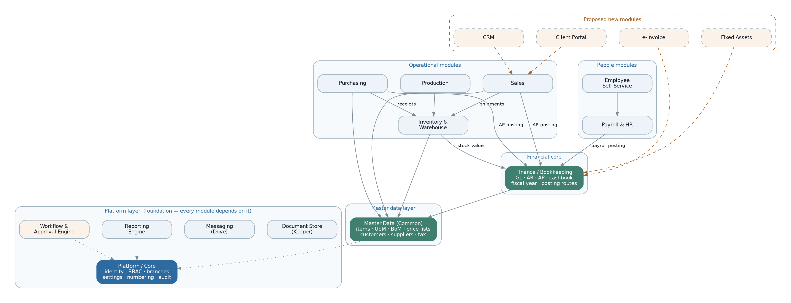

*Figure 2 — Module map — layered dependency model, with the modules referenced by the legacy code but absent from it shown dashed.*

## 3.3 User classes and characteristics

The legacy system does not ship predefined roles; every customer builds roles from the 722 available permission keys. The classes below are therefore behavioural profiles observed in the permission structure and the navigation design, not fixed roles. They exist to drive requirements, and the new system shall ship them as editable role templates rather than as hard-coded roles (FR-SEC-014).

| **User class**                  | **Characteristics and system use**                                                                                                                                                       | **Access profile**                                                                                                                 |
|---------------------------------|------------------------------------------------------------------------------------------------------------------------------------------------------------------------------------------|------------------------------------------------------------------------------------------------------------------------------------|
| System administrator            | Small number of technically confident users. Manages users, roles, branches, settings, numbering, currencies and integration configuration. Does not enter business transactions.        | Full platform administration; generally no transactional permissions.                                                              |
| Finance manager / accountant    | Daily heavy user. Works in the ledger, receivables, payables, cashbook and reconciliation. Runs period close. Highest sensitivity to correctness and to period locking.                  | Full finance module; read access across operational documents; fiscal-period control.                                              |
| Accounts clerk                  | High-volume data entry of invoices, receipts and payments. Needs speed and strong validation, not breadth.                                                                               | Create and edit within specified finance document types; no period control; no deletion.                                           |
| Sales executive / sales agent   | Enters enquiries, quotations and orders. Territory-restricted: sees only own customers and own documents unless explicitly granted otherwise. Needs price history and margin visibility. | Sales module, restricted by sales-agent data scope; read-only master data.                                                         |
| Sales manager                   | Reviews team pipeline, approves documents that breach credit rules, monitors margins.                                                                                                    | Full sales module across all agents; approval authority; sales reporting.                                                          |
| Purchasing officer              | Raises requests, sources quotations, issues purchase orders, matches supplier invoices.                                                                                                  | Purchasing module; supplier master data; supplier price history.                                                                   |
| Warehouse operator              | Works on the warehouse floor, frequently on a mobile or tablet device. Picks, putaways, receives, transfers and counts. Needs very few screens and very fast interaction.                | Narrow inventory permissions; typically one branch only.                                                                           |
| Warehouse supervisor            | Manages bins and batches, authorises adjustments and scrap, investigates variances.                                                                                                      | Full inventory module including adjustment and valuation.                                                                          |
| Production planner / supervisor | Plans job orders from demand, explodes bills of material, issues materials, records progress.                                                                                            | Production and inventory modules; read access to sales orders.                                                                     |
| HR / payroll officer            | Periodic but high-stakes user. Maintains employees, runs payroll, handles statutory filing. Data is highly confidential.                                                                 | Payroll module; restricted from operational and finance modules; strict segregation from payroll approval.                         |
| Payroll approver                | Reviews and approves the payroll run before disbursement. Must be a different person from the preparer.                                                                                  | Payroll approval only.                                                                                                             |
| Employee (self-service)         | Occasional, mostly mobile. Views own payslips and leave balance, applies for leave, submits claims. Must see nothing belonging to anyone else.                                           | Self-service module scoped to own employee record only.                                                                            |
| Management / director           | Read-only consumer of dashboards, statements and management reports across all branches.                                                                                                 | Read-only, all branches, reporting and dashboards.                                                                                 |
| External auditor                | Time-boxed read-only access for audit fieldwork. Needs the audit trail and drill-down from ledger to source document.                                                                    | Read-only across finance and the audit trail, optionally time-limited. Proposed — the legacy system has no such role (FR-SEC-015). |
| Integration / service account   | Non-human. Used by partner systems and internal automation. Must be separable from human accounts for audit.                                                                             | Scoped API credentials with their own permission set. Proposed (FR-SEC-016).                                                       |

## 3.4 Operating environment

Environment requirements are stated as constraints on the requirements, not as design. The corresponding design is in ERP-SDD-001 sections 4 and 16.

| **Ref** | **Requirement**                                                                                                                                                                                                         | **Status**                                                                                     |
|---------|-------------------------------------------------------------------------------------------------------------------------------------------------------------------------------------------------------------------------|------------------------------------------------------------------------------------------------|
| ENV-01  | The system shall be usable from current versions of Chrome, Edge, Firefox and Safari on desktop, with no browser plug-in or extension required.                                                                         | Existing                                                                                       |
| ENV-02  | Warehouse, production and self-service functions shall be usable on a tablet or phone-sized screen, including one-handed operation for picking and putaway.                                                             | Partially Implemented — the legacy interface is responsive but not designed for warehouse use. |
| ENV-03  | The system shall be deployable on Linux servers, both on customer-managed infrastructure and on a cloud provider, without functional difference.                                                                        | Existing                                                                                       |
| ENV-04  | The system shall not require any component that cannot be inspected, debugged or rebuilt by the development team.                                                                                                       | Missing — directly addresses the encrypted legacy core.                                        |
| ENV-05  | The system shall operate correctly in the Asia/Kuala_Lumpur time zone and shall store all timestamps unambiguously so that a later move to multiple time zones does not corrupt historical data.                        | Requires Business Confirmation (OQ-005) — the legacy system stores naive local dates.          |
| ENV-06  | Printing of business documents shall produce a stable, paginated, print-ready artefact independent of the browser’s print engine.                                                                                       | Existing — via the server-side report engine.                                                  |
| ENV-07  | The system shall continue to function for read and data-entry purposes when the outbound internet connection is unavailable, degrading only the features that genuinely require it (e-Invoice submission, email, push). | Proposed                                                                                       |

## 3.5 Design and implementation constraints

| **Ref** | **Constraint**                                                                                                                                                                                                             | **Origin**                                                                                                                               |
|---------|----------------------------------------------------------------------------------------------------------------------------------------------------------------------------------------------------------------------------|------------------------------------------------------------------------------------------------------------------------------------------|
| CON-01  | The system shall be built on Node.js with TypeScript, using the NestJS application framework.                                                                                                                              | Business decision recorded for this project.                                                                                             |
| CON-02  | No encrypted, obfuscated or otherwise non-inspectable component may form part of the production runtime.                                                                                                                   | Business driver; objective OBJ-02.                                                                                                       |
| CON-03  | Malaysian statutory requirements govern the first release; the tax and payroll engines shall nevertheless be structured so that another jurisdiction can be added without modifying them.                                  | Business decision recorded for this project.                                                                                             |
| CON-04  | Monetary values shall never be held in binary floating point at rest or in calculation.                                                                                                                                    | Correctness constraint. The legacy system uses fixed-point decimal columns; this must be preserved deliberately rather than by accident. |
| CON-05  | Accounting entries, once posted to a locked period, shall never be altered or deleted. Correction is by further entry only.                                                                                                | Audit constraint; see BR-FISC-004.                                                                                                       |
| CON-06  | The audit trail shall be append-only and shall not be modifiable through the application under any permission.                                                                                                             | Audit constraint.                                                                                                                        |
| CON-07  | Legacy data shall be migratable. The new data model may differ from the legacy model, but for every legacy table carrying business data there shall be a defined migration path or an explicit decision not to migrate it. | Project constraint; section 9.6.                                                                                                         |
| CON-08  | The document numbering token grammar used by the legacy system shall be supported, because existing documents, external correspondence and customer expectations depend on the resulting formats.                          | Continuity constraint; see BR-NUM-001.                                                                                                   |
| CON-09  | The permission key format Module::Object@Action shall be preserved so that existing role configurations can be migrated rather than rebuilt by hand.                                                                       | Continuity constraint; 722 keys are in use.                                                                                              |
| CON-10  | The system shall be developed with automated tests from the first module. A module without tests covering its business rules is not complete.                                                                              | Quality constraint; objective OBJ-03.                                                                                                    |

## 3.6 Assumptions

| **Ref** | **Assumption**                                                                                                                                                   | **Impact if false**                                                                               |
|---------|------------------------------------------------------------------------------------------------------------------------------------------------------------------|---------------------------------------------------------------------------------------------------|
| ASM-01  | The legacy database remains available, readable and reasonably clean for the duration of the project, for both requirements archaeology and data migration.      | Requirements confidence drops; migration scope grows substantially.                               |
| ASM-02  | The business processes embedded in the legacy system reflect how the organisation actually works today, rather than how it worked when each feature was written. | Requirements tagged Existing may encode obsolete practice; section 19 review becomes larger.      |
| ASM-03  | Malaysia remains the only statutory jurisdiction for the first release.                                                                                          | Tax and payroll scope expands; phasing changes.                                                   |
| ASM-04  | Process owners are available for requirement review and acceptance at each phase boundary.                                                                       | Requirements stay unconfirmed; rework risk rises sharply.                                         |
| ASM-05  | Existing business documents (invoice, order, statement layouts) may be redesigned provided they carry the same statutory and commercial content.                 | Report development effort increases if pixel fidelity is required.                                |
| ASM-06  | Users can be trained on a new interface; screen-level familiarity is not a requirement.                                                                          | If false, the interface must mimic the legacy layout, which constrains the redesign considerably. |

## 3.7 Dependencies

| **Ref** | **Dependency**                                                                                                                                                                                 | **Owner**       | **Criticality**                    |
|---------|------------------------------------------------------------------------------------------------------------------------------------------------------------------------------------------------|-----------------|------------------------------------|
| DEP-01  | LHDN MyInvois platform availability, current API specification, and production credentials for each legal entity.                                                                              | Business + LHDN | Blocking for Phase 3.              |
| DEP-02  | A maintained source of Malaysian statutory contribution tables (EPF, SOCSO, EIS, HRDF, PCB). The legacy system pulls these from a vendor-hosted endpoint, which the new system cannot rely on. | Business        | Blocking for Phase 4 — see OQ-025. |
| DEP-03  | SMTP relay or transactional email service with adequate deliverability and sending limits.                                                                                                     | IT              | Blocking for Phase 0.              |
| DEP-04  | Push notification service credentials, if mobile push is retained.                                                                                                                             | IT              | Non-blocking; feature-level.       |
| DEP-05  | Bank payment-file specifications for each bank used for payroll and supplier payment.                                                                                                          | Finance         | Blocking for Phase 4.              |
| DEP-06  | Report design capability — whichever engine is chosen, 173 report definitions must be rebuilt or migrated.                                                                                     | Development     | Blocking per module.               |
| DEP-07  | Decision on tenancy model (OQ-001) before Phase 0 data-access code is written.                                                                                                                 | Business        | Blocking for Phase 0.              |
| DEP-08  | Chart of accounts, posting-route configuration and opening balances for each legal entity, as at cutover.                                                                                      | Finance         | Blocking for cutover.              |

## 3.8 Apportioning of requirements — release phasing

The business has directed that all modules be documented and that the phasing be proposed by this analysis. The phasing below follows the dependency hierarchy in section 3.2, because it cannot be reordered without building throwaway work: nothing can post to a ledger that does not exist, and nothing can transact on items that have no master data.

| **Phase** | **Contents**                                                                                                                                                                                                                           | **Why here**                                                                                                  | **Exit criteria**                                                                              |
|-----------|----------------------------------------------------------------------------------------------------------------------------------------------------------------------------------------------------------------------------------------|---------------------------------------------------------------------------------------------------------------|------------------------------------------------------------------------------------------------|
| 0         | Platform: identity, RBAC and data scopes, company/branch structure, settings, document numbering, audit trail, document store, messaging, report engine, approval engine.                                                              | Everything depends on it. Building it late forces every module to be rewritten.                               | An administrator can create companies, users, roles and settings, and every action is audited. |
| 1         | Master data (items, UoM, BoM, price lists, customers, suppliers, tax, credit terms, dimensions) and the financial core (chart of accounts, fiscal years and periods, journals, AR, AP, cashbook, bank reconciliation, posting routes). | The ledger and master data are prerequisites for every operational document.                                  | A full month can be entered manually and closed, producing a correct trial balance.            |
| 2         | Sales order-to-cash, Purchasing procure-to-pay, Inventory core with valuation, the automatic posting engine, credit control, and document transfer with partial-transfer support.                                                      | This is the commercial cycle and the first release that can replace the legacy system for day-to-day trading. | Order to cash and procure to pay run end to end, and post correctly and automatically.         |
| 3         | e-Invoice (MyInvois submission, validation results, cancellation), warehouse depth (bins, picking, putaway, batch and expiry), stock valuation reporting.                                                                              | Compliance is externally mandated. Warehouse depth is only meaningful once inventory core exists.             | e-Invoices are submitted and validated in production; warehouse operates bin-level.            |
| 4         | Production (BoM explosion, job orders, process orders, routing, issue, progress, assembly, wastage), Payroll with statutory computation, Employee self-service.                                                                        | Both are self-contained verticals with their own user populations; neither blocks trading.                    | A payroll run reconciles to the statutory tables; a job order runs end to end.                 |
| 5         | CRM, Client Portal, Fixed Assets, Budgeting, the public API and mobile clients, analytics.                                                                                                                                             | Growth capability. None of it is required to operate the business.                                            | Per-feature acceptance.                                                                        |

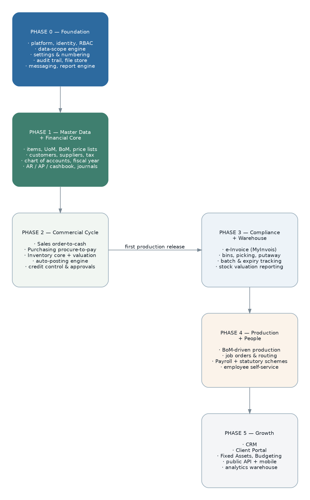

*Figure 3 — Proposed release phasing. Phases 0 to 2 constitute the first production release.*

<table>
<colgroup>
<col style="width: 100%" />
</colgroup>
<tbody>
<tr class="odd">
<td>
<strong>Phasing risk to accept explicitly</strong>

Phases 0 to 2 deliver no payroll and no production. If the legacy system must be retired in one step, Phase 4 becomes part of the first release and the critical path lengthens considerably. If the legacy system can run payroll and production while the new system runs trading, the phasing above is far cheaper and lower risk — but it requires both systems to be live at once, with a defined boundary for stock and ledger ownership.

This is a business decision, not a technical one. It is recorded as OQ-006 and must be answered before Phase 0 begins.
</td>
</tr>
</tbody>
</table>

# 4. Scope Baseline — Legacy Capability Inventory

## 4.1 Method used to derive requirements

The requirements in this document were not invented. They were extracted from the legacy codebase by reading the artefacts that encode business intent. The method is recorded here so that any reader can judge how much confidence to place in a given requirement, and so that the work can be repeated when the codebase changes.

<table style="width:100%;">
<colgroup>
<col style="width: 0%" />
<col style="width: 25%" />
<col style="width: 43%" />
<col style="width: 29%" />
</colgroup>
<thead>
<tr class="header">
<th colspan="2"><strong>Artefact read</strong></th>
<th><strong>What it yields</strong></th>
<th><strong>Confidence</strong></th>
</tr>
</thead>
<tbody>
<tr class="odd">
<td colspan="2">Database migrations (214 files)</td>
<td>Entities, attributes, data types, precision, defaults, foreign keys, uniqueness. The most reliable statement of what the system stores.</td>
<td>High. Schema does not lie about structure, though it may retain unused columns.</td>
</tr>
<tr class="even">
<td colspan="2">Module manifests (12 files)</td>
<td>Module identity, dependency priority, the full permission catalogue, the navigation structure and the master-data menu.</td>
<td>High. These are declarative and maintained.</td>
</tr>
<tr class="odd">
<td colspan="2">Settings manifests (21 files)</td>
<td>Every configurable business rule, its type and its default. An unusually direct statement of business variability.</td>
<td>High.</td>
</tr>
<tr class="even">
<td colspan="2">Route files (21 files)</td>
<td>The complete set of operations the system exposes, including non-CRUD verbs such as release, revise, cancel and bulk operations.</td>
<td>High.</td>
</tr>
<tr class="odd">
<td colspan="2">Domain events and listeners (231 + 88)</td>
<td>The cross-module workflow. What happens when a document is released, updated or cancelled.</td>
<td>High for structure; medium for intent, since ordering is sometimes implicit.</td>
</tr>
<tr class="even">
<td colspan="2">Domain services (117 files)</td>
<td>Calculation and posting logic: journal construction, costing, credit control, statutory computation, transfer mechanics.</td>
<td>Medium to high. Logic is explicit but rarely commented.</td>
</tr>
<tr class="odd">
<td colspan="2">Controllers and request classes</td>
<td>Validation rules, permission bindings, lifecycle hooks and per-action authorisation.</td>
<td>High.</td>
</tr>
<tr class="even">
<td colspan="2">Report catalogue (173 definitions)</td>
<td>The complete reporting requirement, with each report’s parameters and category.</td>
<td>High.</td>
</tr>
<tr class="odd">
<td colspan="2">Sidecar manifests (report, file, message)</td>
<td>Reports, document storage buckets with allowed types and size limits, and notification intents.</td>
<td>High.</td>
</tr>
<tr class="even">
<td colspan="2">Encrypted platform module</td>
<td>Nothing directly. Its interface was reconstructed from a published signature file and from how the other eleven modules call it.</td>
<td>Low to medium. Platform behaviour is the largest area of residual uncertainty in this document.</td>
</tr>
<tr class="odd">
<td colspan="4">
<strong>The single largest limitation of this analysis</strong>

The platform module is distributed as encrypted bytecode. Its internals — the document lifecycle framework, the permission evaluator, the data-grid query engine, the numbering generator, the audit writer and the user-interface component model — could not be read. Their behaviour has been inferred from the interface signatures and from call sites.

Consequence: requirements concerning platform behaviour carry more risk of being incomplete than requirements concerning the business modules. Section 19 lists the specific points where that uncertainty matters, and each should be resolved by observing the running legacy system rather than by reading code.
</td>
</tr>
</tbody>
</table>

## 4.2 Module inventory and status

Each legacy module is assessed below. "Depth" is a judgement of how completely the module covers its own domain, based on the entities, documents and rules found in it.

| **Legacy module** | **Domain**                                                                            | **Tables** | **Perms** | **Depth and assessment**                                                                                                                                                                                                                                                                                                                                                                                                     |
|-------------------|---------------------------------------------------------------------------------------|------------|-----------|------------------------------------------------------------------------------------------------------------------------------------------------------------------------------------------------------------------------------------------------------------------------------------------------------------------------------------------------------------------------------------------------------------------------------|
| Core              | Platform: identity, RBAC, branches, settings, numbering, approvals, audit, currencies | ≈27        | 73        | Deep but opaque. Encrypted, so unverifiable. Provides the entire application framework in addition to business features, which conflates two concerns that the new system shall separate.                                                                                                                                                                                                                                    |
| Common            | Master data                                                                           | 39         | 86        | Deep. Items, groups, brands, scopes, UoM with conversions, multi-level BoM with pre-flattening, price lists with schedules and history, customers and suppliers with addresses, contacts, branches and banks, tax and tax profiles, credit terms, document types, payment plans, departments, sales agents, tariff codes.                                                                                                    |
| Sales             | Order to cash                                                                         | 34         | 95        | Deep. Ten document types with transfer, revision, cancellation, approval, credit control, tax exemption, price history and a profit estimator. e-Invoice fields present but non-functional.                                                                                                                                                                                                                                  |
| Purchase          | Procure to pay                                                                        | 27         | 94        | Deep, and a near-mirror of Sales. Demand planning, requests, RFQ, orders, invoices, debit notes, returns, cash purchases, cancellation, approval, supplier tax exemption.                                                                                                                                                                                                                                                    |
| Inventory         | Stock, warehouse and production                                                       | 74         | 132       | Very deep, and the largest module. Inbound and outbound shipment chains, bin-level locations, picking and putaway with exception states, batch and expiry, transfers, adjustments, issues, receipts, scrap, an immutable stock ledger with FIFO and weighted-average costing, plus a complete production sub-domain (job orders, process orders, routing task sets, multi-level BoM layers, assembly, disassembly, wastage). |
| Bookkeeping       | Finance and accounting                                                                | 71         | 135       | Very deep. Chart of accounts with control accounts, journals and templates, fiscal years with per-period accounting and stock locks, full AR and AP document sets with settlement and deposits, cashbook, bank reconciliation, contra, payment registers, posting routes, projects and project natures, budgets, and statement generation with scheduling.                                                                   |
| Payroll           | Payroll and HR                                                                        | 52         | 68        | Deep for Malaysian payroll. Employees with statutory and dependant data, positions, compensation structures, allowances, deductions, overtime, commissions, leave setup with service-year entitlement and balances, claims, payroll runs with ten entry categories, payslips, all five statutory schemes, annual income and EA form data, and GL account bindings.                                                           |
| EmployeeHub       | Employee self-service                                                                 | 0          | 1         | Shallow. Four controllers over Payroll data, a single permission, no tables of its own. Functional but minimal — no approval visibility, no document upload, no notifications.                                                                                                                                                                                                                                               |
| Keeper            | Document storage                                                                      | 3          | 1         | Adequate. Bucket definitions declared by each module with allowed MIME types and size caps, favourites, and a cleanup action on parent deletion.                                                                                                                                                                                                                                                                             |
| Dove              | Messaging and notification                                                            | 3          | 1         | Shallow. Three channels (email, push, in-app), an intent registry with only five intents declared across all modules, message archive with a 90-day purge. No templating per intent, no user preferences, no delivery guarantees.                                                                                                                                                                                            |
| Reporting         | Report management                                                                     | 9          | 2         | Adequate. Template registry with categories, parameter definitions, per-role and per-user access, generation history, image assets, sub-reports, and customer-uploaded templates. Bound to one specific report engine.                                                                                                                                                                                                       |
| Extension         | Scaffold for customer-specific work                                                   | 1          | 0         | A template, not a feature. Correctly retained as the pattern for vertical customisation.                                                                                                                                                                                                                                                                                                                                     |

## 4.3 Quantified capability baseline

These figures are the scope baseline. Any estimate, plan or comparison should be made against them rather than against impressions.

| **Module**      | **Tables** | **Permissions** | **Reports** | **Events** | **Services** | **Routes** | **Scheduled** |
|-----------------|------------|-----------------|-------------|------------|--------------|------------|---------------|
| Core (platform) | ≈27        | 73              | 0           | n/a        | n/a          | n/a        | 2             |
| Common          | 39         | 86              | 7           | 24         | 6            | 39         | 3             |
| Sales           | 34         | 95              | 27          | 40         | 17           | 89         | 1             |
| Purchase        | 27         | 94              | 24          | 33         | 15           | 74         | 0             |
| Inventory       | 74         | 132             | 38          | 58         | 20           | 136        | 3             |
| Bookkeeping     | 71         | 135             | 72          | 57         | 25           | 89         | 3             |
| Payroll         | 52         | 68              | 5           | 19         | 11           | 65         | 1             |
| EmployeeHub     | 0          | 1               | 0           | 0          | 0            | 4          | 0             |
| Keeper          | 3          | 1               | 0           | 0          | 0            | 15         | 0             |
| Dove            | 3          | 1               | 0           | 1          | 1            | 13         | 1             |
| Reporting       | 9          | 2               | 0           | 0          | 0            | 40         | 1             |
| Extension       | 1          | 0               | 0           | 0          | 0            | 2          | 0             |
| **Total**       | **≈340**   | **722**         | **173**     | **232**    | **95**       | **≈570**   | **15**        |

*Service counts exclude nested service directories; report counts are declared template definitions, several of which share a template with different parameters. Route counts are route-registration directives, each of which may expand to multiple HTTP endpoints — a single resource registration creates seven.*

## 4.4 Capabilities referenced by the legacy code but absent from it

This is the most consequential finding of the analysis. The business modules contain defensive capability checks and service look-ups for three modules that do not exist in the repository. Because the look-ups are wrapped in exception handlers or guarded by capability checks, the features fail silently: no error is raised, and the feature simply does nothing.

<table style="width:100%;">
<colgroup>
<col style="width: 0%" />
<col style="width: 14%" />
<col style="width: 12%" />
<col style="width: 41%" />
<col style="width: 30%" />
</colgroup>
<thead>
<tr class="header">
<th colspan="2"><strong>Referenced module</strong></th>
<th><strong>References found</strong></th>
<th><strong>What the surrounding code expects it to do</strong></th>
<th><strong>Consequence today</strong></th>
</tr>
</thead>
<tbody>
<tr class="odd">
<td colspan="2">e-Invoice</td>
<td>54</td>
<td>Validate party tax identity against LHDN, determine e-Invoice document type, build and submit documents to MyInvois, handle validation results, and handle cancellation. Sales, Purchase and Bookkeeping each carry a thin service that delegates to it, and the AR/AP document tables carry twelve e-Invoice columns (type, UUID, long id, submission status, submission and validation timestamps).</td>
<td>The database is prepared for e-Invoice and the user interface shows the fields, but nothing is ever submitted. Statutory compliance is not achieved.</td>
</tr>
<tr class="even">
<td colspan="2">CRM</td>
<td>2</td>
<td>Own the pre-sales lifecycle. Two Sales listeners hand the draft-quotation lifecycle to it when present.</td>
<td>Draft quotation release and cancellation skip their CRM-side effects. Any pipeline management the business believes exists does not.</td>
</tr>
<tr class="odd">
<td colspan="2">Client Portal</td>
<td>1</td>
<td>Provide customer-facing self-service, and supply a default branch for documents created through it.</td>
<td>No customer self-service exists.</td>
</tr>
<tr class="even">
<td colspan="5">
<strong>Requirement consequence</strong>

These three are not "nice to have" — they are load-bearing holes in the current system. e-Invoice in particular is a statutory obligation with database columns, user-interface fields and event plumbing already built around a module that is missing.

All three are therefore specified in this document as first-class modules (section 6.14), and e-Invoice is placed in Phase 3 rather than Phase 5.
</td>
</tr>
</tbody>
</table>

## 4.5 Structural weaknesses observed, to be corrected

These are defects and design weaknesses found during the review. They are listed here because each generates a requirement elsewhere in the document; the full backlog is in section 17.

| **Ref** | **Observation**                                                                                                                                                                                                                           | **Requirement raised**                                                                                                                                                          |
|---------|-------------------------------------------------------------------------------------------------------------------------------------------------------------------------------------------------------------------------------------------|---------------------------------------------------------------------------------------------------------------------------------------------------------------------------------|
| WK-01   | A duplicated key in a controller permission map silently discards a permission binding, leaving a document-release operation with no permission check at all. The same duplication appears in the matching user-interface permission map. | FR-SEC-008: every operation shall have exactly one resolved permission binding, verified automatically at build time.                                                           |
| WK-02   | A finance posting routine retries three times inside the web request, swallowing the exception each time, and then dereferences a variable that is undefined if all three attempts failed.                                                | FR-FIN-031 and NFR-REL-004: posting shall be asynchronous, idempotent and observable, and shall never silently discard a failure.                                               |
| WK-03   | The journal-entry dispatcher selects a handler by reflecting over method signatures. Any document type without a matching handler causes a runtime crash instead of the intended explicit error.                                          | FR-FIN-032: document-to-posting-profile resolution shall be explicit and exhaustively checked, with an unmapped type failing at configuration time rather than at posting time. |
| WK-04   | Scheduled "outstanding document correction" jobs exist in three modules, running twice daily to repair transfer balances that the system itself corrupts.                                                                                 | FR-PLT-015 and NFR-REL-002: transfer balances shall be maintained transactionally and reconciled by assertion, not by scheduled repair.                                         |
| WK-05   | Warehouse movement processing issues several database queries per detail line, so a large document produces thousands of round trips.                                                                                                     | NFR-PERF-006: document posting shall be set-based and shall meet the stated performance targets at the stated volumes.                                                          |
| WK-06   | Zero automated tests exist across 340 tables and 117 services.                                                                                                                                                                            | CON-10 and NFR-MNT-001.                                                                                                                                                         |
| WK-07   | Cross-document references are stored as a loose triple of type string, identifier and a rendered URL, with no referential integrity. Orphaned links are possible and are repaired by the corrective jobs in WK-04.                        | DR-018: document linkage shall be a first-class, referentially enforced relation.                                                                                               |
| WK-08   | The same "document number format" and "mail template" settings are duplicated across five modules with identical structure, so a change to the mechanism requires five edits.                                                             | FR-PLT-009: numbering and templating shall be single platform services consumed by all modules.                                                                                 |
| WK-09   | Inter-company mirroring operates by writing directly into the counterparty module’s tables from a listener, coupling two modules at the data layer.                                                                                       | FR-PLT-026: inter-company mirroring shall operate through published module contracts only.                                                                                      |
| WK-10   | A vendor-hosted endpoint is the sole source of Malaysian statutory contribution tables, and the fetch deletes all existing rows before inserting the new set — so a failed fetch leaves the tables empty.                                 | INT-006: statutory table refresh shall be transactional, validated before replacement, and shall retain the previous set on failure.                                            |

# 5. User Roles, Permissions and Access Control Requirements

Access control in this system is unusually elaborate, and it is elaborate for a real reason: several legal entities share one installation, sales agents must not see each other’s customers, and payroll data must be invisible to almost everyone. The model has three independent layers, and all three must be satisfied before a user sees a record.

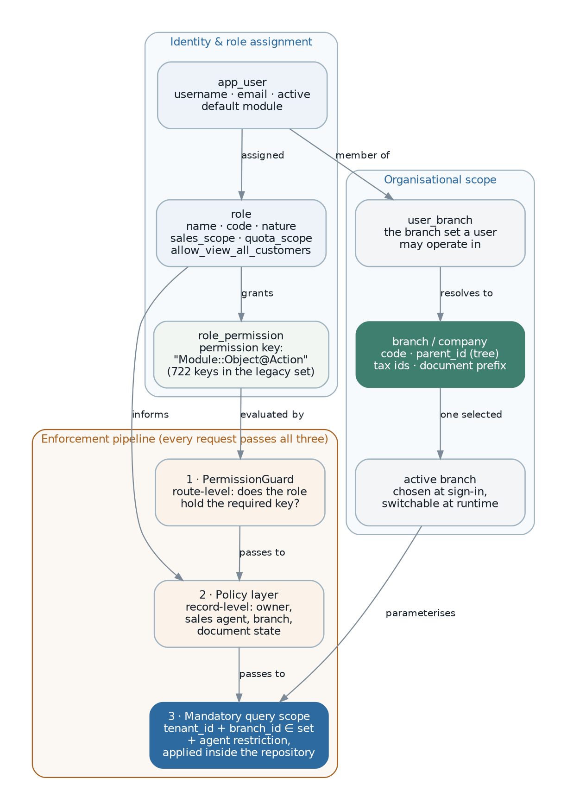

*Figure 4 — Access control model — role assignment, organisational scope, and the three-stage enforcement pipeline.*

## 5.1 Role model

| **Ref**    | **Requirement**                                                                                                                                                   | **Status**                                                                                                              |
|------------|-------------------------------------------------------------------------------------------------------------------------------------------------------------------|-------------------------------------------------------------------------------------------------------------------------|
| FR-SEC-001 | The system shall support an arbitrary number of named roles, each holding a set of permissions, created and edited by an administrator without code change.       | Existing                                                                                                                |
| FR-SEC-002 | The system shall permit a user to hold more than one role, with effective permissions being the union of them.                                                    | Missing — the legacy model binds a user to exactly one role, which forces administrators to create combinatorial roles. |
| FR-SEC-003 | The system shall ship editable role templates covering the user classes in section 3.3, so that a new installation is usable before any role design work is done. | Missing                                                                                                                 |
| FR-SEC-004 | A role shall carry, in addition to its permissions, a set of data-scope attributes that determine which records its holders may see (section 5.3).                | Existing                                                                                                                |
| FR-SEC-005 | The system shall provide a role-comparison view showing the differences between two roles, and an effective-permission view for a given user.                     | Proposed — administrators currently reason about 722 keys unaided.                                                      |
| FR-SEC-006 | Changes to roles, permissions and user-role assignment shall be recorded in the audit trail with actor, timestamp and before/after state.                         | Existing                                                                                                                |
| FR-SEC-007 | The system shall support time-limited role assignment, so that temporary access (an auditor, a covering colleague) expires automatically.                         | Missing                                                                                                                 |

## 5.2 Permission catalogue

Permissions are declared per module as a catalogue of objects and actions, and are expressed as strings. The legacy catalogue contains 722 keys across 135 objects. That catalogue is a requirement in itself, and Appendix B lists it in full.

| **Ref**    | **Requirement**                                                                                                                                                                                                                            | **Status**                                        |
|------------|--------------------------------------------------------------------------------------------------------------------------------------------------------------------------------------------------------------------------------------------|---------------------------------------------------|
| FR-SEC-008 | Every operation the system exposes shall be bound to exactly one permission key. The binding shall be verified automatically, and an operation with no binding, or with more than one conflicting binding, shall fail the build.           | Missing — and the direct cause of weakness WK-01. |
| FR-SEC-009 | Permission keys shall retain the format Module::Object@Action so that existing role configurations can be migrated.                                                                                                                        | Existing                                          |
| FR-SEC-010 | The permission catalogue shall be declared by each module and aggregated by the platform, so that installing or removing a module adds or removes its permissions without affecting others.                                                | Existing                                          |
| FR-SEC-011 | Actions shall include, at minimum: view list, view record, create, edit, delete, print, release, cancel, revise, approve, and export — because the legacy catalogue distinguishes all of these and the business relies on the distinction. | Existing                                          |
| FR-SEC-012 | The user interface shall not render an action a user does not hold permission for. Suppressing the control is required in addition to, never instead of, server-side enforcement.                                                          | Existing                                          |
| FR-SEC-013 | Permission checks shall be enforced on the server for every request, independently of any client-side check.                                                                                                                               | Existing                                          |
| FR-SEC-014 | Role templates shall be data, not code, so that they can be adjusted per installation.                                                                                                                                                     | Missing                                           |
| FR-SEC-015 | The system shall support a read-only audit role with access to the audit trail and to drill-down from ledger entry to source document.                                                                                                     | Missing                                           |
| FR-SEC-016 | The system shall support non-human service accounts with their own credentials, permission set and audit identity, distinguishable from human users in every log and report.                                                               | Missing                                           |

## 5.3 Data-scope rules

Permissions decide which operations a user may perform. Data scopes decide which records those operations may touch. The legacy system implements three scopes, all of which are business-critical and all of which must be reproduced exactly.

### 5.3.1 Branch scope

| **Ref**    | **Requirement**                                                                                                                                                                                            | **Status**                                                                                       |
|------------|------------------------------------------------------------------------------------------------------------------------------------------------------------------------------------------------------------|--------------------------------------------------------------------------------------------------|
| FR-SEC-020 | Every user shall be assigned a set of branches. The user may operate only within that set.                                                                                                                 | Existing                                                                                         |
| FR-SEC-021 | The user shall select one active branch, switchable at any time without signing out. Documents created are stamped with the active branch.                                                                 | Existing                                                                                         |
| FR-SEC-022 | List and report queries shall be restricted to the user’s assigned branches by default, with the option to view a single branch or all assigned branches.                                                  | Existing                                                                                         |
| FR-SEC-023 | Branch restriction shall be applied in the data-access layer, not in individual queries, so that a new query cannot accidentally omit it.                                                                  | Existing in effect (a global query scope), and shall be preserved as an architectural guarantee. |
| FR-SEC-024 | A user with no branch assigned shall be prevented from transacting, with a clear message rather than an error.                                                                                             | Existing                                                                                         |
| FR-SEC-025 | The branch hierarchy shall support parent and child branches, and reporting shall be able to roll up a parent branch and all of its descendants.                                                           | Existing                                                                                         |
| FR-SEC-026 | Where a branch represents a separate legal entity, cross-entity document transfer shall be permitted only where explicitly enabled for that branch, and shall be recorded as an inter-company transaction. | Partially Implemented — a branch-level flag exists; the rules around it are unclear. See OQ-008. |

### 5.3.2 Sales-agent scope

| **Ref**    | **Requirement**                                                                                                                                                                                                                        | **Status**                                                                                                                                                |
|------------|----------------------------------------------------------------------------------------------------------------------------------------------------------------------------------------------------------------------------------------|-----------------------------------------------------------------------------------------------------------------------------------------------------------|
| FR-SEC-030 | Where a role is marked as agent-scoped, its holders shall see only the customers assigned to them as primary or secondary sales agent, and only the sales documents belonging to those customers.                                      | Existing                                                                                                                                                  |
| FR-SEC-031 | A role attribute shall allow an agent-scoped role to view all customers while still being restricted on documents, and vice versa, because the legacy model carries separate switches for customer visibility and document visibility. | Existing                                                                                                                                                  |
| FR-SEC-032 | Agent scope shall apply consistently to lists, look-ups, reports, dashboards and exports. A restricted user shall not be able to reach a restricted record through any route, including a direct record URL.                           | Requires Business Confirmation (OQ-009) — the legacy scope is applied to a defined set of models, and whether coverage is complete could not be verified. |
| FR-SEC-033 | A customer may be marked visible to all branches, overriding branch scope for that record only.                                                                                                                                        | Existing                                                                                                                                                  |

### 5.3.3 Record and field sensitivity

| **Ref**    | **Requirement**                                                                                                                                                                                                                   | **Status**                                                                                                                                                |
|------------|-----------------------------------------------------------------------------------------------------------------------------------------------------------------------------------------------------------------------------------|-----------------------------------------------------------------------------------------------------------------------------------------------------------|
| FR-SEC-040 | Payroll and employee personal data shall be accessible only to holders of explicit payroll permissions, and shall never appear in cross-module search, general reporting or the audit trail payload visible to non-payroll roles. | Requires Business Confirmation (OQ-010) — the legacy system relies on module permissions alone, with no field-level classification.                       |
| FR-SEC-041 | An employee shall be able to see their own payroll records and no one else’s, enforced by matching the authenticated user to the employee record rather than by permission alone.                                                 | Existing in the self-service module; shall be enforced in the data-access layer.                                                                          |
| FR-SEC-042 | Personal identifiers (national identity number, passport, bank account) shall be classified as sensitive, masked by default in lists and exports, and revealed only on an explicit action that is itself audited.                 | Missing — a PDPA exposure in the current system.                                                                                                          |
| FR-SEC-043 | Cost and margin data shall be suppressible per role, so that a role can quote prices without seeing purchase cost.                                                                                                                | Partially Implemented — a per-module setting controls whether cost and price are editable on warehouse documents, but there is no role-level suppression. |

## 5.4 Approval authority and delegation

The legacy system implements approval as a per-branch ordered list of approver users, plus a generic approval request record that points at the document awaiting decision. It is simple, and its simplicity is the limitation.

| **Ref**    | **Requirement**                                                                                                                                                                                 | **Status**                                                                                                                  |
|------------|-------------------------------------------------------------------------------------------------------------------------------------------------------------------------------------------------|-----------------------------------------------------------------------------------------------------------------------------|
| FR-SEC-050 | The system shall maintain, per branch and per document type, an ordered chain of approvers.                                                                                                     | Partially Implemented — the legacy chain is per branch only, not per document type, so all sales documents share one chain. |
| FR-SEC-051 | An approval request shall record the document it concerns, the requester, the assigned approver, the reason it was raised, its status, the decision, the decision reason and a validity expiry. | Existing                                                                                                                    |
| FR-SEC-052 | Approval shall support sequential chains, and shall support a threshold model in which the required approval level depends on document value.                                                   | Partially Implemented — a value threshold exists for purchase orders only, expressed as a single amount in settings.        |
| FR-SEC-053 | An approver shall be able to delegate their authority for a stated period, with the delegation recorded and audited.                                                                            | Missing                                                                                                                     |
| FR-SEC-054 | A user shall not be able to approve a document they created, unless the role explicitly permits self-approval and the exception is recorded.                                                    | Missing — a segregation-of-duties gap.                                                                                      |
| FR-SEC-055 | Approval requests shall notify the approver through the configured channels, and shall escalate on expiry rather than remaining silently pending.                                               | Partially Implemented — notification exists; escalation does not, and the expiry field is not acted upon.                   |
| FR-SEC-056 | A document awaiting approval shall be blocked from release and from downstream transfer, and the blocking reason shall be visible to the user.                                                  | Existing                                                                                                                    |
| FR-SEC-057 | Approval decisions shall be immutable once recorded. Reversal shall create a new decision record, not amend the original.                                                                       | Requires Business Confirmation (OQ-011).                                                                                    |

## 5.5 Authentication requirements

| **Ref**    | **Requirement**                                                                                                                                                                                 | **Status**                                                                                                                           |
|------------|-------------------------------------------------------------------------------------------------------------------------------------------------------------------------------------------------|--------------------------------------------------------------------------------------------------------------------------------------|
| FR-SEC-060 | The system shall authenticate users by username or email and password, with a configurable password policy.                                                                                     | Existing                                                                                                                             |
| FR-SEC-061 | The system shall support multi-factor authentication, mandatory for roles carrying financial, payroll or administrative authority.                                                              | Missing                                                                                                                              |
| FR-SEC-062 | The system shall lock an account after a configurable number of failed attempts and shall record every attempt, successful or not.                                                              | Partially Implemented — login records exist; lockout could not be confirmed.                                                         |
| FR-SEC-063 | The system shall support password reset by a verified channel, with single-use time-limited tokens.                                                                                             | Existing                                                                                                                             |
| FR-SEC-064 | On creation of a user, the system shall optionally send login credentials through the configured channel, controlled by a setting.                                                              | Existing                                                                                                                             |
| FR-SEC-065 | Sessions shall expire after a configurable period of inactivity, and a user shall be able to see and revoke their own active sessions and registered devices.                                   | Partially Implemented — session lifetime is configurable and device identity is recorded; user-visible session management is absent. |
| FR-SEC-066 | The system shall support authentication for non-interactive clients (mobile application, partner integration) separately from interactive sessions, with independently revocable credentials.   | Partially Implemented — an OAuth mechanism exists but the exposed API is minimal.                                                    |
| FR-SEC-067 | The system shall be able to federate authentication to an external identity provider, so that a customer with existing corporate identity management need not maintain a second user directory. | Proposed                                                                                                                             |

# 6. Functional Requirements by Module

This section is the functional core of the specification. Each subsection covers one module and follows the same shape: what the module is for, what it contains, the lifecycle of its principal documents, and a numbered requirement table.

Requirements are deliberately stated at the level of business capability, not screen layout. Where the legacy system’s specific behaviour matters — a numbering token, a status value, a computation — it is stated, because that behaviour is what the business relies on.

<table>
<colgroup>
<col style="width: 100%" />
</colgroup>
<tbody>
<tr class="odd">
<td>
<strong>Reading the status column</strong>

Existing = observed in the legacy code. Partially Implemented = started but incomplete. Missing = required but absent. Proposed = an improvement suggested by this analysis. Requires Business Confirmation = the code implies a rule whose intent is unclear; the open question number is given.
</td>
</tr>
</tbody>
</table>

## 6.1 Platform and Administration

**Purpose.** To provide the services every other module depends on: who the user is, what they may do, which company they are working in, how documents are numbered, what is configurable, what happened and when. In the legacy system this module also provides the entire application framework, which is a conflation the new system shall not repeat.

### 6.1.1 Sub-modules

- Identity and access — users, roles, permissions, data scopes, sessions, devices, password policy.

- Organisation — companies and branches as a tree, branch tax and statutory identifiers, banks, letterhead and signature configuration.

- Configuration — module settings with per-branch override, feature switches, mail and push configuration, webhook targets.

- Document numbering — per-document-type format definitions with a token grammar and reset policy.

- Approval — approval chains, approval requests, decisions.

- Currency — currencies, default currency, dated buy and sell rates, FX gain and loss account mapping.

- Audit — activity log of every data change, login record, error reporting.

- Reference data — document types, custom data-field definitions, saved query commands, global search and quick-access commands.

- Personalisation — per-user interface state, theme, default landing module.

### 6.1.2 Requirements

| **Ref**                        | **Requirement**                                                                                                                                                                                                                                                                                                                                               | **Status**                                                                                                                                                                                                            |
|--------------------------------|---------------------------------------------------------------------------------------------------------------------------------------------------------------------------------------------------------------------------------------------------------------------------------------------------------------------------------------------------------------|-----------------------------------------------------------------------------------------------------------------------------------------------------------------------------------------------------------------------|
| **Organisation structure**     |                                                                                                                                                                                                                                                                                                                                                               |                                                                                                                                                                                                                       |
| FR-PLT-001                     | The system shall represent the organisation as a tree of branches, each carrying its own code, name, address, contact details, registration number and remarks.                                                                                                                                                                                               | Existing                                                                                                                                                                                                              |
| FR-PLT-002                     | A branch shall carry the statutory identifiers required for Malaysian operation: tax registration number, tax filing number, TIN, sales tax number, service tax number, employer number, EPF number, SOCSO number, identity type and identity number, and the MyInvois branch name.                                                                           | Existing                                                                                                                                                                                                              |
| FR-PLT-003                     | A branch shall carry a document prefix used by the numbering service, a default control account, bank accounts per currency, and a letterhead and signature configuration which may be inherited from its parent.                                                                                                                                             | Existing                                                                                                                                                                                                              |
| FR-PLT-004                     | The system shall distinguish a legal entity from an operating location within it, rather than representing both with the same branch record.                                                                                                                                                                                                                  | Missing — see BR-ORG-002 and OQ-002. This is a significant data-model correction.                                                                                                                                     |
| FR-PLT-005                     | The system shall allow a branch to be deactivated without deleting it, and shall prevent new transactions against an inactive branch while leaving its history intact.                                                                                                                                                                                        | Existing                                                                                                                                                                                                              |
| **Configuration and settings** |                                                                                                                                                                                                                                                                                                                                                               |                                                                                                                                                                                                                       |
| FR-PLT-006                     | Each module shall declare its configurable settings, including type, label, default value and grouping, so that the settings user interface is generated rather than hand-built.                                                                                                                                                                              | Existing                                                                                                                                                                                                              |
| FR-PLT-007                     | Settings shall be resolvable at global level and overridable per branch, with the effective value clearly shown and the override visible.                                                                                                                                                                                                                     | Partially Implemented — the legacy model stores a module and key with no branch dimension for most settings, although some settings carry a branch identifier in their payload. See OQ-012.                           |
| FR-PLT-008                     | Every setting change shall be audited with actor, previous value and new value.                                                                                                                                                                                                                                                                               | Requires Business Confirmation (OQ-013) — settings are audited in the legacy system but the payload detail could not be verified.                                                                                     |
| FR-PLT-009                     | Document numbering and mail templating shall be single platform services consumed by all modules, not duplicated per module.                                                                                                                                                                                                                                  | Missing — corrects weakness WK-08.                                                                                                                                                                                    |
| FR-PLT-010                     | Feature switches shall exist for, at minimum: multi-currency, lenient currency exchange, tax selection, automatic rounding adjustment, automatic posting without release, strict price lists, item-group code prefixing, inter-company mirroring, shared customer accounts, shared supplier accounts, editable document numbers, and quantity decimal places. | Existing — these are the switches found in the legacy platform settings and they define much of the system’s behavioural variability.                                                                                 |
| **Document numbering**         |                                                                                                                                                                                                                                                                                                                                                               |                                                                                                                                                                                                                       |
| FR-PLT-011                     | The system shall generate document numbers from a per-document-type format string using a token grammar (branch prefix, year, month, running number, alphabetic source, and literal characters), with a configurable reset policy of never, monthly or yearly.                                                                                                | Existing — see BR-NUM-001 for the grammar.                                                                                                                                                                            |
| FR-PLT-012                     | Number generation shall be atomic and gap-free per sequence, and shall remain correct under concurrent document creation.                                                                                                                                                                                                                                     | Requires Business Confirmation (OQ-014) — the legacy implementation is a running-number table whose concurrency behaviour could not be verified, and gap-free numbering is a statutory expectation for tax documents. |
| FR-PLT-013                     | Whether a user may edit a generated document number shall be controlled by a setting and by a permission, and any edit shall be audited.                                                                                                                                                                                                                      | Existing                                                                                                                                                                                                              |
| FR-PLT-014                     | An administrator shall be able to inspect and adjust the next value of a sequence, under permission, with the adjustment audited.                                                                                                                                                                                                                             | Existing                                                                                                                                                                                                              |
| **Platform guarantees**        |                                                                                                                                                                                                                                                                                                                                                               |                                                                                                                                                                                                                       |
| FR-PLT-015                     | Derived values that summarise child records — transfer balances, outstanding amounts, stock balances, document counts — shall be maintained within the same transaction as the change that causes them, and shall never require a scheduled repair job to remain correct.                                                                                     | Missing — corrects weakness WK-04.                                                                                                                                                                                    |
| FR-PLT-016                     | Every data-changing action shall be recorded in an append-only audit trail capturing actor, timestamp, entity, action, before and after state, and a correlation identifier linking all changes made by one request.                                                                                                                                          | Partially Implemented — an activity log exists; correlation identifiers and guaranteed coverage do not.                                                                                                               |
| FR-PLT-017                     | The audit trail shall not be alterable or deletable through the application under any permission.                                                                                                                                                                                                                                                             | Requires Business Confirmation (OQ-015).                                                                                                                                                                              |
| FR-PLT-018                     | The system shall record unhandled errors with enough context to diagnose them, and shall notify a configured recipient.                                                                                                                                                                                                                                       | Existing                                                                                                                                                                                                              |
| FR-PLT-019                     | The system shall provide a maintenance mode that blocks user access while permitting administrative and batch operations.                                                                                                                                                                                                                                     | Existing                                                                                                                                                                                                              |
| FR-PLT-020                     | The system shall provide global search across business documents and master data, honouring the user’s permissions and data scopes, and a quick-access command palette for navigation.                                                                                                                                                                        | Existing                                                                                                                                                                                                              |
| FR-PLT-021                     | Modules shall be independently enable-able per deployment. When a module is disabled, its navigation, permissions, reports and the contributions it makes to other modules shall disappear cleanly, and no other module shall fail.                                                                                                                           | Existing                                                                                                                                                                                                              |
| FR-PLT-022                     | A module shall be able to extend another module’s entities and user interface — adding fields, relationships, data scopes, list columns and form sections — without modifying the extended module.                                                                                                                                                            | Existing — this is the legacy extension mechanism and it is what makes vertical customisation possible.                                                                                                               |
| FR-PLT-023                     | Custom data fields shall be definable per entity by an administrator, with type and validation, and shall appear in forms, lists, exports and reports.                                                                                                                                                                                                        | Partially Implemented — a custom-field definition table exists but its coverage is narrow.                                                                                                                            |
| FR-PLT-024                     | Module dependency rules shall be enforced mechanically, such that a module referencing a module above it in the hierarchy fails the build.                                                                                                                                                                                                                    | Missing                                                                                                                                                                                                               |
| FR-PLT-025                     | The system shall expose a health endpoint and a readiness signal suitable for automated monitoring and orchestration.                                                                                                                                                                                                                                         | Partially Implemented                                                                                                                                                                                                 |
| FR-PLT-026                     | Cross-module interaction shall occur only through published events and contracts. No module shall read or write another module’s tables directly.                                                                                                                                                                                                             | Missing — corrects weakness WK-09.                                                                                                                                                                                    |
| **Currency**                   |                                                                                                                                                                                                                                                                                                                                                               |                                                                                                                                                                                                                       |
| FR-PLT-030                     | The system shall maintain a set of currencies with one designated as the home currency, and shall hold a symbol, description, government reporting code and per-currency FX gain and loss accounts.                                                                                                                                                           | Existing                                                                                                                                                                                                              |
| FR-PLT-031                     | The system shall hold dated buy and sell rates per currency, and shall select the rate applicable to a document’s date.                                                                                                                                                                                                                                       | Existing                                                                                                                                                                                                              |
| FR-PLT-032                     | Every monetary amount on a foreign-currency document shall be stored both in the document currency and converted to the home currency at the document rate, and both shall be immutable once the document is released.                                                                                                                                        | Existing                                                                                                                                                                                                              |
| FR-PLT-033                     | A "lenient currency exchange" mode shall allow the rate to be overridden per document; when disabled, the dated rate shall be enforced.                                                                                                                                                                                                                       | Existing                                                                                                                                                                                                              |
| FR-PLT-034                     | Realised exchange gain and loss shall be computed on settlement and posted to the configured accounts.                                                                                                                                                                                                                                                        | Existing                                                                                                                                                                                                              |
| FR-PLT-035                     | Unrealised exchange gain and loss on open balances at period end shall be computed and posted, with a reversing entry in the following period.                                                                                                                                                                                                                | Missing — a standard accounting requirement not found in the legacy system. See OQ-016.                                                                                                                               |

## 6.2 Master Data

**Purpose.** To hold the shared reference data that every operational module depends on, so that an item, a customer, a tax rate or a price is defined once and used everywhere. This module is the reason Sales and Purchasing can describe the same item consistently and the reason the ledger can be posted automatically.

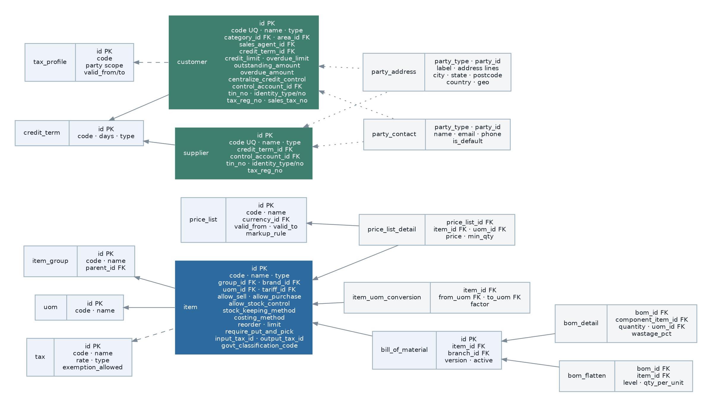

*Figure 5 — Master data entity relationships. Items, parties, pricing and tax form the shared vocabulary of every transaction.*

### 6.2.1 Requirements

| **Ref**                          | **Requirement**                                                                                                                                                                                                                     | **Status**                                                                                                                            |
|----------------------------------|-------------------------------------------------------------------------------------------------------------------------------------------------------------------------------------------------------------------------------------|---------------------------------------------------------------------------------------------------------------------------------------|
| **Items and services**           |                                                                                                                                                                                                                                     |                                                                                                                                       |
| FR-MST-001                       | The system shall maintain items of type product and type service, each with a code, name, barcode, sales and purchase descriptions, extended description, image, active flag, and group, brand, category and tariff classification. | Existing                                                                                                                              |
| FR-MST-002                       | An item shall independently declare whether it may be sold, whether it may be purchased, and whether it is stock-controlled.                                                                                                        | Existing                                                                                                                              |
| FR-MST-003                       | An item shall carry a base unit of measure and a stock-keeping method of either standard or batch-tracked.                                                                                                                          | Existing                                                                                                                              |
| FR-MST-004                       | An item shall carry a costing method of FIFO or weighted average, defaulting from a system setting but overridable per item.                                                                                                        | Existing                                                                                                                              |
| FR-MST-005                       | An item shall carry default input and output tax codes, default sales and purchase currencies, standard price and standard cost, and default sales and purchase document types.                                                     | Existing                                                                                                                              |
| FR-MST-006                       | An item shall carry reorder level, minimum level, weight, and physical dimensions (width, height, length) for shipment and storage planning.                                                                                        | Existing                                                                                                                              |
| FR-MST-007                       | An item shall carry a flag requiring putaway and picking, so that bin-level warehouse handling can be applied selectively.                                                                                                          | Existing                                                                                                                              |
| FR-MST-008                       | An item shall carry a government classification code for e-Invoice reporting.                                                                                                                                                       | Existing                                                                                                                              |
| FR-MST-009                       | The system shall maintain denormalised quantity summaries per item — on hand, available, ordered, reserved for sales, and in production — and these shall be transactionally consistent with the stock ledger.                      | Partially Implemented — the columns exist; their consistency is the subject of weakness WK-04.                                        |
| FR-MST-010                       | Item codes shall optionally be prefixed by item group, controlled by a system setting.                                                                                                                                              | Existing                                                                                                                              |
| FR-MST-011                       | Item visibility shall be restrictable by branch and by item scope, so that a branch sees only the catalogue relevant to it.                                                                                                         | Existing                                                                                                                              |
| **Units of measure**             |                                                                                                                                                                                                                                     |                                                                                                                                       |
| FR-MST-015                       | The system shall maintain units of measure and conversion factors between them per item, supporting purchase, stock and sales in different units.                                                                                   | Existing                                                                                                                              |
| FR-MST-016                       | Every stock movement shall record both the transaction unit and the conversion factor applied, so that historical documents remain interpretable after a conversion factor changes.                                                 | Existing                                                                                                                              |
| FR-MST-017                       | The system shall prevent a conversion factor of less than one against the base unit where that would produce a fractional base quantity beyond the configured decimal precision.                                                    | Existing — an explicit validation rule in the legacy system.                                                                          |
| **Bills of material**            |                                                                                                                                                                                                                                     |                                                                                                                                       |
| FR-MST-020                       | The system shall maintain multi-level bills of material per item and per branch, with component quantity, unit and wastage allowance.                                                                                               | Existing                                                                                                                              |
| FR-MST-021                       | The system shall maintain a pre-computed flattened expansion of each bill of material, giving total quantity per base component, and shall keep it consistent when any level changes.                                               | Existing                                                                                                                              |
| FR-MST-022                       | The system shall detect and reject circular bill-of-material structures.                                                                                                                                                            | Requires Business Confirmation (OQ-017) — no such check was found.                                                                    |
| FR-MST-023                       | The system shall roll up component cost to the parent item, and shall recompute the roll-up when a component price changes, on a schedule and on demand.                                                                            | Existing — a daily scheduled job performs this.                                                                                       |
| **Pricing**                      |                                                                                                                                                                                                                                     |                                                                                                                                       |
| FR-MST-030                       | The system shall maintain named price lists, each with a currency and validity period, holding a price per item and unit with optional minimum quantity breaks.                                                                     | Existing                                                                                                                              |
| FR-MST-031                       | Price lists shall support scheduled future activation, so that a price change can be prepared in advance and applied automatically at a stated time.                                                                                | Existing — a scheduled job activates due price lists.                                                                                 |
| FR-MST-032                       | The system shall retain full price-list history, so that the price applicable on any past date can be established.                                                                                                                  | Existing                                                                                                                              |
| FR-MST-033                       | Price lists shall support derivation from another list by markup or markdown, and shall support foreign-currency lists derived at a stated rate.                                                                                    | Existing                                                                                                                              |
| FR-MST-034                       | A "strict price list" mode shall prevent manual price entry outside the applicable price list, controlled by a system setting and overridable per item.                                                                             | Existing                                                                                                                              |
| FR-MST-035                       | The system shall record the price at which each item was actually sold to or purchased from each party, and shall make that history available during document entry.                                                                | Existing                                                                                                                              |
| FR-MST-036                       | The system shall enforce minimum and maximum margin per customer where configured, and shall raise an approval rather than silently permitting a breach.                                                                            | Partially Implemented — margin columns exist on the customer record; enforcement could not be located. See OQ-018.                    |
| **Customers and suppliers**      |                                                                                                                                                                                                                                     |                                                                                                                                       |
| FR-MST-040                       | The system shall maintain customers and suppliers with code, name, company name, type (company or individual), registration number, salutation, contact details, active flag and free-text notes.                                   | Existing                                                                                                                              |
| FR-MST-041                       | A party shall support multiple addresses, multiple contacts with one marked default, multiple bank accounts, and assignment to multiple branches.                                                                                   | Existing                                                                                                                              |
| FR-MST-042                       | A party shall carry the identifiers required for e-Invoice: TIN, identity type, identity number, tax registration number, sales tax number, service tax number, tax type, and an e-Invoice notification email.                      | Existing                                                                                                                              |
| FR-MST-043                       | The system shall validate a party’s tax identity against the statutory platform and shall record the validation outcome and timestamp.                                                                                              | Partially Implemented — validation columns and a service call exist, but the module that performs validation is absent (section 4.4). |
| FR-MST-044                       | A customer shall carry credit limit, overdue limit, default credit term, default payment and delivery terms, category, area, primary and secondary sales agent, currency and control account.                                       | Existing                                                                                                                              |
| FR-MST-045                       | Credit control shall be applicable either per branch or centralised across the group for a given customer, controlled by a flag on the customer.                                                                                    | Existing                                                                                                                              |
| FR-MST-046                       | The system shall maintain a party’s outstanding and overdue amounts as derived values kept consistent with the underlying ledger.                                                                                                   | Existing                                                                                                                              |
| FR-MST-047                       | Customer and supplier accounts shall be shareable across branches or held private to the creating branch, controlled by a system setting with a per-record override.                                                                | Existing                                                                                                                              |
| FR-MST-048                       | Party codes shall be generated from a configurable format, optionally resetting by alphabet and by account.                                                                                                                         | Existing                                                                                                                              |
| FR-MST-049                       | The system shall prevent deletion of a party that has transactions, offering deactivation instead.                                                                                                                                  | Existing                                                                                                                              |
| FR-MST-050                       | The system shall support merging duplicate parties, repointing all documents and preserving the audit trail.                                                                                                                        | Missing                                                                                                                               |
| **Tax and other reference data** |                                                                                                                                                                                                                                     |                                                                                                                                       |
| FR-MST-055                       | The system shall maintain tax codes with rate, type, and whether exemption is permitted, and shall maintain tax profiles applicable to parties over a validity period.                                                              | Existing                                                                                                                              |
| FR-MST-056                       | The system shall support tax exemption certificates per customer and per supplier, with an effective period and the specific items or item groups covered.                                                                          | Existing                                                                                                                              |
| FR-MST-057                       | Tax shall be computable inclusive or exclusive per document, and the exempted tax amount shall be stored separately from the charged tax amount on every line.                                                                      | Existing                                                                                                                              |
| FR-MST-058                       | The system shall maintain credit terms, payment plans, document types, departments, sales agents, customer categories, customer areas and tariff codes as administrator-maintained reference data.                                  | Existing                                                                                                                              |
| FR-MST-059                       | Document types shall be definable per module and shall be usable as a reporting dimension and as a driver of accounting posting.                                                                                                    | Existing                                                                                                                              |
| FR-MST-060                       | The tax engine shall be structured so that a different jurisdiction’s tax rules can be added as a configuration and rule set, without modifying the calculation engine.                                                             | Proposed — required by the multi-country-ready direction.                                                                             |

## 6.3 Sales

**Purpose.** To manage the complete order-to-cash cycle: capturing demand, quoting, taking orders, releasing goods for shipment, invoicing, and handling returns, re-bills and cancellations — while enforcing credit control and territory restrictions and posting automatically to the ledger.

### 6.3.1 Document set and flow

The legacy module implements ten document types. The flow is not strictly linear: a document can be transferred to more than one downstream type, and several types can be created directly without a predecessor.

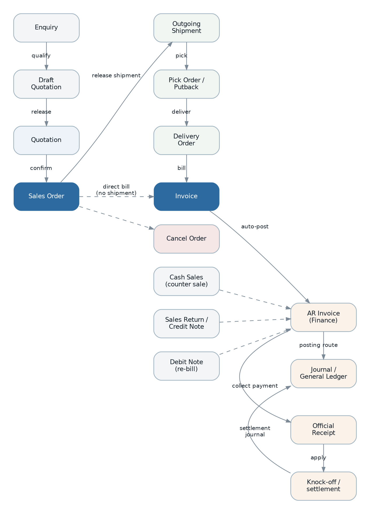

*Figure 6 — Order-to-cash document flow, including the direct-entry and reversal paths.*

| **Document**     | **Role in the flow**                                                                                                                                           | **Transfers to**                                           |
|------------------|----------------------------------------------------------------------------------------------------------------------------------------------------------------|------------------------------------------------------------|
| Enquiry          | Captures an inbound customer request with a type, source and assigned agent. No financial effect.                                                              | Draft Quotation, Quotation                                 |
| Draft Quotation  | An internal working quotation, not yet issued to the customer.                                                                                                 | Quotation                                                  |
| Quotation        | The issued offer, with validity period and revision support.                                                                                                   | Sales Order                                                |
| Sales Order      | The confirmed commitment. The pivot of the whole module: it drives shipment release and invoicing, and it is the document credit control most commonly blocks. | Outgoing Shipment, Invoice, Proforma Invoice, Cancel Order |
| Proforma Invoice | A pre-payment request that is not a tax invoice and does not post to the ledger.                                                                               | — (informational)                                          |
| Invoice          | The tax invoice. Posts to accounts receivable and the general ledger, and is the e-Invoice subject.                                                            | Debit Note, Sales Return, Outgoing Shipment                |
| Cash Sales       | A counter sale, invoiced and settled in one document.                                                                                                          | Accounts receivable plus immediate receipt                 |
| Debit Note       | An additional charge referencing one or more invoices.                                                                                                         | Accounts receivable                                        |
| Sales Return     | A return of goods, producing a credit note and a stock receipt.                                                                                                | Accounts receivable credit note, Inventory receipt         |
| Cancel Order     | Formal cancellation of outstanding order quantities, releasing reservations and closing the order.                                                             | — (terminal)                                               |

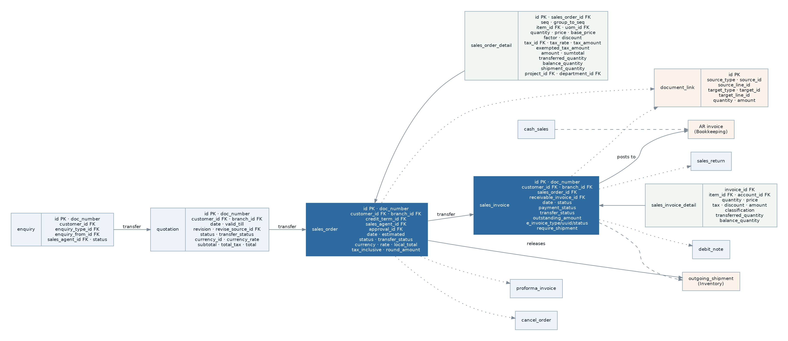

*Figure 7 — Sales entity relationships, showing the header/detail pattern, the transfer chain and the links into Finance and Inventory.*

### 6.3.2 Requirements

| **Ref**                            | **Requirement**                                                                                                                                                                                                                                  | **Status**                                                                                                                                     |
|------------------------------------|--------------------------------------------------------------------------------------------------------------------------------------------------------------------------------------------------------------------------------------------------|------------------------------------------------------------------------------------------------------------------------------------------------|
| **Document entry and calculation** |                                                                                                                                                                                                                                                  |                                                                                                                                                |
| FR-SAL-001                         | Every sales document shall consist of a header carrying party, branch, date, currency, terms and totals, and detail lines carrying item, description, quantity, unit, price, discount, tax and amounts.                                          | Existing                                                                                                                                       |
| FR-SAL-002                         | Detail lines shall support a display sequence and grouping of lines under a heading line, so that a document can be structured for the customer.                                                                                                 | Existing                                                                                                                                       |
| FR-SAL-003                         | The system shall compute, per line: taxable amount, discount amount, tax amount, exempted tax amount and line total; and per document: subtotal, taxable subtotal, total discount, total tax, total exempted tax, rounding adjustment and total. | Existing                                                                                                                                       |
| FR-SAL-004                         | Discount shall be enterable as a percentage or as an amount, and the system shall store both the expression and the resulting amount.                                                                                                            | Existing                                                                                                                                       |
| FR-SAL-005                         | Tax shall be computable inclusive or exclusive per document, defaulting from the customer and item, and the mode shall be fixed once the document is released.                                                                                   | Existing                                                                                                                                       |
| FR-SAL-006                         | Automatic rounding adjustment shall be applied where enabled by setting, and the adjustment shall be stored as a separate amount and posted to a configured account.                                                                             | Existing                                                                                                                                       |
| FR-SAL-007                         | For a foreign-currency document, the system shall store the document rate and the home-currency total, and shall optionally recompute prices from the rate where the document is flagged for automatic price exchange calculation.               | Existing                                                                                                                                       |
| FR-SAL-008                         | A document shall carry a delivery address independent of the customer’s billing address, an attention contact, internal notes not printed, a customer-facing memo, an external reference number, and a warehouse note.                           | Existing                                                                                                                                       |
| FR-SAL-009                         | A document shall be assignable to a project and each line to a project and department, for use as reporting and posting dimensions.                                                                                                              | Existing                                                                                                                                       |
| FR-SAL-010                         | The system shall support cloning an existing document of the same or a different type as the basis for a new one.                                                                                                                                | Existing                                                                                                                                       |
| FR-SAL-011                         | The system shall support attaching files to a document, subject to the configured type and size limits, and shall prevent deletion of a document that has attachments until they are removed.                                                    | Existing                                                                                                                                       |
| **Transfer and lifecycle**         |                                                                                                                                                                                                                                                  |                                                                                                                                                |
| FR-SAL-015                         | The system shall transfer quantities from an upstream document to a downstream document, decrementing the upstream line’s balance quantity and incrementing its transferred quantity, and shall permit partial transfer.                         | Existing                                                                                                                                       |
| FR-SAL-016                         | The system shall maintain a transfer status per document of pending, partial or done, derived from the sum of balance quantities across its lines.                                                                                               | Existing                                                                                                                                       |
| FR-SAL-017                         | The system shall present a transfer-overview view for any document, showing the complete upstream and downstream lineage with quantities.                                                                                                        | Existing                                                                                                                                       |
| FR-SAL-018                         | The system shall prevent transferring more than the outstanding balance of a line, and shall prevent transfer across branches unless inter-branch transaction is enabled for the branch.                                                         | Existing                                                                                                                                       |
| FR-SAL-019                         | Release shall be the single event that commits a document and triggers its downstream effects, and shall be permission-controlled and audited.                                                                                                   | Existing                                                                                                                                       |
| FR-SAL-020                         | The system shall support bulk release of multiple documents in one operation, reporting per-document success or failure without aborting the whole batch.                                                                                        | Existing                                                                                                                                       |
| FR-SAL-021                         | The system shall support revising a released document by creating a new revision linked to its source, incrementing a revision counter, and carrying forward the detail lines.                                                                   | Existing                                                                                                                                       |
| FR-SAL-022                         | The system shall support cancelling a document with a mandatory reason, and shall prevent cancellation where downstream documents exist that have not themselves been reversed.                                                                  | Partially Implemented — the check exists for some document types; coverage could not be verified. See OQ-019.                                  |
| FR-SAL-023                         | Deletion of a released document shall not be permitted. Correction shall be by revision, credit note or cancellation.                                                                                                                            | Requires Business Confirmation (OQ-020) — delete permissions exist for released document types in the legacy catalogue.                        |
| **Credit control**                 |                                                                                                                                                                                                                                                  |                                                                                                                                                |
| FR-SAL-030                         | Before a sales document is saved, the system shall evaluate the customer’s credit limit and overdue limit, taking into account the document amount and the amounts of other open documents.                                                      | Existing                                                                                                                                       |
| FR-SAL-031                         | The configured action on breach shall be selectable per operation (quotation, sales order, invoice, cash sales, delivery) and per breach type (credit limit, overdue limit), with actions of allow, require approval, or block.                  | Existing                                                                                                                                       |
| FR-SAL-032                         | Where the action is to require approval, the system shall raise an approval request automatically, block release until it is decided, and clear it if the document is subsequently cancelled.                                                    | Existing                                                                                                                                       |
| FR-SAL-033                         | Credit evaluation shall be applicable per branch or centralised across the group per customer.                                                                                                                                                   | Existing                                                                                                                                       |
| FR-SAL-034                         | The system shall show the user the customer’s current exposure — outstanding, overdue, limit and remaining headroom — during document entry.                                                                                                     | Partially Implemented                                                                                                                          |
| FR-SAL-035                         | Credit evaluation shall be bypassed for documents created by batch or console processes, and the bypass shall be recorded.                                                                                                                       | Existing — and shall be made explicit rather than implicit.                                                                                    |
| **Shipment and fulfilment**        |                                                                                                                                                                                                                                                  |                                                                                                                                                |
| FR-SAL-040                         | Releasing a sales order for shipment shall create an outgoing shipment in Inventory, mark the transferred quantities, and set the order’s transfer status accordingly.                                                                           | Existing                                                                                                                                       |
| FR-SAL-041                         | An invoice shall be able to require shipment or not, and where it requires shipment, releasing it shall create the shipment in the same way.                                                                                                     | Existing                                                                                                                                       |
| FR-SAL-042                         | Where the document is an invoice, debit note or cash sales, the resulting shipment shall be marked as not returnable; where it is a sales order, it shall be returnable.                                                                         | Existing — and the business intent behind this rule should be confirmed (OQ-021).                                                              |
| FR-SAL-043                         | The system shall optionally check available stock during document entry, controlled by a setting, and shall show the shortfall rather than silently permitting an oversell.                                                                      | Existing                                                                                                                                       |
| **Accounting integration**         |                                                                                                                                                                                                                                                  |                                                                                                                                                |
| FR-SAL-050                         | Releasing an invoice, cash sales, debit note or sales return shall create the corresponding accounts-receivable document in Finance and post the journal entry, without user intervention.                                                       | Existing                                                                                                                                       |
| FR-SAL-051                         | Where automatic posting is disabled by setting, the operational document shall post only on release; where enabled, it shall post on save.                                                                                                       | Existing                                                                                                                                       |
| FR-SAL-052                         | A cash sales document shall additionally create the receipt and settle the receivable in the same operation.                                                                                                                                     | Existing                                                                                                                                       |
| FR-SAL-053                         | The link between the operational document and the finance document shall be stored on both sides and shall be referentially enforced.                                                                                                            | Partially Implemented — the link exists as a nullable identifier; it is not enforced.                                                          |
| FR-SAL-054                         | Where posting fails, the operational document shall remain released, the failure shall be visible to the user and to operations, and the posting shall be retried without duplicating entries.                                                   | Missing — corrects weakness WK-02.                                                                                                             |
| **Supporting features**            |                                                                                                                                                                                                                                                  |                                                                                                                                                |
| FR-SAL-060                         | The system shall maintain enquiry types with specifications, and enquiry sources, as administrator-maintained reference data, and shall support forwarding an enquiry to a sales agent.                                                          | Existing                                                                                                                                       |
| FR-SAL-061                         | The system shall maintain customer areas as a territory dimension.                                                                                                                                                                               | Existing                                                                                                                                       |
| FR-SAL-062                         | The system shall support excluding specific items from sale, per branch.                                                                                                                                                                         | Existing                                                                                                                                       |
| FR-SAL-063                         | The system shall provide a profit estimator showing estimated margin for a document or line, available where enabled by setting and by permission.                                                                                               | Existing                                                                                                                                       |
| FR-SAL-064                         | The system shall provide customer price history during entry, filterable by item, period and document type.                                                                                                                                      | Existing                                                                                                                                       |
| FR-SAL-065                         | The system shall email a document to the customer using a configurable template with substitutable variables, and shall record the dispatch.                                                                                                     | Existing                                                                                                                                       |
| FR-SAL-066                         | The system shall support recording and managing sales commission per agent.                                                                                                                                                                      | Missing — sales agents exist as a dimension, and commission exists in Payroll, but no sales-side commission calculation was found. See OQ-022. |

## 6.4 Purchasing

**Purpose.** To manage procure-to-pay: identifying need, sourcing, ordering, receiving, matching supplier invoices and handling returns and cancellations. The module is deliberately structured as a mirror of Sales, and the requirements below state only where it differs; where a Sales requirement applies symmetrically it is referenced rather than repeated.

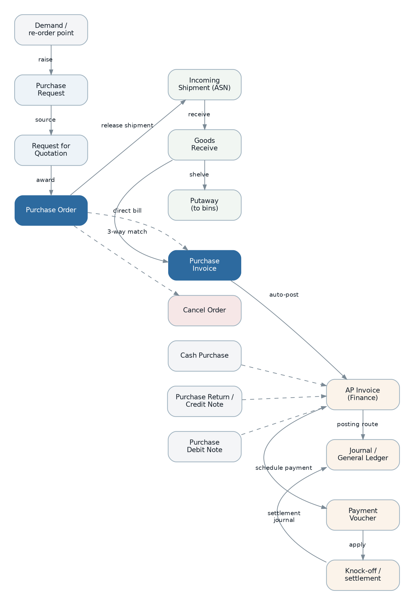

*Figure 8 — Procure-to-pay document flow.*

### 6.4.1 Document set

| **Document**          | **Role in the flow**                                                                                          | **Transfers to**                                  |
|-----------------------|---------------------------------------------------------------------------------------------------------------|---------------------------------------------------|
| Demand                | Aggregates requirement from reorder levels, sales orders and production shortages into a purchasing worklist. | Purchase Request                                  |
| Purchase Request      | An internal request to procure, raised by any department.                                                     | Request for Quotation, Purchase Order             |
| Request for Quotation | A sourcing document issued to one or more suppliers, with a confirmed status once a quotation is accepted.    | Purchase Order                                    |
| Purchase Order        | The commitment to the supplier. Subject to a value-threshold approval.                                        | Incoming Shipment, Purchase Invoice, Cancel Order |
| Purchase Invoice      | The supplier’s bill. Posts to accounts payable and the general ledger.                                        | Purchase Debit Note, Purchase Return              |
| Cash Purchase         | A counter purchase, billed and paid in one document.                                                          | Accounts payable plus immediate payment           |
| Purchase Debit Note   | An additional charge from the supplier, referencing one or more purchase invoices.                            | Accounts payable                                  |
| Purchase Return       | A return of goods to the supplier, producing a credit note and a stock issue.                                 | Accounts payable credit note, Inventory issue     |
| Cancel Order          | Formal cancellation of outstanding order quantities.                                                          | — (terminal)                                      |

### 6.4.2 Requirements

| **Ref**    | **Requirement**                                                                                                                                                                                                                                                      | **Status**                                                                                                                                                         |
|------------|----------------------------------------------------------------------------------------------------------------------------------------------------------------------------------------------------------------------------------------------------------------------|--------------------------------------------------------------------------------------------------------------------------------------------------------------------|
| FR-PUR-001 | All document entry, calculation, transfer, lifecycle, attachment, cloning, dimension and emailing requirements stated for Sales (FR-SAL-001 to FR-SAL-023 and FR-SAL-060 to FR-SAL-065) shall apply symmetrically to Purchasing, substituting supplier for customer. | Existing                                                                                                                                                           |
| FR-PUR-002 | The system shall generate a demand worklist from reorder levels, outstanding sales orders and production material shortages, and shall allow a purchase request to be raised from it.                                                                                | Existing                                                                                                                                                           |
| FR-PUR-003 | A request for quotation shall support issue to multiple suppliers and the recording of each supplier’s response, with one response marked as awarded.                                                                                                                | Partially Implemented — the document exists with a confirmed status; multi-supplier comparison could not be located. See OQ-023.                                   |
| FR-PUR-004 | A purchase order exceeding a configured value threshold shall require approval before release, with the threshold expressed in home currency and configurable per branch.                                                                                            | Existing — the legacy threshold is a single global amount; per-branch configuration is a proposed improvement.                                                     |
| FR-PUR-005 | Releasing a purchase order shall create an incoming shipment in Inventory, mirroring the outbound behaviour of Sales.                                                                                                                                                | Existing                                                                                                                                                           |
| FR-PUR-006 | The system shall support three-way matching between purchase order, goods receipt and supplier invoice, and shall highlight quantity and price variances before the invoice is released.                                                                             | Partially Implemented — the transfer chain permits it and quantities are carried, but no explicit variance check or tolerance configuration was found. See OQ-024. |
| FR-PUR-007 | Releasing a purchase invoice, cash purchase, purchase debit note or purchase return shall create the corresponding accounts-payable document and post the journal entry automatically.                                                                               | Existing                                                                                                                                                           |
| FR-PUR-008 | The system shall maintain supplier price history and shall make it available during document entry and as a report.                                                                                                                                                  | Existing                                                                                                                                                           |
| FR-PUR-009 | The system shall support supplier tax exemption certificates on the same model as customer exemptions.                                                                                                                                                               | Existing                                                                                                                                                           |
| FR-PUR-010 | The system shall support excluding specific items from purchase, per branch.                                                                                                                                                                                         | Existing                                                                                                                                                           |
| FR-PUR-011 | The system shall notify a supplier of an incoming shipment or a purchase order by email using a configurable template.                                                                                                                                               | Existing                                                                                                                                                           |
| FR-PUR-012 | The system shall record landed cost components (freight, duty, handling) against a receipt and apportion them to item cost.                                                                                                                                          | Missing — a material gap for an importing business. See OQ-026.                                                                                                    |
| FR-PUR-013 | The system shall support blanket purchase orders with scheduled call-off releases.                                                                                                                                                                                   | Missing                                                                                                                                                            |

## 6.5 Inventory and Warehouse

**Purpose.** To know, at all times, how much of every item is in every location, what it is worth, and how it got there. This is the largest module in the legacy system and carries the highest correctness burden, because its output feeds both fulfilment and the general ledger.

### 6.5.1 Structure

- **Outbound chain.** Outgoing Shipment is created from Sales on release. It may be picked (Stock Pick Order) and then delivered (Delivery Order). Goods Return brings customer returns back in. Cancel Shipment reverses an unfulfilled shipment.

- **Inbound chain.** Incoming Shipment (ASN) is created from Purchasing on release. Goods Receive records actual receipt. Putaway moves received goods into bins. Delivery Return handles returns to supplier.

- **Internal operations.** Stock Issue and Stock Receive for non-trade movements, Stock Transfer between branches, Internal Movement between bins, Stock Adjustment for counts and corrections, Scrap for write-off, Opening Balance for initial load.

- **Valuation.** An immutable stock transaction ledger per item, bin, batch and project, with FIFO cost layers or a running weighted average, aggregated into period stock balances and posted to the ledger as closing stock value.

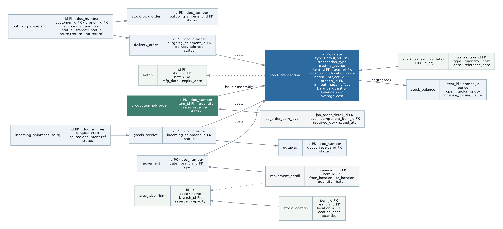

*Figure 9 — Inventory entity relationships. The stock transaction ledger is the single source of truth for quantity and value.*

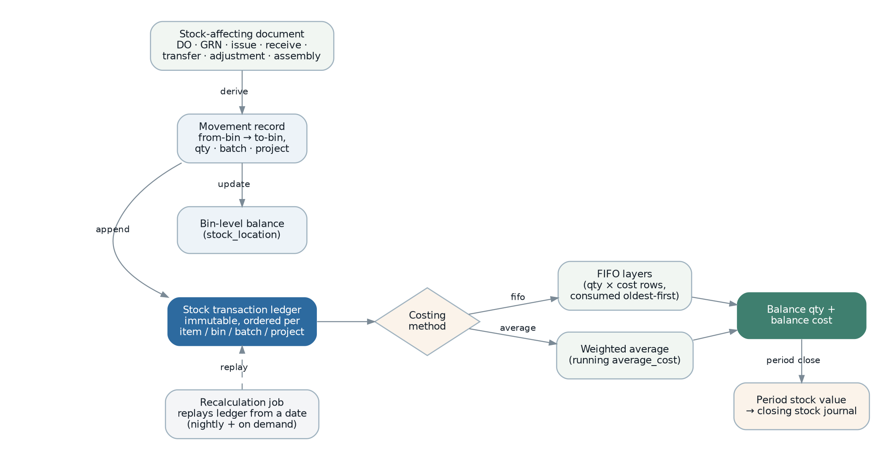

*Figure 10 — Stock movement and valuation pipeline.*

### 6.5.2 Requirements

| **Ref**                               | **Requirement**                                                                                                                                                                                                                                                                                       | **Status**                                                                                                                                                              |
|---------------------------------------|-------------------------------------------------------------------------------------------------------------------------------------------------------------------------------------------------------------------------------------------------------------------------------------------------------|-------------------------------------------------------------------------------------------------------------------------------------------------------------------------|
| **Locations, batches and structure**  |                                                                                                                                                                                                                                                                                                       |                                                                                                                                                                         |
| FR-INV-001                            | The system shall maintain storage locations (bins) per branch, with code, name, capacity and a reserve flag marking non-stock locations such as a receiving area.                                                                                                                                     | Existing                                                                                                                                                                |
| FR-INV-002                            | The system shall maintain stock quantity per item, branch, bin and batch, and shall keep it consistent with the stock transaction ledger.                                                                                                                                                             | Existing                                                                                                                                                                |
| FR-INV-003                            | The system shall support batch-tracked items, with batch number, manufacture date and expiry date, and shall require batch selection on every movement of a batch-tracked item.                                                                                                                       | Existing                                                                                                                                                                |
| FR-INV-004                            | The system shall support stock isolation by project, so that stock held for one project is not consumed by another, controlled by a setting.                                                                                                                                                          | Existing                                                                                                                                                                |
| FR-INV-005                            | The system shall print bin labels and item or batch sticker labels, including a scannable barcode.                                                                                                                                                                                                    | Existing                                                                                                                                                                |
| **Inbound**                           |                                                                                                                                                                                                                                                                                                       |                                                                                                                                                                         |
| FR-INV-010                            | The system shall create an incoming shipment automatically when a purchasing document is released for shipment, carrying the ordered quantities.                                                                                                                                                      | Existing                                                                                                                                                                |
| FR-INV-011                            | Goods receipt shall record actual received quantity per line, which may differ from the shipment quantity, and shall classify the difference as a short or extra receipt exception.                                                                                                                   | Existing                                                                                                                                                                |
| FR-INV-012                            | Goods receipt shall optionally permit editing of unit cost, controlled by a setting and by permission.                                                                                                                                                                                                | Existing                                                                                                                                                                |
| FR-INV-013                            | Putaway shall move received quantities from the receiving area into one or more bins, and shall support partial putaway with an exception state where quantities do not reconcile.                                                                                                                    | Existing                                                                                                                                                                |
| FR-INV-014                            | The system shall support returning received goods to the supplier, reversing the stock effect and producing the corresponding purchase credit note.                                                                                                                                                   | Existing                                                                                                                                                                |
| **Outbound**                          |                                                                                                                                                                                                                                                                                                       |                                                                                                                                                                         |
| FR-INV-020                            | The system shall create an outgoing shipment automatically when a sales document is released for shipment.                                                                                                                                                                                            | Existing                                                                                                                                                                |
| FR-INV-021                            | The system shall support generating a pick order from an outgoing shipment, recording picked quantity per bin, and shall support pick statuses of pending, in progress, done, short-pick exception, extra-pick exception and retake.                                                                  | Existing                                                                                                                                                                |
| FR-INV-022                            | The system shall support putting picked stock back when a pick is abandoned.                                                                                                                                                                                                                          | Existing                                                                                                                                                                |
| FR-INV-023                            | Delivery order shall record the goods actually despatched, with delivery address, consignment note reference and despatch date, and shall be the document that decrements stock.                                                                                                                      | Existing                                                                                                                                                                |
| FR-INV-024                            | The system shall support customer returns, receiving goods back into a nominated bin and producing the corresponding sales credit note.                                                                                                                                                               | Existing                                                                                                                                                                |
| FR-INV-025                            | The system shall support cancellation of an unfulfilled shipment, releasing any reservation and updating the source document’s transfer status.                                                                                                                                                       | Existing                                                                                                                                                                |
| FR-INV-026                            | The system shall support stock reservation against a sales order, with a reservation lifecycle of pending, approved, rejected and cancelled.                                                                                                                                                          | Partially Implemented — reservation statuses and controllers exist; how reservation interacts with availability could not be verified. See OQ-027.                      |
| **Internal movements and adjustment** |                                                                                                                                                                                                                                                                                                       |                                                                                                                                                                         |
| FR-INV-030                            | The system shall support stock issue and stock receive for movements that are not linked to a trade document, with a reason and an account for the resulting posting.                                                                                                                                 | Existing                                                                                                                                                                |
| FR-INV-031                            | The system shall support stock transfer between branches, recording both the issuing and receiving side and holding goods in transit until receipt is confirmed.                                                                                                                                      | Partially Implemented — transfer documents exist; a goods-in-transit state could not be confirmed. See OQ-028.                                                          |
| FR-INV-032                            | The system shall support internal movement between bins within a branch without any valuation effect.                                                                                                                                                                                                 | Existing                                                                                                                                                                |
| FR-INV-033                            | The system shall support stock adjustment with a reason code, adjusting quantity and value, and shall require release and permission.                                                                                                                                                                 | Existing                                                                                                                                                                |
| FR-INV-034                            | The system shall produce a stock count sheet and shall support entering counted quantities to produce an adjustment for the variance.                                                                                                                                                                 | Partially Implemented — a count sheet report exists; a cycle-count workflow does not.                                                                                   |
| FR-INV-035                            | The system shall support scrap and write-off with a reason, posting the loss to a configured account.                                                                                                                                                                                                 | Existing                                                                                                                                                                |
| FR-INV-036                            | The system shall support an opening balance document per item, bin and batch for initial data load, permitted only where no prior transaction exists for that combination.                                                                                                                            | Existing                                                                                                                                                                |
| **Valuation**                         |                                                                                                                                                                                                                                                                                                       |                                                                                                                                                                         |
| FR-INV-040                            | Every stock-affecting document shall, on release, append one or more immutable rows to a stock transaction ledger recording date, direction, item, unit and conversion factor, bin, batch, project, branch, quantity in or out, unit cost, resulting balance quantity, balance cost and average cost. | Existing                                                                                                                                                                |
| FR-INV-041                            | The ledger shall support FIFO valuation, maintaining cost layers per transaction and consuming them oldest-first, and weighted-average valuation, maintaining a running average cost.                                                                                                                 | Existing                                                                                                                                                                |
| FR-INV-042                            | Costing method shall be selectable per item, defaulting from a system setting.                                                                                                                                                                                                                        | Existing                                                                                                                                                                |
| FR-INV-043                            | The system shall compute period opening and closing stock quantity and value per item, bin and project, and shall post the closing stock value to the ledger where automatic stock-value posting is enabled.                                                                                          | Existing                                                                                                                                                                |
| FR-INV-044                            | The system shall support recalculation of stock value from a stated date by replaying the ledger, available on a schedule at configurable times and on demand, and shall be idempotent.                                                                                                               | Existing                                                                                                                                                                |
| FR-INV-045                            | Stock valuation shall respect the stock lock on a fiscal period: no movement may be posted into, and no revaluation may alter, a stock-locked period.                                                                                                                                                 | Existing — controlled by a setting that makes Inventory follow the Finance period lock.                                                                                 |
| FR-INV-046                            | A negative stock balance shall be prevented, or permitted only where explicitly enabled, and the decision shall be configurable per item or globally.                                                                                                                                                 | Requires Business Confirmation (OQ-029) — the legacy system has a stock-balance check setting that defaults to off, which implies negative stock is currently possible. |
| FR-INV-047                            | Recalculation shall not be required to keep day-to-day balances correct; it shall exist only to correct historical restatement such as a backdated cost change.                                                                                                                                       | Missing — presently it is scheduled twice daily, which implies it is load-bearing.                                                                                      |
| **Planning and alerts**               |                                                                                                                                                                                                                                                                                                       |                                                                                                                                                                         |
| FR-INV-050                            | The system shall maintain reorder level and minimum level per item and shall produce a low-level stock alert to a configured recipient list, on configurable days and at a configurable time.                                                                                                         | Existing                                                                                                                                                                |
| FR-INV-051                            | The system shall report stock aging by quantity and by value, and batch expiry with a configurable horizon.                                                                                                                                                                                           | Existing                                                                                                                                                                |
| FR-INV-052                            | The system shall report outstanding inbound and outbound shipments and deliveries, so that unfulfilled commitments are visible.                                                                                                                                                                       | Existing                                                                                                                                                                |

## 6.6 Production

**Purpose.** To convert materials into finished goods under a bill of material, tracking material consumption, progress, output, wastage and cost. In the legacy system this lives inside the Inventory module; the new system shall separate it into its own module because it has a distinct user population, a distinct lifecycle and its own reporting needs.

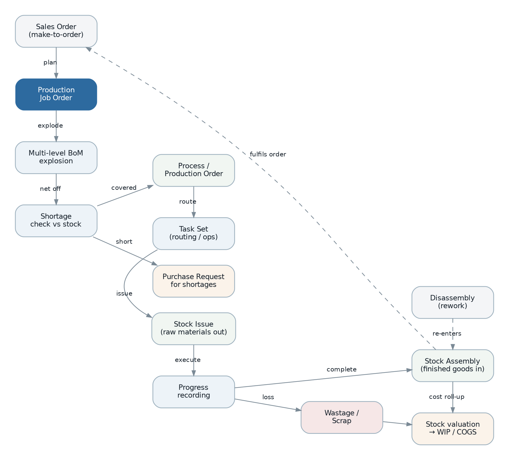

*Figure 11 — Production flow from demand through to finished goods and cost roll-up.*

### 6.6.1 Requirements

| **Ref**    | **Requirement**                                                                                                                                                                                 | **Status**                                                                                            |
|------------|-------------------------------------------------------------------------------------------------------------------------------------------------------------------------------------------------|-------------------------------------------------------------------------------------------------------|
| FR-PRD-001 | The system shall support a production job order for a quantity of a manufactured item, optionally linked to the sales order that created the demand.                                            | Existing                                                                                              |
| FR-PRD-002 | On creation, the job order shall explode the item’s bill of material to all levels, recording required quantity per component per level, and shall net the requirement against available stock. | Existing                                                                                              |
| FR-PRD-003 | Where components are short, the system shall generate a purchase request for the shortfall.                                                                                                     | Existing                                                                                              |
| FR-PRD-004 | The system shall support a process or production order representing the execution of work, with a routing of tasks drawn from a maintained task set.                                            | Existing                                                                                              |
| FR-PRD-005 | The system shall record material issue against a job order, decrementing stock and accumulating work-in-progress cost.                                                                          | Existing                                                                                              |
| FR-PRD-006 | The system shall record production progress incrementally, so that a partially completed job order is visible.                                                                                  | Existing                                                                                              |
| FR-PRD-007 | The system shall record finished output through a stock assembly document, incrementing finished-goods stock and relieving work in progress.                                                    | Existing                                                                                              |
| FR-PRD-008 | The system shall record wastage against a production order, with reason, and shall value it according to the configured production costing method.                                              | Existing                                                                                              |
| FR-PRD-009 | The system shall support disassembly, converting a finished item back into its components.                                                                                                      | Existing                                                                                              |
| FR-PRD-010 | Production costing method shall be configurable as actual or standard.                                                                                                                          | Existing                                                                                              |
| FR-PRD-011 | Bill-of-material explosion shall optionally traverse sub-assemblies by default, controlled by a setting.                                                                                        | Existing                                                                                              |
| FR-PRD-012 | The system shall produce a bill-of-material planner showing, for a job order, the full component requirement, availability, shortfall and expected completion.                                  | Existing                                                                                              |
| FR-PRD-013 | The system shall record labour and machine time against a production order and include it in cost.                                                                                              | Missing — no labour or overhead capture was found; production cost is material cost only. See OQ-031. |
| FR-PRD-014 | The system shall support capacity planning and scheduling against work centres.                                                                                                                 | Missing                                                                                               |
| FR-PRD-015 | The system shall support recording quality inspection outcomes against production output, with a hold and release decision.                                                                     | Missing                                                                                               |
| FR-PRD-016 | The system shall report production variance — planned versus actual material, wastage and cost — per job order.                                                                                 | Partially Implemented — a project costing report exists; a job-order variance report does not.        |

## 6.7 Finance and Accounting

**Purpose.** To maintain a complete, balanced and auditable set of books for every legal entity, fed automatically by operational documents and directly by manual entry, with controlled period close and full statutory and management reporting.

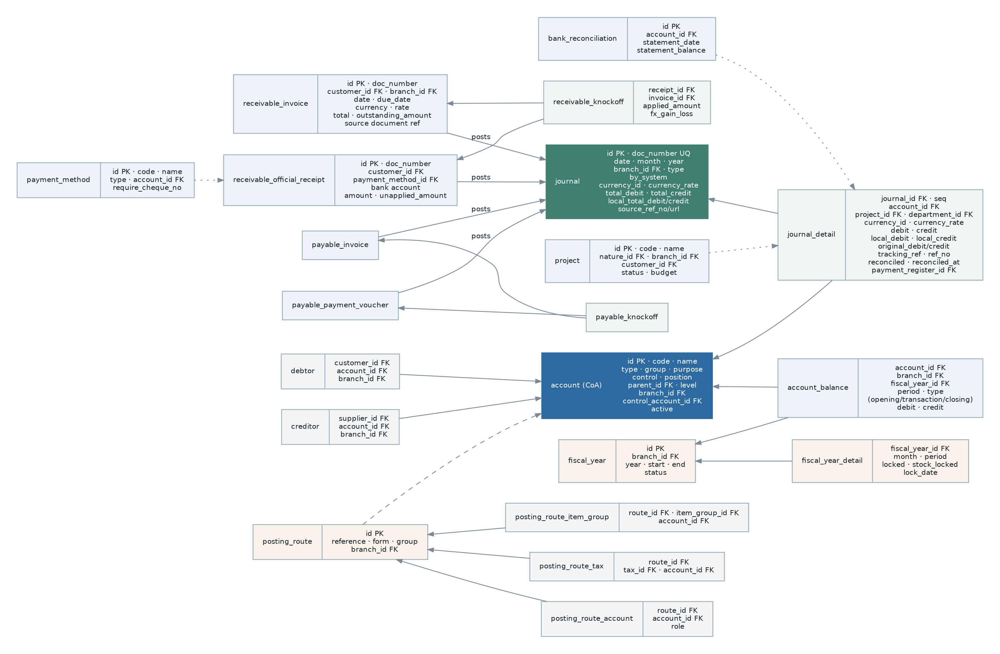

*Figure 12 — Finance entity relationships — chart of accounts, journals, sub-ledgers, settlement and posting routes.*

### 6.7.1 Requirements — general ledger

| **Ref**    | **Requirement**                                                                                                                                                                                                                                                                                                                                                                  | **Status**                                                                              |
|------------|----------------------------------------------------------------------------------------------------------------------------------------------------------------------------------------------------------------------------------------------------------------------------------------------------------------------------------------------------------------------------------|-----------------------------------------------------------------------------------------|
| FR-FIN-001 | The system shall maintain a hierarchical chart of accounts per branch, each account carrying code, name, type, group, purpose, control classification, level, parent, related account and active flag.                                                                                                                                                                           | Existing                                                                                |
| FR-FIN-002 | Account types shall cover, at minimum: cash, bank, current assets, fixed assets, other assets, investment, current liabilities, non-current liabilities, long-term liabilities, other liabilities, capital, capital reserve, retained earnings, appropriation, dividend, sales, sales adjustment, cost of goods sold, other income, extraordinary income, expenses and taxation. | Existing                                                                                |
| FR-FIN-003 | Every journal shall balance: total debits shall equal total credits in both document currency and home currency, and an unbalanced journal shall not be committable.                                                                                                                                                                                                             | Existing                                                                                |
| FR-FIN-004 | A journal line shall carry account, debit and credit in document, original and home currency, project, department, tracking reference, reference number and up to three description fields.                                                                                                                                                                                      | Existing                                                                                |
| FR-FIN-005 | The system shall distinguish system-generated journals from manually entered journals, and shall prevent manual editing of system-generated journals.                                                                                                                                                                                                                            | Existing — a by-system flag exists; the prevention rule requires confirmation (OQ-032). |
| FR-FIN-006 | The system shall support journal templates for recurring entries.                                                                                                                                                                                                                                                                                                                | Existing                                                                                |
| FR-FIN-007 | The system shall support recurring journals that post automatically on a schedule.                                                                                                                                                                                                                                                                                               | Missing                                                                                 |
| FR-FIN-008 | The system shall maintain account balances per account, branch, fiscal year and period, distinguishing opening, transaction and closing balances.                                                                                                                                                                                                                                | Existing                                                                                |
| FR-FIN-009 | The system shall allow drill-down from any account balance to the journal lines that compose it, and from a journal line to the source operational document.                                                                                                                                                                                                                     | Existing                                                                                |
| FR-FIN-010 | The system shall support projects and departments as posting and reporting dimensions on every journal line, and project nature as a higher-level grouping.                                                                                                                                                                                                                      | Existing                                                                                |
| FR-FIN-011 | A project shall have a lifecycle of in progress, suspended and completed, and shall support a budget against which actuals are reported.                                                                                                                                                                                                                                         | Existing                                                                                |

### 6.7.2 Requirements — fiscal year and period control

| **Ref**    | **Requirement**                                                                                                                                                                                         | **Status**                                                                                                                       |
|------------|---------------------------------------------------------------------------------------------------------------------------------------------------------------------------------------------------------|----------------------------------------------------------------------------------------------------------------------------------|
| FR-FIN-015 | The system shall maintain a fiscal year per branch with a start and end date, divided into periods.                                                                                                     | Existing                                                                                                                         |
| FR-FIN-016 | Each period shall carry two independent locks: an accounting lock and a stock lock.                                                                                                                     | Existing                                                                                                                         |
| FR-FIN-017 | No entry shall be postable into a locked period, and no existing entry in a locked period shall be alterable or deletable.                                                                              | Existing                                                                                                                         |
| FR-FIN-018 | The system shall support a per-period lock date, so that a period locks automatically once that date passes.                                                                                            | Existing — a scheduled job applies period locks daily.                                                                           |
| FR-FIN-019 | The system shall support named exceptions permitting a specified user to post into a locked period for a stated reason and period, fully audited.                                                       | Existing                                                                                                                         |
| FR-FIN-020 | The system shall generate the next fiscal year automatically before it begins.                                                                                                                          | Existing — a scheduled job performs this daily.                                                                                  |
| FR-FIN-021 | A setting shall control whether entries may be written outside any defined fiscal-year range; the legacy default permits it, which the new system shall reverse.                                        | Existing, with a proposed change of default. See OQ-033.                                                                         |
| FR-FIN-022 | The system shall compute and post year-end closing entries, transferring profit and loss balances to retained earnings and carrying forward balance-sheet balances as the next year’s opening balances. | Partially Implemented — an opening-balance calculation command exists; a controlled year-end close process does not. See OQ-034. |

### 6.7.3 Requirements — receivables and payables

| **Ref**    | **Requirement**                                                                                                                                                                                                                    | **Status**                                                                                                 |
|------------|------------------------------------------------------------------------------------------------------------------------------------------------------------------------------------------------------------------------------------|------------------------------------------------------------------------------------------------------------|
| FR-FIN-030 | The system shall maintain accounts-receivable documents of invoice, credit note, debit note, refund, deposit and official receipt, and the mirror set for accounts payable with payment voucher in place of official receipt.      | Existing                                                                                                   |
| FR-FIN-031 | Operational documents shall post to receivables and payables asynchronously, idempotently and observably. A posting failure shall be visible, retryable and shall never produce a duplicate entry or a silently unposted document. | Missing — corrects weakness WK-02 and is the single most important correctness requirement in this module. |
| FR-FIN-032 | The mapping from a document type to its posting profile shall be explicit and complete. An unmapped document type shall be rejected at configuration time, not at posting time.                                                    | Missing — corrects weakness WK-03.                                                                         |
| FR-FIN-033 | The system shall maintain a party sub-ledger (debtor and creditor) linking each party to its control account within a branch.                                                                                                      | Existing                                                                                                   |
| FR-FIN-034 | The system shall support settlement of a receipt, payment, credit note, debit note or deposit against one or more open documents, in full or in part, recording the applied amount per pairing.                                    | Existing                                                                                                   |
| FR-FIN-035 | The system shall maintain the outstanding amount and payment status of every open document, and the unapplied amount of every receipt or payment.                                                                                  | Existing                                                                                                   |
| FR-FIN-036 | The system shall compute and post realised exchange gain or loss on settlement of a foreign-currency document.                                                                                                                     | Existing                                                                                                   |
| FR-FIN-037 | The system shall support contra, offsetting a receivable against a payable for a party that is both customer and supplier.                                                                                                         | Existing                                                                                                   |
| FR-FIN-038 | The system shall support deposits received and paid, and their subsequent application to invoices.                                                                                                                                 | Existing                                                                                                   |
| FR-FIN-039 | The system shall report aging by debtor and creditor over configurable buckets, with the aging basis (document date or due date) configurable.                                                                                     | Existing                                                                                                   |
| FR-FIN-040 | The system shall generate customer and supplier statements, and shall support scheduled automatic dispatch to the party’s configured recipients.                                                                                   | Existing — a scheduled job dispatches due statements every thirty minutes.                                 |
| FR-FIN-041 | The system shall recompute a party’s outstanding and overdue totals transactionally on every settlement, and shall not depend on a scheduled sweep to stay correct.                                                                | Partially Implemented — recalculation listeners exist alongside an overdue-amount sweep job.               |

### 6.7.4 Requirements — cashbook, banking and posting configuration

| **Ref**    | **Requirement**                                                                                                                                                                                                                                             | **Status**                                                                                                                                 |
|------------|-------------------------------------------------------------------------------------------------------------------------------------------------------------------------------------------------------------------------------------------------------------|--------------------------------------------------------------------------------------------------------------------------------------------|
| FR-FIN-050 | The system shall maintain payment methods, each mapped to a general-ledger account, with a flag requiring a cheque or reference number.                                                                                                                     | Existing                                                                                                                                   |
| FR-FIN-051 | The system shall support general official receipts and general payment vouchers that are not tied to a party sub-ledger, for non-trade cash movements.                                                                                                      | Existing                                                                                                                                   |
| FR-FIN-052 | The system shall support a payment register grouping multiple payments for batch processing and bank submission.                                                                                                                                            | Existing                                                                                                                                   |
| FR-FIN-053 | The system shall support bank reconciliation: importing or entering a statement, matching ledger lines against it, marking lines reconciled with a date, and reporting unreconciled items.                                                                  | Existing                                                                                                                                   |
| FR-FIN-054 | The system shall export payment instructions in the format required by the organisation’s banks.                                                                                                                                                            | Partially Implemented — an electronic payment export exists in the legacy finance module; per-bank format coverage is unknown. See OQ-035. |
| FR-FIN-055 | The system shall maintain posting routes per branch that determine the general-ledger account for each posting, resolved through an ordered chain: item group, tax, payment method, foreign exchange, then a default route.                                 | Existing                                                                                                                                   |
| FR-FIN-056 | Posting-route configuration shall be validated on save: every route required by the enabled document types shall resolve to an active account, and an incomplete configuration shall be reported before it causes a posting failure.                        | Missing                                                                                                                                    |
| FR-FIN-057 | The system shall support a budget per account, project and period, and shall report actual against budget.                                                                                                                                                  | Partially Implemented — a budget entity and a budgetary ledger report exist; budget maintenance and variance workflow are thin.            |
| FR-FIN-058 | The system shall produce the standard financial statements — trial balance, profit and loss, balance sheet and cash flow — at any level of the account hierarchy, for any branch or roll-up of branches, and for any project, project nature or department. | Existing                                                                                                                                   |
| FR-FIN-059 | The system shall support comparative reporting: this month against last month, this month against this year, this year against last year, and twelve-month trend, for each statement.                                                                       | Existing                                                                                                                                   |
| FR-FIN-060 | The system shall support fixed-asset registration, depreciation calculation and disposal.                                                                                                                                                                   | Missing — there is no fixed-asset capability at all. See section 6.14.4.                                                                   |

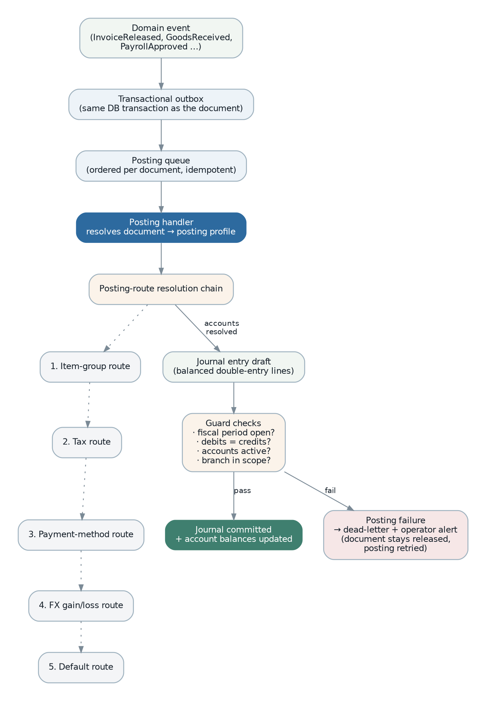

*Figure 13 — Posting engine — from document event to committed journal, with the posting-route resolution chain and the failure path.*

## 6.8 Payroll and Human Resources

**Purpose.** To maintain employee records, compute pay correctly including all Malaysian statutory contributions, produce payslips and statutory returns, and post the result to the ledger. Payroll carries the highest confidentiality requirement in the system and the least tolerance for arithmetic error.

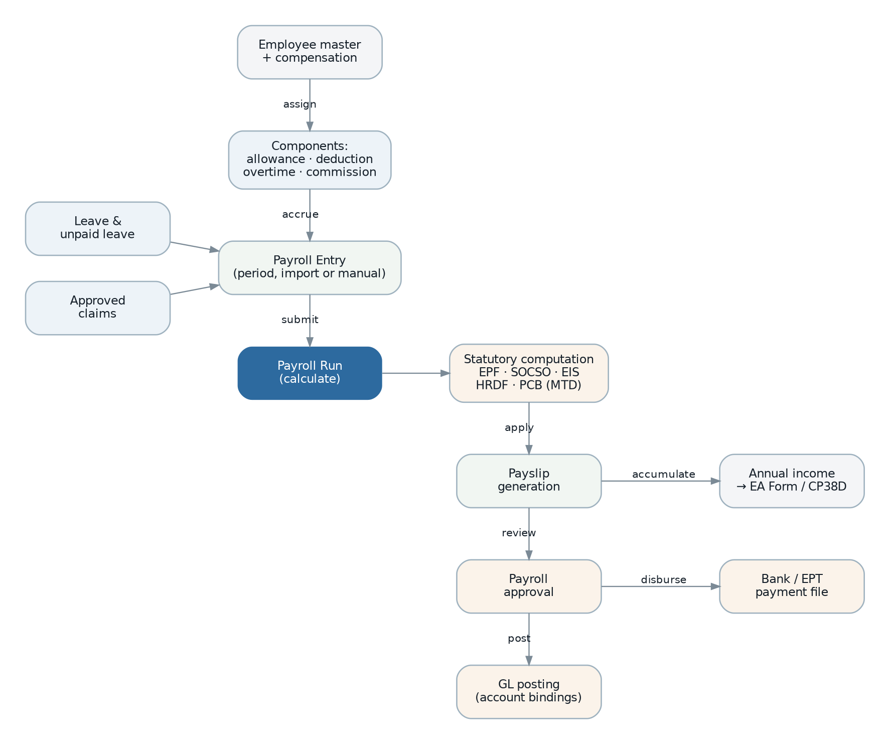

*Figure 14 — Payroll cycle from employee master data to disbursement and annual reporting.*

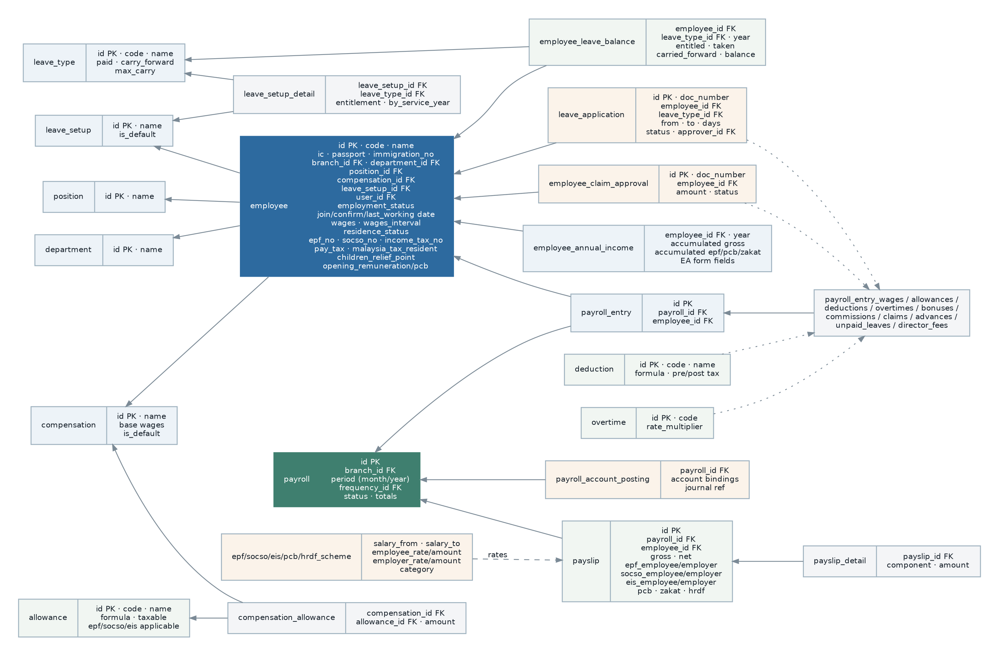

*Figure 15 — Payroll entity relationships, including the statutory scheme tables that drive contribution calculation.*

### 6.8.1 Requirements — employee and structure

| **Ref**    | **Requirement**                                                                                                                                                                                                                                                                                                | **Status**                                            |
|------------|----------------------------------------------------------------------------------------------------------------------------------------------------------------------------------------------------------------------------------------------------------------------------------------------------------------|-------------------------------------------------------|
| FR-PAY-001 | The system shall maintain employee records with identity (name, code, national identity number, passport, immigration and permit numbers with issue and expiry dates), demographics, contact details, emergency contact and spouse details.                                                                    | Existing                                              |
| FR-PAY-002 | An employee shall carry employment data: branch, department, position, join date, confirmation date, employment status, last working date, leaving reason, years of service, retirement date and active flag.                                                                                                  | Existing                                              |
| FR-PAY-003 | An employee shall carry statutory data: residence status, EPF number, SOCSO number, income tax number, whether tax applies, Malaysian tax residency, disability status, spouse working and disability status, and children relief points broken down by full and half claim, tertiary and disabled categories. | Existing                                              |
| FR-PAY-004 | An employee shall carry wage data: wage interval, monthly, daily and hourly basic and actual wages, and bank account for disbursement.                                                                                                                                                                         | Existing                                              |
| FR-PAY-005 | An employee shall carry opening balances for remuneration, contribution, zakat and PCB, so that a mid-year implementation computes correct year-to-date figures.                                                                                                                                               | Existing                                              |
| FR-PAY-006 | An employee record shall be linkable to a system user account, so that self-service can be scoped to the employee’s own data.                                                                                                                                                                                  | Existing                                              |
| FR-PAY-007 | The system shall maintain positions, departments and compensation structures, with one compensation structure marked default.                                                                                                                                                                                  | Existing                                              |
| FR-PAY-008 | The system shall maintain allowances, deductions, overtime types and commissions as reusable components, each declaring whether it is taxable and whether it attracts EPF, SOCSO and EIS.                                                                                                                      | Existing                                              |
| FR-PAY-009 | Components shall be assignable at compensation-structure level and overridable per employee.                                                                                                                                                                                                                   | Existing                                              |
| FR-PAY-010 | The system shall record employee confirmation and resignation as explicit actions with their own permissions.                                                                                                                                                                                                  | Existing                                              |
| FR-PAY-011 | The system shall maintain a document store per employee for contracts, certificates and correspondence, with a size and type limit.                                                                                                                                                                            | Existing                                              |
| FR-PAY-012 | The system shall alert on expiring passports, permits and immigration documents.                                                                                                                                                                                                                               | Missing — the dates are recorded but no alert exists. |

### 6.8.2 Requirements — leave and claims

| **Ref**    | **Requirement**                                                                                                                                                              | **Status**                                                                                                                    |
|------------|------------------------------------------------------------------------------------------------------------------------------------------------------------------------------|-------------------------------------------------------------------------------------------------------------------------------|
| FR-PAY-020 | The system shall maintain leave types declaring whether the leave is paid, whether the balance may be carried forward and the carry-forward cap.                             | Existing                                                                                                                      |
| FR-PAY-021 | The system shall maintain leave setups defining entitlement per leave type, including entitlement that varies by completed years of service, with one setup marked default.  | Existing                                                                                                                      |
| FR-PAY-022 | The system shall maintain a leave balance per employee, leave type and year, holding entitlement, taken, carried forward and remaining balance.                              | Existing                                                                                                                      |
| FR-PAY-023 | The system shall initialise leave balances on employee creation and at each year start, and shall compute carry-forward according to the leave type’s cap.                   | Existing                                                                                                                      |
| FR-PAY-024 | The system shall support leave application with date range, day count computed against the working-day calendar, supporting document attachment, and an approval decision.   | Existing                                                                                                                      |
| FR-PAY-025 | Approved leave shall decrement the balance; unpaid leave shall flow into the payroll run as a deduction.                                                                     | Existing                                                                                                                      |
| FR-PAY-026 | The system shall maintain a working-day and rest-day calendar per organisation, and shall support public holidays.                                                           | Partially Implemented — a working-day pattern per weekday exists in settings; a public-holiday calendar does not. See OQ-036. |
| FR-PAY-027 | The system shall support employee claim submission with amount, category, supporting document and an approval decision, and approved claims shall flow into the payroll run. | Existing                                                                                                                      |
| FR-PAY-028 | The system shall provide a leave calendar view showing team absence.                                                                                                         | Existing                                                                                                                      |
| FR-PAY-029 | The system shall publish bulletins to employees, targeted by department or role.                                                                                             | Existing                                                                                                                      |

### 6.8.3 Requirements — payroll run and statutory computation

| **Ref**    | **Requirement**                                                                                                                                                                                                                                                                     | **Status**                                                                                                                                           |
|------------|-------------------------------------------------------------------------------------------------------------------------------------------------------------------------------------------------------------------------------------------------------------------------------------|------------------------------------------------------------------------------------------------------------------------------------------------------|
| FR-PAY-035 | The system shall support payroll runs per branch and period, with a configurable frequency.                                                                                                                                                                                         | Existing                                                                                                                                             |
| FR-PAY-036 | A payroll entry shall be created per employee per run, accumulating wages, allowances, deductions, overtime, bonuses, commissions, claims, advances, director fees and unpaid leave as separate categories.                                                                         | Existing                                                                                                                                             |
| FR-PAY-037 | The system shall support importing payroll entry data from a spreadsheet using a downloadable template, with validation before application.                                                                                                                                         | Existing                                                                                                                                             |
| FR-PAY-038 | The system shall compute EPF, SOCSO, EIS and HRDF contributions for both employee and employer from the statutory tables applicable to the payroll date.                                                                                                                            | Existing                                                                                                                                             |
| FR-PAY-039 | The system shall compute PCB according to the LHDN monthly tax deduction formula, taking into account year-to-date remuneration, year-to-date EPF, year-to-date PCB and zakat, individual relief, spouse relief, disability relief for self and spouse, and children relief points. | Existing — see BR-PAY-010 for the formula as implemented and OQ-037 for the reliefs not currently supported.                                         |
| FR-PAY-040 | Statutory tables shall be versioned by effective date, so that recomputing a prior period uses the rates in force at that time.                                                                                                                                                     | Missing — the legacy implementation replaces the tables in place, which makes historical recomputation wrong. This is a significant correctness gap. |
| FR-PAY-041 | The system shall generate a payslip per employee per run, itemising earnings, deductions, employee and employer statutory contributions, and net pay.                                                                                                                               | Existing                                                                                                                                             |
| FR-PAY-042 | The payroll run shall require approval before payslips are released or payment files are produced, and the approver shall not be the preparer.                                                                                                                                      | Partially Implemented — approval exists; separation of duties is not enforced.                                                                       |
| FR-PAY-043 | The system shall support recalculating a payroll run before approval, and shall prevent recalculation after approval.                                                                                                                                                               | Existing — recalculation exists; the post-approval prohibition requires confirmation (OQ-038).                                                       |
| FR-PAY-044 | The approved payroll run shall post to the general ledger using configurable account bindings per component.                                                                                                                                                                        | Existing                                                                                                                                             |
| FR-PAY-045 | The system shall produce a bank payment file for net salary disbursement.                                                                                                                                                                                                           | Partially Implemented — electronic payment export exists in Finance; payroll-specific formats are unconfirmed.                                       |
| FR-PAY-046 | The system shall accumulate annual income per employee and produce the EA Form and CP38D statutory returns.                                                                                                                                                                         | Existing                                                                                                                                             |
| FR-PAY-047 | The system shall produce the monthly statutory contribution returns for EPF, SOCSO, EIS, HRDF and PCB in the formats required by each body.                                                                                                                                         | Partially Implemented — the data exists; only payslip and EA form outputs were found. See OQ-039.                                                    |
| FR-PAY-048 | The statutory computation engine shall be structured so that a different jurisdiction’s contribution and withholding rules can be added as a rule set without modifying the payroll run.                                                                                            | Proposed — required by the multi-country-ready direction.                                                                                            |
| FR-PAY-049 | Payslips shall be individually deletable only before approval, under permission, and the deletion shall be audited.                                                                                                                                                                 | Existing                                                                                                                                             |

## 6.9 Employee Self-Service

**Purpose.** To let employees serve themselves for the things they need most often, removing routine load from the HR team. The legacy module is minimal — four screens and a single permission — and this is one of the clearest opportunities for improvement.

| **Ref**    | **Requirement**                                                                                                                                           | **Status**                                            |
|------------|-----------------------------------------------------------------------------------------------------------------------------------------------------------|-------------------------------------------------------|
| FR-ESS-001 | An employee shall see only their own records, enforced by matching the authenticated user to the employee record in the data-access layer.                | Existing                                              |
| FR-ESS-002 | An employee shall be able to view and download their own payslips for any period, and their own EA Form.                                                  | Existing for payslips; EA Form access is Missing.     |
| FR-ESS-003 | An employee shall be able to view their leave entitlement, taken and remaining balance per leave type, and their leave history.                           | Existing                                              |
| FR-ESS-004 | An employee shall be able to apply for leave, attach a supporting document, and see the status and decision of each application.                          | Existing                                              |
| FR-ESS-005 | An employee shall be able to submit a claim with supporting documents and see its status.                                                                 | Existing                                              |
| FR-ESS-006 | An employee shall be able to view the team leave calendar, subject to configuration.                                                                      | Existing                                              |
| FR-ESS-007 | An employee shall be able to view and update a defined subset of their own details, with changes routed for HR confirmation rather than applied directly. | Missing                                               |
| FR-ESS-008 | A manager shall be able to approve or reject leave and claims from within self-service, with notification.                                                | Missing — approval exists only in the payroll module. |
| FR-ESS-009 | An employee shall receive notification when a leave application or claim is decided.                                                                      | Missing                                               |
| FR-ESS-010 | Self-service shall be fully usable on a phone.                                                                                                            | Partially Implemented                                 |

## 6.10 Document Store

**Purpose.** To hold files attached to business records, with declared constraints per attachment point.

| **Ref**    | **Requirement**                                                                                                                                                                           | **Status**                                                                                                                                                   |
|------------|-------------------------------------------------------------------------------------------------------------------------------------------------------------------------------------------|--------------------------------------------------------------------------------------------------------------------------------------------------------------|
| FR-DOC-001 | Each module shall declare its storage buckets, each with a reference key, display name, permitted MIME types, maximum file size and the action to take when the owning record is deleted. | Existing                                                                                                                                                     |
| FR-DOC-002 | The system shall enforce the declared type and size constraints on upload, server-side.                                                                                                   | Existing                                                                                                                                                     |
| FR-DOC-003 | File access shall be authorised against the permissions and data scopes of the record the file is attached to, not by knowledge of the file URL.                                          | Requires Business Confirmation (OQ-040) — the legacy authorisation model for stored files could not be verified, and this is a potential data-exposure risk. |
| FR-DOC-004 | The system shall scan uploaded files for malicious content before they are made available for download.                                                                                   | Missing                                                                                                                                                      |
| FR-DOC-005 | The system shall support multipart upload for large files and shall support fetching a file from a remote URL into storage.                                                               | Existing                                                                                                                                                     |
| FR-DOC-006 | Users shall be able to mark files as favourites for quick access.                                                                                                                         | Existing                                                                                                                                                     |
| FR-DOC-007 | The system shall record who uploaded each file and when, and shall retain that record after the file is deleted.                                                                          | Partially Implemented                                                                                                                                        |
| FR-DOC-008 | The system shall support retention policies per bucket, so that files can be archived or purged on a defined schedule.                                                                    | Missing                                                                                                                                                      |

## 6.11 Messaging and Notification

**Purpose.** To deliver system-generated messages to people through the channel appropriate to the message. The legacy module is functional but thin: three channels, five declared intents across the entire system, no per-user preferences and no delivery guarantees.

| **Ref**    | **Requirement**                                                                                                                                                                                                                                                                       | **Status**                                                                                                              |
|------------|---------------------------------------------------------------------------------------------------------------------------------------------------------------------------------------------------------------------------------------------------------------------------------------|-------------------------------------------------------------------------------------------------------------------------|
| FR-MSG-001 | The system shall support delivery channels of email, mobile push and in-application notification, and shall be extensible to further channels without modifying the modules that raise messages.                                                                                      | Existing                                                                                                                |
| FR-MSG-002 | Each module shall declare its message intents, and each intent shall have a configurable template per channel with substitutable variables.                                                                                                                                           | Partially Implemented — intents are declared but templating is per module and per document type rather than per intent. |
| FR-MSG-003 | The system shall maintain a recipient configuration per intent and per document type, supporting to, cc and bcc, sender name and sender address.                                                                                                                                      | Existing                                                                                                                |
| FR-MSG-004 | Users shall be able to set their own notification preferences per intent and channel, subject to intents that are mandatory.                                                                                                                                                          | Missing                                                                                                                 |
| FR-MSG-005 | The system shall archive every message sent, with its recipients, channel, content and delivery outcome, and shall purge the archive on a configurable retention period.                                                                                                              | Existing — the legacy retention is fixed at ninety days.                                                                |
| FR-MSG-006 | Delivery shall be retried on transient failure and a permanent failure shall be recorded and surfaced, not silently dropped.                                                                                                                                                          | Missing                                                                                                                 |
| FR-MSG-007 | The system shall record and act on bounced and invalid email addresses, flagging the party record.                                                                                                                                                                                    | Partially Implemented — an invalid-email notification exists.                                                           |
| FR-MSG-008 | In-application notifications shall support unread counts, marking as read, and deletion by the recipient.                                                                                                                                                                             | Existing                                                                                                                |
| FR-MSG-009 | The intents required at minimum are: user account created, password recovery, approval requested, approval decided, document sent to party, low stock level, statement dispatched, e-Invoice validation outcome, leave decided, claim decided, payroll approved, and posting failure. | Partially Implemented — five of these twelve exist.                                                                     |

## 6.12 Reporting and Analytics

**Purpose.** To produce the printed business documents the organisation issues, the statutory and management reports it relies on, and the dashboards it runs on. The legacy catalogue contains 173 report definitions and is one of the most valuable and most easily underestimated parts of the system.

### 6.12.1 Report classes

| **Class**            | **Purpose**                                                                                                   | **Count in legacy** | **Characteristics**                                           |
|----------------------|---------------------------------------------------------------------------------------------------------------|---------------------|---------------------------------------------------------------|
| Printable documents  | The artefact issued to a customer, supplier or employee — invoice, order, delivery order, payslip, statement. | ≈60                 | Fixed layout, letterhead, signature, often statutory content. |
| Summary reports      | Transaction listings over a period with filters — sales by document, purchases by item group.                 | ≈55                 | Heavily parameterised; commonly exported.                     |
| Outstanding reports  | Unfulfilled or unsettled commitments — outstanding orders, invoices, shipments.                               | ≈20                 | Driven by balance quantities and outstanding amounts.         |
| Financial statements | Trial balance, profit and loss, balance sheet, cash flow, ledgers, aging.                                     | ≈30                 | Hierarchical, comparative, multi-branch roll-up.              |
| Listings             | Master data extracts — customer, supplier, stock listings.                                                    | ≈8                  | Simple, high volume.                                          |

### 6.12.2 Requirements

| **Ref** | **Requirement**                                                                                                                                                                        | **Status**                                                                                                                                                                            |
|---------|----------------------------------------------------------------------------------------------------------------------------------------------------------------------------------------|---------------------------------------------------------------------------------------------------------------------------------------------------------------------------------------|
| RPT-001 | Each module shall declare its reports with a code, name, category, template reference and parameter definitions, so that adding a report is a configuration act.                       | Existing                                                                                                                                                                              |
| RPT-002 | Report parameters shall support dates, date ranges, months, single and multiple selection from a dynamic data source, and free text, and shall carry a label, placeholder and default. | Existing                                                                                                                                                                              |
| RPT-003 | Every report shall accept the current branch and the user’s viewable branch set, and shall not return data outside the user’s data scopes under any parameter combination.             | Existing — and shall be verified by automated test for every report.                                                                                                                  |
| RPT-004 | Report access shall be grantable per role and per user, in addition to the module permission.                                                                                          | Existing                                                                                                                                                                              |
| RPT-005 | The system shall record every report generation with the requesting user, parameters and timestamp, and shall purge that history on a configurable schedule.                           | Existing                                                                                                                                                                              |
| RPT-006 | Reports shall be exportable to PDF and to a spreadsheet format, preserving numeric types rather than exporting formatted text.                                                         | Existing                                                                                                                                                                              |
| RPT-007 | Long-running reports shall execute asynchronously, notify the user on completion and make the output available for download, rather than holding a request open.                       | Partially Implemented                                                                                                                                                                 |
| RPT-008 | Reports shall execute against a read-optimised data source so that reporting load does not degrade transactional performance.                                                          | Missing                                                                                                                                                                               |
| RPT-009 | A customer shall be able to upload a modified report template without a code change, subject to validation and permission.                                                             | Existing                                                                                                                                                                              |
| RPT-010 | Printable documents shall support per-branch letterhead, signature block and logo, with inheritance from a parent branch.                                                              | Existing                                                                                                                                                                              |
| RPT-011 | A printed document shall record that it was printed and how many times, so that reprints are visible.                                                                                  | Existing                                                                                                                                                                              |
| RPT-012 | The system shall provide role-appropriate dashboards with operational and financial indicators, refreshed on a defined cadence.                                                        | Existing — module overview screens with widgets exist.                                                                                                                                |
| RPT-013 | Dashboard indicators shall be defined declaratively and shall respect permissions and data scopes.                                                                                     | Partially Implemented                                                                                                                                                                 |
| RPT-014 | The system shall support user-defined ad-hoc queries over a governed, read-only data set, without granting database access.                                                            | Partially Implemented — a saved "query command" facility exists in the platform, which is powerful and correspondingly risky; its authorisation model requires confirmation (OQ-041). |
| RPT-015 | Every report in Appendix C shall be delivered or shall carry a recorded business decision not to deliver it.                                                                           | Existing scope baseline                                                                                                                                                               |

## 6.13 Extensibility Framework

**Purpose.** To allow customer-specific behaviour to be added without forking the shared modules. This is what keeps one codebase serving several operating styles, and it is one of the legacy system’s genuine strengths.

| **Ref**    | **Requirement**                                                                                                                                      | **Status**                                                                  |
|------------|------------------------------------------------------------------------------------------------------------------------------------------------------|-----------------------------------------------------------------------------|
| FR-EXT-001 | A module shall be able to add fields to another module’s entities, with their own validation and persistence, without modifying the extended module. | Existing                                                                    |
| FR-EXT-002 | A module shall be able to add relationships, computed attributes and data scopes to another module’s entities.                                       | Existing                                                                    |
| FR-EXT-003 | A module shall be able to contribute columns, filters, form sections and actions to another module’s user interface.                                 | Existing                                                                    |
| FR-EXT-004 | A module shall be able to subscribe to another module’s published events, and shall not be able to subscribe to anything not published.              | Partially Implemented — events are effectively public in the legacy system. |
| FR-EXT-005 | Removing an extending module shall cleanly remove its contributions, leaving the extended module fully functional.                                   | Existing                                                                    |
| FR-EXT-006 | The system shall provide a documented module template and generator so that a new module starts correct.                                             | Existing — the legacy scaffold module serves this purpose.                  |
| FR-EXT-007 | Extension points shall be versioned, so that a change to a shared module that breaks an extension is detected at build time.                         | Missing                                                                     |

## 6.14 Proposed Modules

The modules in this subsection do not exist in the legacy repository. The first three are referenced by legacy code and are therefore holes rather than additions. The remainder are capabilities a complete ERP is normally expected to have and whose absence was confirmed during the review.

### 6.14.1 e-Invoice (Malaysia — MyInvois)

**Status.** Missing, with 54 references to it in the existing code and twelve database columns already provisioned on every AR and AP document. Statutorily mandated. Placed in Phase 3.

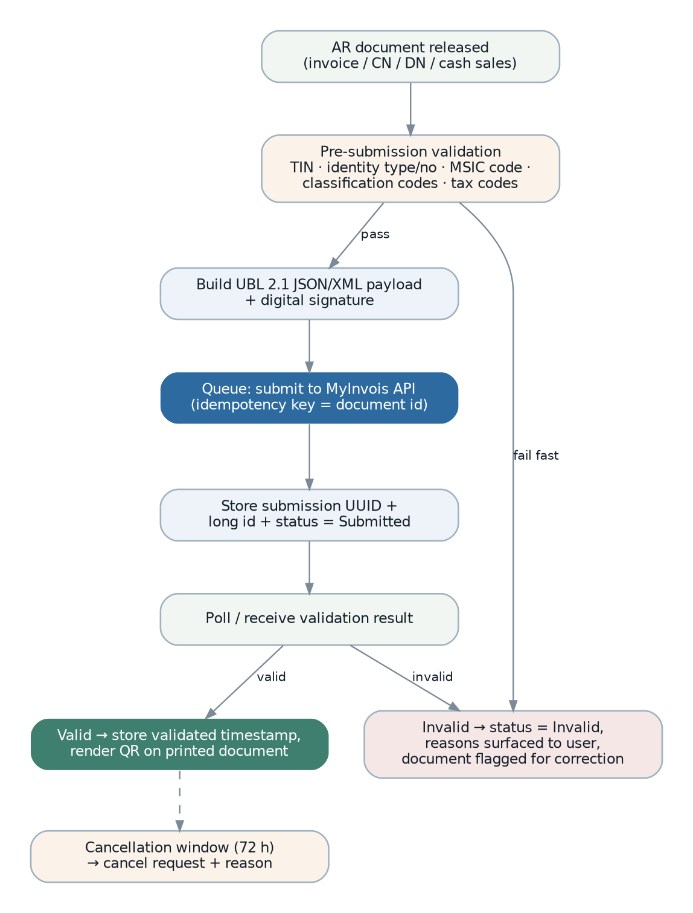

*Figure 16 — e-Invoice submission lifecycle, including the validation-result and cancellation paths.*

| **Ref**    | **Requirement**                                                                                                                                                                                                                                              | **Status**                                                          |
|------------|--------------------------------------------------------------------------------------------------------------------------------------------------------------------------------------------------------------------------------------------------------------|---------------------------------------------------------------------|
| FR-EIV-001 | The system shall determine, per document, whether an e-Invoice is required and which e-Invoice document type applies (invoice, credit note, debit note, refund note, or self-billed equivalents).                                                            | Missing                                                             |
| FR-EIV-002 | Before submission the system shall validate all mandatory content: party TIN, identity type and number, classification codes per line, tax codes, unit codes, currency and exchange rate, and shall report every failure together rather than one at a time. | Missing                                                             |
| FR-EIV-003 | The system shall validate a party’s TIN against the statutory platform and record the outcome, so that validation failures are discovered at master-data entry rather than at invoice submission.                                                            | Missing                                                             |
| FR-EIV-004 | The system shall submit the document to the statutory platform, recording the submission identifier, unique identifier, long identifier, submission timestamp and status.                                                                                    | Missing                                                             |
| FR-EIV-005 | The system shall retrieve and record the validation outcome, and on success shall record the validation timestamp and make the validation link and QR code available on the printed document.                                                                | Missing                                                             |
| FR-EIV-006 | On rejection the system shall record the reasons, present them to the user, and hold the document in a state that requires correction and resubmission.                                                                                                      | Missing                                                             |
| FR-EIV-007 | The system shall support cancellation within the statutory window, with a reason, and shall record the cancellation outcome.                                                                                                                                 | Missing                                                             |
| FR-EIV-008 | Submission shall be idempotent: a retry shall never create a second submission for the same document.                                                                                                                                                        | Missing                                                             |
| FR-EIV-009 | The system shall support consolidated e-Invoicing for transactions that qualify, and self-billed e-Invoices for foreign supplier transactions.                                                                                                               | Missing — requires business confirmation of applicability (OQ-030). |
| FR-EIV-010 | The system shall report e-Invoice status across all documents, so that anything unsubmitted, rejected or pending is visible without inspecting documents individually.                                                                                       | Missing                                                             |
| FR-EIV-011 | The e-Invoice module shall be structured as a jurisdiction adapter, so that a second jurisdiction’s electronic invoicing regime can be added alongside it.                                                                                                   | Proposed                                                            |

### 6.14.2 Customer Relationship Management

**Status.** Missing, referenced twice by Sales listeners. Phase 5.

| **Ref**    | **Requirement**                                                                                                                                                                       | **Status**                                                             |
|------------|---------------------------------------------------------------------------------------------------------------------------------------------------------------------------------------|------------------------------------------------------------------------|
| FR-CRM-001 | The system shall maintain leads and opportunities with a configurable pipeline stage, value, expected close date and owner.                                                           | Missing                                                                |
| FR-CRM-002 | The system shall link an opportunity to the enquiries, draft quotations and quotations raised from it, and shall reflect quotation release and cancellation in the opportunity state. | Missing — this is precisely what the two existing legacy hooks expect. |
| FR-CRM-003 | The system shall record activities (calls, meetings, emails, notes) against a party, contact or opportunity, with follow-up reminders.                                                | Missing                                                                |
| FR-CRM-004 | The system shall report pipeline by stage, owner, value and age, and win and loss rates with loss reasons.                                                                            | Missing                                                                |
| FR-CRM-005 | The system shall support sales targets per agent and period, and report attainment.                                                                                                   | Missing                                                                |

### 6.14.3 Client Portal

**Status.** Missing, referenced once by Finance. Phase 5.

| **Ref**    | **Requirement**                                                                                                                                                        | **Status**                                       |
|------------|------------------------------------------------------------------------------------------------------------------------------------------------------------------------|--------------------------------------------------|
| FR-CPT-001 | A customer shall be able to authenticate to a portal separate from the internal application, scoped strictly to their own records.                                     | Missing                                          |
| FR-CPT-002 | A customer shall be able to view their quotations, orders, delivery status, invoices, statements and outstanding balance, and download documents.                      | Missing                                          |
| FR-CPT-003 | A customer shall be able to place an order against agreed pricing, which enters the internal system as a sales order or enquiry subject to configuration and approval. | Missing                                          |
| FR-CPT-004 | The portal shall be separately deployable and separately rate-limited, and a portal compromise shall not grant access to internal functions.                           | Proposed — a security requirement on the design. |

### 6.14.4 Fixed Assets

**Status.** Missing entirely. No asset register, no depreciation. A notable omission in a system with an otherwise complete general ledger. Phase 5.

| **Ref**    | **Requirement**                                                                                                                                              | **Status** |
|------------|--------------------------------------------------------------------------------------------------------------------------------------------------------------|------------|
| FR-FXA-001 | The system shall maintain an asset register with acquisition date, cost, category, location, custodian, useful life, residual value and depreciation method. | Missing    |
| FR-FXA-002 | The system shall compute depreciation per period by straight-line and reducing-balance methods and post it to the ledger.                                    | Missing    |
| FR-FXA-003 | The system shall support asset disposal and write-off, computing and posting the gain or loss.                                                               | Missing    |
| FR-FXA-004 | The system shall support asset transfer between branches and revaluation.                                                                                    | Missing    |
| FR-FXA-005 | The system shall reconcile the asset register to the ledger control accounts.                                                                                | Missing    |

### 6.14.5 Workflow and Approval Engine

**Status.** Partially Implemented as a fixed per-branch approver chain. Proposed as a general capability in Phase 0 because several modules need it and each currently reimplements part of it.

| **Ref**    | **Requirement**                                                                                                                            | **Status**            |
|------------|--------------------------------------------------------------------------------------------------------------------------------------------|-----------------------|
| FR-WFL-001 | The system shall provide a single approval engine used by every module, configurable per document type, branch and condition.              | Missing               |
| FR-WFL-002 | Approval conditions shall be expressible against document attributes — value, customer, item group, margin, project — without code change. | Missing               |
| FR-WFL-003 | The engine shall support sequential and parallel approval, quorum, escalation on expiry, delegation, and prohibition of self-approval.     | Missing               |
| FR-WFL-004 | Every decision shall be recorded immutably with actor, timestamp, decision and reason.                                                     | Partially Implemented |
| FR-WFL-005 | A user shall have a single work queue showing everything awaiting their decision across all modules.                                       | Missing               |

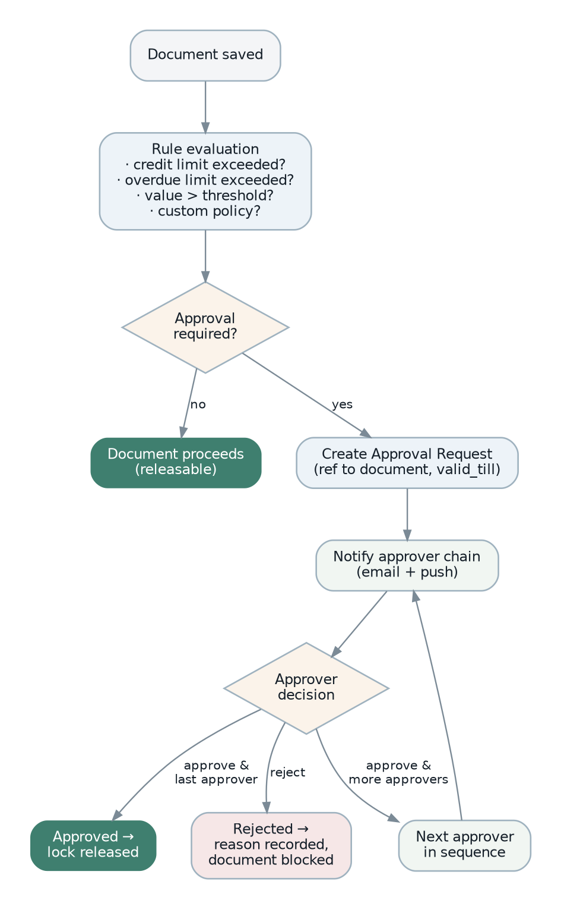

*Figure 17 — Approval workflow, from rule evaluation through the approver chain to release.*

### 6.14.6 Integration Hub

**Status.** Missing. Phase 5, but the API surface it depends on is built incrementally from Phase 0.

| **Ref**    | **Requirement**                                                                                                                                                                      | **Status**                                                                                                                        |
|------------|--------------------------------------------------------------------------------------------------------------------------------------------------------------------------------------|-----------------------------------------------------------------------------------------------------------------------------------|
| FR-IHB-001 | The system shall expose a documented, versioned API covering every core business entity and operation, sufficient for a third party to build against without access to the database. | Missing                                                                                                                           |
| FR-IHB-002 | The system shall emit webhooks for defined business events, with retry, signature verification and a delivery log.                                                                   | Partially Implemented — webhook target configuration and a shared secret exist in platform settings; no event emission was found. |
| FR-IHB-003 | The system shall support scheduled and on-demand import of master data and transactions from files, with validation, a dry-run mode and a rejection report.                          | Partially Implemented — import commands exist for customers and items, driven from the command line only.                         |
| FR-IHB-004 | All integration traffic shall be authenticated as a service account, rate-limited and fully logged.                                                                                  | Missing                                                                                                                           |

### 6.14.7 Other capabilities confirmed absent

| **Capability**                          | **Why an ERP normally has it**                                                                                            | **Recommendation**                            |
|-----------------------------------------|---------------------------------------------------------------------------------------------------------------------------|-----------------------------------------------|
| Budgeting and forecasting workflow      | Budgets exist as an entity and a report, but there is no preparation, submission, approval or revision cycle.             | Phase 5. Build on the existing budget entity. |
| Multi-warehouse replenishment planning  | The system knows reorder levels but cannot propose transfers between branches to balance stock.                           | Phase 5.                                      |
| Serial-number tracking                  | Batch tracking exists; individual serial tracking does not. Required for warranty and recall in some industries.          | Confirm need with the business (OQ-042).      |
| Contract and price-agreement management | Price lists exist but there is no notion of a customer contract with committed volumes and periods.                       | Phase 5.                                      |
| Consolidated group reporting            | Reporting rolls up branches within one database; it cannot consolidate separate legal databases with elimination entries. | Depends on the tenancy decision (OQ-001).     |
| Document version comparison             | Revisions are created but there is no view showing what changed between revisions.                                        | Proposed, low cost, high user value.          |
| Data archiving                          | Nothing is ever archived. Transaction tables grow without bound.                                                          | Phase 3 onward; see section 9.5.              |

# 7. Business Processes and Workflows

Section 6 describes what each module must do. This section describes how the modules act together, because almost every significant business process in this system crosses module boundaries. These are the processes that break first when a module is rebuilt in isolation, and they are the processes that end-to-end testing must cover.

## 7.1 Notation and conventions

- A process is described by its trigger, its actors, its steps, the documents it creates, the accounting and stock effects it causes, and its failure modes.

- Steps marked automatic happen without human action, as a consequence of a release. In the legacy system these are implemented as event listeners; the new system may implement them differently but their observable behaviour is a requirement.

- Failure modes are stated explicitly because the most valuable thing this section can record is what the legacy system does badly when something goes wrong.

## 7.2 Order to cash

**Trigger.** A customer enquiry, a repeat order, or a direct counter sale.

**Actors.** Sales executive or agent, sales manager (approval), warehouse operator, accounts clerk.

*Figure 18 — Order to cash — the same diagram as section 6.3, repeated here for reading continuity.*

| **\#** | **Step**                                 | **What happens**                                                                                                                                                                                                                                                | **Effects**                                                                  |
|--------|------------------------------------------|-----------------------------------------------------------------------------------------------------------------------------------------------------------------------------------------------------------------------------------------------------------------|------------------------------------------------------------------------------|
| 1      | Capture enquiry                          | Sales records the customer request with type, source and assigned agent. Agent scope means the agent sees only their own enquiries.                                                                                                                             | None.                                                                        |
| 2      | Quote                                    | A draft quotation is prepared internally, then released as a quotation with a validity period computed from the configured validity days. Pricing comes from the applicable price list; strict price-list mode may prevent manual override.                     | Balance quantities initialised.                                              |
| 3      | Revise quote                             | If the customer negotiates, the quotation is revised: a new revision is created, linked to its source, with the revision counter incremented. The superseded revision remains on record.                                                                        | New document; source marked superseded.                                      |
| 4      | Convert to order                         | The quotation is transferred to a sales order, in whole or in part. Credit control evaluates the customer’s limit and overdue position before the order can be saved.                                                                                           | Quotation balance decremented; transfer status updated.                      |
| 5      | **Automatic: credit evaluation**         | If the configured action for the sales-order operation is to require approval, an approval request is raised and release is blocked until decided. If the action is to block, the save is refused with the reason.                                              | Approval request created; document locked.                                   |
| 6      | Release order                            | On release the order becomes a commitment. This is the point from which downstream effects flow.                                                                                                                                                                | Status done; downstream events raised.                                       |
| 7      | **Automatic: shipment creation**         | Releasing the order for shipment creates an outgoing shipment in Inventory carrying the outstanding quantities, marks the transferred quantities on the order and recomputes the order’s transfer status as pending, partial or done.                           | Outgoing shipment created; order balance reduced.                            |
| 8      | Pick and deliver                         | The warehouse generates a pick order, picks from bins (recording short-pick or extra-pick exceptions), then raises a delivery order for what is actually despatched.                                                                                            | Stock ledger appended; bin balances decremented.                             |
| 9      | Invoice                                  | An invoice is transferred from the order, or from the delivery order, or entered directly. Credit control evaluates again against the invoice operation.                                                                                                        | Order or delivery balance decremented.                                       |
| 10     | **Automatic: receivable creation**       | Releasing the invoice creates the accounts-receivable invoice in Finance and writes the link back onto the sales invoice.                                                                                                                                       | AR document created.                                                         |
| 11     | **Automatic: ledger posting**            | The receivable document posts a journal. Accounts are resolved through the posting-route chain: item-group route, then tax route, then payment-method route, then FX route, then the default route. The period lock is checked before the journal is committed. | Journal committed; account balances updated; customer outstanding increased. |
| 12     | **Automatic: e-Invoice submission**      | Where e-Invoice applies, the document is validated, submitted, and its validation outcome recorded.                                                                                                                                                             | Currently no effect — the module is absent (section 4.4).                    |
| 13     | Collect payment                          | An official receipt is entered and knocked off against one or more open invoices, in full or in part. Realised exchange gain or loss is computed for foreign-currency invoices.                                                                                 | Outstanding reduced; settlement journal posted.                              |
| 14     | **Automatic: outstanding recalculation** | Payment received recalculates the invoice’s outstanding amount and payment status, and the customer’s outstanding and overdue totals.                                                                                                                           | Derived balances updated.                                                    |
| 15     | Handle exceptions                        | Returns produce a sales return and a credit note plus a stock receipt. Additional charges produce a debit note. Unwanted balances produce a cancel order which closes the remaining quantity.                                                                   | Reversing stock and ledger effects.                                          |

#### Failure modes to be corrected

- Posting failure at step 11 is currently retried three times inside the request, with the exception discarded, and can leave a released invoice with no receivable document and no visible error (WK-02). FR-FIN-031 requires this to become asynchronous, idempotent and observable.

- Transfer balances at steps 7 and 9 can drift out of step with reality, which is why a corrective job runs twice daily (WK-04). FR-PLT-015 requires transactional maintenance instead.

- Cancellation at step 15 does not consistently verify that downstream documents have been reversed first (FR-SAL-022, OQ-019).

## 7.3 Procure to pay

Structurally the mirror of order to cash. The steps below state only the differences.

*Figure 19 — Procure to pay.*

| **\#** | **Step**        | **Difference from order to cash**                                                                                                                                                                                                   |
|--------|-----------------|-------------------------------------------------------------------------------------------------------------------------------------------------------------------------------------------------------------------------------------|
| 1      | Identify demand | Demand is generated from reorder levels, outstanding sales orders and production material shortages rather than captured from outside.                                                                                              |
| 2      | Source          | A request for quotation may be issued to several suppliers; one response is accepted, marking the RFQ confirmed.                                                                                                                    |
| 3      | Approve order   | Approval is driven by a configured value threshold on the purchase order rather than by credit control.                                                                                                                             |
| 4      | Receive         | Releasing the purchase order creates an incoming shipment. Goods receipt records actual quantity, which may differ from ordered quantity, producing a short-receipt or extra-receipt exception. Putaway then moves goods into bins. |
| 5      | Match           | The supplier invoice should be matched against the order and the receipt. FR-PUR-006 requires explicit variance checking with tolerances, which the legacy system does not provide.                                                 |
| 6      | Pay             | A payment voucher settles open payables. Payment registers group vouchers for bank submission.                                                                                                                                      |
| 7      | Exceptions      | Purchase returns produce a supplier credit note and a stock issue. Purchase debit notes record additional supplier charges.                                                                                                         |

## 7.4 Inventory movement and valuation

Every stock-affecting document, regardless of which module raised it, funnels into one pipeline. This is the single most important internal contract in the system: if it is wrong, both the warehouse and the ledger are wrong.

*Figure 20 — Stock movement and valuation pipeline.*

1.  A document is released. The document type determines the movement direction and whether the movement is returnable.

2.  A movement record is derived, carrying source and destination bin, quantity, batch and project.

3.  Bin-level balances are updated.

4.  One or more immutable rows are appended to the stock transaction ledger, ordered by date within item, bin, batch and project.

5.  The item’s costing method decides valuation. Under FIFO, cost layers are maintained per transaction and consumed oldest-first; the layers of the preceding transaction are carried forward, adjusted, merged where type, cost and date coincide, and any layer summing to zero is removed. Under weighted average, a running average cost is maintained and outbound movements are valued at it.

6.  The transaction’s resulting balance quantity and balance cost are computed and stored on the row, so that a point-in-time balance never requires summing history.

7.  Period stock balances aggregate the ledger, and where automatic stock-value posting is enabled the closing value posts to the ledger.

8.  A recalculation job can replay the ledger from a date to restate value after a backdated change.

<table>
<colgroup>
<col style="width: 100%" />
</colgroup>
<tbody>
<tr class="odd">
<td>
<strong>Requirement emphasis</strong>

The legacy system schedules the recalculation job twice daily, which means recalculation is load-bearing rather than exceptional. FR-INV-047 requires the pipeline to be correct without it: recalculation should exist only for deliberate historical restatement.

The legacy movement processor issues several queries per detail line (WK-05). NFR-PERF-006 sets a set-based performance requirement instead.
</td>
</tr>
</tbody>
</table>

## 7.5 Make to order

*Figure 21 — Production process.*

| **\#** | **Step**        | **What happens**                                                                                                                                               |
|--------|-----------------|----------------------------------------------------------------------------------------------------------------------------------------------------------------|
| 1      | Demand          | A sales order for a manufactured item, or a stock replenishment decision, creates the need.                                                                    |
| 2      | Job order       | A production job order is raised for a quantity, optionally linked to the originating sales order.                                                             |
| 3      | Explode         | The item’s bill of material is exploded to all levels, optionally traversing sub-assemblies by default. Required quantity per component per level is recorded. |
| 4      | Net and source  | Requirements are netted against available stock. Shortfalls generate a purchase request.                                                                       |
| 5      | Plan work       | A process order is raised with a routing drawn from a task set.                                                                                                |
| 6      | Issue material  | Stock issue decrements component stock and accumulates work-in-progress cost.                                                                                  |
| 7      | Record progress | Progress is recorded incrementally so partially complete work is visible.                                                                                      |
| 8      | Receive output  | A stock assembly document increments finished-goods stock, relieves work in progress and rolls up cost according to the configured production costing method.  |
| 9      | Record loss     | Wastage is recorded against the production order with a reason and valued.                                                                                     |
| 10     | Fulfil          | Finished goods satisfy the originating sales order through the normal outbound chain.                                                                          |

**Gap.** Labour and overhead are not captured (FR-PRD-013), so production cost is material cost only. For a business quoting on manufactured items this understates cost and overstates margin. This should be confirmed and, if confirmed, corrected (OQ-031).

## 7.6 Record to report — period close

The close process is assembled from the scheduled jobs, the lock mechanism and the report set found in the legacy system. It is not documented anywhere in the codebase, and the sequence below should be confirmed with the finance team (OQ-043).

9.  Cut off operational entry for the period, either by agreement or by applying the accounting lock.

10. Ensure all operational documents for the period are released, so that they have posted. Outstanding-document reports identify what is unreleased.

11. Run stock valuation for the period and post the closing stock value where automatic posting is enabled; otherwise post it manually.

12. Reconcile bank accounts against statements and clear unreconciled items.

13. Review and post accruals, prepayments and any manual adjustments by journal.

14. Compute and post depreciation. Currently a manual journal, because no fixed-asset module exists (FR-FIN-060).

15. Review aging reports for receivables and payables and confirm the control accounts reconcile to the sub-ledgers.

16. Produce the trial balance and confirm it balances and that no suspense or clearing account carries an unexplained balance.

17. Produce the profit and loss, balance sheet and cash flow statements, with comparatives.

18. Apply the accounting lock and the stock lock for the period.

19. At year end, compute opening balances for the next year and roll profit and loss balances to retained earnings. FR-FIN-022 notes that a controlled year-end close process does not currently exist.

## 7.7 Hire to retire — the payroll cycle

*Figure 22 — Payroll cycle.*

<table style="width:100%;">
<colgroup>
<col style="width: 0%" />
<col style="width: 4%" />
<col style="width: 25%" />
<col style="width: 68%" />
</colgroup>
<thead>
<tr class="header">
<th colspan="2"><strong>#</strong></th>
<th><strong>Step</strong></th>
<th><strong>What happens</strong></th>
</tr>
</thead>
<tbody>
<tr class="odd">
<td colspan="2">1</td>
<td>Onboard</td>
<td>Employee record created with identity, statutory, wage and dependant data. Leave balances initialised from the applicable leave setup, taking completed years of service into account. Optionally linked to a system user for self-service.</td>
</tr>
<tr class="even">
<td colspan="2">2</td>
<td>Accrue through the period</td>
<td>Leave applications are approved and decrement balances. Unpaid leave is recorded. Claims are approved. Overtime and commission are captured.</td>
</tr>
<tr class="odd">
<td colspan="2">3</td>
<td>Prepare entry</td>
<td>A payroll entry is created per employee for the period, either manually or by spreadsheet import against a downloadable template. Approved claims and unpaid leave flow in automatically.</td>
</tr>
<tr class="even">
<td colspan="2">4</td>
<td>Calculate</td>
<td>The run computes gross pay, then statutory contributions from the tables in force, then PCB from the LHDN monthly formula using year-to-date figures, then net pay.</td>
</tr>
<tr class="odd">
<td colspan="2">5</td>
<td>Review</td>
<td>Payslips are generated and reviewed. The run may be recalculated at this stage.</td>
</tr>
<tr class="even">
<td colspan="2">6</td>
<td>Approve</td>
<td>The run is approved. FR-PAY-042 requires the approver to differ from the preparer, which the legacy system does not enforce.</td>
</tr>
<tr class="odd">
<td colspan="2">7</td>
<td>Post and pay</td>
<td>The approved run posts to the ledger using configured account bindings, and a bank payment file is produced for disbursement.</td>
</tr>
<tr class="even">
<td colspan="2">8</td>
<td>File statutory returns</td>
<td>Monthly contribution returns for EPF, SOCSO, EIS, HRDF and PCB. FR-PAY-047 notes that only payslip and annual outputs were found.</td>
</tr>
<tr class="odd">
<td colspan="2">9</td>
<td>Annual</td>
<td>Annual income accumulates through the year and produces the EA Form and CP38D.</td>
</tr>
<tr class="even">
<td colspan="2">10</td>
<td>Offboard</td>
<td>Resignation recorded with last working date and reason; final pay computed; leave balance settled.</td>
</tr>
<tr class="odd">
<td colspan="4">
<strong>Highest-risk payroll requirement</strong>

The legacy statutory tables are replaced in place by a scheduled download: the existing rows are deleted and the new set inserted. This means recomputing a prior period uses today’s rates, which produces a wrong answer, and a failed download leaves the tables empty (WK-10).

FR-PAY-040 requires effective-dated statutory tables, and INT-006 requires the refresh to be transactional and validated. Both are mandatory for payroll to be defensible in an audit.
</td>
</tr>
</tbody>
</table>

## 7.8 Approval and authorisation

*Figure 23 — Approval workflow.*

Two distinct approval triggers exist in the legacy system and both must be preserved:

- **Credit-driven.** A sales document that breaches the customer’s credit limit or overdue limit raises an approval automatically. The action taken (allow, require approval, block) is configurable per operation and per breach type. Cancelling the document clears the approval; an already-approved document is not re-blocked.

- **Value-driven.** A purchase order whose home-currency total exceeds a configured threshold requires approval before release.

Both route to the same structure: an approval request pointing at the document, assigned to the next approver in the branch’s ordered chain, with notification by email. Section 5.4 states the requirements for extending this into a general engine.

## 7.9 Inter-company trading

Where two companies in the group trade with each other, releasing a sales document in one automatically creates the matching purchase document in the other. The legacy mapping is:

| **Source document (selling company)** |                                                                                                                                                   | **Mirrored document (buying company)** |                                                                                                                                                                                          | **On cancellation**                                                   |
|---------------------------------------|---------------------------------------------------------------------------------------------------------------------------------------------------|----------------------------------------|------------------------------------------------------------------------------------------------------------------------------------------------------------------------------------------|-----------------------------------------------------------------------|
| **Ref**                               | **Rule**                                                                                                                                          |                                        | **Status**                                                                                                                                                                               |                                                                       |
| Quotation                             |                                                                                                                                                   | Request for Quotation                  |                                                                                                                                                                                          | Link cleared; mirror cancelled with the same reason.                  |
| Sales Order                           |                                                                                                                                                   | Purchase Order                         |                                                                                                                                                                                          | Link cleared; mirror cancelled; detail-line cross-references cleared. |
| Cancel Order                          |                                                                                                                                                   | Cancel Order                           |                                                                                                                                                                                          | Propagated.                                                           |
| BR-ICO-001                            | Inter-company mirroring shall operate only when enabled by the platform setting, and shall be suppressible per document.                          |                                        | Existing — the legacy suppression flag is an undeclared attribute that a developer must add manually, which is fragile. FR-PLT-026 requires this to become an explicit, supported field. |                                                                       |
| BR-ICO-002                            | The mirrored document shall carry a bidirectional reference to its source, at both header and detail-line level.                                  |                                        | Existing                                                                                                                                                                                 |                                                                       |
| BR-ICO-003                            | Cancelling the source shall cancel the mirror and clear the references. The mirror shall not be left orphaned.                                    |                                        | Existing                                                                                                                                                                                 |                                                                       |
| BR-ICO-004                            | Mirroring shall be asynchronous and idempotent. A retry shall not create a duplicate mirror.                                                      |                                        | Partially Implemented — the legacy listener is queued, which gives asynchrony, but idempotency was not evident.                                                                          |                                                                       |
| BR-ICO-005                            | Mirroring shall operate through published module contracts, not by writing into the counterparty module’s tables.                                 |                                        | Missing — corrects WK-09.                                                                                                                                                                |                                                                       |
| BR-ICO-006                            | The business rules governing inter-company pricing, and whether inter-company balances must be eliminated for group reporting, must be confirmed. |                                        | Requires Business Confirmation (OQ-044)                                                                                                                                                  |                                                                       |

## 7.10 Document revision, cancellation and correction

How a released document is corrected is one of the most consequential process rules in an ERP, because it determines whether the audit trail is trustworthy. The legacy system offers four mechanisms, and their boundaries are not clearly defined.

| **Mechanism**       | **What it does**                                                                                     | **When it should be used**                                                                                                                                         |
|---------------------|------------------------------------------------------------------------------------------------------|--------------------------------------------------------------------------------------------------------------------------------------------------------------------|
| Revise              | Replicates the document as a new revision, links it to its source and increments a revision counter. | Commercial change before fulfilment or invoicing — a renegotiated quotation or order.                                                                              |
| Cancel              | Sets the document status to cancelled with a mandatory reason, closing outstanding quantities.       | The transaction will not proceed. Only valid where nothing downstream has been actioned.                                                                           |
| Credit / debit note | Issues a new document that reverses or supplements the original.                                     | The only correct mechanism once an invoice has been issued and posted.                                                                                             |
| Delete              | Removes the document.                                                                                | Should be restricted to unreleased drafts only. The legacy permission catalogue grants delete on released document types, which conflicts with audit expectations. |

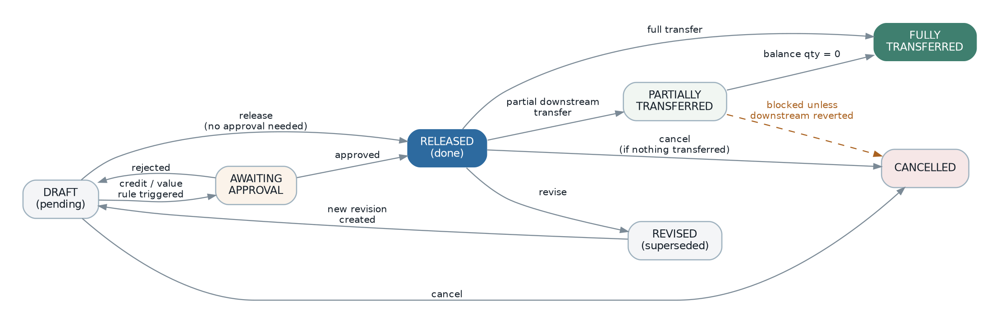

*Figure 24 — Document state machine — the lifecycle every numbered document follows, with the transitions that must be guarded.*

| **Ref**    | **Rule**                                                                                                                           | **Status**                                                                                                 |
|------------|------------------------------------------------------------------------------------------------------------------------------------|------------------------------------------------------------------------------------------------------------|
| BR-DOC-001 | A document in draft may be edited or deleted freely.                                                                               | Existing                                                                                                   |
| BR-DOC-002 | A released document shall not be deletable. Correction shall be by revision, reversal or cancellation.                             | Requires Business Confirmation (OQ-020) — conflicts with the legacy permission catalogue.                  |
| BR-DOC-003 | A document whose quantities have been transferred downstream shall not be cancellable until the downstream documents are reversed. | Partially Implemented                                                                                      |
| BR-DOC-004 | A document that has posted to a locked accounting period shall not be alterable by any mechanism.                                  | Existing                                                                                                   |
| BR-DOC-005 | A document with attachments shall not be deletable until the attachments are removed.                                              | Existing                                                                                                   |
| BR-DOC-006 | Every cancellation and revision shall record actor, timestamp and reason, and the superseded document shall remain retrievable.    | Existing                                                                                                   |
| BR-DOC-007 | Reverting a document flow shall restore the upstream balance quantities exactly, and shall be transactional.                       | Existing in intent (a document-flow-revert event exists), and the subject of the corrective jobs in WK-04. |

# 8. Business Rules

A business rule constrains data or behaviour regardless of which screen, API or batch process is acting. Rules are stated separately from functional requirements because they must hold everywhere, and because they are the natural unit of automated testing. Objective OBJ-03 requires every rule in this section to be covered by at least one automated test.

## 8.1 Document numbering

| **Ref**    | **Rule**                                                                                                                                                                                                                                                                                                                                                                                                                                                                                                                                                            | **Status**                              |
|------------|---------------------------------------------------------------------------------------------------------------------------------------------------------------------------------------------------------------------------------------------------------------------------------------------------------------------------------------------------------------------------------------------------------------------------------------------------------------------------------------------------------------------------------------------------------------------|-----------------------------------------|
| BR-NUM-001 | A document number shall be generated from a format string using the following token grammar, which shall be supported exactly because existing documents depend on it: {B} copies characters from the branch document prefix, left to right, one character per token instance; {Y} copies digits from the current year, right to left; {M} copies the current month; {0} defines the zero-padded width of the running number; {A} copies characters from an alphabetic source such as a party name; {N} inserts a numeric source. Any other character is a literal. | Existing                                |
| BR-NUM-002 | A sequence shall reset never, monthly or yearly, according to its configured reset policy.                                                                                                                                                                                                                                                                                                                                                                                                                                                                          | Existing                                |
| BR-NUM-003 | A sequence shall be held per branch and per document type, and additionally per period where the reset policy is monthly or yearly.                                                                                                                                                                                                                                                                                                                                                                                                                                 | Existing                                |
| BR-NUM-004 | Party codes may additionally reset by alphabet and by account, producing per-letter sequences.                                                                                                                                                                                                                                                                                                                                                                                                                                                                      | Existing                                |
| BR-NUM-005 | Number allocation shall be atomic under concurrency and shall not produce duplicates.                                                                                                                                                                                                                                                                                                                                                                                                                                                                               | Requires Business Confirmation (OQ-014) |
| BR-NUM-006 | Whether gaps in a sequence are acceptable must be confirmed. Gap-free numbering is commonly expected for tax documents but requires the number to be allocated at commit, which prevents pre-allocation in the user interface.                                                                                                                                                                                                                                                                                                                                      | Requires Business Confirmation (OQ-045) |
| BR-NUM-007 | System-generated posting journals shall use a separate sequence from manually entered journals, so that the two are distinguishable by number.                                                                                                                                                                                                                                                                                                                                                                                                                      | Existing                                |

#### Default formats found in the legacy configuration

These are the shipped defaults and they document the expected shape of every document number in the system. Each is configurable per installation.

| **Document**          | **Default format** | **Document**      | **Default format**        |
|-----------------------|--------------------|-------------------|---------------------------|
| Sales enquiry         | {BB}/S-ENQ{00000}  | AR invoice        | {BB}/I-R{00000}           |
| Draft quotation       | {BB}/S-DQ{00000}   | AR credit note    | {BB}/C-R{00000}           |
| Quotation             | {BB}/S-QT{00000}   | AR debit note     | {BB}/D-R{00000}           |
| Sales order           | {BB}/S-SO{00000}   | AR refund         | {BB}/RF-R{00000}          |
| Sales invoice         | {BB}/S-IV{00000}   | AR deposit        | {BB}/DP-R{00000}          |
| Sales debit note      | {BB}/S-DN{00000}   | Official receipt  | {BB}/OR-R{00000}          |
| Cash sales            | {BB}/S-CS{00000}   | AP invoice        | {BB}/I-P{00000}           |
| Sales return          | {BB}/S-SR{00000}   | AP credit note    | {BB}/C-P{00000}           |
| Proforma invoice      | {BB}/S-PI{00000}   | Payment voucher   | {BB}/PV-P{00000}          |
| Purchase request      | {BB}/P-PR{00000}   | Contra            | {BB}/C-G{00000}           |
| Request for quotation | {BB}/P-Q{00000}    | Manual journal    | {BB}/J-G{MM}-{YY}/{000}   |
| Purchase order        | {BB}/P-PO{00000}   | System journal    | {BB}/P-S{MM}-{YY}/{00000} |
| Purchase invoice      | {BB}/P-IV{00000}   | Payment register  | {BB}/PR-G{00000}          |
| Delivery order        | {BB}/ST-DO{00000}  | Project code      | {BB}/PR-G-{00000}         |
| Incoming shipment     | {BB}/ST-IS{00000}  | Employee code     | E-{N}{000}                |
| Goods receive note    | {BB}/ST-GRN{00000} | Leave application | PL/{YY}-{MM}/{000}        |
| Outgoing shipment     | {BB}/ST-OS{00000}  | Claim approval    | {BB}/CA/{YY}-{MM}/{000}   |
| Stock adjustment      | {BB}/ST-ADJ{00000} | Approval request  | {BB}/G-APL{00000}         |
| Production job order  | {BB}/ST-JO{00000}  | Customer code     | {AAAA}-{N}{0000}          |
| Stock transfer        | {BB}/ST-TR{00000}  | Supplier code     | {AAAA}-{N}{0000}          |

## 8.2 Document status and transfer status

Two independent status dimensions govern every transactional document and conflating them is a common source of error.

| **Dimension**   |                                                                                                                                                                                                                              | **Values**                                                                                    | **Meaning**                                                                                                                                                 |                                                          |
|-----------------|------------------------------------------------------------------------------------------------------------------------------------------------------------------------------------------------------------------------------|-----------------------------------------------------------------------------------------------|-------------------------------------------------------------------------------------------------------------------------------------------------------------|----------------------------------------------------------|
| **Ref**         | **Rule**                                                                                                                                                                                                                     |                                                                                               |                                                                                                                                                             | **Status**                                               |
| Document status |                                                                                                                                                                                                                              | pending, done, cancel; plus confirmed for quotations and RFQs, and closed for purchase orders | Where the document is in its own lifecycle. Pending means draft and not yet committed; done means released.                                                 |                                                          |
| Transfer status |                                                                                                                                                                                                                              | pending, partial, done                                                                        | How much of the document has been consumed by downstream documents. Derived from the sum of detail-line balance quantities.                                 |                                                          |
| Payment status  |                                                                                                                                                                                                                              | pending, partial, done (paid); plus overdue, partially_paid, void on finance documents        | How much of a receivable or payable has been settled.                                                                                                       |                                                          |
| Shipment status |                                                                                                                                                                                                                              | pending, partial, done                                                                        | How much of the document has been shipped. Tracked separately from transfer status because a document can be invoiced without being shipped and vice versa. |                                                          |
| BR-STA-001      | Transfer status shall be computed as: done when the sum of balance quantities across detail lines is zero or less; partial when the sum is greater than zero but less than the sum of ordered quantities; otherwise pending. |                                                                                               |                                                                                                                                                             | Existing                                                 |
| BR-STA-002      | A cancelled document shall be excluded from default list views and from outstanding calculations, and shall be included only when the user explicitly asks for cancelled documents.                                          |                                                                                               |                                                                                                                                                             | Existing                                                 |
| BR-STA-003      | A revised document shall be excluded from list views by default, so that only the current revision is shown.                                                                                                                 |                                                                                               |                                                                                                                                                             | Existing                                                 |
| BR-STA-004      | Status transitions shall be validated against an explicit state machine. An invalid transition shall be rejected with a clear reason rather than silently applied.                                                           |                                                                                               |                                                                                                                                                             | Missing — the legacy system sets status values directly. |
| BR-STA-005      | A bulk operation shall report per-document success and failure and shall not abort the remaining documents on a single failure.                                                                                              |                                                                                               |                                                                                                                                                             | Existing                                                 |

## 8.3 Pricing and discount

| **Ref**    | **Rule**                                                                                                                                                                                                                                | **Status**                                                                                                     |
|------------|-----------------------------------------------------------------------------------------------------------------------------------------------------------------------------------------------------------------------------------------|----------------------------------------------------------------------------------------------------------------|
| BR-PRC-001 | Price shall be resolved in this order: an explicit price on the document line if manual entry is permitted; otherwise the applicable price-list price for the item, unit, quantity break and date; otherwise the item’s standard price. | Requires Business Confirmation (OQ-046) — the resolution order is implied by the code but not stated anywhere. |
| BR-PRC-002 | Where strict price list is enabled globally and the item is not flagged to bypass it, manual price entry shall be prevented.                                                                                                            | Existing                                                                                                       |
| BR-PRC-003 | A price list with a future activation date shall not be used until that date, and shall become active automatically.                                                                                                                    | Existing                                                                                                       |
| BR-PRC-004 | Price-list history shall be retained so the price applicable on any past date can be established.                                                                                                                                       | Existing                                                                                                       |
| BR-PRC-005 | Discount may be expressed as a percentage or an amount; both the expression and the computed amount shall be stored.                                                                                                                    | Existing                                                                                                       |
| BR-PRC-006 | Where a customer has a minimum or maximum margin configured, a document breaching it shall raise an approval rather than being silently accepted or blocked.                                                                            | Partially Implemented (OQ-018)                                                                                 |
| BR-PRC-007 | For a foreign-currency document with automatic price exchange calculation enabled, prices shall be recomputed from the base-currency price at the document rate.                                                                        | Existing                                                                                                       |

## 8.4 Credit control

| **Ref**     | **Rule**                                                                                                                                                                                                                                      | **Status**                                              |
|-------------|-----------------------------------------------------------------------------------------------------------------------------------------------------------------------------------------------------------------------------------------------|---------------------------------------------------------|
| BR-CRED-001 | Credit exposure shall be evaluated before a sales document is saved, using the document amount plus the customer’s existing outstanding amount, excluding the amount of the document being edited where it is an amendment.                   | Existing                                                |
| BR-CRED-002 | Two limits shall be evaluated independently: credit limit against total outstanding, and overdue limit against the overdue portion.                                                                                                           | Existing                                                |
| BR-CRED-003 | The action on breach shall be configured per operation and per breach type, with values of allow, require approval, or block. The shipped default is allow for every combination, which effectively disables credit control until configured. | Existing — and the default should be reviewed (OQ-047). |
| BR-CRED-004 | Limits shall default from system settings and be overridable per customer.                                                                                                                                                                    | Existing                                                |
| BR-CRED-005 | Credit control shall be evaluable per branch or centralised across the group, per customer.                                                                                                                                                   | Existing                                                |
| BR-CRED-006 | Where an approval already exists and is approved, re-saving the document shall not raise a second approval.                                                                                                                                   | Existing                                                |
| BR-CRED-007 | Cancelling a document shall remove any pending approval raised for it.                                                                                                                                                                        | Existing                                                |
| BR-CRED-008 | Credit control shall not apply to documents created by console or batch processes, and every such bypass shall be recorded.                                                                                                                   | Existing — the recording is Missing.                    |
| BR-CRED-009 | Credit evaluation shall not apply once a document has begun transferring downstream, because the commitment has already been made.                                                                                                            | Existing                                                |

## 8.5 Tax

| **Ref**    | **Rule**                                                                                                                                                                                                                  | **Status**                                                                                                  |
|------------|---------------------------------------------------------------------------------------------------------------------------------------------------------------------------------------------------------------------------|-------------------------------------------------------------------------------------------------------------|
| BR-TAX-001 | Tax shall be computed per detail line, and the document total tax shall be the sum of line tax rather than a tax computed on the document total.                                                                          | Existing                                                                                                    |
| BR-TAX-002 | A document shall be either tax-inclusive or tax-exclusive, fixed for the whole document, and immutable once released.                                                                                                     | Existing                                                                                                    |
| BR-TAX-003 | Where a party or item holds a valid exemption for the document date, the exempted tax rate and exempted tax amount shall be recorded on the line separately from any charged tax, so that the foregone tax is reportable. | Existing                                                                                                    |
| BR-TAX-004 | Tax selection shall be enabled or disabled globally by setting; when disabled, documents shall carry no tax.                                                                                                              | Existing                                                                                                    |
| BR-TAX-005 | An official tax code shall be configurable at platform level for statutory reporting.                                                                                                                                     | Existing                                                                                                    |
| BR-TAX-006 | Tax rates shall be effective-dated so that a rate change does not alter historical documents or their recomputation.                                                                                                      | Missing — tax carries a rate but no effective dating was found. A correctness gap equivalent to BR-PAY-011. |
| BR-TAX-007 | Tax rules shall be expressed as a jurisdiction rule set, so that adding a country does not require modifying the calculation engine.                                                                                      | Proposed                                                                                                    |

## 8.6 Currency and foreign exchange

| **Ref**   | **Rule**                                                                                                                                                                                                                            | **Status**                                                                               |
|-----------|-------------------------------------------------------------------------------------------------------------------------------------------------------------------------------------------------------------------------------------|------------------------------------------------------------------------------------------|
| BR-FX-001 | One currency shall be designated the home currency. All reporting and all ledger balances shall be expressible in it.                                                                                                               | Existing                                                                                 |
| BR-FX-002 | A document in a foreign currency shall store the rate applied, and shall store every amount both in document currency and converted to home currency.                                                                               | Existing                                                                                 |
| BR-FX-003 | The rate shall be selected from the dated rate table for the document date, using the buy or sell rate as appropriate to the transaction direction.                                                                                 | Existing                                                                                 |
| BR-FX-004 | Where lenient currency exchange is enabled, the rate may be overridden per document; otherwise the dated rate shall be enforced.                                                                                                    | Existing                                                                                 |
| BR-FX-005 | Rates and converted amounts shall be immutable once the document is released.                                                                                                                                                       | Existing                                                                                 |
| BR-FX-006 | Realised exchange difference shall be computed on settlement as the difference between the home-currency value of the original document and of the settlement, and posted to the configured gain or loss account for that currency. | Existing                                                                                 |
| BR-FX-007 | Unrealised exchange difference on open foreign-currency balances shall be computed at period end and posted, with reversal in the following period.                                                                                 | Missing (OQ-016)                                                                         |
| BR-FX-008 | Currency rates shall be stored with at least six decimal places and monetary amounts with at least two, and no monetary calculation shall use binary floating point.                                                                | Existing — the legacy schema uses decimal(10,6) for rates and decimal(15,2) for amounts. |

## 8.7 Inventory costing and valuation

| **Ref**     | **Rule**                                                                                                                                                                                                                                           | **Status**                                                  |
|-------------|----------------------------------------------------------------------------------------------------------------------------------------------------------------------------------------------------------------------------------------------------|-------------------------------------------------------------|
| BR-COST-001 | Costing method shall be FIFO or weighted average, selected per item and defaulted from a system setting.                                                                                                                                           | Existing                                                    |
| BR-COST-002 | Under FIFO, each stock transaction shall hold cost layers of quantity and unit cost. An inbound movement adds a layer; an outbound movement consumes layers oldest-first; a return adds a layer carrying the reference date of the original issue. | Existing                                                    |
| BR-COST-003 | Layers with equal type, cost and date shall be merged, and any group of layers summing to zero quantity shall be removed, so that the stock card does not accumulate noise.                                                                        | Existing                                                    |
| BR-COST-004 | Under weighted average, an inbound movement shall recompute the running average as total balance cost divided by total balance quantity; an outbound movement shall be valued at the prevailing average.                                           | Existing                                                    |
| BR-COST-005 | Every stock transaction shall store its resulting balance quantity and balance cost, so that a historical balance is a lookup rather than an aggregation.                                                                                          | Existing                                                    |
| BR-COST-006 | An outbound movement with no prior cost basis shall be valued at the last known cost, and the fact shall be recorded so it can be reviewed.                                                                                                        | Existing — the valuation happens; the recording is Missing. |
| BR-COST-007 | Production costing shall be actual or standard, configured by setting.                                                                                                                                                                             | Existing                                                    |
| BR-COST-008 | Valuation shall be computed per item, bin, batch and project where project isolation is enabled, and not merely per item.                                                                                                                          | Existing                                                    |
| BR-COST-009 | No movement shall be posted into a stock-locked period, and revaluation shall not alter a stock-locked period.                                                                                                                                     | Existing                                                    |
| BR-COST-010 | Whether negative stock is permitted shall be an explicit configuration decision rather than an emergent consequence of a disabled check.                                                                                                           | Requires Business Confirmation (OQ-029)                     |

## 8.8 Fiscal period control

| **Ref**     | **Rule**                                                                                                                                                           | **Status**                                          |
|-------------|--------------------------------------------------------------------------------------------------------------------------------------------------------------------|-----------------------------------------------------|
| BR-FISC-001 | Every accounting entry shall fall within a defined fiscal year and period of its branch.                                                                           | Existing                                            |
| BR-FISC-002 | Each period shall carry an independent accounting lock and stock lock.                                                                                             | Existing                                            |
| BR-FISC-003 | No entry shall be created, altered or deleted in a locked period.                                                                                                  | Existing                                            |
| BR-FISC-004 | A posted entry in a locked period shall be corrected only by a further entry in an open period.                                                                    | Existing                                            |
| BR-FISC-005 | A period shall lock automatically once its configured lock date passes.                                                                                            | Existing                                            |
| BR-FISC-006 | A named exception may permit a specified user to post into a locked period for a stated reason and window, and every such posting shall be audited and reportable. | Existing                                            |
| BR-FISC-007 | Entry outside any defined fiscal year shall be prevented. The legacy default permits it; the new default shall prohibit it.                                        | Existing with a proposed change of default (OQ-033) |
| BR-FISC-008 | The next fiscal year shall be created automatically before the current one ends.                                                                                   | Existing                                            |
| BR-FISC-009 | Inventory shall follow the Finance period lock where the corresponding setting is enabled, so that stock and ledger cannot diverge across a close.                 | Existing                                            |

## 8.9 Accounting posting

| **Ref**     | **Rule**                                                                                                                                                                                                              | **Status**                                   |
|-------------|-----------------------------------------------------------------------------------------------------------------------------------------------------------------------------------------------------------------------|----------------------------------------------|
| BR-POST-001 | Every journal shall balance in document currency and in home currency. An unbalanced journal shall be rejected.                                                                                                       | Existing                                     |
| BR-POST-002 | The account for a posting shall be resolved through an ordered chain: item-group route, tax route, payment-method route, foreign-exchange route, then the default route. The first route that resolves shall be used. | Existing                                     |
| BR-POST-003 | Posting routes shall be held per branch, so that each legal entity can map to its own chart of accounts.                                                                                                              | Existing                                     |
| BR-POST-004 | A posting whose account cannot be resolved shall fail loudly and shall not post to a suspense account silently.                                                                                                       | Requires Business Confirmation (OQ-048)      |
| BR-POST-005 | Automatic posting shall occur on release by default, and on save only where the automatic-posting setting is enabled.                                                                                                 | Existing                                     |
| BR-POST-006 | A system-generated journal shall be identifiable as such, shall carry a reference to its source document, and shall not be manually editable.                                                                         | Existing with confirmation required (OQ-032) |
| BR-POST-007 | Posting shall be idempotent. Re-processing the same document event shall not create a second journal.                                                                                                                 | Missing                                      |
| BR-POST-008 | A posting failure shall leave the operational document released and visibly unposted, and shall be retryable without duplication. It shall never be silently discarded.                                               | Missing — corrects WK-02.                    |
| BR-POST-009 | Project, department and document type shall be carried onto journal lines as reporting dimensions.                                                                                                                    | Existing                                     |

## 8.10 Payroll and statutory rules (Malaysia)

| **Ref**    | **Rule**                                                                                                                                                                                                                                                                                                                                                                                                                                                                                                                                                                                                                                                                                                                                                  | **Status**                                                                          |
|------------|-----------------------------------------------------------------------------------------------------------------------------------------------------------------------------------------------------------------------------------------------------------------------------------------------------------------------------------------------------------------------------------------------------------------------------------------------------------------------------------------------------------------------------------------------------------------------------------------------------------------------------------------------------------------------------------------------------------------------------------------------------------|-------------------------------------------------------------------------------------|
| BR-PAY-001 | EPF, SOCSO, EIS and HRDF contributions shall be derived from banded statutory tables, looking up the band containing the employee’s applicable wage and returning the employee and employer amounts or rates for that band.                                                                                                                                                                                                                                                                                                                                                                                                                                                                                                                               | Existing                                                                            |
| BR-PAY-002 | Whether a component attracts EPF, SOCSO and EIS shall be declared per component, not inferred.                                                                                                                                                                                                                                                                                                                                                                                                                                                                                                                                                                                                                                                            | Existing                                                                            |
| BR-PAY-003 | Statutory contribution shall depend on the employee’s residence status and age category where the statutes so require.                                                                                                                                                                                                                                                                                                                                                                                                                                                                                                                                                                                                                                    | Existing — residence status and a category dimension exist on the scheme tables.    |
| BR-PAY-010 | PCB shall be computed by the LHDN monthly tax deduction formula. As implemented in the legacy system the taxable income is: (accumulated gross income less accumulated EPF) plus (current month gross less current month EPF) plus ((current month gross less the estimated remaining-month deduction) multiplied by the number of remaining months in the year), less the sum of individual relief, spouse relief, self-disability relief, spouse-disability relief and children relief (children relief points multiplied by the relief rate). The estimated remaining-month deduction is (4000 less accumulated EPF less current month EPF) divided by the number of remaining months. The resulting taxable income selects a band from the PCB table. | Existing                                                                            |
| BR-PAY-011 | Statutory tables shall be effective-dated, and a computation for a given payroll date shall use the tables in force on that date.                                                                                                                                                                                                                                                                                                                                                                                                                                                                                                                                                                                                                         | Missing — the highest-severity correctness gap in payroll.                          |
| BR-PAY-012 | Zakat paid through the employer shall reduce the PCB liability.                                                                                                                                                                                                                                                                                                                                                                                                                                                                                                                                                                                                                                                                                           | Existing                                                                            |
| BR-PAY-013 | The reliefs not currently supported by the implementation — the Kt component, accumulated and current-month other deductions, and life-insurance and other personal reliefs — shall either be implemented or their exclusion shall be confirmed as acceptable.                                                                                                                                                                                                                                                                                                                                                                                                                                                                                            | Requires Business Confirmation (OQ-037)                                             |
| BR-PAY-014 | Children relief points shall be computed from the counts of full-claim, half-claim, tertiary and disabled children held on the employee record.                                                                                                                                                                                                                                                                                                                                                                                                                                                                                                                                                                                                           | Existing                                                                            |
| BR-PAY-015 | Year-to-date accumulations for income, EPF, PCB and zakat shall be taken from the employee’s prior payslips in the same year, plus the opening balances recorded on the employee for a mid-year implementation.                                                                                                                                                                                                                                                                                                                                                                                                                                                                                                                                           | Existing                                                                            |
| BR-PAY-016 | Leave entitlement shall be derived from the applicable leave setup, which may vary entitlement by completed years of service.                                                                                                                                                                                                                                                                                                                                                                                                                                                                                                                                                                                                                             | Existing                                                                            |
| BR-PAY-017 | Carry-forward at year end shall be capped per leave type, and any excess shall lapse.                                                                                                                                                                                                                                                                                                                                                                                                                                                                                                                                                                                                                                                                     | Existing                                                                            |
| BR-PAY-018 | Leave day count shall be computed against the working-day calendar, excluding rest days and public holidays.                                                                                                                                                                                                                                                                                                                                                                                                                                                                                                                                                                                                                                              | Partially Implemented — rest days are configured; public holidays are not (OQ-036). |
| BR-PAY-019 | Unpaid leave shall produce a deduction computed from the employee’s daily wage and the configured working days per month.                                                                                                                                                                                                                                                                                                                                                                                                                                                                                                                                                                                                                                 | Existing — the legacy default is 26 working days and 8 working hours.               |
| BR-PAY-020 | A payroll run shall not be recalculated after approval; a change shall require a new run or a documented reversal.                                                                                                                                                                                                                                                                                                                                                                                                                                                                                                                                                                                                                                        | Requires Business Confirmation (OQ-038)                                             |

## 8.11 Validation rules

The legacy system carries eighteen explicit validation rule classes plus extensive inline validation. The rules below are the explicit ones, because they encode business decisions rather than mere type checking.

| **Ref**    | **Rule**                                                                                                                                                                    |                                                                                                                                        | **Module**             |                                                       |
|------------|-----------------------------------------------------------------------------------------------------------------------------------------------------------------------------|----------------------------------------------------------------------------------------------------------------------------------------|------------------------|-------------------------------------------------------|
| **Ref**    |                                                                                                                                                                             | **Rule**                                                                                                                               |                        | **Status**                                            |
| BR-VAL-001 | A detail line shall have either an item reference or a description, and a line with neither shall be rejected.                                                              |                                                                                                                                        | Master data, Inventory |                                                       |
| BR-VAL-002 | A party used on a document shall be active and available to the document’s branch.                                                                                          |                                                                                                                                        | Master data            |                                                       |
| BR-VAL-003 | A journal detail line shall carry a debit or a credit, and the entry shall not be saved with a line carrying neither.                                                       |                                                                                                                                        | Finance                |                                                       |
| BR-VAL-004 | A payment method flagged as requiring a cheque number shall not accept a payment without one.                                                                               |                                                                                                                                        | Finance                |                                                       |
| BR-VAL-005 | A settlement amount shall not exceed the open balance of the documents it is applied to.                                                                                    |                                                                                                                                        | Finance                |                                                       |
| BR-VAL-006 | A branch in-charge email address shall be unique.                                                                                                                           |                                                                                                                                        | Finance, Inventory     |                                                       |
| BR-VAL-007 | A batch-tracked item shall not be moved without a batch reference.                                                                                                          |                                                                                                                                        | Inventory              |                                                       |
| BR-VAL-008 | A goods-receipt line shall record a received quantity where a delivered quantity exists.                                                                                    |                                                                                                                                        | Inventory              |                                                       |
| BR-VAL-009 | A unit conversion factor shall be greater than one relative to the base unit.                                                                                               |                                                                                                                                        | Inventory              |                                                       |
| BR-VAL-010 | A unit selected on a movement shall not be the base unit where a conversion is required.                                                                                    |                                                                                                                                        | Inventory              |                                                       |
| BR-VAL-011 | Putaway detail shall reconcile to the receipt quantity, and a shelf code shall not contain a path separator.                                                                |                                                                                                                                        | Inventory              |                                                       |
| BR-VAL-012 | A customer or supplier used on a document shall have its account settings configured (control account and credit term), and a document shall be refused where they are not. |                                                                                                                                        | Sales, Purchase        |                                                       |
| BR-VAL-013 | An uploaded report template shall be a valid template for the configured report engine.                                                                                     |                                                                                                                                        | Reporting              |                                                       |
| BR-VAL-020 |                                                                                                                                                                             | Validation shall be enforced on the server for every write path, including API and batch import, and never only in the user interface. |                        | Existing                                              |
| BR-VAL-021 |                                                                                                                                                                             | Validation failures shall be returned together, identifying the field and the reason, rather than one at a time.                       |                        | Existing                                              |
| BR-VAL-022 |                                                                                                                                                                             | Business-rule validation shall live with the rule, not in the request handler, so that the same rule applies regardless of entry path. |                        | Partially Implemented — the legacy system mixes both. |

# 9. Data Requirements

## 9.1 Conceptual data model

The legacy schema contains approximately 340 tables. Six structural patterns account for most of them, and understanding the patterns matters more than enumerating the tables.

| **Pattern**                   | **Description**                                                                                                                                                                                         | **Occurrences**                                                                                                 |
|-------------------------------|---------------------------------------------------------------------------------------------------------------------------------------------------------------------------------------------------------|-----------------------------------------------------------------------------------------------------------------|
| Document header and detail    | A numbered header carrying party, branch, date, currency, status and totals, with detail lines carrying item, quantity, price, tax and balance quantity. Frequently a third level for batch allocation. | Roughly 45 document families across Sales, Purchase, Inventory and Finance.                                     |
| Reference and settlement link | A junction table pairing a settlement document with the documents it settles, carrying the applied amount.                                                                                              | Invoice reference and knock-off tables in Finance; return reference tables in Sales and Purchase.               |
| Immutable ledger              | Append-only rows with a computed running balance stored on each row, so that point-in-time balances are lookups.                                                                                        | Stock transactions, journals and account balances.                                                              |
| Denormalised summary          | A derived aggregate stored for speed — item on-hand quantity, customer outstanding amount, document transfer status.                                                                                    | Widespread, and the source of most consistency risk (WK-04).                                                    |
| Effective-dated configuration | A configuration row valid between two dates.                                                                                                                                                            | Currency rates, price lists, tax exemptions. Notably absent for tax rates and statutory tables, which is a gap. |
| Polymorphic reference         | A loose triple of type string, identifier and rendered URL, used for cross-module references with no referential integrity.                                                                             | Document links, approvals, attachments, audit entries.                                                          |

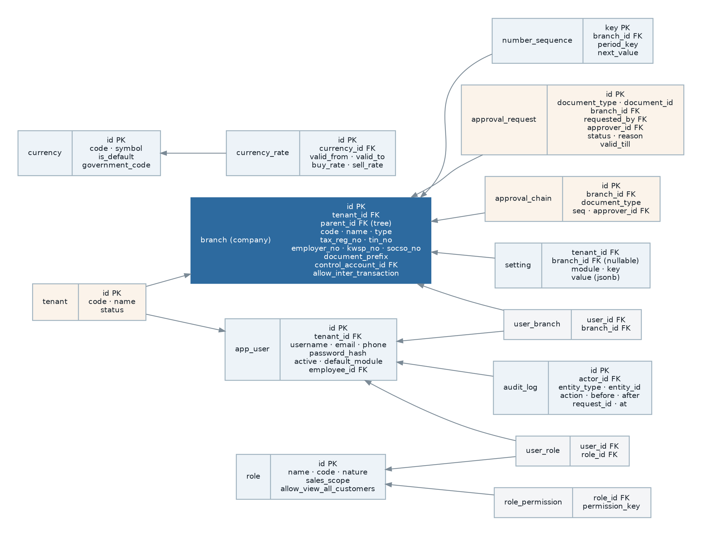

*Figure 25 — Core platform and identity data model, including the proposed tenant and approval-chain entities.*

## 9.2 Master data entities

| **Ref** | **Requirement**                                                                                                                                                                                                                                                                                                                                                                                                                                                                                                     | **Status**                                                                                                                                                  |
|---------|---------------------------------------------------------------------------------------------------------------------------------------------------------------------------------------------------------------------------------------------------------------------------------------------------------------------------------------------------------------------------------------------------------------------------------------------------------------------------------------------------------------------|-------------------------------------------------------------------------------------------------------------------------------------------------------------|
| DR-001  | The system shall maintain the master data entities listed in Appendix A section A.2, being items, item groups, brands, categories, scopes, units of measure and conversions, bills of material with flattened expansion, price lists with details, schedules, history and references, customers with addresses, contacts, branches, categories and outstanding summaries, suppliers with the same, taxes and tax profiles, tariff codes, credit terms, payment plans, document types, departments and sales agents. | Existing                                                                                                                                                    |
| DR-002  | Master data records shall be deactivatable rather than deletable once referenced by a transaction.                                                                                                                                                                                                                                                                                                                                                                                                                  | Existing                                                                                                                                                    |
| DR-003  | Master data shall carry a creation and modification audit, including the acting user.                                                                                                                                                                                                                                                                                                                                                                                                                               | Existing                                                                                                                                                    |
| DR-004  | Master data codes shall be unique within their scope, and the scope (global, per branch, per tenant) shall be explicit for each entity.                                                                                                                                                                                                                                                                                                                                                                             | Partially Implemented — customer and supplier codes are globally unique in the legacy schema, which conflicts with per-branch private accounts. See OQ-049. |
| DR-005  | Every master data entity shall support bulk import with validation, a dry-run mode and a rejection report.                                                                                                                                                                                                                                                                                                                                                                                                          | Partially Implemented — import exists for customers and items via the command line only.                                                                    |

## 9.3 Transactional data entities

| **Ref** | **Requirement**                                                                                                                                                                                                                                                                         | **Status**                                                                                                                                          |
|---------|-----------------------------------------------------------------------------------------------------------------------------------------------------------------------------------------------------------------------------------------------------------------------------------------|-----------------------------------------------------------------------------------------------------------------------------------------------------|
| DR-010  | Every transactional document shall carry: its own identifier, a document number unique within its type and branch, the branch, the transaction date, the creating user, the creation and modification timestamps, its status, and its currency and rate where monetary.                 | Existing                                                                                                                                            |
| DR-011  | Every monetary column shall be a fixed-point decimal with at least two decimal places; quantity columns shall carry at least four; rate columns at least six.                                                                                                                           | Existing — the legacy schema uses decimal(15,2), decimal(10,4) and decimal(10,6) respectively, and cost carries decimal(20,10) in the stock ledger. |
| DR-012  | Quantity decimal precision shall be configurable per installation, and the configured precision shall be enforced on entry and in calculation.                                                                                                                                          | Existing                                                                                                                                            |
| DR-013  | Detail lines shall carry both the transacted quantity and the transferred and balance quantities, so that partial transfer is representable without recomputation.                                                                                                                      | Existing                                                                                                                                            |
| DR-014  | Documents shall carry both document-currency and home-currency amounts, and both shall be immutable after release.                                                                                                                                                                      | Existing                                                                                                                                            |
| DR-015  | The stock transaction ledger shall be append-only. Correction shall be by further transaction, never by amendment.                                                                                                                                                                      | Existing                                                                                                                                            |
| DR-016  | Journals and journal details shall be append-only once posted to a locked period.                                                                                                                                                                                                       | Existing                                                                                                                                            |
| DR-017  | Every document shall record the dimensions applicable to it — project, department, document type, sales agent, area — so that reporting does not require joining back through master data that may since have changed.                                                                  | Existing                                                                                                                                            |
| DR-018  | Cross-document linkage shall be a first-class, referentially enforced relation recording source document, source line, target document, target line and the quantity or amount transferred. The legacy triple of type string, identifier and rendered URL shall not be carried forward. | Missing — corrects WK-07.                                                                                                                           |
| DR-019  | Where a document copies data from master data at the time of entry (party name, address, tax number, price), the copy shall be retained so that the document remains a faithful record after the master data changes.                                                                   | Existing — the legacy system copies party and address data onto documents, which is correct and shall be preserved deliberately.                    |

## 9.4 Data volumes and growth

These figures are estimates for sizing and performance targets. They must be replaced with measurements from the production legacy database before the non-functional targets in section 13 are baselined (OQ-050).

| **Entity class**             | **Order of magnitude at go-live** | **Annual growth**                                               | **Retention pressure**                            |
|------------------------------|-----------------------------------|-----------------------------------------------------------------|---------------------------------------------------|
| Items                        | 10³ – 10⁴                         | Low                                                             | Never purged.                                     |
| Customers and suppliers      | 10³ – 10⁴                         | Low                                                             | Never purged.                                     |
| Sales and purchase documents | 10⁴ – 10⁵ per year                | Linear with trading volume                                      | Retain at least seven years for tax.              |
| Document detail lines        | 10⁵ – 10⁶ per year                | 5–20× header volume                                             | Retain with header.                               |
| Stock transactions           | 10⁵ – 10⁶ per year                | Highest-volume table; every movement of every item in every bin | Candidate for partitioning and archiving.         |
| Journal details              | 10⁵ – 10⁶ per year                | Every posting produces several lines                            | Retain at least seven years.                      |
| Audit log                    | 10⁶ – 10⁷ per year                | Every data change                                               | Tiered retention; the largest table by row count. |
| Message archive              | 10⁴ – 10⁵ per year                | Per notification sent                                           | Legacy purge at ninety days.                      |
| Report history               | 10⁴ – 10⁵ per year                | Per report generated                                            | Scheduled purge.                                  |
| Payslips                     | Employees × periods               | Predictable                                                     | Retain at least seven years.                      |

## 9.5 Data retention and archiving

| **Ref** | **Requirement**                                                                                                                                                                                    | **Status**                                                                         |
|---------|----------------------------------------------------------------------------------------------------------------------------------------------------------------------------------------------------|------------------------------------------------------------------------------------|
| DR-025  | The system shall define a retention period per data class, and shall retain statutory records for the period Malaysian law requires.                                                               | Missing                                                                            |
| DR-026  | The system shall archive closed transactional data beyond a configurable age to a separate store, keeping it queryable for reporting and audit while removing it from the operational working set. | Missing — nothing is archived today and the transaction tables grow without bound. |
| DR-027  | Archiving shall never break referential integrity or drill-down from a retained record to an archived one.                                                                                         | Missing                                                                            |
| DR-028  | The audit log shall support tiered retention: full detail for a recent window, then summarised, then archived.                                                                                     | Missing                                                                            |
| DR-029  | The system shall support a defensible deletion process for personal data where a legal erasure obligation applies and no statutory retention obligation overrides it.                              | Missing — a PDPA requirement.                                                      |
| DR-030  | Message and report history purges shall be configurable rather than hard-coded.                                                                                                                    | Partially Implemented — the legacy purge is fixed at ninety days.                  |

## 9.6 Data migration requirements

Migration is a project in its own right and is the single largest cutover risk. The requirements below define what must be true, not how it will be done; the design is in ERP-SDD-001 section 7.9.

| **Ref** | **Requirement**                                                                                                                                                                                                          | **Status**                              |
|---------|--------------------------------------------------------------------------------------------------------------------------------------------------------------------------------------------------------------------------|-----------------------------------------|
| DR-040  | For every legacy table carrying business data there shall be either a defined migration mapping or a recorded decision not to migrate it, with a reason.                                                                 | Proposed                                |
| DR-041  | All master data shall be migrated with its identifiers preserved or with a permanent cross-reference retained, so that legacy documents and external references remain traceable.                                        | Proposed                                |
| DR-042  | Open transactional documents — unfulfilled orders, unsettled invoices, undelivered shipments — shall be migrated with their balance quantities and outstanding amounts intact, because these drive day-one operation.    | Proposed                                |
| DR-043  | Closed historical documents shall be migrated as records for reporting and audit, and shall be clearly marked as migrated so that they are not expected to obey new-system business rules retrospectively.               | Proposed                                |
| DR-044  | Ledger history shall be migrated at least as period balances per account, branch, project and department, and preferably at journal-line level for the statutory retention period.                                       | Requires Business Confirmation (OQ-051) |
| DR-045  | Stock shall be migrated as an opening balance per item, bin, batch and project with its cost basis, and as FIFO layers where the item is FIFO-costed, so that the first outbound movement values correctly.              | Proposed                                |
| DR-046  | Role and permission configuration shall be migrated, which requires the permission key format to be preserved (CON-09).                                                                                                  | Proposed                                |
| DR-047  | Attached documents shall be migrated with their attachment points intact.                                                                                                                                                | Proposed                                |
| DR-048  | Migration shall be repeatable and idempotent, so that it can be rehearsed against production data as many times as needed before cutover.                                                                                | Proposed                                |
| DR-049  | Every migration run shall produce a reconciliation report: record counts per entity, control totals for monetary and quantity columns, and an itemised rejection list. Cutover shall not proceed on an unreconciled run. | Proposed                                |
| DR-050  | The legacy system shall remain available read-only after cutover for a defined period.                                                                                                                                   | Requires Business Confirmation (OQ-052) |

## 9.7 Data quality requirements

| **Ref** | **Requirement**                                                                                                                                                                                                       | **Status**                                                                                                                         |
|---------|-----------------------------------------------------------------------------------------------------------------------------------------------------------------------------------------------------------------------|------------------------------------------------------------------------------------------------------------------------------------|
| DR-055  | Referential integrity shall be enforced by the database, not only by the application. A row referencing a non-existent parent shall be impossible.                                                                    | Partially Implemented — the legacy schema declares many foreign keys but uses loose polymorphic references for cross-module links. |
| DR-056  | Derived aggregates shall be reconcilable: for every denormalised summary there shall be a query that recomputes it from source, and a scheduled assertion that reports any discrepancy without silently repairing it. | Missing — the legacy approach silently repairs (WK-04), which hides the underlying defect.                                         |
| DR-057  | The system shall prevent creation of duplicate parties and items by warning on near-match during entry.                                                                                                               | Missing                                                                                                                            |
| DR-058  | Mandatory statutory fields shall be validated at master-data entry rather than at document submission, so that compliance failures surface early.                                                                     | Missing — this is why e-Invoice validation failures would appear at invoicing time.                                                |

# 10. Reporting Requirements

Reporting is not a secondary concern in an ERP; for most users it is the product. The legacy catalogue contains 173 report definitions across 19 categories, and rebuilding them is a substantial and easily underestimated part of the project. The functional requirements for the report engine are in section 6.12; this section states the catalogue and the cross-cutting reporting rules.

## 10.1 Catalogue summary

| **Category**                | **Reports** | **Nature**                                                                  |
|-----------------------------|-------------|-----------------------------------------------------------------------------|
| Bookkeeping / AP Reports    | 10          | Sub-ledger analysis — aging, settlement, deposits.                          |
| Bookkeeping / AR Reports    | 12          | Sub-ledger analysis — aging, settlement, deposits.                          |
| Bookkeeping / Balance Sheet | 4           | Financial statements — hierarchical, comparative, multi-branch.             |
| Bookkeeping / Cash Flow     | 4           | Financial statements — hierarchical, comparative, multi-branch.             |
| Bookkeeping / Documents     | 18          | Printable business documents — fixed layout, letterhead, statutory content. |
| Bookkeeping / General       | 10          | Operational summary and outstanding analysis.                               |
| Bookkeeping / Ledger        | 6           | Financial statements — hierarchical, comparative, multi-branch.             |
| Bookkeeping / Profit & Loss | 5           | Financial statements — hierarchical, comparative, multi-branch.             |
| Bookkeeping / Trial Balance | 2           | Financial statements — hierarchical, comparative, multi-branch.             |
| Common / Documents          | 2           | Printable business documents — fixed layout, letterhead, statutory content. |
| Inventory                   | 20          | Operational summary and outstanding analysis.                               |
| Inventory Documents         | 18          | Printable business documents — fixed layout, letterhead, statutory content. |
| Listing Report              | 4           | Master data extracts.                                                       |
| Payroll                     | 5           | Operational summary and outstanding analysis.                               |
| Purchase                    | 18          | Operational summary and outstanding analysis.                               |
| Purchase Documents          | 6           | Printable business documents — fixed layout, letterhead, statutory content. |
| Sales                       | 20          | Operational summary and outstanding analysis.                               |
| Sales Documents             | 7           | Printable business documents — fixed layout, letterhead, statutory content. |
| Tax Report                  | 2           | Statutory tax analysis.                                                     |
| **Total**                   | **173**     |                                                                             |

## 10.2 Cross-cutting reporting requirements

| **Ref** | **Requirement**                                                                                                                                                                                                                                                       | **Status**                                                             |
|---------|-----------------------------------------------------------------------------------------------------------------------------------------------------------------------------------------------------------------------------------------------------------------------|------------------------------------------------------------------------|
| RPT-020 | Every report shall accept the current branch and the user’s viewable branch set, and shall be incapable of returning data outside the user’s data scopes under any parameter combination. This shall be verified by automated test for every report in the catalogue. | Existing behaviour; the verification is Missing.                       |
| RPT-021 | Financial statements shall be producible at any level of the account hierarchy, for a single branch or a roll-up of a parent branch and its descendants, and filtered by project, project nature and department.                                                      | Existing                                                               |
| RPT-022 | Comparative variants shall be available for each financial statement: this month against last month, this month against this year, this year against last year, twelve-month trend, and branch against branch.                                                        | Existing                                                               |
| RPT-023 | Aging reports shall support four-month, six-month and twelve-month bucket sets, with the aging basis (document date or due date) configurable.                                                                                                                        | Existing                                                               |
| RPT-024 | Outstanding reports shall exist for every transferable document type, showing what remains uncommitted, unshipped or unsettled.                                                                                                                                       | Existing                                                               |
| RPT-025 | Every summary report shall be exportable to a spreadsheet with numeric values preserved as numbers, not as formatted text.                                                                                                                                            | Existing                                                               |
| RPT-026 | Printable documents shall be reproducible identically at any later date, which requires the document to be rendered from stored data rather than from a live join to master data that may have changed.                                                               | Existing — supported by DR-019.                                        |
| RPT-027 | A statement shall be dispatchable to a party on a schedule, and the dispatch shall be recorded against the party.                                                                                                                                                     | Existing                                                               |
| RPT-028 | Report definitions shall be versioned, so that a template change does not silently alter the appearance of a historically reproduced document.                                                                                                                        | Missing                                                                |
| RPT-029 | The report catalogue shall be inspectable by an administrator, showing every report, its parameters, its access grants and its recent usage.                                                                                                                          | Partially Implemented                                                  |
| RPT-030 | Reports that are never used shall be identifiable from the generation history, so that the catalogue can be pruned rather than migrated wholesale.                                                                                                                    | Proposed — a practical way to reduce the migration burden. See OQ-053. |

## 10.3 Dashboard and indicator requirements

| **Ref** | **Requirement**                                                                                                                                                                                                                                                  | **Status**                                                         |
|---------|------------------------------------------------------------------------------------------------------------------------------------------------------------------------------------------------------------------------------------------------------------------|--------------------------------------------------------------------|
| RPT-035 | Each module shall provide an overview dashboard appropriate to its users, composed of declaratively defined indicators.                                                                                                                                          | Existing                                                           |
| RPT-036 | Indicators shall respect permissions and data scopes; an indicator a user may not see shall not be rendered.                                                                                                                                                     | Existing                                                           |
| RPT-037 | The minimum indicator set shall include: sales and purchase volume by period, top customers, top items, outstanding receivables and payables with aging, stock value and low-stock count, open orders by status, production work in progress, and cash position. | Existing — derived from the legacy dashboard data sources.         |
| RPT-038 | Indicators shall be computed from a read-optimised source and cached with a stated freshness, so that dashboards do not degrade transactional performance.                                                                                                       | Missing                                                            |
| RPT-039 | A user shall be able to choose which indicators appear on their landing page.                                                                                                                                                                                    | Partially Implemented — per-user interface personalisation exists. |

# 11. Notification Requirements

The legacy system has the mechanism for notification but almost none of the content: three channels are implemented, and only five notification intents are declared across the whole system. The consequence is that users discover most things by looking rather than by being told.

## 11.1 Intent catalogue

| **Ref** | **Intent**                   | **Trigger**                                                  | **Recipients**                              | **Status**                                                                                           |
|---------|------------------------------|--------------------------------------------------------------|---------------------------------------------|------------------------------------------------------------------------------------------------------|
| NTF-001 | User account created         | A user account is created                                    | The new user                                | Existing                                                                                             |
| NTF-002 | Password recovery            | A password reset is requested                                | The requesting user                         | Existing                                                                                             |
| NTF-003 | Document sent to party       | A document is emailed to a customer or supplier              | The party’s configured recipients           | Existing                                                                                             |
| NTF-004 | Low stock level              | Scheduled check finds items at or below reorder level        | Configured recipient list per branch        | Existing                                                                                             |
| NTF-005 | Enquiry created              | A sales enquiry is recorded                                  | The assigned sales agent                    | Existing                                                                                             |
| NTF-006 | Approval requested           | An approval request is raised                                | The next approver in the chain              | Partially Implemented — email only, sent to a single configured address rather than to the approver. |
| NTF-007 | Approval decided             | An approver approves or rejects                              | The document creator                        | Missing                                                                                              |
| NTF-008 | Approval expiring            | An approval request is approaching its validity expiry       | The approver, then their escalation         | Missing                                                                                              |
| NTF-009 | Statement dispatched         | A scheduled statement is sent                                | The party, and the account owner internally | Partially Implemented                                                                                |
| NTF-010 | e-Invoice validation outcome | The statutory platform returns a validation result           | The document creator and finance            | Missing                                                                                              |
| NTF-011 | Posting failure              | An automatic posting fails                                   | Finance and operations                      | Missing — and the most operationally important missing notification.                                 |
| NTF-012 | Leave decided                | A leave application is approved or rejected                  | The applicant                               | Missing                                                                                              |
| NTF-013 | Claim decided                | A claim is approved or rejected                              | The claimant                                | Missing                                                                                              |
| NTF-014 | Payroll approved             | A payroll run is approved                                    | Payroll preparer and finance                | Missing                                                                                              |
| NTF-015 | Payslip available            | Payslips are released for a period                           | Each employee                               | Missing                                                                                              |
| NTF-016 | Credit limit breached        | A document breaches a customer credit limit                  | Sales manager and finance                   | Partially Implemented — raises an approval, does not notify separately.                              |
| NTF-017 | Document expiring            | A quotation is approaching the end of its validity period    | The owning sales agent                      | Missing                                                                                              |
| NTF-018 | Batch expiring               | Scheduled check finds batches approaching expiry             | Warehouse supervisor                        | Missing — the data exists and a report exists, but no alert.                                         |
| NTF-019 | Employee document expiring   | A passport, permit or immigration document approaches expiry | HR                                          | Missing                                                                                              |
| NTF-020 | Period lock applied          | A fiscal period is locked                                    | Finance team                                | Missing                                                                                              |
| NTF-021 | Bulletin published           | HR publishes a bulletin                                      | Targeted departments or roles               | Existing                                                                                             |
| NTF-022 | Error reported               | An unhandled system error occurs                             | Configured technical recipient              | Existing                                                                                             |

## 11.2 Delivery requirements

| **Ref** | **Requirement**                                                                                                                                                     | **Status**                                                                                                                                                                                     |
|---------|---------------------------------------------------------------------------------------------------------------------------------------------------------------------|------------------------------------------------------------------------------------------------------------------------------------------------------------------------------------------------|
| NTF-030 | Every intent shall be configurable per channel and per recipient rule, without code change.                                                                         | Partially Implemented                                                                                                                                                                          |
| NTF-031 | Notification templates shall support substitutable variables and shall be editable by an administrator. The variables available shall be documented per intent.     | Existing for document emails, whose available variables include document name, party code and name, attention, credit terms, document number, totals in both currencies, and currency symbols. |
| NTF-032 | Delivery shall be asynchronous and shall not delay or fail the business transaction that raised it.                                                                 | Existing                                                                                                                                                                                       |
| NTF-033 | Transient delivery failure shall be retried with backoff; permanent failure shall be recorded and surfaced.                                                         | Missing                                                                                                                                                                                        |
| NTF-034 | A user shall be able to set their own preferences per intent and channel, except for intents marked mandatory.                                                      | Missing                                                                                                                                                                                        |
| NTF-035 | Every notification sent shall be archived with recipients, channel, rendered content and delivery outcome.                                                          | Existing                                                                                                                                                                                       |
| NTF-036 | Notifications containing personal or financial data shall not include that data in a push notification payload, only a reference requiring authenticated retrieval. | Missing — a PDPA consideration.                                                                                                                                                                |

# 12. Integration Requirements

## 12.1 Existing integrations

| **Ref** | **Integration**               | **Nature and direction**                                                                                                             | **Status**                                                                 |
|---------|-------------------------------|--------------------------------------------------------------------------------------------------------------------------------------|----------------------------------------------------------------------------|
| INT-001 | Outbound email (SMTP)         | Documents, statements, approvals, credentials. Host, port, credentials, encryption and sender identity configurable in the platform. | Existing                                                                   |
| INT-002 | Mobile push notification      | Push to registered devices, configured by a service account file, project identifier and web push certificate.                       | Existing                                                                   |
| INT-003 | Statutory contribution tables | Inbound. The legacy system fetches EPF, SOCSO, EIS, HRDF and PCB tables from a vendor-hosted endpoint on a daily schedule.           | Existing but unacceptable — see INT-006 and OQ-025.                        |
| INT-004 | Server-to-server webhooks     | Bidirectional. A shared secret and a list of targets with per-target secrets are configurable, but no event emission was found.      | Partially Implemented                                                      |
| INT-005 | Report engine                 | Internal. The legacy system bridges from the application to a Java report engine over a socket protocol.                             | Existing — an architectural dependency rather than a business integration. |

## 12.2 Required integrations

| **Ref** | **Requirement**                                                                                                                                                                                                                                                                                                                                                                                                            | **Status**                                                                                   |
|---------|----------------------------------------------------------------------------------------------------------------------------------------------------------------------------------------------------------------------------------------------------------------------------------------------------------------------------------------------------------------------------------------------------------------------------|----------------------------------------------------------------------------------------------|
| INT-006 | The statutory table refresh shall be transactional and validated: the fetched set shall be validated for completeness and plausibility before it replaces the current set, the previous set shall be retained as an effective-dated version, and a failed fetch shall leave the system with working tables. The source shall be a specification the organisation controls or can substitute, not a single vendor endpoint. | Missing — corrects WK-10.                                                                    |
| INT-007 | The system shall integrate with the LHDN MyInvois platform for e-Invoice submission, status retrieval and cancellation, per document type, per legal entity, with credentials held per entity.                                                                                                                                                                                                                             | Missing — see section 6.14.1.                                                                |
| INT-008 | The system shall validate party tax identification against the statutory platform at master-data entry.                                                                                                                                                                                                                                                                                                                    | Missing                                                                                      |
| INT-009 | The system shall export payment instructions in each required bank format, for supplier payment and payroll disbursement, with a per-bank format definition that can be added without code change.                                                                                                                                                                                                                         | Partially Implemented                                                                        |
| INT-010 | The system shall import bank statements for reconciliation in at least one standard format per bank.                                                                                                                                                                                                                                                                                                                       | Missing                                                                                      |
| INT-011 | The system shall expose a documented, versioned API covering every core entity and operation, sufficient to build a mobile client or a partner integration without database access.                                                                                                                                                                                                                                        | Missing                                                                                      |
| INT-012 | The system shall emit webhooks for defined business events with retry, signature verification and a delivery log.                                                                                                                                                                                                                                                                                                          | Partially Implemented                                                                        |
| INT-013 | The system shall support scheduled and on-demand file-based import of master data and transactions, with validation, dry run and a rejection report, available through the user interface rather than only the command line.                                                                                                                                                                                               | Partially Implemented                                                                        |
| INT-014 | Every integration shall be independently configurable, independently disable-able, and shall fail without affecting unrelated function.                                                                                                                                                                                                                                                                                    | Partially Implemented                                                                        |
| INT-015 | Every outbound integration call and inbound request shall be logged with a correlation identifier, and every credential shall be stored in a secret store rather than in application settings.                                                                                                                                                                                                                             | Missing — the legacy system stores mail passwords and webhook secrets in the settings table. |

## 12.3 Integration constraints

- No integration may require the counterparty to have direct database access.

- No integration credential may be visible to a user through the application, including to an administrator.

- An integration outage shall degrade only the dependent feature. e-Invoice submission failing must not prevent invoicing; it must queue.

- Every integration shall be testable against a sandbox or stub without touching a production counterparty.

# 13. Non-Functional Requirements

Non-functional requirements are organised by the ISO/IEC 25010 quality characteristics. Targets are proposed and must be baselined against measurements from the production legacy system (OQ-050); an unmeasurable non-functional requirement is not a requirement.

## 13.1 Performance

| **Ref**      | **Requirement**                                                                                                                                           | **Target**                                                                                |
|--------------|-----------------------------------------------------------------------------------------------------------------------------------------------------------|-------------------------------------------------------------------------------------------|
| NFR-PERF-001 | Interactive screen load — a list view with default filters shall render usable content.                                                                   | ≤ 1.5 s at the 95th percentile.                                                           |
| NFR-PERF-002 | Document save — a document of up to 50 detail lines, including validation, numbering and derived-value maintenance.                                       | ≤ 2 s at the 95th percentile.                                                             |
| NFR-PERF-003 | Document release including automatic stock and accounting effects, measured to the point the user regains control.                                        | ≤ 3 s at the 95th percentile; downstream posting may complete asynchronously within 30 s. |
| NFR-PERF-004 | Look-up and autocomplete responses during document entry.                                                                                                 | ≤ 300 ms at the 95th percentile.                                                          |
| NFR-PERF-005 | Operational report — a period summary over one year of data.                                                                                              | ≤ 10 s; longer-running reports shall run asynchronously (RPT-007).                        |
| NFR-PERF-006 | Bulk document posting shall be set-based. Processing a 500-line document shall not issue a number of database round trips proportional to the line count. | ≤ 5 s for 500 lines; corrects WK-05.                                                      |
| NFR-PERF-007 | Financial statement generation at the volumes in section 9.4.                                                                                             | ≤ 15 s.                                                                                   |
| NFR-PERF-008 | Stock valuation recalculation for one branch and one fiscal year.                                                                                         | ≤ 30 min, running without blocking transactional use.                                     |
| NFR-PERF-009 | Payroll calculation for 500 employees.                                                                                                                    | ≤ 5 min.                                                                                  |
| NFR-PERF-010 | Performance shall be measured continuously in production and reported against these targets, not assessed only at acceptance.                             | Continuous.                                                                               |

## 13.2 Capacity and scalability

| **Ref**      | **Requirement**                                                                                                                       | **Target**                                                                                                 |
|--------------|---------------------------------------------------------------------------------------------------------------------------------------|------------------------------------------------------------------------------------------------------------|
| NFR-SCAL-001 | Concurrent named users per deployment.                                                                                                | At least 200, with headroom to 500.                                                                        |
| NFR-SCAL-002 | Concurrent active sessions performing document entry.                                                                                 | At least 100.                                                                                              |
| NFR-SCAL-003 | Transactional document volume.                                                                                                        | At least 500,000 documents and 5,000,000 detail lines without degradation beyond the section 13.1 targets. |
| NFR-SCAL-004 | Stock ledger volume.                                                                                                                  | At least 20,000,000 rows.                                                                                  |
| NFR-SCAL-005 | Branches per deployment.                                                                                                              | At least 50.                                                                                               |
| NFR-SCAL-006 | The application tier shall scale horizontally without sticky sessions or node affinity.                                               | Stateless application processes.                                                                           |
| NFR-SCAL-007 | Background processing shall scale independently of the interactive tier, so that a large batch does not degrade interactive response. | Separate worker capacity.                                                                                  |
| NFR-SCAL-008 | Growth beyond these figures shall be achievable by adding capacity rather than by redesign.                                           | Architectural.                                                                                             |

## 13.3 Availability and reliability

| **Ref**     | **Requirement**                                                                                                                                                                           | **Target**                                                                    |
|-------------|-------------------------------------------------------------------------------------------------------------------------------------------------------------------------------------------|-------------------------------------------------------------------------------|
| NFR-REL-001 | Availability during business hours.                                                                                                                                                       | 99.5% monthly, excluding planned maintenance. Requires confirmation (OQ-054). |
| NFR-REL-002 | Financial and stock data shall be correct without corrective batch processes. No scheduled job shall exist whose purpose is to repair data the system itself produced.                    | Zero corrective jobs in production.                                           |
| NFR-REL-003 | A transaction shall be atomic across all of its effects. A partially applied document release shall be impossible.                                                                        | Absolute.                                                                     |
| NFR-REL-004 | A failure in an asynchronous consequence of a transaction (posting, mirroring, notification) shall be recorded, visible, retryable and idempotent, and shall never be silently discarded. | Absolute; corrects WK-02.                                                     |
| NFR-REL-005 | Planned maintenance shall be performable without data loss, and schema changes shall be applied without extended downtime.                                                                | ≤ 15 min planned window per release.                                          |
| NFR-REL-006 | The system shall degrade gracefully when a non-essential dependency is unavailable.                                                                                                       | No hard failure on email, push or statutory-platform outage.                  |
| NFR-REL-007 | Concurrent edits to the same record shall be detected and shall not silently overwrite one another.                                                                                       | Optimistic concurrency on every document.                                     |

## 13.4 Security

| **Ref**     | **Requirement**                                                                                                                                                                                                                                                                 |
|-------------|---------------------------------------------------------------------------------------------------------------------------------------------------------------------------------------------------------------------------------------------------------------------------------|
| NFR-SEC-001 | All traffic shall be encrypted in transit using current protocol versions, with plain HTTP refused rather than redirected for API endpoints.                                                                                                                                    |
| NFR-SEC-002 | Data shall be encrypted at rest at the storage layer, and personal identifiers and bank details shall additionally be protected at field level.                                                                                                                                 |
| NFR-SEC-003 | Credentials shall be stored using a current memory-hard password hashing algorithm with per-user salt.                                                                                                                                                                          |
| NFR-SEC-004 | Secrets — database credentials, integration keys, signing keys — shall be held in a secret store, never in the application database or in source control. The legacy system stores mail credentials and webhook secrets in a settings table; this shall not be carried forward. |
| NFR-SEC-005 | Every input shall be validated server-side and every database access shall be parameterised. Dynamic query construction from user input shall not exist.                                                                                                                        |
| NFR-SEC-006 | Authorisation shall be enforced at the server for every request, and shall be enforced again as a mandatory query scope at the data-access layer, so that a missing check in one place does not expose data.                                                                    |
| NFR-SEC-007 | Uploaded files shall be validated by type and size, scanned for malicious content, stored outside the web root, and served only through an authorising endpoint.                                                                                                                |
| NFR-SEC-008 | Session tokens shall be short-lived with rotating refresh, and shall be revocable by the user and by an administrator.                                                                                                                                                          |
| NFR-SEC-009 | Multi-factor authentication shall be available and shall be enforceable per role.                                                                                                                                                                                               |
| NFR-SEC-010 | The system shall be subject to dependency vulnerability scanning and static analysis on every build, and to penetration testing before each major release.                                                                                                                      |
| NFR-SEC-011 | Rate limiting and abuse protection shall apply to authentication, API and export endpoints.                                                                                                                                                                                     |
| NFR-SEC-012 | Security-relevant events — sign-in, sign-in failure, permission change, data export, sensitive-field reveal, credential change — shall be logged distinctly from application logs and retained for at least one year.                                                           |
| NFR-SEC-013 | No production data shall be used in a non-production environment without masking of personal and financial identifiers.                                                                                                                                                         |
| NFR-SEC-014 | The system shall contain no non-inspectable component in its production runtime (CON-02).                                                                                                                                                                                       |

## 13.5 Auditability and compliance

| **Ref**     | **Requirement**                                                                                                                                                                                                                   |
|-------------|-----------------------------------------------------------------------------------------------------------------------------------------------------------------------------------------------------------------------------------|
| NFR-AUD-001 | Every data change shall be recorded with actor, timestamp, entity, action, before and after state, and a correlation identifier grouping all changes made by one request.                                                         |
| NFR-AUD-002 | The audit trail shall be append-only and shall not be modifiable or deletable through the application under any permission.                                                                                                       |
| NFR-AUD-003 | Every accounting entry shall be traceable to its source operational document, and every operational document to its resulting entries, in both directions, without manual investigation.                                          |
| NFR-AUD-004 | Every approval, override, period-lock exception and credit-control bypass shall be recorded and reportable as an exception list.                                                                                                  |
| NFR-AUD-005 | Personal data processing shall comply with the Personal Data Protection Act 2010: purpose limitation, retention limits, access on request, and a defensible erasure process where no statutory retention obligation overrides it. |
| NFR-AUD-006 | The system shall be able to produce, for any period and any legal entity, a complete and reconciling set of statutory records.                                                                                                    |
| NFR-AUD-007 | Statutory computations shall be reproducible: recomputing a historical period shall use the rates and rules in force at that time and shall produce the original result.                                                          |

## 13.6 Usability and accessibility

| **Ref**     | **Requirement**                                                                                                                                                                                             |
|-------------|-------------------------------------------------------------------------------------------------------------------------------------------------------------------------------------------------------------|
| NFR-USE-001 | Document entry shall be completable by keyboard alone, because high-volume users do not use a mouse. Tab order, field-level autocomplete, line duplication and submit shortcuts are required, not optional. |
| NFR-USE-002 | Validation errors shall be shown against the field that caused them and shall state how to correct them.                                                                                                    |
| NFR-USE-003 | A destructive or irreversible action shall require explicit confirmation naming what will happen.                                                                                                           |
| NFR-USE-004 | The system shall preserve in-progress work across an accidental navigation or a transient connection loss.                                                                                                  |
| NFR-USE-005 | List views shall retain the user’s filters, sort order, column selection and page position between visits.                                                                                                  |
| NFR-USE-006 | Warehouse, production and self-service functions shall be operable on a touch device with gloved or single-handed use.                                                                                      |
| NFR-USE-007 | The interface shall meet WCAG 2.1 level AA for contrast, keyboard operability, focus visibility and screen-reader labelling.                                                                                |
| NFR-USE-008 | The system shall provide contextual help for every business rule that can block a user, explaining why and what to do.                                                                                      |
| NFR-USE-009 | Bulk operations shall report per-item outcome and shall never leave the user unsure what succeeded.                                                                                                         |

## 13.7 Localisation and internationalisation

| **Ref**     | **Requirement**                                                                                                                                                                                                                                                              |
|-------------|------------------------------------------------------------------------------------------------------------------------------------------------------------------------------------------------------------------------------------------------------------------------------|
| NFR-LOC-001 | All user-facing text shall be externalised for translation. No business string shall be embedded in code.                                                                                                                                                                    |
| NFR-LOC-002 | Locale shall be selectable per installation and per user, governing language, number format, date format and first day of week.                                                                                                                                              |
| NFR-LOC-003 | Tax rules, statutory computations, electronic invoicing and statutory reporting shall be implemented as jurisdiction rule sets behind a common interface, so that adding a country is a configuration and rule-set exercise rather than a change to the calculation engines. |
| NFR-LOC-004 | The data model shall not assume a single tax regime, a single statutory identifier set, or a single set of payroll contributions.                                                                                                                                            |
| NFR-LOC-005 | All timestamps shall be stored unambiguously with respect to time zone, so that a later multi-time-zone deployment does not corrupt history.                                                                                                                                 |
| NFR-LOC-006 | Multi-currency shall remain a first-class capability, with the home currency configurable per legal entity.                                                                                                                                                                  |

## 13.8 Maintainability

| **Ref**     | **Requirement**                                                                                                                                        |
|-------------|--------------------------------------------------------------------------------------------------------------------------------------------------------|
| NFR-MNT-001 | Every business rule in section 8 shall be covered by at least one automated test, and the domain layer shall maintain at least 80% statement coverage. |
| NFR-MNT-002 | Module dependency rules shall be enforced in the build; a violation shall fail the pipeline.                                                           |
| NFR-MNT-003 | All configuration shall be externalised from the build artefact, so that the same artefact is promoted through every environment.                      |
| NFR-MNT-004 | Database schema changes shall be versioned, reviewable, forward-only and reversible in effect.                                                         |
| NFR-MNT-005 | The system shall be buildable and runnable locally by a new developer from a documented procedure in under one hour.                                   |
| NFR-MNT-006 | Public module contracts and the API shall be documented as generated artefacts from the code, so that documentation cannot drift.                      |
| NFR-MNT-007 | No production defect shall require reading non-inspectable code to diagnose.                                                                           |

## 13.9 Portability and operability

| **Ref**     | **Requirement**                                                                                                      |
|-------------|----------------------------------------------------------------------------------------------------------------------|
| NFR-POR-001 | The system shall run on customer-managed Linux infrastructure and on a cloud provider without functional difference. |
| NFR-POR-002 | The system shall not depend on a managed service unique to one cloud provider for any core function.                 |
| NFR-POR-003 | A complete environment shall be reproducible from version-controlled definitions.                                    |
| NFR-POR-004 | Deployment, migration and rollback shall be scripted and shall require no manual database intervention.              |

## 13.10 Observability

| **Ref**     | **Requirement**                                                                                                                                                    |
|-------------|--------------------------------------------------------------------------------------------------------------------------------------------------------------------|
| NFR-OBS-001 | Application logs shall be structured, shall carry a correlation identifier per request, and shall never contain credentials or unmasked personal data.             |
| NFR-OBS-002 | Business-level metrics shall be emitted: documents released, postings succeeded and failed, queue depth and age, integration success rate, report generation time. |
| NFR-OBS-003 | Failed asynchronous work shall be visible in an operational view with the ability to inspect, retry and discard, under permission.                                 |
| NFR-OBS-004 | Alerts shall exist for posting failure, queue backlog, integration failure, failed scheduled job, and any data-consistency assertion failure.                      |
| NFR-OBS-005 | A scheduled job shall record its start, end, outcome and the volume it processed, and a missed run shall raise an alert.                                           |

## 13.11 Backup and disaster recovery

| **Ref**     | **Requirement**                                                                                                                   | **Target**                                  |
|-------------|-----------------------------------------------------------------------------------------------------------------------------------|---------------------------------------------|
| NFR-BCP-001 | Recovery point objective — maximum acceptable data loss.                                                                          | ≤ 15 min. Requires confirmation (OQ-055).   |
| NFR-BCP-002 | Recovery time objective — maximum acceptable outage.                                                                              | ≤ 4 h during business hours.                |
| NFR-BCP-003 | Backups shall be automated, encrypted, retained on a defined schedule, and stored in a location separate from the primary system. | Daily full plus continuous transaction log. |
| NFR-BCP-004 | Restore shall be tested on a defined cadence, and a backup that has never been restored shall not be considered a backup.         | At least quarterly.                         |
| NFR-BCP-005 | Stored documents and generated reports shall be included in the backup and recovery scope.                                        | Included.                                   |
| NFR-BCP-006 | The recovery procedure shall be documented to the level that a competent operator who did not build the system can execute it.    | Documented and rehearsed.                   |

## 13.12 Licensing and intellectual property

| **Ref**     | **Requirement**                                                                                                                                                                                             |
|-------------|-------------------------------------------------------------------------------------------------------------------------------------------------------------------------------------------------------------|
| NFR-LIC-001 | Every third-party component shall carry a licence compatible with the organisation’s intended commercial use, and the inventory of components and licences shall be generated automatically on every build. |
| NFR-LIC-002 | The organisation shall own or hold perpetual rights to all custom code, with no encrypted or licence-gated component in the runtime.                                                                        |
| NFR-LIC-003 | Where the system is licensed to a customer, the licensing mechanism shall not be able to render the customer’s own data inaccessible.                                                                       |

*The legacy system enforces licensing through a validator middleware and a licence key file, and fails closed with a licence-not-valid page. Requirement NFR-LIC-003 exists because that mechanism sits in front of the customer’s own data.*

# 14. System Constraints

Constraints on the solution are stated in section 3.5 (CON-01 to CON-10). This section records constraints arising from the operating environment rather than from the solution choice.

| **Ref** | **Constraint**                                                                                                                    | **Consequence**                                                                                         |
|---------|-----------------------------------------------------------------------------------------------------------------------------------|---------------------------------------------------------------------------------------------------------|
| SCN-01  | Malaysian statutory requirements are set externally and change without regard to the release schedule.                            | Tax rates, contribution tables and e-Invoice rules must be changeable by configuration, not by release. |
| SCN-02  | The organisation trades continuously; there is no natural shutdown window.                                                        | Cutover must be achievable over a weekend or with a read-only overlap period.                           |
| SCN-03  | Warehouse and production staff work on the floor with shared devices and intermittent connectivity.                               | Those functions must tolerate brief connection loss without losing work.                                |
| SCN-04  | Several legal entities share the installation and must not see each other’s data except where deliberately shared.                | Data scoping is a correctness requirement, not a convenience.                                           |
| SCN-05  | The legacy platform module cannot be inspected, so some legacy behaviour can only be established by observing the running system. | A period of parallel observation is required before Phase 0 completes.                                  |
| SCN-06  | Existing document numbers appear in customer correspondence, contracts and statutory filings.                                     | The numbering grammar must be preserved (CON-08).                                                       |

# 15. Assumptions and Dependencies

Assumptions are listed in section 3.6 (ASM-01 to ASM-06) and dependencies in section 3.7 (DEP-01 to DEP-08). Both are repeated in the acceptance checklist in section 20 because an unvalidated assumption is a risk carried into build.

# 16. Gap Analysis Summary

Every requirement in this document carries a status. Aggregated, they give the shape of the work.

## 16.1 Distribution by status

| **Status**                     | **Meaning for the project**                                                                                                             | **Approximate share** |
|--------------------------------|-----------------------------------------------------------------------------------------------------------------------------------------|-----------------------|
| Existing                       | Rebuild to match observed behaviour. Requirements are well understood; the risk is in fidelity and in the sheer volume.                 | ≈ 60%                 |
| Partially Implemented          | Complete the capability. Requires a business decision about what "complete" means, because the legacy behaviour is not a specification. | ≈ 17%                 |
| Missing                        | Build new. Includes the statutory e-Invoice obligation and the correctness requirements that eliminate the corrective jobs.             | ≈ 15%                 |
| Proposed                       | Optional improvement. Should be explicitly accepted or deferred rather than absorbed silently.                                          | ≈ 5%                  |
| Requires Business Confirmation | Blocked pending an answer. Each is listed in section 19.                                                                                | ≈ 3%                  |

## 16.2 The gaps that matter most

| **Rank** | **Gap**                                                 | **Why it ranks here**                                                                                                                                                            | **Requirements**                                  |
|----------|---------------------------------------------------------|----------------------------------------------------------------------------------------------------------------------------------------------------------------------------------|---------------------------------------------------|
| 1        | e-Invoice is absent while the system is prepared for it | A statutory obligation, with the database, user interface and event plumbing already built around a module that does not exist. The business may believe this capability exists. | FR-EIV-001 to 011, INT-007                        |
| 2        | Statutory tables are not effective-dated                | Payroll recomputation of any prior period produces a wrong answer, and a failed refresh empties the tables. Both are audit-fatal.                                                | FR-PAY-040, BR-PAY-011, INT-006                   |
| 3        | Automatic posting is not reliable or observable         | A released invoice can end up with no accounting entry and no error. This is the failure mode most likely to be discovered by an auditor rather than by the team.                | FR-FIN-031, BR-POST-007, BR-POST-008, NFR-REL-004 |
| 4        | Derived balances require scheduled repair               | Transfer balances, outstanding amounts and stock figures are corrected twice daily by jobs that mask the underlying defect.                                                      | FR-PLT-015, DR-056, NFR-REL-002                   |
| 5        | No automated tests exist                                | 340 tables and 117 services with no regression safety net. This is what makes every other gap expensive to close.                                                                | CON-10, NFR-MNT-001                               |
| 6        | Permission binding can be silently lost                 | A duplicated map key removes a permission check from a release operation. One occurrence was found; without automated verification there may be others.                          | FR-SEC-008                                        |
| 7        | Branch conflates legal entity and location              | Statutory identifiers, document prefixes and control accounts all hang off one overloaded entity, which limits both reporting and multi-entity operation.                        | FR-PLT-004, BR-ORG-002                            |
| 8        | Tax rates are not effective-dated                       | The same class of defect as the statutory tables, affecting every historical document recomputation.                                                                             | BR-TAX-006                                        |
| 9        | No archiving strategy                                   | The highest-volume tables grow without bound, and performance degrades with age rather than with load.                                                                           | DR-026 to DR-028                                  |
| 10       | Sensitive personal data is unclassified and unmasked    | National identity numbers, passports and bank accounts are handled as ordinary fields. A PDPA exposure.                                                                          | FR-SEC-042, NFR-SEC-002                           |
| 11       | No fixed-asset capability                               | Depreciation is a manual journal in a system with an otherwise complete ledger.                                                                                                  | FR-FXA-001 to 005                                 |
| 12       | Approval is too rigid for segregation of duties         | One chain per branch, no delegation, no escalation, and self-approval is possible.                                                                                               | FR-SEC-050 to 057, FR-WFL-001 to 005              |
| 13       | Production cost excludes labour and overhead            | Manufactured-item margin is overstated, which affects pricing decisions.                                                                                                         | FR-PRD-013                                        |
| 14       | Employee self-service is minimal                        | Four screens. Routine HR load that could be self-served is not.                                                                                                                  | FR-ESS-007 to 010                                 |
| 15       | Notification coverage is thin                           | Five intents system-wide. Users discover state by looking rather than being told, and posting failures notify no one.                                                            | NTF-006 to NTF-020                                |

# 17. Improvement Backlog

Improvements that are neither required capability nor defect correction, and which should be explicitly accepted or deferred.

| **Ref** | **Improvement**                                                                     | **Value**                     | **Phase** |
|---------|-------------------------------------------------------------------------------------|-------------------------------|-----------|
| IMP-01  | Multiple roles per user, replacing combinatorial role creation.                     | High — administration effort  | Phase 0   |
| IMP-02  | Shipped role templates so a new installation is immediately usable.                 | High — implementation time    | Phase 0   |
| IMP-03  | Effective-permission and role-comparison views for administrators.                  | Medium                        | Phase 0   |
| IMP-04  | A single cross-module work queue for everything awaiting a user’s decision.         | High — user productivity      | Phase 2   |
| IMP-05  | Document revision comparison showing what changed between revisions.                | Medium — low cost             | Phase 2   |
| IMP-06  | Customer exposure panel during sales entry (outstanding, overdue, limit, headroom). | High — prevents blocked saves | Phase 2   |
| IMP-07  | Near-match warning to prevent duplicate parties and items.                          | Medium                        | Phase 1   |
| IMP-08  | Read-replica reporting so reports cannot degrade transactional performance.         | High at scale                 | Phase 2   |
| IMP-09  | Report usage analysis to prune the catalogue before migrating it.                   | High — reduces scope          | Phase 1   |
| IMP-10  | Landed-cost apportionment on receipts.                                              | High for an importer          | Phase 3   |
| IMP-11  | Batch expiry and employee document expiry alerting.                                 | Medium                        | Phase 3   |
| IMP-12  | Cycle-count workflow rather than a count sheet report.                              | Medium                        | Phase 3   |
| IMP-13  | Party merge with document repointing.                                               | Medium                        | Phase 1   |
| IMP-14  | Unrealised FX revaluation at period end.                                            | High for accuracy             | Phase 2   |
| IMP-15  | Recurring journals.                                                                 | Medium                        | Phase 1   |
| IMP-16  | Federated authentication to a corporate identity provider.                          | Medium                        | Phase 5   |
| IMP-17  | Job-order variance reporting (planned versus actual).                               | High for manufacturing        | Phase 4   |
| IMP-18  | Per-bank payment format definitions as configuration.                               | High                          | Phase 2   |

# 18. Future Requirements and Roadmap

Capabilities deliberately out of scope for the phases in section 3.8, recorded so that the architecture does not preclude them.

| **Capability**                                             | **Rationale for deferral**                                | **Architectural implication now**                                                                                                                        |
|------------------------------------------------------------|-----------------------------------------------------------|----------------------------------------------------------------------------------------------------------------------------------------------------------|
| Multi-country localisation                                 | No second jurisdiction is in scope for the first release. | Tax, payroll and e-invoicing must be jurisdiction rule sets from day one (NFR-LOC-003). This is the one deferral that constrains the design immediately. |
| Multi-tenant SaaS operation                                | The tenancy decision is open (OQ-001).                    | Every table carries a tenant identifier and all data access passes through one tenant-aware layer, whatever the deployment model.                        |
| Consolidated group reporting with eliminations             | Depends on the tenancy and legal-entity model.            | Legal entity must be separable from branch (FR-PLT-004).                                                                                                 |
| Warehouse mobile application                               | Phase 3 delivers warehouse depth in the web client first. | The API must be complete enough for a native client (INT-011).                                                                                           |
| Analytics warehouse and self-service business intelligence | Operational reporting comes first.                        | A read replica and an event stream make this additive rather than invasive.                                                                              |
| Demand forecasting and replenishment planning              | Requires clean transaction history.                       | Retain full transaction history rather than only balances.                                                                                               |
| Serial-number tracking                                     | Need unconfirmed (OQ-042).                                | The batch model should generalise to a unit-level identifier.                                                                                            |
| Contract and price-agreement management                    | Price lists cover current need.                           | Pricing resolution should be a service, not a lookup embedded in document entry.                                                                         |
| Quality management and inspection                          | Not currently performed in the system.                    | Production output should support a hold state.                                                                                                           |
| Equipment maintenance management                           | Out of scope.                                             | Requires the fixed-asset register (FR-FXA-001).                                                                                                          |

# 19. Open Questions Requiring Business Confirmation

Each question below arose from a specific piece of code whose business intent could not be determined. These are not requests for preference; each one changes what gets built. They are ordered by the cost of answering them late.

| **Ref**                                     | **Question**                                                                                                                                                                        | **Why it matters / what it blocks**                                                                   |
|---------------------------------------------|-------------------------------------------------------------------------------------------------------------------------------------------------------------------------------------|-------------------------------------------------------------------------------------------------------|
| **Blocking Phase 0**                        |                                                                                                                                                                                     |                                                                                                       |
| OQ-001                                      | Is the new system to be deployed once per customer, or as a shared multi-tenant service? If undecided, is the intention to keep the option open?                                    | Determines the entire data-access design. Answering after Phase 0 means rewriting every repository.   |
| OQ-002                                      | Should a legal entity be modelled separately from an operating location, rather than both being a "branch"?                                                                         | Affects the core data model, statutory reporting and every document. Cheap now, very expensive later. |
| OQ-003                                      | Which of the business drivers in section 2.2 are the actual priorities, and in what order?                                                                                          | Determines what is protected when scope must be cut.                                                  |
| OQ-004                                      | Are the success measures in section 2.3 the right measures, and are the targets right?                                                                                              | Without agreed measures the project cannot be judged complete.                                        |
| OQ-005                                      | Will the system ever operate across more than one time zone?                                                                                                                        | Determines whether timestamps are stored with zone information. Retrofitting corrupts history.        |
| OQ-006                                      | Can the legacy system run payroll and production while the new system runs trading, or must cutover be a single step?                                                               | Determines whether Phase 4 is in the first release, and therefore the critical path.                  |
| OQ-007                                      | Who are the named process owners empowered to accept requirements for each area?                                                                                                    | Without them, section 6 cannot be baselined.                                                          |
| **Access control and organisation**         |                                                                                                                                                                                     |                                                                                                       |
| OQ-008                                      | What are the rules for transferring documents between legal entities? When is it permitted, at what price, and must the balances be eliminated for group reporting?                 | Affects inter-company design and reporting.                                                           |
| OQ-009                                      | Is sales-agent scoping intended to cover every route to a record, including direct URLs, reports and exports? Are there records an agent should see outside their own customers?    | A data-exposure question. The legacy coverage could not be verified.                                  |
| OQ-010                                      | Should payroll and employee personal data be excluded from cross-module search, general reporting and audit payloads visible to non-payroll roles?                                  | A PDPA question with data-model consequences.                                                         |
| OQ-011                                      | May an approval decision be reversed? If so, by whom, and should the reversal create a new record rather than amend the original?                                                   | Determines whether approval history is immutable.                                                     |
| OQ-012                                      | Should settings be overridable per branch? The legacy model is largely global with some per-branch payloads.                                                                        | Affects the configuration service design.                                                             |
| OQ-013                                      | What level of detail is required in the audit of a settings change?                                                                                                                 | Determines audit payload design.                                                                      |
| **Document lifecycle and numbering**        |                                                                                                                                                                                     |                                                                                                       |
| OQ-014                                      | Must document number allocation be gap-free, or is a gap acceptable when a document is abandoned?                                                                                   | Gap-free requires allocation at commit, which prevents showing the number during entry.               |
| OQ-015                                      | Is the audit trail to be strictly immutable, with no administrative deletion path at all?                                                                                           | Determines storage design and retention approach.                                                     |
| OQ-019                                      | Under exactly what conditions may a document be cancelled once downstream documents exist?                                                                                          | The legacy rules are inconsistent between document types.                                             |
| OQ-020                                      | Should deletion of a released document be prohibited entirely? The legacy permission catalogue permits it.                                                                          | An audit-integrity decision.                                                                          |
| OQ-021                                      | Why are shipments from invoices, debit notes and cash sales marked non-returnable while shipments from sales orders are returnable? Is this still the intended rule?                | Affects return handling.                                                                              |
| OQ-045                                      | Related to OQ-014: are gaps in a tax-document sequence acceptable to the auditors?                                                                                                  | Same trade-off, viewed from compliance.                                                               |
| **Commercial rules**                        |                                                                                                                                                                                     |                                                                                                       |
| OQ-018                                      | Are the minimum and maximum margin fields on the customer record intended to be enforced? What should happen on breach?                                                             | Columns exist with no enforcement found.                                                              |
| OQ-022                                      | Is sales commission calculated in this system or outside it? Sales agents exist as a dimension and commission exists in payroll, but no sales-side calculation was found.           | Potentially a whole missing capability.                                                               |
| OQ-023                                      | Should a request for quotation support comparing responses from multiple suppliers before award?                                                                                    | Affects the purchasing data model.                                                                    |
| OQ-024                                      | What variance tolerances apply to three-way matching, and what happens when they are exceeded?                                                                                      | Affects purchase invoice release.                                                                     |
| OQ-026                                      | Are landed costs (freight, duty, handling) currently apportioned to item cost by any means? If not, should they be?                                                                 | Materially affects inventory valuation and margin.                                                    |
| OQ-046                                      | What is the intended price resolution order — manual entry, price list, item standard price?                                                                                        | Affects every sales and purchase document.                                                            |
| OQ-047                                      | Credit control ships with every action set to "allow", which effectively disables it. Is that the intended default?                                                                 | Affects risk exposure at go-live.                                                                     |
| **Inventory and production**                |                                                                                                                                                                                     |                                                                                                       |
| OQ-027                                      | How should stock reservation interact with availability? Does a reservation reduce available stock for other orders?                                                                | Affects availability calculation throughout.                                                          |
| OQ-028                                      | Does an inter-branch stock transfer require a goods-in-transit state, with stock owned by neither branch until receipt?                                                             | Affects valuation and the transfer document model.                                                    |
| OQ-029                                      | Is negative stock permitted? The legacy balance check defaults to disabled, which implies it currently is.                                                                          | Affects valuation correctness and warehouse discipline.                                               |
| OQ-031                                      | Should production cost include labour and overhead, or is material-only cost intentional?                                                                                           | Affects manufactured-item margin and pricing.                                                         |
| OQ-042                                      | Is serial-number tracking required for any product line?                                                                                                                            | Determines whether the batch model must generalise.                                                   |
| **Finance**                                 |                                                                                                                                                                                     |                                                                                                       |
| OQ-016                                      | Should unrealised foreign-exchange revaluation be performed at period end?                                                                                                          | A standard requirement not found in the legacy system.                                                |
| OQ-032                                      | Should system-generated journals be completely uneditable, or may finance adjust them?                                                                                              | Affects audit integrity.                                                                              |
| OQ-033                                      | Should entry outside a defined fiscal year be prohibited? The legacy default permits it.                                                                                            | Affects period control integrity.                                                                     |
| OQ-034                                      | What is the intended year-end close process, and should it be a controlled, reversible system process?                                                                              | Currently a set of command-line operations.                                                           |
| OQ-035                                      | Which banks and which payment file formats are required?                                                                                                                            | Blocks payment export.                                                                                |
| OQ-043                                      | Is the period-close sequence in section 7.6 correct and complete?                                                                                                                   | It was assembled from code, not documented anywhere.                                                  |
| OQ-044                                      | What pricing applies to inter-company transactions, and must balances be eliminated?                                                                                                | Affects inter-company design.                                                                         |
| OQ-048                                      | When a posting route cannot resolve an account, should the posting fail or post to a suspense account?                                                                              | Determines failure behaviour of the posting engine.                                                   |
| OQ-049                                      | Should party codes be unique globally or per branch? The legacy schema enforces global uniqueness while also supporting private per-branch accounts.                                | A latent contradiction in the current model.                                                          |
| OQ-051                                      | At what granularity must ledger history be migrated — period balances or journal lines?                                                                                             | Materially affects migration effort.                                                                  |
| **Payroll**                                 |                                                                                                                                                                                     |                                                                                                       |
| OQ-025                                      | Who will own the supply of Malaysian statutory contribution tables? The legacy system depends on a single vendor endpoint that the new system should not rely on.                   | Blocks Phase 4.                                                                                       |
| OQ-036                                      | Is a public-holiday calendar required for leave day counting? The legacy system configures rest days only.                                                                          | Affects leave and unpaid-leave computation.                                                           |
| OQ-037                                      | Which PCB reliefs must be supported? The legacy implementation omits the Kt component, other accumulated and current-month deductions, and personal reliefs such as life insurance. | Affects statutory correctness.                                                                        |
| OQ-038                                      | May a payroll run be recalculated after approval?                                                                                                                                   | Affects payroll control.                                                                              |
| OQ-039                                      | Which statutory return formats are required for EPF, SOCSO, EIS, HRDF and PCB submission?                                                                                           | Blocks statutory filing.                                                                              |
| **Reporting, documents and non-functional** |                                                                                                                                                                                     |                                                                                                       |
| OQ-017                                      | Should circular bill-of-material structures be rejected? No check was found.                                                                                                        | A correctness question with a cheap answer.                                                           |
| OQ-030                                      | Which e-Invoice scenarios apply to this business — consolidated e-Invoices, self-billed e-Invoices for foreign suppliers?                                                           | Affects e-Invoice scope.                                                                              |
| OQ-040                                      | How is access to stored documents authorised today? Is a file URL sufficient to retrieve a file?                                                                                    | A potential data-exposure risk in the current system.                                                 |
| OQ-041                                      | The platform includes a saved-query facility. Who may use it, and against what data?                                                                                                | A powerful and correspondingly risky feature.                                                         |
| OQ-050                                      | What are the actual production data volumes and peak concurrency? The figures in section 9.4 are estimates.                                                                         | Section 13 targets cannot be baselined without them.                                                  |
| OQ-052                                      | For how long must the legacy system remain available read-only after cutover?                                                                                                       | Affects migration scope and infrastructure cost.                                                      |
| OQ-053                                      | May the report catalogue be pruned based on actual usage rather than migrated in full?                                                                                              | Potentially a large scope reduction.                                                                  |
| OQ-054                                      | What availability commitment is required, and during which hours?                                                                                                                   | Affects infrastructure cost and design.                                                               |
| OQ-055                                      | What data loss and outage are actually tolerable? The proposed 15-minute RPO and 4-hour RTO are assumptions.                                                                        | Affects backup and recovery design and cost.                                                          |

# 20. Acceptance and Traceability

## 20.1 Acceptance approach

20. Every requirement in this document is either accepted, amended, rejected or deferred by the responsible process owner. A requirement with no recorded decision is not baselined and shall not be built.

21. Each accepted requirement is traced forward to a design element in ERP-SDD-001 and to at least one test case. A requirement with no test is not verifiable and therefore not acceptable.

22. Every business rule in section 8 is covered by at least one automated test, in line with objective OBJ-03.

23. Phase acceptance requires: all requirements in the phase verified, the exit criteria in section 3.8 demonstrated, the non-functional targets in section 13 measured rather than assumed, and no open question remaining that affects the phase.

24. Cutover acceptance additionally requires a reconciled migration run (DR-049) and a rehearsed rollback.

## 20.2 Traceability matrix structure

The traceability matrix is maintained outside this document, as a living artefact. Its structure is:

| **Column**          | **Content**                                                            |
|---------------------|------------------------------------------------------------------------|
| Requirement ID      | The identifier from this document.                                     |
| Status              | The classification from section 1.2.3.                                 |
| Business decision   | Accepted, amended, rejected or deferred, with date and decision-maker. |
| Priority            | Must, should or could, assigned at acceptance.                         |
| Phase               | The release phase from section 3.8.                                    |
| Design reference    | The section of ERP-SDD-001 that realises it.                           |
| Test reference      | The test case or cases that verify it.                                 |
| Verification method | Test, demonstration, inspection or analysis.                           |
| Verified            | Date and evidence.                                                     |

## 20.3 Verification methods

| **Method**     | **Used for**                                                                                      |
|----------------|---------------------------------------------------------------------------------------------------|
| Automated test | All business rules, all calculations, all data scopes, all state transitions. The default method. |
| Demonstration  | End-to-end process requirements in section 7, witnessed by the relevant process owner.            |
| Inspection     | Data model, audit trail structure, security controls, licence inventory.                          |
| Analysis       | Non-functional targets under load, measured rather than argued.                                   |

# Appendices

## Appendix A — Legacy Database Table Inventory

The tables below were extracted from the legacy module migrations. They constitute the data scope baseline. Column counts are the number of distinct columns declared across all migrations affecting that table, and indicate relative complexity. The platform module’s approximately 27 tables are listed separately in section A.11 because they were reconstructed from a signature file rather than from migrations.

### A.1 Bookkeeping — 71 tables

| **Table**                                               | **Cols** | **Table**                                             | **Cols** |
|---------------------------------------------------------|----------|-------------------------------------------------------|----------|
| bookkeeping_account_balances                            | 17       | bookkeeping_payable_invoice_details                   | 19       |
| bookkeeping_account_relations                           | 3        | bookkeeping_payable_invoices                          | 42       |
| bookkeeping_account_values                              | 9        | bookkeeping_payable_knockoffs                         | 12       |
| bookkeeping_accounts                                    | 17       | bookkeeping_payable_payment_vouchers                  | 38       |
| bookkeeping_balance_sheet_statements                    | 18       | bookkeeping_payable_refunds                           | 24       |
| bookkeeping_bank_reconciliation                         | 15       | bookkeeping_payment_methods                           | 13       |
| bookkeeping_branch_stackholder_account_maps             | 6        | bookkeeping_payment_register_details                  | 5        |
| bookkeeping_budgets                                     | 8        | bookkeeping_payment_registers                         | 13       |
| bookkeeping_cash_flow_statements                        | 18       | bookkeeping_posting_route_accounts                    | 4        |
| bookkeeping_closing_stock_values                        | 9        | bookkeeping_posting_route_foreign_exchanges           | 3        |
| bookkeeping_contras                                     | 18       | bookkeeping_posting_route_item_groups                 | 4        |
| bookkeeping_creditors                                   | 7        | bookkeeping_posting_route_payment_methods             | 3        |
| bookkeeping_debtors                                     | 6        | bookkeeping_posting_route_taxes                       | 3        |
| bookkeeping_documents                                   | 6        | bookkeeping_posting_routes                            | 7        |
| bookkeeping_fiscal_year_details                         | 10       | bookkeeping_profit_and_loss_statements                | 17       |
| bookkeeping_fiscal_year_exceptions                      | 5        | bookkeeping_project_natures                           | 6        |
| bookkeeping_fiscal_years                                | 9        | bookkeeping_projects                                  | 20       |
| bookkeeping_general_official_receipt_details            | 16       | bookkeeping_receivable_credit_note_details            | 18       |
| bookkeeping_general_official_receipt_invoice_references | 4        | bookkeeping_receivable_credit_note_invoice_references | 6        |
| bookkeeping_general_official_receipts                   | 43       | bookkeeping_receivable_credit_notes                   | 38       |
| bookkeeping_general_payment_voucher_details             | 16       | bookkeeping_receivable_debit_note_details             | 19       |
| bookkeeping_general_payment_voucher_invoice_references  | 6        | bookkeeping_receivable_debit_note_invoice_references  | 6        |
| bookkeeping_general_payment_vouchers                    | 47       | bookkeeping_receivable_debit_notes                    | 44       |
| bookkeeping_journal_details                             | 25       | bookkeeping_receivable_deposits                       | 28       |
| bookkeeping_journal_template_details                    | 11       | bookkeeping_receivable_document_balances              | 23       |
| bookkeeping_journal_templates                           | 6        | bookkeeping_receivable_invoice_details                | 19       |
| bookkeeping_journals                                    | 25       | bookkeeping_receivable_invoices                       | 42       |
| bookkeeping_paid_payments                               | 17       | bookkeeping_receivable_knockoffs                      | 12       |
| bookkeeping_payable_credit_note_details                 | 17       | bookkeeping_receivable_official_receipts              | 37       |
| bookkeeping_payable_credit_note_invoice_references      | 5        | bookkeeping_receivable_refunds                        | 23       |
| bookkeeping_payable_credit_notes                        | 38       | bookkeeping_received_payments                         | 18       |
| bookkeeping_payable_debit_note_details                  | 19       | bookkeeping_stackholder_account_controls              | 7        |
| bookkeeping_payable_debit_note_invoice_references       | 4        | bookkeeping_statement_send_schedule_details           | 8        |
| bookkeeping_payable_debit_notes                         | 43       | bookkeeping_statement_send_schedules                  | 21       |
| bookkeeping_payable_deposits                            | 27       | core_branches                                         | 3        |
| bookkeeping_payable_document_balances                   | 22       |                                                       |          |

### A.2 Common — 39 tables

| **Table**                               | **Cols** | **Table**                         | **Cols** |
|-----------------------------------------|----------|-----------------------------------|----------|
| common_bill_of_material_details         | 12       | common_item_price_list_schedules  | 5        |
| common_bill_of_material_flatten_details | 5        | common_item_reference_price_lists | 5        |
| common_bill_of_materials                | 11       | common_item_scope_setups          | 5        |
| common_credit_terms                     | 6        | common_item_scopes                | 6        |
| common_customer_addresses               | 11       | common_item_uom                   | 5        |
| common_customer_branches                | 5        | common_item_uom_conversions       | 10       |
| common_customer_categories              | 4        | common_item_visibles              | 4        |
| common_customer_contacts                | 11       | common_items                      | 46       |
| common_customer_credit_controls         | 5        | common_payment_plans              | 6        |
| common_customer_outstandings            | 6        | common_sales_agents               | 5        |
| common_customers                        | 55       | common_supplier_addresses         | 11       |
| common_departments                      | 5        | common_supplier_banks             | 10       |
| common_document_types                   | 11       | common_supplier_branches          | 5        |
| common_documents                        | 6        | common_supplier_contacts          | 11       |
| common_item_brands                      | 4        | common_suppliers                  | 49       |
| common_item_groups                      | 16       | common_suppliers_outstandings     | 6        |
| common_item_price_list                  | 17       | common_tariff_codes               | 5        |
| common_item_price_list_details          | 13       | common_tax_profiles               | 15       |
| common_item_price_list_history          | 4        | common_taxes                      | 13       |
| common_item_price_list_history_details  | 13       |                                   |          |

### A.3 Dove — 3 tables

| **Table**               | **Cols** | **Table**     | **Cols** |
|-------------------------|----------|---------------|----------|
| dove_intents            | 5        | dove_messages | 9        |
| dove_message_recipients | 10       |               |          |

### A.4 Extension — 1 tables

| **Table**         | **Cols** | **Table** | **Cols** |
|-------------------|----------|-----------|----------|
| extension_samples | 5        |           |          |

### A.5 Inventory — 74 tables

| **Table**                                        | **Cols** | **Table**                                   | **Cols** |
|--------------------------------------------------|----------|---------------------------------------------|----------|
| inventory_advanced_shipping_notice_details       | 27       | inventory_production_job_order_details      | 16       |
| inventory_advanced_shipping_notices              | 41       | inventory_production_job_order_progresses   | 6        |
| inventory_area_label_details                     | 5        | inventory_production_job_orders             | 46       |
| inventory_area_labels                            | 17       | inventory_production_order_detail_wastages  | 8        |
| inventory_batches                                | 8        | inventory_production_order_details          | 15       |
| inventory_cancel_shipment_details                | 24       | inventory_production_orders                 | 13       |
| inventory_cancel_shipments                       | 51       | inventory_production_task_purchase_requests | 4        |
| inventory_delivery_order_batches                 | 5        | inventory_production_task_set               | 8        |
| inventory_delivery_order_details                 | 29       | inventory_production_task_set_details       | 4        |
| inventory_delivery_orders                        | 43       | inventory_production_tasks                  | 7        |
| inventory_delivery_return_batches                | 7        | inventory_putaway_details                   | 31       |
| inventory_delivery_return_details                | 29       | inventory_putaway_locations                 | 9        |
| inventory_delivery_returns                       | 38       | inventory_putaways                          | 17       |
| inventory_documents                              | 6        | inventory_scrap_batches                     | 5        |
| inventory_flow_summaries                         | 7        | inventory_scrap_details                     | 15       |
| inventory_goods_receive_batches                  | 7        | inventory_scraps                            | 18       |
| inventory_goods_receive_details                  | 34       | inventory_stock_adjustment_details          | 20       |
| inventory_goods_receives                         | 42       | inventory_stock_adjustments                 | 20       |
| inventory_goods_return_batches                   | 5        | inventory_stock_balance_outs                | 13       |
| inventory_goods_return_details                   | 28       | inventory_stock_balance_returns             | 9        |
| inventory_goods_returns                          | 37       | inventory_stock_balances                    | 15       |
| inventory_low_level_controls                     |          | inventory_stock_issue_batches               | 5        |
| inventory_low_level_stock_control_recipients     | 4        | inventory_stock_issue_details               | 15       |
| inventory_low_level_stock_controls               | 8        | inventory_stock_issues                      | 19       |
| inventory_movement_batches                       | 5        | inventory_stock_locations                   | 8        |
| inventory_movement_details                       | 15       | inventory_stock_pick_locations              | 9        |
| inventory_movements                              | 20       | inventory_stock_pick_order_details          | 31       |
| inventory_opening_balance_details                | 7        | inventory_stock_pick_orders                 | 19       |
| inventory_opening_balances                       | 14       | inventory_stock_received                    | 20       |
| inventory_outgoing_shipment_details              | 29       | inventory_stock_received_batches            | 7        |
| inventory_outgoing_shipments                     | 46       | inventory_stock_received_details            | 15       |
| inventory_production_assemblies                  | 35       | inventory_stock_transaction_details         | 9        |
| inventory_production_assembly_detail_bom_layers  | 18       | inventory_stock_transactions                | 30       |
| inventory_production_assembly_details            | 17       | inventory_stock_transfer_batches            | 5        |
| inventory_production_disassemblies               | 23       | inventory_stock_transfer_details            | 10       |
| inventory_production_disassembly_details         | 12       | inventory_stock_transfers                   | 19       |
| inventory_production_job_order_detail_bom_layers | 20       | inventory_stocks                            | 13       |

### A.6 Keeper — 3 tables

| **Table**                       | **Cols** | **Table**       | **Cols** |
|---------------------------------|----------|-----------------|----------|
| keeper_resource_file_favourites | 4        | keeper_storages | 10       |
| keeper_resource_files           | 10       |                 |          |

### A.7 Payroll — 52 tables

| **Table**                        | **Cols** | **Table**                           | **Cols** |
|----------------------------------|----------|-------------------------------------|----------|
| payroll_account_postings         | 21       | payroll_hrdf_schemes                | 5        |
| payroll_allowances               | 13       | payroll_leave_applications          | 16       |
| payroll_authorization_details    | 5        | payroll_leave_setup_details         | 7        |
| payroll_authorizations           | 3        | payroll_leave_setup_schemes         | 6        |
| payroll_bulletin_departments     | 4        | payroll_leave_setups                | 6        |
| payroll_bulletin_roles           | 4        | payroll_leave_types                 | 9        |
| payroll_bulletins                | 9        | payroll_overtimes                   | 11       |
| payroll_commissions              | 11       | payroll_payroll_entries             | 8        |
| payroll_compensation_allowances  | 13       | payroll_payroll_entry_advances      | 11       |
| payroll_compensation_deductions  | 13       | payroll_payroll_entry_allowances    | 13       |
| payroll_compensation_overtimes   | 13       | payroll_payroll_entry_bonuses       | 11       |
| payroll_compensations            | 49       | payroll_payroll_entry_claims        | 11       |
| payroll_deductions               | 13       | payroll_payroll_entry_commissions   | 11       |
| payroll_documents                | 6        | payroll_payroll_entry_deductions    | 13       |
| payroll_eis_schemes              | 7        | payroll_payroll_entry_director_fees | 10       |
| payroll_employee_allowances      | 13       | payroll_payroll_entry_overtimes     | 14       |
| payroll_employee_annual_incomes  | 33       | payroll_payroll_entry_unpaid_leaves | 12       |
| payroll_employee_childrens       | 6        | payroll_payroll_entry_wages         | 10       |
| payroll_employee_claim_approvals | 12       | payroll_payrolls                    | 23       |
| payroll_employee_deductions      | 13       | payroll_payslip_details             | 16       |
| payroll_employee_leave_balances  | 9        | payroll_payslips                    | 39       |
| payroll_employee_overtimes       | 12       | payroll_pcb_schemes                 | 8        |
| payroll_employees                | 77       | payroll_positions                   | 6        |
| payroll_epf_schemes              | 9        | payroll_posting_account_bindings    | 5        |
| payroll_frequencies              | 4        | payroll_socso_schemes               | 8        |
| payroll_frequency_details        | 13       | payroll_unpaid_leave_deductions     | 5        |

### A.8 Purchase — 27 tables

| **Table**                               | **Cols** | **Table**                               | **Cols** |
|-----------------------------------------|----------|-----------------------------------------|----------|
| purchase_authorization_details          | 5        | purchase_purchase_invoice_details       | 31       |
| purchase_authorizations                 | 3        | purchase_purchase_invoices              | 64       |
| purchase_cancel_order_details           | 28       | purchase_purchase_order_details         | 29       |
| purchase_cancel_orders                  | 44       | purchase_purchase_orders                | 51       |
| purchase_cash_purchase_details          | 29       | purchase_purchase_return_details        | 31       |
| purchase_cash_purchase_payments         | 6        | purchase_purchase_returns               | 62       |
| purchase_cash_purchases                 | 51       | purchase_request_details                | 28       |
| purchase_debit_notes_invoice_references | 4        | purchase_request_for_quotation_details  | 29       |
| purchase_demand_details                 | 9        | purchase_request_for_quotations         | 46       |
| purchase_demands                        | 12       | purchase_requests                       | 51       |
| purchase_documents                      | 6        | purchase_return_invoice_references      | 4        |
| purchase_exclude_items                  | 4        | purchase_supplier_tax_exemption_details | 5        |
| purchase_purchase_debit_note_details    | 31       | purchase_supplier_tax_exemptions        | 8        |
| purchase_purchase_debit_notes           | 64       |                                         |          |

### A.9 Reporting — 9 tables

| **Table**                     | **Cols** | **Table**                  | **Cols** |
|-------------------------------|----------|----------------------------|----------|
| reporting_data_providers      | 5        | reporting_report_templates | 25       |
| reporting_report_categories   | 4        | reporting_reports          | 7        |
| reporting_report_histories    | 7        | reporting_role_accesses    | 4        |
| reporting_report_image_assets | 5        | reporting_user_accesses    | 4        |
| reporting_report_sub_reports  | 5        |                            |          |

### A.10 Sales — 34 tables

| **Table**                            | **Cols** | **Table**                         | **Cols** |
|--------------------------------------|----------|-----------------------------------|----------|
| core_roles                           | 2        | sales_draft_quotations            | 50       |
| sales_areas                          | 5        | sales_enquiries                   | 25       |
| sales_authorization_details          | 5        | sales_enquiry_from                | 6        |
| sales_authorizations                 | 3        | sales_enquiry_type_specifications | 9        |
| sales_cancel_order_details           | 26       | sales_enquiry_types               | 5        |
| sales_cancel_orders                  | 41       | sales_exclude_items               | 4        |
| sales_cash_sales                     | 52       | sales_invoice_details             | 30       |
| sales_cash_sales_details             | 29       | sales_invoices                    | 64       |
| sales_cash_sales_payments            | 6        | sales_proforma_invoice_details    | 28       |
| sales_credit_control_rules           | 7        | sales_proforma_invoices           | 50       |
| sales_customer_tax_exemption_details | 5        | sales_quotation_details           | 28       |
| sales_customer_tax_exemptions        | 8        | sales_quotations                  | 52       |
| sales_debit_note_details             | 30       | sales_return_invoice_references   | 6        |
| sales_debit_note_invoice_references  | 6        | sales_sales_order_details         | 33       |
| sales_debit_notes                    | 67       | sales_sales_orders                | 47       |
| sales_documents                      | 6        | sales_sales_return_details        | 31       |
| sales_draft_quotation_details        | 28       | sales_sales_returns               | 61       |

### A.11 Platform module tables (reconstructed)

Derived from the platform migration file names and the model signature file: OAuth authorisation codes, access tokens, refresh tokens, clients and personal access clients; users; branches; branch banks; currencies; currency rates; settings; customisable data fields; roles; grants; navigation; resource data menu; activity log; approvals; running numbers; user social platforms; user branches; user personalisations; verification codes; lighthouse (quick-access) commands; query commands; mail recipient configurations; discussions; error reportings.

## Appendix B — Permission Catalogue

The complete legacy permission catalogue: 135 permission objects yielding 722 discrete permission keys of the form Module::Object@Action. Requirement CON-09 preserves this format so that existing role configurations can be migrated rather than rebuilt.

### B.1 Bookkeeping

| **Object**                  | **Controller**                      | **Actions**                                                                                               |
|-----------------------------|-------------------------------------|-----------------------------------------------------------------------------------------------------------|
| Overview                    | BookkeepingController               | Index                                                                                                     |
| Receivable Invoice          | ReceivableInvoiceController         | Index, Create, Print Record, Edit Record, Show, Delete Record                                             |
| Receivable Official Receipt | ReceivableOfficialReceiptController | Index, Create, Print Record, Edit Record, Show, Delete Record                                             |
| Receivable Credit Note      | ReceivableCreditNoteController      | Index, Create, Print Record, Edit Record, Show, Delete Record                                             |
| Receivable Debit Note       | ReceivableDebitNoteController       | Index, Create, Print Record, Edit Record, Show, Delete Record                                             |
| Receivable Refund           | ReceivableRefundController          | Index, Create, Print Record, Edit Record, Show, Delete Record                                             |
| Receivable Deposit          | ReceivableDepositController         | Index, Create, Print Record, Edit Record, Show, Delete Record                                             |
| Payable Invoice             | PayableInvoiceController            | Index, Create, Print Record, Edit Record, Show, Delete Record                                             |
| Payable Payment Voucher     | PayableOfficialReceiptController    | Index, Create, Print Record, Edit Record, Show, Delete Record                                             |
| Payable Credit Note         | PayableCreditNoteController         | Index, Create, Print Record, Edit Record, Show, Delete Record                                             |
| Payable Debit Note          | PayableDebitNoteController          | Index, Create, Print Record, Edit Record, Show, Delete Record                                             |
| Payable Refund              | PayableRefundController             | Index, Create, Print Record, Edit Record, Show, Delete Record                                             |
| Payable Deposit             | PayableDepositController            | Index, Create, Print Record, Edit Record, Show, Delete Record                                             |
| Journal                     | JournalController                   | Index, Create, Edit Record, Show, Delete Record, Print Record, Recalculate Bookkeeping Transaction        |
| Journal Template            | JournalTemplateController           | Index, Create, Edit Record, Show                                                                          |
| Contra                      | ContraController                    | Index, Create, Edit Record, Print Record, Show, Delete Record                                             |
| Customer Statement          | CustomerStatementController         | Index                                                                                                     |
| Supplier Statement          | SupplierStatementController         | Index                                                                                                     |
| Bank Reconciliation         | BankReconciliationController        | Index, Create, Print Record, Edit Record, Show, Delete Record                                             |
| Payment Register            | PaymentRegisterController           | Index, Create, Edit Record, Show, Delete Record                                                           |
| General Official Receipt    | GeneralOfficialReceiptController    | Index, Create, Print Record, Edit Record, Show, Delete Record                                             |
| General Payment Voucher     | GeneralPaymentVoucherController     | Index, Create, Print Record, Edit Record, Show, Delete Record                                             |
| Chart of Accounts           | AccountController                   | Index                                                                                                     |
| Project                     | ProjectController                   | Index, Create, Delete Record, Edit Record, Show, Complete, Suspend, Reactive                              |
| Fiscal Year                 | FiscalYearController                | Index, Create, Edit Record, Show, Lock Fiscal Year, Lock Stock, Unlock Fiscal Year / Stock, Delete Record |
| Payment Method              | PaymentMethodController             | Index, Create, Delete Record, Edit Record, Show                                                           |
| Stackholder Account Control | StackholderAccountControlController | Index, Create, Delete Record, Edit Record, Show                                                           |
| Stock Value                 |                                     | (none declared)                                                                                           |
| Project Nature              | ProjectNatureController             | Index, Create, Edit Record, Delete Record, Show                                                           |

### B.2 Common

| **Object**          | **Controller**             | **Actions**                                                   |
|---------------------|----------------------------|---------------------------------------------------------------|
| Product / Items     | ItemController             | Index, Create, Show, Edit Record, Delete Record               |
| Price List          | PriceListController        | Index, Create, Show, Edit, Delete, Manage Price               |
| Bill of Material    | BillOfMaterialController   | Index, Create, Show, Edit Record, Delete Record, Print Record |
| Item Scope          | ItemScopeController        | Index, Create, Edit Record, Show, Delete Record               |
| Item Group          | ItemGroupController        | Index, Create, Edit Record, Show, Delete Record               |
| Unit of Measurement | ItemUomController          | Index, Create, Edit Record, Show, Delete Record               |
| Credit Terms        | CreditTermController       | Index, Create, Edit Record, Show, Delete Record               |
| Document Type       | DocumentTypeController     | Index, Create, Delete Record, Edit Record, Show               |
| Payment Plan        | PaymentPlanController      | Index, Create, Delete Record, Edit Record, Show               |
| Sales Agent         | SalesAgentController       | Index, Create, Edit Record, Show, Delete Record               |
| Department          | DepartmentController       | Index, Create, Edit Record, Show, Delete Record               |
| Customer            | CustomerController         | Index, Create, Edit Record, Show, Delete Record               |
| Customer Category   | CustomerCategoryController | Index, Create, Edit Record, Show, Delete Record               |
| Supplier            | SupplierController         | Index, Create, Edit Record, Show, Delete Record               |
| Tax                 | TaxController              | Index, Create, Edit Record, Show, Delete Record               |
| Tax Profile         | TaxProfileController       | Index, Create, Delete Record, Edit Record, Show               |
| Area                | AreaController             | Index, Create, Edit Record, Show, Delete Record               |
| Tariff Code         | TariffCodeController       | Index, Create, Edit Record, Show, Delete Record               |

### B.3 Core

| **Object**                  | **Controller**            | **Actions**                                                                                 |
|-----------------------------|---------------------------|---------------------------------------------------------------------------------------------|
| Overview                    | CoreController            | Index, Overview, Features, Login Record, User Activities                                    |
| User Management             | UserController            | Index, Create, Edit, Activate, Deactivate, Show, Password Recovery, Division Access Control |
| Local Files                 | KeeperController          | Access                                                                                      |
| Message History             | DoveController            | Access                                                                                      |
| Branch / Company Management | BranchController          | Index, Create, Edit, Show, Delete                                                           |
| Approval Request            | ApprovalController        | Index, Edit, Show, Delete, Response                                                         |
| Role Management             | RoleController            | Index, Create, Edit, Show, Delete, Assign Grant                                             |
| Document Number Sequence    | DocumentNumberController  | Allows Change / Edit, Allows Adjust Sequence                                                |
| Activity Logs               | ActivityLogController     | (none declared)                                                                             |
| Recipient Config            | RecipientConfigController | (none declared)                                                                             |
| Settings                    | Setting                   | (none declared)                                                                             |
| Currency                    | CurrencyController        | Index, Create, Edit Record, Manage Rates, Delete Record                                     |
| Query Command               | QueryCommandController    | Index                                                                                       |

### B.4 Dove

| **Object**       | **Controller** | **Actions**     |
|------------------|----------------|-----------------|
| Message Composer | DoveController | (none declared) |

### B.5 EmployeeHub

| **Object**   | **Controller**        | **Actions** |
|--------------|-----------------------|-------------|
| Employee Hub | EmployeeHubController | Index       |

### B.6 Inventory

| **Object**              | **Controller**                   | **Actions**                                                                                                       |
|-------------------------|----------------------------------|-------------------------------------------------------------------------------------------------------------------|
| Overview                | InventoryController              | Index, Summary, Outstanding                                                                                       |
| Outgoing Shipment       | OutgoingShipmentController       | Index, Print Record, Edit Record, Show, Cancel Record, Delete Record                                              |
| Delivery Order          | DeliveryOrderController          | Index, Create, Print Record, Print Sticker Label, Edit Record, Show, Delete Record, Cancel Record, Release Record |
| Goods Return            | GoodsReturnController            | Index, Create, Print Record, Edit Record, Show, Cancel Record, Release Record                                     |
| Incoming Shipment       | AdvancedShippingNoticeController | Index, Create, Print Record, Cancel Record, Delete Record, Show, Edit Record, Release Record                      |
| Goods Receive           | GoodsReceiveController           | Index, Create, Print Record, Print Sticker Label, Edit Record, Show, Cancel Record, Delete Record, Release Record |
| Delivery Return         | DeliveryReturnController         | Index, Create, Print Record, Edit Record, Show, Cancel Record, Release Record                                     |
| Inventory Overview      | StockController                  | Index, Show, Recalculate Stock Value, Create Opening Balance, Edit Opening Balance                                |
| Batch                   | BatchController                  | Index, Create, Show, Edit Record, Delete Record                                                                   |
| Cancel Shipment         | CancelShipmentController         | Index, Create, Edit Record, Show, Delete Record, Cancel Record, Release Record                                    |
| Stock Issue             | StockIssueController             | Index, Create, Print Record, Show, Edit Record, Delete Record, Release Record                                     |
| Stock Receive           | StockReceivedController          | Index, Create, Print Record, Show, Edit Record, Delete Record, Release Record                                     |
| Opening Balance         | OpeningBalanceController         | Index, Create, Show, Edit Record, Delete Record                                                                   |
| Stock Adjustment        | StockAdjustmentController        | Index, Create, Print Record, Show, Edit Record, Delete Record, Release Record                                     |
| Stock Transfer          | StockTransferController          | Index, Create, Show, Edit Record, Delete Record, Release Record, Print Record                                     |
| Scrap                   | ScrapController                  | Index, Create, Print Record, Show, Edit Record, Delete Record, Release Record                                     |
| Internal Movement       | MovementController               | Index, Create, Show, Edit Record, Delete Record, Release Record                                                   |
| Tag / Batch             | BatchController                  | Index, Create, Show, Edit Record, Delete Record, View Serial Numbers                                              |
| Area Location           | AreaLabelController              | Index, Create, Show, Edit Record, Delete Record, Print Area Label Sticker                                         |
| Job Process             | ProductionOrderController        | Index, Create, Show, Edit Record, Delete Record, Manage Order, Release Record, Complete All Order                 |
| Production Job Order    | ProductionJobOrderController     | Index, Create, Show, Edit Record, Delete Record, Release Record, Print Record                                     |
| Stock Assembly          | ProductionAssemblyController     | Index, Create, Show, Edit Record, Delete Record, Release Record, Print Record                                     |
| Stock Disassembly       | ProductionDisassemblyController  | Index, Create, Show, Edit Record, Delete Record, Release Record                                                   |
| Process / Task Set      | ProductionTaskSetController      | Index, Create, Show, Edit Record, Delete Record                                                                   |
| Low Level Stock Control | LowLevelControlController        | Index                                                                                                             |

### B.7 Payroll

| **Object**        | **Controller**             | **Actions**                                                                                                                                                                                            |
|-------------------|----------------------------|--------------------------------------------------------------------------------------------------------------------------------------------------------------------------------------------------------|
| Overview          | PayrollOverviewController  | Index                                                                                                                                                                                                  |
| Allowance         | AllowanceController        | Index, Create, Edit Record, Show, Delete Record                                                                                                                                                        |
| Employee          | EmployeeController         | Index, Create, Edit Record, Show, Delete Record, Confirm Employee, Resign Employee                                                                                                                     |
| Commission        | CommissionController       | Index, Create, Edit Record, Show, Delete Record                                                                                                                                                        |
| Deduction         | DeductionController        | Index, Create, Edit Record, Show, Delete Record                                                                                                                                                        |
| Leave Type        | LeaveTypeController        | Index, Create, Edit Record, Show, Delete Record                                                                                                                                                        |
| Overtime          | OvertimeController         | Index, Create, Edit Record, Show, Delete Record                                                                                                                                                        |
| Position          | PositionController         | Index, Create, Edit Record, Show, Delete Record                                                                                                                                                        |
| Leave Setup       | LeaveSetupController       | Index, Create, Edit Record, Show, Delete Record, Set Default                                                                                                                                           |
| Leave Application | LeaveApplicationController | Index, Create, Edit Record, Show, Delete Record, Approval                                                                                                                                              |
| Compensation      | CompensationController     | Index, Create, Edit Record, Show, Delete Record, Set Default                                                                                                                                           |
| Payroll           | PayrollController          | Index, Create, Edit Record, Show, Delete Record, View Payslip, Recalculate, Release Record, Manage Payroll, Delete Payslip                                                                             |
| Payroll Entry     | PayrollEntryController     | Index, Create, Edit Record, Show, Delete Record, Upload File, Apply Uploaded Data, Delete File, Download Template, Manage Payroll Entry, Edit Payroll Entry, Store Payroll Entry, Delete Payroll Entry |
| Payroll Approval  | ApprovalController         | Index, Authorization Setup, Show                                                                                                                                                                       |
| Scheme            | SchemeController           | Index, Sync Record                                                                                                                                                                                     |

### B.8 Purchase

| **Object**            | **Controller**                 | **Actions**                                                                                                    |
|-----------------------|--------------------------------|----------------------------------------------------------------------------------------------------------------|
| Overview              | PurchaseController             | Index, Summary, Outstanding                                                                                    |
| Purchase Request      | PurchaseRequestController      | Index, Create, Print Record, Edit Record, Show, Release Record, Delete Record                                  |
| Request For Quotation | RequestForQuotationController  | Index, Create, Print Record, Edit Record, Show, Cancel Record, Release Record, Delete Record                   |
| Purchase Order        | PurchaseOrderController        | Index, Create, Print Record, Edit Record, Show, Cancel Record, Delete Record, Release Record, Release Shipment |
| Purchase Invoice      | PurchaseInvoiceController      | Index, Create, Print Record, Edit Record, Show, Cancel Record, Delete Record, Release Record, Release Shipment |
| Purchase Debit Note   | PurchaseDebitNoteController    | Index, Create, Print Record, Edit Record, Show, Cancel Record, Delete Record, Release Record, Release Shipment |
| Cash Purchase         | CashPurchaseController         | Index, Create, Print Record, Edit Record, Show, Cancel Record, Delete Record, Release Record, Release Shipment |
| Cancel Order          | CancelOrderController          | Index, Create, Edit Record, Show, Delete Record, Cancel Record, Release Record                                 |
| Exclude Item          | ExcludeItemController          | Index, Create, Delete Record                                                                                   |
| Purchase Return       | PurchaseReturnController       | Index, Create, Print Record, Edit Record, Show, Delete Record, Release Record, Cancel Record                   |
| Purchase Approval     | ApprovalController             | Index, Authorization Setup, Show                                                                               |
| Tax Exemption         | CustomerTaxExemptionController | Index, Create, Edit Record, Show, Delete Record                                                                |
| Demand                | DemandController               | Index, Create, Edit Record, Show, Delete Record                                                                |

### B.9 Reporting

| **Object**     | **Controller**   | **Actions**     |
|----------------|------------------|-----------------|
| Report Manager | ReportController | Explorer, Write |
| Report Sidebar | ReportController | (none declared) |

### B.10 Sales

| **Object**       | **Controller**                 | **Actions**                                                                                                    |
|------------------|--------------------------------|----------------------------------------------------------------------------------------------------------------|
| Overview         | SalesController                | Index, Summary, Outstanding                                                                                    |
| Enquiry          | EnquiryController              | Index, Create, Edit Record, Show, Delete Record, Update Status                                                 |
| Draft Quotation  | DraftQuotationController       | Index, Create, Print Record, Edit Record, Show, Delete Record, Release Record                                  |
| Quotation        | QuotationController            | Index, Create, Print Record, Edit Record, Show, Delete Record, Cancel Record, Release Record                   |
| Sales Order      | SalesOrderController           | Index, Create, Print Record, Edit Record, Show, Delete Record, Cancel Record, Release Record, Release Shipment |
| Invoice          | InvoiceController              | Index, Create, Print Record, Edit Record, Show, Delete Record, Cancel Record, Release Record, Release Shipment |
| Proforma Invoice | ProformaInvoiceController      | Index, Create, Print Record, Edit Record, Show, Delete Record                                                  |
| Debit Note       | DebitNoteController            | Index, Create, Print Record, Edit Record, Show, Delete Record, Cancel Record, Release Record, Release Shipment |
| Cash Sales       | CashSalesController            | Index, Create, Print Record, Edit Record, Show, Delete Record, Cancel Record, Release Record, Release Shipment |
| Sales Return     | SalesReturnController          | Index, Create, Print Record, Edit Record, Show, Delete Record, Cancel Record, Release Record                   |
| Cancel Order     | CancelOrderController          | Index, Create, Edit Record, Show, Delete Record, Cancel Record, Release Record                                 |
| Sales Approval   | ApprovalController             | Index, Authorization Setup, Show                                                                               |
| Exclude Item     | ExcludeItemController          | Index, Create, Delete Record                                                                                   |
| Area             | AreaController                 | Index, Create, Edit Record, Show, Delete Record                                                                |
| Enquiry From     | EnquiryFromController          | Index, Create, Edit Record, Show, Delete Record                                                                |
| Enquiry Type     | EnquiryTypeController          | Index, Create, Edit Record, Show, Delete Record                                                                |
| Tax Exemption    | CustomerTaxExemptionController | Index, Create, Edit Record, Show, Delete Record                                                                |
| Profit Estimator | ProfitEstimatorController      | Show                                                                                                           |

## Appendix C — Report Catalogue

All 173 legacy report definitions, by category. "Params" is the number of declared prompt parameters; a report with zero parameters is a printable business document rendered for a single record. Requirement RPT-015 makes this the reporting scope baseline, and OQ-053 asks whether it may be pruned on usage before migration.

### Bookkeeping / AP Reports — 10 reports

| **Report**                      | **Code**                                    | **Module**  | **Params** |
|---------------------------------|---------------------------------------------|-------------|------------|
| 12 Months Aging by Creditor     | bookkeeping-12-months-aging-by-creditor     | Bookkeeping | 8          |
| 4 Months Aging by Creditor      | bookkeeping-4-months-aging-by-creditor      | Bookkeeping | 8          |
| 6 Months Aging by Creditor      | bookkeeping-6-months-aging-by-creditor      | Bookkeeping | 8          |
| Creditor Deposit Balance Report | bookkeeping-creditor-deposit-balance        | Bookkeeping | 5          |
| Payable Credit Note Report      | bookkeeping-payable-credit-note-summary     | Bookkeeping | 8          |
| Payable Debit Note Report       | bookkeeping-payable-debit-note-summary      | Bookkeeping | 7          |
| Payable Deposit Report          | bookkeeping-payable-deposit-summary         | Bookkeeping | 7          |
| Payable Invoice Report          | bookkeeping-payable-invoice-summary         | Bookkeeping | 7          |
| Payable Payment Voucher Report  | bookkeeping-payable-payment-voucher-summary | Bookkeeping | 10         |
| Payable Refund Report           | bookkeeping-payable-refund-summary          | Bookkeeping | 8          |

### Bookkeeping / AR Reports — 12 reports

| **Report**                         | **Code**                                        | **Module**  | **Params** |
|------------------------------------|-------------------------------------------------|-------------|------------|
| 12 Months Aging by Debtor          | bookkeeping-12-months-aging-by-debtor           | Bookkeeping | 11         |
| 4 Months Aging by Debtor           | bookkeeping-4-months-aging-by-debtor            | Bookkeeping | 11         |
| 6 Months Aging by Debtor           | bookkeeping-6-months-aging-by-debtor            | Bookkeeping | 11         |
| A/R Summary Report                 | ar-summary-report                               | Bookkeeping | 5          |
| Collection Report                  | bookkeeping-collection-report                   | Bookkeeping | 7          |
| Debtor Deposit Balance Report      | bookkeeping-debtor-deposit-balance              | Bookkeeping | 7          |
| Receivable Credit Note Report      | bookkeeping-receivable-credit-note-summary      | Bookkeeping | 9          |
| Receivable Debit Note Report       | bookkeeping-receivable-debit-note-summary       | Bookkeeping | 9          |
| Receivable Deposit Report          | bookkeeping-receivable-deposit-summary          | Bookkeeping | 9          |
| Receivable Invoice Report          | bookkeeping-receivable-invoice-summary          | Bookkeeping | 9          |
| Receivable Official Receipt Report | bookkeeping-receivable-official-receipt-summary | Bookkeeping | 13         |
| Receivable Refund Report           | bookkeeping-receivable-refund-summary           | Bookkeeping | 9          |

### Bookkeeping / Balance Sheet — 4 reports

| **Report**                              | **Code**                                           | **Module**  | **Params** |
|-----------------------------------------|----------------------------------------------------|-------------|------------|
| Balance Sheet                           | bookkeeping-balance-sheet                          | Bookkeeping | 8          |
| Balance Sheet 12 Months                 | bookkeeping-balance-sheet-12-months                | Bookkeeping | 7          |
| Balance Sheet This Month vs. Last Month | bookkeeping-balance-sheet-this-month-vs-last-month | Bookkeeping | 7          |
| Balance Sheet This Year vs. Last Year   | bookkeeping-balance-sheet-this-year-vs-last-year   | Bookkeeping | 7          |

### Bookkeeping / Cash Flow — 4 reports

| **Report**                          | **Code**                                       | **Module**  | **Params** |
|-------------------------------------|------------------------------------------------|-------------|------------|
| Cash Flow 12 Months                 | bookkeeping-cash-flow-12-months                | Bookkeeping | 6          |
| Cash Flow Statement                 | bookkeeping-cash-flow                          | Bookkeeping | 6          |
| Cash Flow This Month vs. Last Month | bookkeeping-cash-flow-this-month-vs-last-month | Bookkeeping | 6          |
| Cash Flow This Year vs. Last Year   | bookkeeping-cash-flow-this-year-vs-last-year   | Bookkeeping | 6          |

### Bookkeeping / Documents — 18 reports

| **Report**                               | **Code**                                       | **Module**  | **Params** |
|------------------------------------------|------------------------------------------------|-------------|------------|
| A/P Credit Note                          | bookkeeping-payable-credit-note                | Bookkeeping | 0          |
| A/P Debit Note                           | bookkeeping-payable-debit-note                 | Bookkeeping | 0          |
| A/P Deposit                              | bookkeeping-payable-deposit                    | Bookkeeping | 0          |
| A/P Invoice                              | bookkeeping-payable-invoice                    | Bookkeeping | 0          |
| A/P Payment Voucher General              | bookkeeping-payable-payment-voucher            | Bookkeeping | 0          |
| A/P Refund                               | bookkeeping-payable-refund                     | Bookkeeping | 0          |
| A/R Credit Note                          | bookkeeping-receivable-credit-note             | Bookkeeping | 0          |
| A/R Debit Note                           | bookkeeping-receivable-debit-note              | Bookkeeping | 0          |
| A/R Deposit                              | bookkeeping-receivable-deposit                 | Bookkeeping | 0          |
| A/R Invoice                              | bookkeeping-receivable-invoice                 | Bookkeeping | 0          |
| A/R Official Receipt General             | bookkeeping-receivable-official-receipt        | Bookkeeping | 0          |
| A/R Refund                               | bookkeeping-receivable-refund                  | Bookkeeping | 0          |
| G/L Bank Reconciliation                  | bookkeeping-bank-reconciliation                | Bookkeeping | 0          |
| G/L Bank Reconciliation (Record Listing) | bookkeeping-bank-reconciliation-record-listing | Bookkeeping | 0          |
| G/L Official Contra General              | bookkeeping-general-contra                     | Bookkeeping | 0          |
| G/L Official Receipt General             | bookkeeping-general-official-receipt           | Bookkeeping | 0          |
| G/L Payment Voucher General              | bookkeeping-general-payment-voucher            | Bookkeeping | 0          |
| Journal Entry                            | journal-entry                                  | Bookkeeping | 0          |

### Bookkeeping / General — 10 reports

| **Report**                     | **Code**                         | **Module**  | **Params** |
|--------------------------------|----------------------------------|-------------|------------|
| Chart of Account               | chart-of-account                 | Bookkeeping | 1          |
| Chart of Account               | chart-of-account                 | Bookkeeping | 1          |
| Chart of Creditor Account      | chart-of-creditor-account        | Bookkeeping | 1          |
| Chart of Debtor Account        | chart-of-debtor-account          | Bookkeeping | 1          |
| Customer Statement             | bookkeeping-customer-statement   | Bookkeeping | 8          |
| Journal Voucher Summary Report | journal-voucher-summary          | Bookkeeping | 4          |
| Official Receipt Summary       | general-official-receipt-summary | Bookkeeping | 9          |
| Payment Voucher Summary        | general-payment-voucher-summary  | Bookkeeping | 9          |
| Receipt And Payment Report     | receipt-and-payment-report       | Bookkeeping | 4          |
| Supplier Statement             | bookkeeping-supplier-statement   | Bookkeeping | 8          |

### Bookkeeping / Ledger — 6 reports

| **Report**              | **Code**                        | **Module**  | **Params** |
|-------------------------|---------------------------------|-------------|------------|
| Budgetary Ledger        | bookkeeping-budgetary-ledger    | Bookkeeping | 9          |
| Creditor Ledger         | bookkeeping-creditor-ledger     | Bookkeeping | 12         |
| Debtor Ledger           | bookkeeping-debtor-ledger       | Bookkeeping | 12         |
| General Ledger          | bookkeeping-general-ledger      | Bookkeeping | 11         |
| Official Receipt Ledger | general-official-receipt-ledger | Bookkeeping | 9          |
| Payment Voucher Ledger  | general-payment-voucher-ledger  | Bookkeeping | 9          |

### Bookkeeping / Profit & Loss — 5 reports

| **Report**                                | **Code**                                             | **Module**  | **Params** |
|-------------------------------------------|------------------------------------------------------|-------------|------------|
| Profit and Loss 12 Months                 | bookkeeping-profit-and-loss-12-months                | Bookkeeping | 7          |
| Profit and Loss Statement                 | bookkeeping-profit-and-loss                          | Bookkeeping | 7          |
| Profit and Loss This Month vs. Last Month | bookkeeping-profit-and-loss-this-month-vs-last-month | Bookkeeping | 7          |
| Profit and Loss This Month vs. This Year  | bookkeeping-profit-and-loss-this-month-vs-this-year  | Bookkeeping | 7          |
| Profit and Loss vs Branch                 | bookkeeping-profit-and-loss-branch-vs                | Bookkeeping | 8          |

### Bookkeeping / Trial Balance — 2 reports

| **Report**                            | **Code**                                          | **Module**  | **Params** |
|---------------------------------------|---------------------------------------------------|-------------|------------|
| Trial Balance                         | bookkeeping-trial-balance                         | Bookkeeping | 7          |
| Trial Balance This Month vs This Year | bookkeeping-trial-balance-this-month-vs-this-year | Bookkeeping | 6          |

### Common / Documents — 2 reports

| **Report**              | **Code**                       | **Module** | **Params** |
|-------------------------|--------------------------------|------------|------------|
| Bill of Material        | common-bill-of-material        | Common     | 1          |
| Item Price List History | common-item-price-list-history | Common     | 0          |

### Inventory — 20 reports

| **Report**                           | **Code**                                     | **Module** | **Params** |
|--------------------------------------|----------------------------------------------|------------|------------|
| Delivery Order Summary Report        | delivery-order-summary                       | Inventory  | 13         |
| Goods Receive Summary Report         | goods-receive-summary                        | Inventory  | 12         |
| Internal Movement Summary Report     | inventory-movement-summary                   | Inventory  | 9          |
| Low Level Stock Item Report          | inventory-low-level-stock-item               | Inventory  | 4          |
| Month End Stock Balance Report       | inventory-month-end-stock-balance            | Inventory  | 7          |
| Outstanding Delivery Order Report    | inventory-outstanding-delivery-order         | Inventory  | 15         |
| Outstanding Goods Receive Report     | inventory-outstanding-goods-receive          | Inventory  | 14         |
| Outstanding Incoming Shipment Report | inventory-outstanding-incoming-shipment      | Inventory  | 14         |
| Outstanding Outgoing Shipment Report | inventory-outstanding-outgoing-shipment      | Inventory  | 14         |
| Project Costing                      | project-costing                              | Inventory  | 10         |
| Scrap Summary Report                 | inventory-scrap-summary                      | Inventory  | 9          |
| Scrap Summary Report                 | inventory-scrap-summary-with-location-report | Inventory  | 8          |
| Scrap Summary Report By Location     | inventory-scrap-summary-report-by-location   | Inventory  | 4          |
| Stock Aging Report                   | inventory-stock-aging                        | Inventory  | 5          |
| Stock Aging by Value Report          | inventory-stock-aging-by-value               | Inventory  | 6          |
| Stock Batch Expiry Report            | inventory-stock-batch-expiry-report          | Inventory  | 9          |
| Stock Card                           | inventory-stock-card                         | Inventory  | 10         |
| Stock Count Sheet                    | inventory-stock-count-sheet                  | Inventory  | 4          |
| Stock Issue Summary Report           | inventory-stock-issue-summary                | Inventory  | 9          |
| Stock Received Summary Report        | inventory-stock-receive-summary              | Inventory  | 9          |

### Inventory Documents — 18 reports

| **Report**                        | **Code**                                             | **Module** | **Params** |
|-----------------------------------|------------------------------------------------------|------------|------------|
| BoM Planner                       | inventory-production-job-order-bom-planner           | Inventory  | 0          |
| Delivery Order                    | inventory-delivery-order                             | Inventory  | 0          |
| Delivery Return                   | inventory-delivery-return                            | Inventory  | 0          |
| Goods Receive                     | inventory-goods-receive                              | Inventory  | 0          |
| Goods Return                      | inventory-goods-return                               | Inventory  | 0          |
| Incoming Shipment                 | inventory-incoming-shipment                          | Inventory  | 0          |
| Internal Movement                 | inventory-movement                                   | Inventory  | 0          |
| Outgoing Shipment                 | inventory-outgoing-shipment                          | Inventory  | 0          |
| Picking List                      | inventory-picking-list                               | Inventory  | 0          |
| Production Job Order              | inventory-production-job-order                       | Inventory  | 0          |
| Putaway                           | inventory-putaway                                    | Inventory  | 0          |
| Scrap                             | inventory-scrap                                      | Inventory  | 0          |
| Stock Adjustment                  | inventory-stock-adjustment                           | Inventory  | 0          |
| Stock Assembly                    | inventory-stock-assembly                             | Inventory  | 0          |
| Stock Assembly (With Actual Cost) | inventory-production-stock-assembly-with-actual-cost | Inventory  | 0          |
| Stock Issue                       | inventory-stock-issue                                | Inventory  | 0          |
| Stock Receive                     | inventory-stock-received                             | Inventory  | 0          |
| Stock Transfer                    | inventory-stock-transfer                             | Inventory  | 0          |

### Listing Report — 4 reports

| **Report**                | **Code**                    | **Module**  | **Params** |
|---------------------------|-----------------------------|-------------|------------|
| Completed Project Listing | bookkeeping-project-listing | Bookkeeping | 7          |
| Customer Listing          | master-customer-listing     | Common      | 7          |
| Stock Listing             | master-stock-listing        | Common      | 6          |
| Supplier Listing          | master-supplier-listing     | Common      | 5          |

### Payroll — 5 reports

| **Report**                  | **Code**               | **Module** | **Params** |
|-----------------------------|------------------------|------------|------------|
| CP38D EA Form               | payroll-ea-forms       | Payroll    | 0          |
| Leave Summary Report        | leave-summary-report   | Payroll    | 8          |
| Payroll Payslip (A4 Format) | payroll-payslips-a4    | Payroll    | 0          |
| Payroll Payslip (A5 Format) | payroll-payslips       | Payroll    | 0          |
| Payslip Summary Report      | payslip-summary-report | Payroll    | 6          |

### Purchase — 18 reports

| **Report**                                    | **Code**                                          | **Module** | **Params** |
|-----------------------------------------------|---------------------------------------------------|------------|------------|
| Cancel Order Summary Report                   | purchase-cancel-order-summary                     | Purchase   | 13         |
| Cash Purchase Summary Report                  | purchase-cash-purchase-summary                    | Purchase   | 12         |
| Outstanding Cash Purchase Report              | purchase-outstanding-cash-purchase                | Purchase   | 15         |
| Outstanding Invoice Payment Report            | purchase-outstanding-invoice-payment              | Purchase   | 9          |
| Outstanding Purchase Invoice Report           | purchase-outstanding-purchase-invoice             | Purchase   | 15         |
| Outstanding Purchase Order Report             | purchase-outstanding-order                        | Purchase   | 15         |
| Outstanding Purchase Order w. Shipment Report | purchase-outstanding-purchase-order-with-shipment | Purchase   | 15         |
| Outstanding Purchase Request Report           | purchase-outstanding-purchase-request             | Purchase   | 15         |
| Outstanding Request For Quotation Report      | purchase-outstanding-request-for-quotation        | Purchase   | 15         |
| Purchase Invoice Summary Report               | purchase-purchase-invoice-summary                 | Purchase   | 12         |
| Purchase Order Summary Report                 | purchase-purchase-order-summary                   | Purchase   | 12         |
| Purchase Project Transaction Report           | purchase-project-transaction                      | Purchase   | 6          |
| Purchase Request Summary Report               | purchase-purchase-request-summary                 | Purchase   | 12         |
| Purchase Return Summary Report                | purchase-purchase-return-summary                  | Purchase   | 12         |
| Purchase Summary By Document                  | purchase-summary-by-document                      | Purchase   | 7          |
| Purchase Summary By Item Group                | purchase-summary-by-item-group                    | Purchase   | 7          |
| Request For Quotation Summary Report          | request-for-quotation-summary                     | Purchase   | 12         |
| Supplier Price History                        | supplier-price-history                            | Purchase   | 9          |

### Purchase Documents — 6 reports

| **Report**                    | **Code**                      | **Module** | **Params** |
|-------------------------------|-------------------------------|------------|------------|
| Cash Purchase General         | cash-purchase-general         | Purchase   | 0          |
| Purchase Debit Note General   | purchase-debit-note-general   | Purchase   | 0          |
| Purchase Invoice General      | purchase-invoice-general      | Purchase   | 0          |
| Purchase Order General        | purchase-order-general        | Purchase   | 0          |
| Purchase Return Note General  | purchase-return-general       | Purchase   | 0          |
| Request For Quotation General | request-for-quotation-general | Purchase   | 0          |

### Sales — 20 reports

| **Report**                                 | **Code**                              | **Module** | **Params** |
|--------------------------------------------|---------------------------------------|------------|------------|
| Cancel Order Summary Report                | sales-cancel-order-summary            | Sales      | 16         |
| Cash Sales Summary Report                  | sales-cash-sales-summary              | Sales      | 16         |
| Customer Price History                     | customer-price-history                | Sales      | 13         |
| Debit Note Summary Report                  | sales-debit-note-summary              | Sales      | 17         |
| Enquiry Report                             | sales-enquiry-report                  | Sales      | 9          |
| Invoice Summary Report                     | sales-invoice-summary                 | Sales      | 17         |
| Outstanding Cash Sales Report              | sales-outstanding-cash-sales          | Sales      | 18         |
| Outstanding Invoice Collection Report      | sales-outstanding-invoice-collection  | Sales      | 11         |
| Outstanding Sales Invoice Report           | sales-outstanding-invoice             | Sales      | 18         |
| Outstanding Sales Order Report             | sales-outstanding-order               | Sales      | 18         |
| Outstanding Sales Order w. Shipment Report | sales-outstanding-order-with-shipment | Sales      | 18         |
| Outstanding Sales Quotation Report         | sales-outstanding-quotation           | Sales      | 19         |
| Quotation Summary Report                   | sales-quotation-summary               | Sales      | 16         |
| Sales Billing Report                       | sales-billing-report                  | Sales      | 6          |
| Sales Order Summary Report                 | sales-sales-order-summary             | Sales      | 16         |
| Sales Project Transaction Report           | sales-project-transaction             | Sales      | 6          |
| Sales Return Summary Report                | sales-return-summary                  | Sales      | 16         |
| Sales Summary By Document                  | sales-summary-by-document             | Sales      | 10         |
| Sales Summary By Item                      | sales-summary-by-item                 | Sales      | 10         |
| Sales Summary By Item Group                | sales-summary-by-item-group           | Sales      | 10         |

### Sales Documents — 7 reports

| **Report**                     | **Code**                       | **Module** | **Params** |
|--------------------------------|--------------------------------|------------|------------|
| Cancel Order General           | cancel-order-general           | Sales      | 0          |
| Cash Sales General             | cash-sales-general             | Sales      | 0          |
| Sales Invoice General          | sales-invoice-general          | Sales      | 0          |
| Sales Order General            | sales-order-general            | Sales      | 0          |
| Sales Proforma Invoice General | sales-proforma-invoice-general | Sales      | 0          |
| Sales Quotation General        | sales-quotation-general        | Sales      | 0          |
| Sales Return General           | sales-return-general           | Sales      | 0          |

### Tax Report — 2 reports

| **Report**             | **Code**                     | **Module** | **Params** |
|------------------------|------------------------------|------------|------------|
| Tax Summary            | common-tax-report            | Common     | 6          |
| Tax Summary By Payment | common-tax-report-by-payment | Common     | 12         |

## Appendix D — Configuration Settings Catalogue

The 239 configurable settings declared by the legacy modules. This is the most direct available statement of which business rules the organisation expects to vary by installation, and every one of them is a requirement in its own right. Document-number format settings are omitted here because their defaults are tabulated in section 8.1.

| **Module**  | **Group**                | **Key**                                              | **Type**       | **Label**                                                                                  | **Default**                                                   |
|-------------|--------------------------|------------------------------------------------------|----------------|--------------------------------------------------------------------------------------------|---------------------------------------------------------------|
| Bookkeeping | doc_number_format        | ar_refund.override                                   | hidden         |                                                                                            |                                                               |
| Bookkeeping | doc_number_format        | ar_deposit.override                                  | hidden         |                                                                                            |                                                               |
| Bookkeeping | doc_number_format        | official_receipt.override                            | hidden         |                                                                                            |                                                               |
| Bookkeeping | doc_number_format        | ap_debit_note.override                               | hidden         |                                                                                            |                                                               |
| Bookkeeping | doc_number_format        | ap_refund.override                                   | hidden         |                                                                                            |                                                               |
| Bookkeeping | doc_number_format        | ap_deposit.override                                  | hidden         |                                                                                            |                                                               |
| Bookkeeping | doc_number_format        | payment_voucher.override                             | hidden         |                                                                                            |                                                               |
| Bookkeeping | doc_number_format        | general_payment_voucher.override                     | hidden         |                                                                                            |                                                               |
| Bookkeeping | doc_number_format        | general_official_receipt.override                    | hidden         |                                                                                            |                                                               |
| Bookkeeping | general                  | allow-write-transaction-not-within-fiscal-year-range | switch         | Allows Write Transaction Not Within Fiscal Year Range (Recommend to close it after stable) | True                                                          |
| Bookkeeping | general                  | allow-project-without-nature                         | switch         | Allows Project Without Nature                                                              | False                                                         |
| Bookkeeping | general                  | default-credit-limit                                 | number         | Default Credit Limit                                                                       | 20000                                                         |
| Bookkeeping | general                  | default-overdue-limit                                | number         | Default Overdue Limit                                                                      | 20000                                                         |
| Bookkeeping | general                  | aging_by                                             | select         | Aging By                                                                                   |                                                               |
| Bookkeeping | general                  | aging_date_by                                        | select         | Aging Date By                                                                              |                                                               |
| Bookkeeping | general                  | default-rules-for-exceed                             | has-many       | Default Rules for Overdue or Exceed Credit Limit                                           | \[{'operation': 'quotation', 'over_credit_limit_action': 'no' |
| Bookkeeping | general                  | default-rules-for-exceed.operation                   | select         | Operation                                                                                  |                                                               |
| Bookkeeping | general                  | default-rules-for-exceed.over_credit_limit_action    | select         | Exceed Credit Limit                                                                        |                                                               |
| Bookkeeping | general                  | default-rules-for-exceed.over_overdue_limit_action   | select         | Exceed Overdue Limit                                                                       |                                                               |
| Bookkeeping | general                  | default-rules-for-exceed.branch_id                   | hidden         |                                                                                            |                                                               |
| Bookkeeping | payable_mail_template    | subject                                              | text           | Template Subject                                                                           | Your document is ready                                        |
| Bookkeeping | payable_mail_template    | template                                             | richtext       |                                                                                            | Greeting, please find below attachment helpful                |
| Bookkeeping | payable_mail_template    | variables                                            | textarea       | Variables                                                                                  | doc_name,code,name,attn,credit_terms,doc_number,total,local\_ |
| Bookkeeping | receivable_mail_template | subject                                              | text           | Template Subject                                                                           | Your document is ready                                        |
| Bookkeeping | receivable_mail_template | template                                             | richtext       |                                                                                            | Greeting, please find below attachment helpful                |
| Bookkeeping | receivable_mail_template | variables                                            | textarea       | Variables                                                                                  | doc_name,code,name,attn,credit_terms,doc_number,total,local\_ |
| Common      | mail                     | customerCreated                                      | textarea       | New Customer Account Mail To                                                               |                                                               |
| Core        | app-profile              | logo                                                 | avatar         | Corporate Logo                                                                             |                                                               |
| Core        | app-profile              | app_name                                             | text           | App Name                                                                                   | XCCEL BUSINESS SUITE                                          |
| Core        | app-profile              | short_app_name                                       | text           | Short App Name                                                                             | XBS APP                                                       |
| Core        | app-profile              | send_login_credentials                               | switch         | Send login credentials if new user account created                                         | True                                                          |
| Core        | app-profile              | locale                                               | select         | Locale                                                                                     | en                                                            |
| Core        | app-profile              | color                                                | color          | Theme Color                                                                                | \#3BB6CF                                                      |
| Core        | app-profile              | login_background                                     | dynamic        | Login Page Background                                                                      | login-background/5.jpg                                        |
| Core        | error-handling           | report_to                                            | textarea       | Error Report Send To                                                                       | joonion@avenir.com.my                                         |
| Core        | general                  | enable-interlink                                     | switch         | Enable interlink, sync document transaction between companies                              | True                                                          |
| Core        | general                  | default-share-customer-accounts                      | switch         | Default share customer accounts                                                            | True                                                          |
| Core        | general                  | default-share-supplier-accounts                      | switch         | Default share supplier accounts                                                            | True                                                          |
| Core        | general                  | allows-edit-document-number                          | switch         | Allows to edit document number                                                             | True                                                          |
| Core        | general                  | strict-price-list                                    | switch         | Strict Item Price List                                                                     | False                                                         |
| Core        | general                  | use-item-group-as-item-code-prefix                   | switch         | Use Item Group as Item Code Prefix                                                         | True                                                          |
| Core        | general                  | multi-currency-enable                                | switch         | Enable multi currency                                                                      | False                                                         |
| Core        | general                  | lenient-currency-exchange                            | switch         | Lenient Currency Exchange                                                                  | False                                                         |
| Core        | general                  | tax-enable                                           | switch         | Enable tax selection                                                                       | False                                                         |
| Core        | general                  | rounding-adjustment-enable                           | switch         | Enable auto rounding adjustment                                                            | False                                                         |
| Core        | general                  | auto-posting-enable                                  | switch         | Enable auto posting, no release required                                                   | False                                                         |
| Core        | general                  | quantity-decimal-places                              | number         | Unit / Quantity Decimal Places                                                             | 2                                                             |
| Core        | general                  | official-tax-code                                    | text           | Official Tax Code                                                                          | SV                                                            |
| Core        | general                  | purchase-tax                                         | select         | Item / Product Default Input Tax                                                           |                                                               |
| Core        | general                  | sales-tax                                            | select         | Item / Product Default Output Tax                                                          |                                                               |
| Core        | mail                     | senderMail                                           | text           | Sender Address                                                                             | no-reply@modular.com                                          |
| Core        | mail                     | senderName                                           | text           | Sender Name                                                                                | Service+ Modular                                              |
| Core        | mail                     | sandboxMail                                          | text           | Sandbox Mail                                                                               |                                                               |
| Core        | mail                     | host                                                 | text           | Host                                                                                       | 127.0.0.1                                                     |
| Core        | mail                     | port                                                 | text           | Port                                                                                       | 1025                                                          |
| Core        | mail                     | username                                             | text           | Username                                                                                   | developer@modular.com                                         |
| Core        | mail                     | password                                             | password       | Password                                                                                   | 123                                                           |
| Core        | mail                     | encryption                                           | select         | Encryption                                                                                 | none                                                          |
| Core        | push                     | file                                                 | dynamic        |                                                                                            |                                                               |
| Core        | push                     | project_id                                           | text           | Project ID                                                                                 |                                                               |
| Core        | push                     | public_api_key                                       | text           | Web Push certificates                                                                      |                                                               |
| Core        | push                     | config                                               | textarea       | Config                                                                                     | {}                                                            |
| Core        | webhook                  | webhook_secret                                       | text           | Our Secret                                                                                 | service plus very cool!                                       |
| Core        | webhook                  | webhooks_target                                      | has-many       | Webhook Target                                                                             |                                                               |
| Core        | webhook                  | webhooks_target.key                                  |                | Key                                                                                        |                                                               |
| Core        | webhook                  | webhooks_target.domain                               |                | Domain/IP                                                                                  |                                                               |
| Core        | webhook                  | webhooks_target.secret                               |                | Secret                                                                                     |                                                               |
| Inventory   | general_setting          | display_price                                        | switch         | Price editable, Outgoing Shipment, Delivery Order, Delivery Return                         | False                                                         |
| Inventory   | general_setting          | display_cost                                         | switch         | Cost editable, Incoming Shipment, Goods Receive, Goods Return                              | False                                                         |
| Inventory   | general_setting          | stock_costing_method                                 | select         | Default Stock Costing Method                                                               | fifo                                                          |
| Inventory   | general_setting          | production_costing_method                            | select         | Default Production Costing Type / Method                                                   | actual                                                        |
| Inventory   | general_setting          | aging_by                                             | select         | Aging By                                                                                   | days                                                          |
| Inventory   | general_setting          | follow_bookkeeping_fiscal_year_lock                  | switch         | Follow Bookkeeping Fiscal Year Lock                                                        | True                                                          |
| Inventory   | general_setting          | auto_posting_stock_value_posting                     | switch         | Auto Posting Stock Value to Bookeeping                                                     | False                                                         |
| Inventory   | general_setting          | auto_recalculate_stock_value                         | switch         | Auto Recalculate Stock Value                                                               | False                                                         |
| Inventory   | general_setting          | assembly_default_traverse_sub_bom                    | switch         | Assembly Default Traverse Sub-bom                                                          | False                                                         |
| Inventory   | general_setting          | default_stock_isolation_by_project                   | switch         | Default Stock Isolation By Project                                                         | False                                                         |
| Inventory   | general_setting          | enabled-stock-balance                                | switch         | Enabled Stock Balance check from document                                                  | False                                                         |
| Inventory   | general_setting          | recalculate_stock_value_time_range                   | select         | Recalculate Stock Value Time Range Based On                                                | fiscal                                                        |
| Inventory   | general_setting          | recalculate_stock_value_time1                        | time           | Recalculate Stock Value Time Slot 1                                                        | 12:30:00                                                      |
| Inventory   | general_setting          | recalculate_stock_value_time2                        | time           | Recalculate Stock Value Time Slot 2                                                        | 18:30:00                                                      |
| Inventory   | general_setting          | low_inventory_reminder_days                          | checkbox-group | Low Inventory Level Reminder Days                                                          |                                                               |
| Inventory   | general_setting          | low_inventory_reminder_time                          | time           | Low Inventory Level Reminder Time                                                          | 08:00:00                                                      |
| Inventory   | mail_template            | subject                                              | text           | Template Subject                                                                           | Your document is ready                                        |
| Inventory   | mail_template            | template                                             | richtext       |                                                                                            | Greeting, please find below attachment helpful                |
| Inventory   | mail_template            | variables                                            | textarea       | Variables                                                                                  | doc_name,code,name,attn,credit_terms,doc_number,total,local\_ |
| Payroll     | general                  | default_wages_interval                               | select         | Default Wages Interval                                                                     | month                                                         |
| Payroll     | general                  | default_working_days                                 | number         | Default Working Days                                                                       | 26                                                            |
| Payroll     | general                  | default_working_hours                                | number         | Default Working Hours                                                                      | 8                                                             |
| Payroll     | general                  | providers                                            | has-many       | Working days / off                                                                         | \[{'day': 0, 'dayDisplay': 'Sun', 'work': '0'}, {'day': 1, 'd |
| Payroll     | general                  | providers.day                                        | hidden         |                                                                                            |                                                               |
| Payroll     | general                  | providers.\_weekday                                  | content        | Day                                                                                        |                                                               |
| Payroll     | general                  | providers.work                                       | select         | Work                                                                                       |                                                               |
| Purchase    | general                  | po-approval-limit                                    | number         | Default Approval require when PO exceed amount limit ( Local Total )                       | 0                                                             |
| Purchase    | general                  | default-payment-terms                                | text           | Quotation Default Payment Terms                                                            | Cash on Delivery                                              |
| Purchase    | general                  | quotation-validity-days                              | number         | Quotation validity days                                                                    | 30                                                            |
| Purchase    | general                  | enabled-stock-balance                                | switch         | Enabled Stock Balance check from document                                                  | False                                                         |
| Purchase    | mail_template            | subject                                              | text           | Template Subject                                                                           | Your document is ready                                        |
| Purchase    | mail_template            | template                                             | richtext       |                                                                                            | Greeting, please find below attachment helpful                |
| Purchase    | mail_template            | variables                                            | textarea       | Variables                                                                                  | doc_name,code,name,attn,credit_terms,doc_number,total,local\_ |
| Sales       | general                  | default-payment-terms                                | text           | Quotation Default Payment Terms                                                            | Cash on Delivery                                              |
| Sales       | general                  | default-delivery-terms                               | text           | Quotation Default Delivery Terms                                                           | Cash on Delivery                                              |
| Sales       | general                  | quotation-validity-days                              | number         | Quotation validity days                                                                    | 30                                                            |
| Sales       | general                  | enabled-profit-estimator                             | switch         | Enabled Profit Estimator                                                                   | False                                                         |
| Sales       | mail_template            | subject                                              | text           | Template Subject                                                                           | Your document is ready                                        |
| Sales       | mail_template            | template                                             | richtext       |                                                                                            | Greeting, please find below attachment helpful                |

## Appendix E — Status and State Vocabularies

The status values the legacy system uses. These are requirements because reports, integrations and user habits depend on them. Requirement BR-STA-004 additionally requires transitions between them to be validated against an explicit state machine.

| **Domain**                         | **Values**                                                                                                                                                                                                                                                                                                                                    |
|------------------------------------|-----------------------------------------------------------------------------------------------------------------------------------------------------------------------------------------------------------------------------------------------------------------------------------------------------------------------------------------------|
| Document status (general)          | pending, done, cancel                                                                                                                                                                                                                                                                                                                         |
| Quotation / RFQ                    | pending, confirmed                                                                                                                                                                                                                                                                                                                            |
| Purchase order                     | pending, done, closed                                                                                                                                                                                                                                                                                                                         |
| Transfer status                    | pending, partial, done                                                                                                                                                                                                                                                                                                                        |
| Shipment status                    | pending, partial, done                                                                                                                                                                                                                                                                                                                        |
| Payment status                     | pending, partial, done (paid)                                                                                                                                                                                                                                                                                                                 |
| Bill status (finance)              | pending, partially_paid, paid, overdue, void                                                                                                                                                                                                                                                                                                  |
| Settlement status                  | applied, partially_applied, paid, partially_paid                                                                                                                                                                                                                                                                                              |
| Incoming shipment                  | pending, arrive, done, cancel, exception_short_receive, exception_extra_receive                                                                                                                                                                                                                                                               |
| Delivery order / return            | pending, done, cancel                                                                                                                                                                                                                                                                                                                         |
| Picking                            | pending, progress, done, retake, cancel, exception_short_picking, exception_extra_picking                                                                                                                                                                                                                                                     |
| Putaway                            | none, pending, progress, done, cancel, exception_short_putaway, exception_extra_putaway                                                                                                                                                                                                                                                       |
| Stock reservation                  | pending, approved, rejected, cancelled                                                                                                                                                                                                                                                                                                        |
| Cancel shipment                    | pending, done, cancel                                                                                                                                                                                                                                                                                                                         |
| Stock adjustment / issue / receive | pending, done                                                                                                                                                                                                                                                                                                                                 |
| Project                            | progress, suspended, completed                                                                                                                                                                                                                                                                                                                |
| Item type                          | product, service                                                                                                                                                                                                                                                                                                                              |
| Stock keeping method               | standard, batch                                                                                                                                                                                                                                                                                                                               |
| Costing method                     | fifo, average                                                                                                                                                                                                                                                                                                                                 |
| Production costing                 | actual, standard                                                                                                                                                                                                                                                                                                                              |
| Account balance type               | opening, transaction, closing                                                                                                                                                                                                                                                                                                                 |
| Posting group                      | default, sales, purchase, inventory, foreign_exchange                                                                                                                                                                                                                                                                                         |
| Employment status                  | probation, confirmed, resigned (per legacy default "probation")                                                                                                                                                                                                                                                                               |
| Residence status                   | citizen, non-citizen (per legacy default "citizen")                                                                                                                                                                                                                                                                                           |
| Party identity type                | BRN, NRIC, PASSPORT, ARMY (per legacy default "BRN")                                                                                                                                                                                                                                                                                          |
| e-Invoice submission status        | none, submitted, valid, invalid, cancelled                                                                                                                                                                                                                                                                                                    |
| Approval status                    | pending, approve, reject                                                                                                                                                                                                                                                                                                                      |
| Account type                       | cash, bank, current_assets, fixed_assets, other_assets, investment, current_liabilities, non_current_liabilities, long_term_liabilities, other_liabilities, capital, capital_reserve, retained_earning, appropriate_account, dividend, sales, sales_adjustment, cost_of_goods_sold, other_incomes, extra_ordinary_incomes, expenses, taxation |

## Appendix F — Scheduled and Batch Operations

The background operations the legacy system depends on. Each one is a requirement, and the four marked corrective are requirements to be eliminated rather than reproduced (FR-PLT-015, FR-INV-047, NFR-REL-002).

| **Operation**                             | **Schedule**                      | **Purpose**                                             | **Disposition**                             |
|-------------------------------------------|-----------------------------------|---------------------------------------------------------|---------------------------------------------|
| Generate fiscal year                      | Daily 00:00                       | Create the next fiscal year before it begins.           | Reproduce                                   |
| Update fiscal-year period lock            | Daily 00:05                       | Lock periods whose configured lock date has passed.     | Reproduce                                   |
| Generate and send statements              | Every 30 min                      | Dispatch customer and supplier statements that are due. | Reproduce                                   |
| Update overdue amount                     | Daily (disabled)                  | Recompute customer and supplier overdue totals.         | Eliminate — FR-FIN-041                      |
| Schedule price list                       | Every minute                      | Activate price lists whose start date has arrived.      | Reproduce — but event-driven                |
| Check subscriber price list               | Hourly                            | Propagate price changes to derived lists.               | Reproduce                                   |
| Update BoM price list                     | Daily 18:00                       | Roll component price changes up to parent items.        | Reproduce                                   |
| Low-level stock reminder                  | Configurable days and time        | Alert on items at or below reorder level.               | Reproduce                                   |
| Recalculate stock value                   | Two configurable time slots daily | Replay the stock ledger to restate valuation.           | Reproduce for restatement only — FR-INV-047 |
| Download statutory schemes                | Daily 00:01                       | Refresh EPF, SOCSO, EIS, HRDF and PCB tables.           | Redesign — INT-006                          |
| Clear message archive                     | Daily 00:01                       | Purge messages older than 90 days.                      | Reproduce, configurable                     |
| Clear report history                      | Daily 00:05                       | Purge report generation history.                        | Reproduce, configurable                     |
| Sales outstanding-document correction     | Twice daily (12:00, 18:00)        | Repair corrupted transfer balances.                     | Eliminate — corrective                      |
| Purchase outstanding-document correction  | Twice daily (disabled)            | Repair corrupted transfer balances.                     | Eliminate — corrective                      |
| Inventory outstanding-document correction | Twice daily (disabled)            | Repair corrupted transfer balances.                     | Eliminate — corrective                      |
| Recalculate leave balance                 | On demand                         | Recompute employee leave balances for a year.           | Reproduce for restatement only              |

## Appendix G — Glossary

The glossary is in section 1.5 rather than in an appendix, because the terms are needed from the first page. It covers organisational and platform terms, document and workflow terms, inventory and production terms, finance terms and Malaysian statutory terms.

## Appendix H — Document Status Legend

| **Status**                         | **Definition**                                                                                                                                                                                                                    |
|------------------------------------|-----------------------------------------------------------------------------------------------------------------------------------------------------------------------------------------------------------------------------------|
| **Existing**                       | The capability is implemented in the legacy codebase and was directly observed during the code review. It is carried forward as a confirmed requirement.                                                                          |
| **Partially Implemented**          | Some of the capability exists — for example database columns, event hooks or UI fields — but the logic that completes it is absent, stubbed, disabled by default, or delegated to a module that is not present in the repository. |
| **Missing**                        | The capability does not exist in the legacy system but is required for the new system to be a complete and defensible ERP product.                                                                                                |
| **Proposed**                       | A new capability or design improvement recommended by this analysis. It was not requested by the business and is not present in the legacy system.                                                                                |
| **Requires Business Confirmation** | The legacy code implies a rule or behaviour whose business intent could not be determined with confidence from the source alone. The requirement is stated as an open question and must be confirmed before implementation.       |

*End of document — ERP-SRS-001 v1.0*
